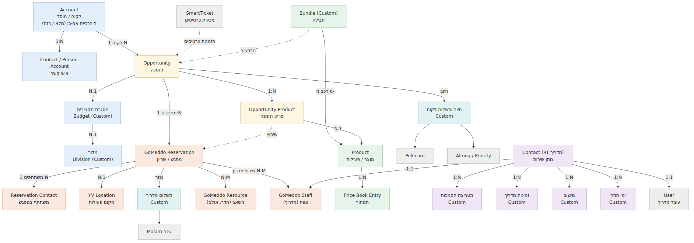
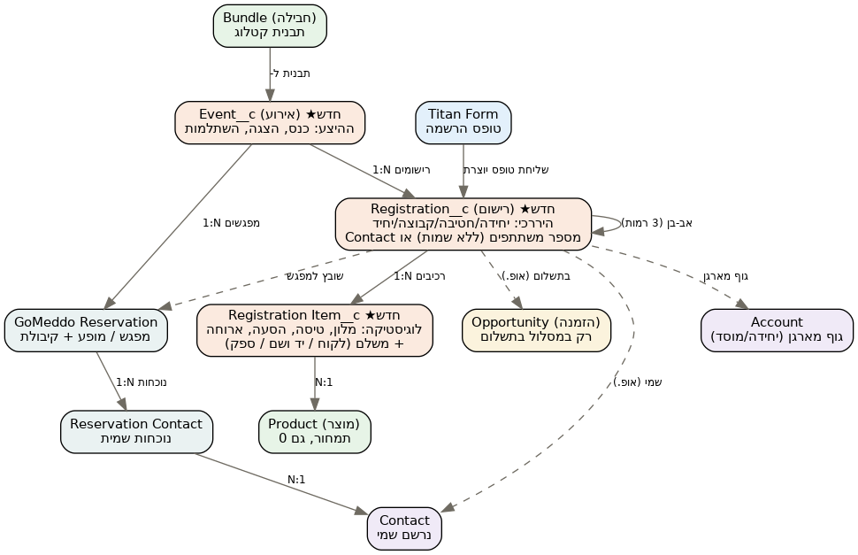
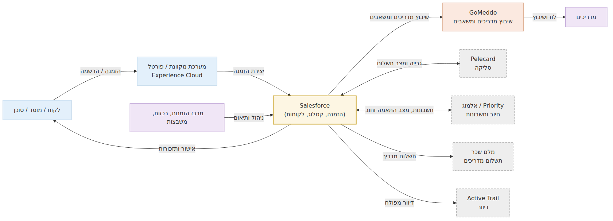
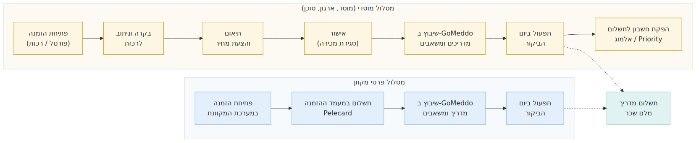

<!-- generated from: אפיון מודול הזמנות מאושר חלק 1 מתוך 3 6-10-2026 .docx | 2026-11-08 | do not edit by hand; regenerate from the docx -->

> **מקור:** מסמך 1 - מבוא וארכיטקטורה, גרסה מאושרת, 6.10.2026  
> **מיקום בניווט:** מסמך 1 - מבוא וארכיטקטורה › תרשימי ישויות וזרימה  
> **הקודם:** [קונפיגורציות מערכת](05-configurations.md) · [מקרא](../INDEX.md)

# תרשימי ישויות וזרימה

פרק זה מציג את מודל הנתונים ואת זרימות המידע באופן חזותי, כתשתית להבנת הקשרים בין הישויות, המערכות, המשתמשים והלקוחות, גם למי שאינו מנתח מערכות.

## ⟦💬 c294⟧תרשים ישויות (ERD)

התרשים מציג את הישויות המרכזיות ואת הקשרים ביניהן, לרבות עוצמת הקשר (יחיד לרבים, רבים לרבים). הצבעים מקבצים את הישויות לפי תחום: לקוחות, קטלוג, הזמנה, שכבת GoMeddo, נותני שירות, וכספים ומערכות חיצוניות. ניתן לראות כיצד ההזמנה (Opportunity) מהווה ציר מרכזי המחבר בין הלקוח, הקטלוג, השיבוץ ב-GoMeddo והחיוב.

⟦💬 c298⟧

תרשים 1: מודל הישויות של מודול ההזמנות

תרשים ישויות עולם האירועים וההרשמה מובא בנפרד, להמחשת המבנה ההיררכי של הרישום ורכיבי הלוגיסטיקה.

תרשים: מודל הישויות של אירועים והרשמה

## זרימת מידע בין המערכות

התרשים מתאר את מסלול המידע מן הלקוח ועד למערכות הקצה. הלקוח או הסוכן פותח הזמנה דרך המערכת המקוונת או הפורטל, ההזמנה נוצרת ב-Salesforce, ומשם זורם המידע לשיבוץ ב-GoMeddo, לסליקה ב-Pelecard, לחיוב באלמוג, לתשלום המדריכים במלם שכר ולדיוור ב-Active Trail. מאלמוג ומ-Pelecard חוזר מידע לסיילספורס, ובכללו מצב התשלום, מצב ההתאמה והחוב, ואילו העברת קובץ התשלום למלם שכר היא חד-כיוונית. מרכז ההזמנות  ⟦💬 c302⟧והרכזות מנהלים ומתאמים את ההזמנה ב-Salesforce, והמדריכים מקבלים את הלוז והשיבוץ.

תרשים 2: זרימת המידע בין המערכות, המשתמשים והלקוחות

## מחזור חיי הזמנה

⟦💬 c305⟧התרשים מציג את שלבי ההזמנה מפתיחתה ועד לתשלום המדריך, בשני מסלולים: מסלול מוסדי, הכולל הצעת מחיר, אישור, שיבוץ והפקת חשבון לתשלום, ומסלול פרטי מקוון, שבו התשלום מתבצע במעמד ההזמנה. שיבוץ מדריך ומשאבים מתקיים בשני המסלולים. התרשים מציג רצף כרונולוגי ואינו מבטא תלות בין תשלום הלקוח לתשלום המדריך.

⟦💬 c307⟧

---

## הערות סקירה בפרק זה

> הערות הסקירה אינן חלק מהאפיון המחייב. הן מסמנות מקומות שבהם הטקסט עדיין בדיון. הסימון ⟦💬 cN⟧ בגוף הטקסט מפנה להערה כאן.

### ⟦💬 c294⟧ סגורה
- **c294** · שגיא תומר [2] · 2026-08-23 · סומנה כסגורה: צריך לא לשכוח הזמנות שמגיעות מסמארטיקט
  - **c295** · שגיא תומר [2] · 2026-08-23 · סומנה כסגורה: 
  - **c296** · Lior Pridor · 2026-08-30 · סומנה כסגורה: צודק. יטופל
  - **c297** · Lior Pridor · 2026-09-24 · סומנה כסגורה: בוצע: Smartticket נוסף לתרשים הישויות (תרשים 1) כמקור הזמנות.

### ⟦💬 c298⟧ סגורה
- **c298** · וייל דבורה · 2026-08-20 · סומנה כסגורה: מה הקשר בין לקוח למסגרת תקציבית?
  - **c299** · טל שמרית · 2026-08-30 · סומנה כסגורה: אין קשר, גם אני כתבתי על זה בסעיף "מסגרות תקציב"
  - **c300** · Lior Pridor · 2026-08-30 · סומנה כסגורה: הורדתי את החיבור הזה בתרשים המעודכן

### ⟦💬 c302⟧ סגורה
- **c302** · וייל דבורה · 2026-08-20 · סומנה כסגורה: מאלמוג ופלאכארד יש ממשק חוזר לסלספורס, / בשונה מדוח תשלום למדריכים שהוא חד כיווני
  - **c303** · Lior Pridor · 2026-08-30 · סומנה כסגורה: ישונה במסמך

### ⟦💬 c305⟧ סגורה
- **c305** · טל שמרית · 2026-08-30 · סומנה כסגורה: הזמנות לאנשים פרטיים שנפתחות במערכת המקוונת, החיוב שלהן הוא במעמד ההזמנה במערכת המקוונת. אין קשר לשיבוצי מדריכים/ משאבים/ הצעת מחיר.
  - **c306** · Lior Pridor · 2026-08-30 · סומנה כסגורה: מקובל. התרשים תוקן ומציג שני מסלולים: מסלול מוסדי, הכולל הצעת מחיר, אישור, שיבוץ והפקת חשבון, ומסלול פרטי מקוון, שבו התשלום מתבצע במעמד ההזמנה. שיבוץ מדריך מתאפשר בשני המסלולים.

### ⟦💬 c307⟧ סגורה
- **c307** · וייל דבורה · 2026-08-20 · סומנה כסגורה: אין קשר תהליכי בין התשלום של המזמין / לבין התשלום למדריך.
  - **c308** · Lior Pridor · 2026-08-30 · סומנה כסגורה: יטופל למרות שזה לא מיצג תלות אלא תהליך כרונולוגי
