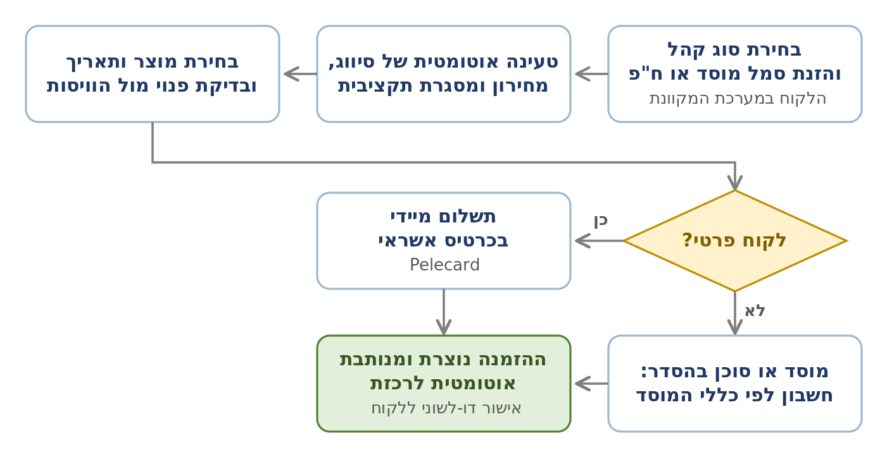

<!-- generated from: אפיון יד ושם מודול הזמנות חלק 2 מאושר 06-10 .docx | 2026-11-08 | do not edit by hand; regenerate from the docx -->

> **מקור:** מסמך 2 - תהליכי ההזמנות, גרסה מאושרת, 6.10.2026  
> **מיקום בניווט:** מסמך 2 - תהליכי ההזמנות › תהליכים עסקיים › הזמנה מקוונת עצמאית, לקוח פרטי ומוסד  
> **קודי ולידציה ואוטומציה בפרק:** A02-01, A02-02, A02-03, A02-04, A02-05, A02-06, A02-07, A02-08, A02-09, A02-10, A02-11, V02-02, V02-03, V02-05, V02-06, V02-07, V02-08, V02-09  
> **הקודם:** [בניית מוצרים, חבילות ותבניות יום פעילות](01-products-bundles-templates.md) · **הבא:** [קליטת הזמנה ידנית](03-manual-order-intake.md) · [מקרא](../../INDEX.md)

# ⟦💬 c201⟧הזמנה מקוונת עצמאית, לקוח פרטי ומוסד

## תיאור התהליך

התהליך נפתח על ידי הלקוח עצמו במערכת המקוונת, נקודת ההזמנה העצמאית של לקוחות יד ושם דרך אתר הארגון תחת הקובייה הזמנות וכרטיסים. המסך הראשי כולל ארבע קוביות לפי קהלי יעד: אנשים פרטיים, בתי ספר (הזדהות לפי סמל מוסד), סוכנים (הזדהות לפי ח"פ וסיסמה, והסיסמה נשמרת גם במערכת החדשה בנוסף לח"פ) וקובייה ייעודית לצה"ל וכוחות הביטחון. כ-90 אחוז מהזמנות התלמידים נקלטות כיום דרך המערכת המקוונת, והמערכת החדשה מרחיבה את השירות העצמי כדי להוריד את העומס הידני ממרכז ההזמנות. המוצרים הזמינים כיום נחלקים לשלוש קטגוריות: יצירת מוצר אישי (כניסה למוזיאון, סיור, רכישת אוזניות), הצטרפות לאירוע חוזר מרובה תאריכים (סיור יום שישי, חיזיון, הצגות) והרשמה לאירועים פרטניים; חסרים בה רישום לקורסים פתוחים לקהל הרחב, רישום למסעות ופרסום אוטומטי של אירועים הנפתחים במערכת. בנוסף, שדה סוג הקהל אינו מנוצל היטב כיום: לקוחות בוחרים משפחה או קהל רחב באופן אוטומטי, מה שמונע זיהוי אמיתי של הקהל וניתוב נכון. פרק זה מגדיר את צד ה-Salesforce של התהליך: הישויות, הלוגיקה, הוולידציות והאוטומציות; ו-Salesforce ישמש מקור אמת בכל תרחיש. לקהל החיצוני מוצג עמוד מוצרים מאוחד, דף נחיתה אחד המרכז את כלל פעילויות יד ושם שאינן ספרים, ולחיצה על מוצר מובילה לטופס ההרשמה במערכת המתאימה ברקע, כך שהחוויה שקופה למשתמש.

חוויית הלקוח הפרטי שונה מזו של המוסד או הסוכן בהסדר. לקוח פרטי מזמין ומשלם מיד בכרטיס אשראי ומקבל אישור והזמנה סגורה. הוא אינו מחויב ביצירת משתמש וסיסמה: עריכת ההזמנה לאחר ביצועה נעשית באמצעות מספר ההזמנה בצירוף כתובת המייל שממנה בוצעה או מספר הטלפון שהוזן בה, שני אמצעי זיהוי חלופיים הקיימים כבר היום במערכת המקוונת, והלקוח אינו רואה ריכוז של כלל הזמנותיו אלא ניגש לכל הזמנה בנפרד (ביטול ושינוי מפורטים בפרק [ביטול ושינוי הזמנה של לקוח פרטי](../../doc3-events-finance/05-processes/10-private-customer-cancel-change.md) שבמסמך 3).

מוסד או סוכן בהסדר מזמין באזור אישי מלא בפורטל, ללא תשלום מיידי, והחיוב מופק כחשבון בהמשך לפי כללי המוסד: סוכן נסיעות מקבל חשבון על דמי ההרשמה והטיפול שלושה ימים לפני הביקור וחשבון על השירות עצמו יומיים אחריו, וההפרשים משתקללים בחשבון השני; מועדים אלה מנוהלים כפרמטרים הניתנים לשינוי על ידי יד ושם ללא פיתוח. המסגרת התקציבית אינה תכונה של המוסד או של הלקוח אלא תוצאה של צירוף תנאים (קהל, שכבת גיל, מיקום, שעות, מוזיאון, גפן), והיא נושאת את המחירון בלבד. באזור האישי רואים המוסד והסוכן את כלל הזמנותיהם, עתידיות, היסטוריות ומבוטלות, ומבצעים שינויים בכפוף להרשאות פרמטריות הניתנות לשינוי על ידי אדמין. גופים בעלי הסדר חוזי, קופות חולים, חברות ומשרדי ממשלה, נכללים אף הם באזור האישי. היקף היוזרים החיצוניים בפורטל עומד בשלב הראשון על כ-300, בעוד מספר המוסדות מקבלי האשראי מגיע לאלפים, נתון המשליך על מודל רישוי הפורטל, שייקבע מול יד ושם. בשני המסלולים ההזמנה נוצרת כרשומת Opportunity ומנותבת להמשך טיפול. יש לוודא רכישת רשיונות פורטל מול סיילספורס ⟦💬 c204⟧ ⟦💬 c205⟧

זיהוי המוסד הוא ליבת המסלול המוסדי: סמל מוסד הוא שדה חובה ומזהה לקבוצות חינוכיות, והמערכת מזהה את המוסד וטוענת אוטומטית את סיווגו ואת שכבת הגיל (יסודי, חטיבה, תיכון), כך שמוצגות רק חבילות מתאימות לגיל הקבוצה; הערכים הנטענים ניתנים לעריכה ולשינוי על ידי המזמין. בחירת שעות המוזיאון אוטומטית בהתאם לשעות הפעילות שנבחרו, והמורה אינו בוחר אותן ידנית. אופן הבחירה נגזר ממשך מוצר ההדרכה שנבחר. במוצר הדרכה שמשכו עולה על הסף המוגדר בקונפיגורציה בוחר המזמין את שעת תחילת הפעילות בלבד, והמערכת משבצת את הכניסה למוזיאון עבורו: היא מחפשת כניסה פנויה בטווח שבין שעת ההגעה שנבחרה לבין השעה האחרונה המאפשרת סיור מלא לפני סגירת המוזיאון באותו יום, ומשאירה את משך הסיור המזערי במוזיאון. שעת התחלה מוצעת למזמין רק כאשר נותר די זמן לסיור במוזיאון וקיים מקום פנוי בו. במוצר הדרכה שמשכו אינו עולה על אותו סף בוחר המזמין את שעת הכניסה למוזיאון, והמערכת מציגה לו מיד את שעת ההגעה הנדרשת ליד ושם. מסגרת השעות כולה, ובכללה השעה האחרונה לכניסה, הסף לפי משך המוצר, משך הסיור המזערי והפרש ההגעה, נגזרת משעות הפעילות והסגירה של משאב המוזיאון, לרבות ההבדל בין שעון חורף לשעון קיץ, ותוגדר בקונפיגורציה לפי הנתונים שיד ושם תעביר; אין במסמך שעות קשיחות. לקוח שאינו מוצא את עצמו במאגר מקבל הודעה כי אינו קיים במאגר הלקוחות, ומופנה לטופס מקוון לפתיחת לקוח (ראה פרק [טפסים](../10-forms.md)): הטופס פותח כרטיס זמני העובר בדיקה ואישור, כולל סבב אישורים פנימי מול אלמוג, לפני הסבתו לכרטיס פעיל. לטופס המקוון נדרשת אפשרות לצירוף קבצים. לקוח ששכח את סיסמתו מקבל הודעה כי סיסמה חדשה נשלחה לכתובת הדואר האלקטרוני הרשומה בכרטיס המוסד, כשהכתובת מוצגת בצורה חלקית. ⟦💬 c207⟧ ⟦💬 c209⟧ ⟦💬 c210⟧ ⟦💬 c212⟧ ⟦💬 c213⟧ ⟦💬 c214⟧ ⟦💬 c215⟧ ⟦💬 c216⟧

בהזמנות של קבוצות חינוכיות פעולת ההזמנה מתחילה בהגדרת מספר הכיתות (קבוצות) ומספר המשתתפים בכל כיתה, ואז המערכת מציעה תאריכים פנויים. לצד כל קבוצה מוזן אפיון לקבוצה, מידע מובנה על הרכב הקבוצה ומאפייניה, החוסך לרכזים טלפונים ומשמש את מנגנון השיבוץ האוטומטי. שאלון דינמי מוצג בכלל סוגי ההזמנות ולא בקבוצות חינוכיות בלבד, ותוכנו נגזר מהמוצר שנבחר ומקהל היעד: הוא מציג שאלות חובה ורשות המותאמות למוצר, לדוגמה שאלות על הקשר המשפחתי בבר מצווה או על פרופיל קבוצה מחו"ל, והתשובות נשמרות כשדות מובנים ולא בהערות. בהזמנת בר מצווה נאספים פרטי הילדים והמערכת אוכפת ולידציה על שנת הלידה, שאינה מוקדמת משנת 1950, ולהזמנה מצורף מוצר מסמך בר מצווה המופק לקבוצה. מגבלות כמות: המגבלה של 35 משתתפים לקבוצה חלה על כלל הקבוצות המודרכות ואינה ייחודית לסוכני נסיעות; החריגים היחידים הם המסגרת התקציבית תגלית והמסגרת התקציבית פעילות חו"ל, שבהן מותרת חריגה עד 50 משתתפים, לפי המסגרת התקציבית ולא לפי זהות המזמין. מינימום ימי העסקים מראש שבהם ניתן להזמין במערכת המקוונת מוגדר בכל מוצר או סוג פעילות כפרמטר בקונפיגורציה, ואינו נקבע לפי קהל ואינו ייחודי לסוכני תגלית. ⟦💬 c217⟧ ⟦💬 c218⟧ ⟦💬 c219⟧ ⟦💬 c220⟧ ⟦💬 c221⟧ ⟦💬 c225⟧ ⟦💬 c226⟧ ⟦💬 c227⟧

התמחור ללקוח פרטי ולסוכנים כולל דמי הרשמה וטיפול לפי שעת הכניסה, הסדר הנהוג ביד ושם החל משנת  ⟦💬 c228⟧2024: 10 שקלים לאדם בשעות הזולות (לפני 10:00 ואחרי 14:00) ו-15 שקלים לאדם בשעות העומס (10:00 עד 14:00); כוחות הביטחון, תלמידים וקבוצות חינוכיות פטורים. מוסד המסומן בזכאות להנחת דמי הרשמה מקבל 100 אחוז הנחה אוטומטית. הזמנה הכוללת הדרכה של מדריך יד ושם או השכרת הדרכה קולית (אודיו גייד) מזכה בהנחה של 20 אחוז על דמי ההרשמה והטיפול בלבד, בכל שעות היום ובהתאמה לשעת הביקור המוזמנת, כלומר 8 שקלים בשעות הזולות ו-12 שקלים בשעות העומס;  ⟦💬 c232⟧ההנחה חלה על כלל המזמינים, בערוץ המקוון ובהזמנה הנקלטת ידנית בתה"ל כאחד. תחולת החיוב נקבעת לפי תוכן ההזמנה: דמי הרשמה וטיפול מחויבים בהזמנה הכוללת כניסה למוזיאון בלבד; סיור מודרך באתר יד ושם ללא כניסה למוזיאון אינו מחויב בהם, ופעילויות ללא תשלום, כדוגמת תיאום ביקור בספרייה, מוזמנות במערכת גם כשאינן כרוכות בדמי הרשמה; הזמנה באמצעות הקיוסק שבמבואה פטורה מדמי הרשמה וטיפול; במערכת המקוונת אין פטור, גם בהזמנה לאותו יום. ⟦💬 c233⟧ התאריך הקובע לחישוב התשלום הוא תאריך הביקור ולא תאריך ביצוע ההזמנה. דמי ההרשמה אינם מוחזרים בביטול, ולכן המערכת אינה מציעה ביטול ויצירה מחדש כתחליף לעריכה. בעריכת הזמנה ניתן לבחור בכל טווח השעות: לקוח שהזמין בשעה זולה ומבקש לעבור לשעה יקרה רשאי לעשות כן, והפרש דמי ההרשמה והטיפול נגבה בהתאם למחירון. פירוט מנגנוני החיוב, הסליקה וההחזרים בפרקי הכספים במסמך 3 (הפקת חשבון, ביטולים וזיכויים). כלל ערכי דמי ההרשמה והטיפול, ובהם טווחי השעות והסכומים, מנוהלים כפרמטרים הניתנים לשינוי על ידי יד ושם ללא פיתוח.

ההזמנה כפופה לזמינות: תאריכים שיד ושם סגרה אינם מוצגים כלל למזמינים, אירוע שנסגרה בו ההרשמה מוצג עם חיווי אזל מן המלאי במקום להיעלם מהתצוגה, ומרכז ההזמנות שולט אילו מופעים יוצגו ובאיזה סטטוס (מפורט בפרק 12.12 ויסות ונעילה רב-רמתית). פתיחת הזמנה כפופה לזמן התראה מזערי לפי קהל ולמגבלות ההזמנה מראש המוגדרות בכל מוצר המוצג במערכת המקוונת. מנגנון הוויסות הוא מנגנון נפרד מזמן ההתראה המזערי וממגבלות ההזמנה מראש: הוא מווסת את חלוקת הכניסות בין הקהלים, ויתרות שלא נוצלו משתחררות לפני מועד הפעילות. שעות הוויסות, חלוקת המכסות בין הקהלים ומועד שחרור היתרות מוגדרים כפרמטרים בקונפיגורציה לפי הנתונים שיד ושם תעביר; הערכים המופיעים במסמך משקפים את המצב הקיים ומשמשים ברירת מחדל הניתנת לשינוי ללא פיתוח. כלל טווחי הזמן והמועדים בפרק זה מנוהלים כפרמטרים הניתנים לשינוי ללא פיתוח. לצד המגבלה לפי קהל נאכף גם מינימום ימי העבודה מראש המוגדר ברמת המוצר (מפורט בפרק 12.1 בניית מוצרים, חבילות ותבניות יום פעילות), הנספר בימי עבודה בלבד ואינו מונה ימי שבתון וימי סגירה; שתי המגבלות נבדקות במקביל והמחמירה שבהן קובעת את התאריך המוקדם ביותר הפתוח להזמנה. בקצה השני, אופק ההזמנה במערכת המקוונת עומד על עד שנה קדימה, שנים עשר חודשים, לכלל הקהלים: לקוחות פרטיים, משפחות וארגונים ללא הסדר, בתי ספר וקבוצות חינוכיות מחו"ל, וסוכני נסיעות וארגונים בעלי הסדר. זהו שינוי מהמצב הקיים, שבו האופק המקוון עומד על כשמונה חודשים ולחלק מהקהלים על כחצי שנה בלבד. אישור ההזמנה נשלח בשפת הממשק שבה בוצעה ההזמנה: מזמין שנכנס בעברית מקבל אישור בעברית, ומזמין שנכנס באנגלית מקבל אישור ואישור מסך באנגלית, וההזמנה נפתחת עם שפת טופס אנגלית כך שגם החשבון יופק באנגלית בהמשך. הזמנה מקוונת נפתחת כשהשדה התקבל אישור חתום מסומן אוטומטית, תנאי להפקת חשבון, והצעת המחיר בה מאושרת אוטומטית (מפורט בפרק 12.8 הצעת מחיר, הנחות ואישור). ⟦💬 c234⟧ ⟦💬 c235⟧ ⟦💬 c238⟧

סוכן המבקש להזמין עבור מספר קבוצות בתאריכים שונים מזין את פרטי הקשר פעם אחת ויוצר בפעולה אחת מספר הזמנות: מכל תאריך או קבוצה נוצרת הזמנה עצמאית הניתנת לניהול, לעריכה ולחיוב בנפרד, ללא הזמנת אב, ובסיום כל הזמנה נשאלת שאלה האם ברצונו להוסיף הזמנה נוספת. באזור האישי בוחר הסוכן תאריך ורואה במסך דינמי את כלל הזמנותיו לאותו יום; ביטול מתבצע ממסך זה, שורה אחר שורה או לכולן יחד, ואילו עריכת כמות או שעה מחייבת כניסה להזמנה הספציפית, כדי שתנאי המשאבים יתעדכנו.

עריכת הזמנה במערכת המקוונת: הלקוח עורך את הזמנתו בעצמו במערכת המקוונת, גם לאחר שההזמנה שולמה, וכל שינוי בעלות מחויב בתשלום נוסף. במסגרת העריכה ניתן לשנות תאריך ושעה, להוסיף או להסיר משתתפים ולהוסיף שירותים, כגון הדרכה קולית (אודיו גייד); בקהל הרחב העריכה מותרת כל עוד אינה מחייבת פתיחת קבוצה נוספת, ובקבוצות חינוכיות ניתן במקרים מסוימים להוסיף קבוצה. כל שינוי כפוף לכללי הוויסות של הכניסה למוזיאון ושל מספר הקבוצות המודרכות לפי קהלים. שינוי תאריך או שעה מתבצע בבחירת הלקוח מתוך הזמינות (A09-09), ועריכת מספר הקבוצות מתוארת בפרק [קליטת הזמנה ידנית](03-manual-order-intake.md). הכללים הקובעים אילו סוגי פעילות ניתנים לעריכה, ובאיזה היקף, יועברו על ידי יד ושם ויוגדרו בקונפיגורציה. מנגנוני החיוב, ההפרשים וההחזרים מפורטים בפרקי הכספים במסמך 3.

## שלבי התהליך

1. הלקוח בוחר סוג קהל בקובייה המתאימה: לקוח פרטי ממשיך ללא הזדהות דרך טופס FORM TITAN, בית ספר מזדהה בסמל מוסד, וסוכן או גוף בהסדר מזדהה באזור האישי במשתמש אישי (כתובת מייל) ובסיסמה; המשתמש משויך למוסד מסוים, שכן הח"פ אינו מזהה חד-ערכי כאשר מוסד אב ומוסדות בן חולקים אותו.

2. המערכת מזהה את הלקוח וטוענת אוטומטית את סיווג המוסד ושכבת הגיל; לקוח שאינו קיים במאגר מקבל הודעה ומופנה לטופס פתיחת לקוח מקוון היוצר כרטיס זמני לאישור.

3. הלקוח בוחר מוצר או חבילה מתוך ההיצע המותאם לסיווגו ולגילו, מגדיר מספר קבוצות ומשתתפים בכל קבוצה ומזין אפיון לקבוצה, ועונה על השאלון הדינמי של המוצר.

4. על בסיס סוג הקהל, פרטי המוסד והמוצר שנבחר נקבעת המסגרת התקציבית של ההזמנה.

5. הלקוח בוחר תאריך ושעה מתוך התאריכים הפנויים בלבד, בטווח של עד שנה קדימה; במוצר הדרכה שמשכו מעל שלוש שעות נבחרת שעת תחילת הפעילות והמערכת משבצת את הכניסה למוזיאון, ובמוצר שמשכו שלוש שעות או פחות נבחרת שעת הכניסה למוזיאון ומוצגת שעת ההגעה הנגזרת ממנה. מתבצעת בדיקת פנוי מול הוויסות, הזמינות, זמן ההתראה המזערי לפי קהל ומינימום ימי העבודה מראש של המוצר.

6. לקוח פרטי משלם דמי הרשמה וטיפול לפי שעת הכניסה ואת יתר השירותים בכרטיס אשראי; מוסד או סוכן בהסדר ממשיך ללא תשלום מיידי, כנגד המסגרת התקציבית.

7. נוצרת הזמנה (Opportunity) עם שורותיה, השדה התקבל אישור חתום מסומן אוטומטית, ונשלח אישור הזמנה בשפת הממשק.

8. ההזמנה מנותבת אוטומטית לרכזת הרלוונטית (מפורט בפרק 12.4 זיהוי, סיווג וניתוב מוסד לרכזת, פרק [זיהוי, סיווג וניתוב מוסד לרכזת](04-institution-identification-routing.md)); סוכן שביקש קבוצות נוספות ממשיך ליצירת ההזמנה הבאה מאותם פרטי קשר.

## ישויות ושדות  ⟦💬 c242⟧בתהליך

| ישות | תפקיד בתהליך | שדות ייעודיים לתהליך |
| --- | --- | --- |
| הזמנה (Opportunity) | רשומת ההזמנה ועגלת הקנייה | סוג קהל, מסגרת תקציבית, שפת טופס, התקבל אישור חתום (מסומן אוטומטית בהזמנה מקוונת), מספר קבוצות, מספר משתתפים, ערוץ קליטה מקוון |
| פריט הזמנה (Opportunity Product) | שורות המוצרים והחבילה שפורקה | מוצר, כמות לפי שיטת התמחור, מחיר לפי קהל ושעת כניסה |
| לקוח (Account / Person Account) | המזמין: מוסד, סוכן, גוף בהסדר או לקוח פרטי | סמל מוסד, ח"פ, סיווג ושכבת גיל, זכאות הנחת דמי הרשמה, חסום להזמנות, כרטיס זמני לאישור |
| איש קשר (Contact) | נציג הארגון שביצע את ההזמנה באזור האישי | פרטי התקשרות, שפת תקשורת, קישור להזמנות שיצר לצורך תצוגה באזור האישי |
| קבוצה | כיתה או קבוצה בתוך ההזמנה | מספר משתתפים בקבוצה, אפיון לקבוצה |
| שאלון דינמי לפי מוצר | איסוף מידע מובנה בעת ההזמנה | שאלות חובה ורשות לפי המוצר, נשמרות כשדות מובנים |
| מסגרת תקציבית (Custom) | ציר החיוב והכללים של ההזמנה | נגזרת מצירוף תנאי ההזמנה (קהל, שכבת גיל, מיקום, שעות, מוזיאון, גפן) ואינה תכונה של הלקוח; נושאת את המחירון בלבד, כלומר מוצר כפול מסגרת תקציבית שווה מחיר. המסגרת התקציבית קובעת אם להפיק חשבון אוטומטי, ומאפייני המוסד קובעים מתי להפיקו; ניתן לסמן במוסד שלא יופק עבורו חשבון אוטומטי, וסימון זה גובר על שני הכללים. ציון הגפן נמנה עם תנאי הזיהוי של המסגרת התקציבית לצורכי סיווג ודיווח בלבד, ולא יוגדרו שתי מסגרות תקציביות הנבדלות זו מזו בסימון הגפן בלבד, כך שאותו מוצר מתומחר באותו מחיר עם גפן ובלעדיה ⟦💬 c244⟧ |
| מפגש (GoMeddo Reservation) | שריון התאריך, המוזיאון והמשאבים | תאריך, שעת כניסה למוזיאון (אוטומטית), סטטוס שריון |

## כללי ולידציה

| מזהה | הכלל | הודעת שגיאה |
| --- | --- | --- |
| V02-02 | ⟦💬 c247⟧סמל מוסד או ח"פ הוא שדה חובה ומזהה בהזמנת קבוצה חינוכית; כאשר קיימים כמה מוסדות בעלי אותו מזהה, מוצגת למזמין רשימת המוסדות והוא בוחר מתוכה | נדרש סמל מוסד או ח"פ לזיהוי בית הספר ⟦💬 c252⟧ |
| V02-03 | מוסד המסומן חסום להזמנות אינו יכול להשלים הזמנה | המוסד חסום להזמנות, יש לפנות למרכז ההזמנות |
| V02-05 | ⟦💬 c253⟧כל ⟦💬 c254⟧ סוגי הקבוצות המודרכות מוגבלים ל-35 משתתפים: המגבלה נאכפת בתה"ל ובמערכת המקוונת, ובתה"ל רק בעלי הרשאה יכולים לחרוג ממנה; חריגה עד 50 מותרת בשתי מסגרות תקציביות בלבד, המסגרת התקציבית תגלית והמסגרת התקציבית פעילות חו"ל, לפי המסגרת התקציבית ולא לפי זהות המזמין ⟦💬 c255⟧ ⟦💬 c256⟧ | חריגה ממספר המשתתפים המרבי לקבוצה |
| V02-06 | לקוח פרטי אינו יכול להשלים הזמנה ללא תשלום מלא בכרטיס אשראי | ההזמנה תושלם רק לאחר תשלום |
| V02-07 | שאלות החובה בשאלון הדינמי של המוצר נאכפות כתנאי להשלמת ההזמנה | יש להשלים את שאלות החובה למוצר זה |
| V02-08 | בעריכת הזמנה של לקוח פרטי ניתן לבחור בכל טווח השעות; מעבר לשעה יקרה מחייב תשלום הפרש דמי ההרשמה והטיפול, וללא החזר דמי הרשמה | השעה המבוקשת אינה זמינה לשינוי בהזמנה זו |
| V02-09 | בהזמנת בר מצווה שנת הלידה של הילד אינה מוקדמת משנת 1950 | שנת הלידה שהוזנה אינה תקינה להזמנת בר  ⟦💬 c257⟧מצווה |

## אוטומציות

| מזהה | טריגר | הפעולה האוטומטית |
| --- | --- | --- |
| A02-01 | הזנת סמל מוסד או ח"פ | זיהוי הלקוח וטעינת סיווג המוסד, שכבת הגיל וההיצע המותאם |
| A02-02 | לקוח שאינו קיים במאגר | הצגת הודעה והפניה לטופס פתיחת לקוח; הטופס יוצר כרטיס זמני לאישור, כולל סבב אישורים מול אלמוג |
| A02-03 | בחירת מוצר לאחר זיהוי הלקוח | קביעת המסגרת התקציבית מסוג הקהל, פרטי המוסד והמוצר |
| A02-04 | בחירת שעות פעילות | קביעה אוטומטית של שעת הכניסה למוזיאון, ללא בחירה ידנית של המורה: במוצר הדרכה ארוך נבחרת שעת ההגעה בלבד והמערכת משבצת כניסה פנויה בין שעת ההגעה לבין השעה האחרונה הנגזרת משעות הפעילות ומשעת הסגירה של המוזיאון באותו יום כפי שהוגדרו על משאב המוזיאון, בהשארת משך הסיור המזערי; במוצר הדרכה קצר נבחרת שעת הכניסה ומוצגת שעת ההגעה הנגזרת. אין שעה קשיחה במסמך, וערכי שעות הפעילות והסגירה, הסף לפי משך המוצר ומשך הסיור המזערי יוגדרו בקונפיגורציה ⟦💬 c260⟧ ⟦💬 c261⟧ ⟦💬 c263⟧ |
| A02-05 | השלמת הזמנה של לקוח פרטי או סוכן | חישוב דמי הרשמה וטיפול לפי שעת הכניסה ולפי תאריך הביקור, רק בהזמנה הכוללת כניסה למוזיאון או שירותים בתשלום; הזמנה הכוללת הדרכה של מדריך יד ושם או אודיו גייד מקבלת 20 אחוז הנחה על דמי ההרשמה והטיפול בלבד; מוסד הזכאי להנחת דמי הרשמה מקבל 100 אחוז הנחה, וקהלים פטורים והזמנות ללא כניסה למוזיאון וללא שירותים בתשלום אינם מחויבים |
| A02-06 | יצירת ההזמנה | סימון אוטומטי של השדה התקבל אישור חתום ואישור אוטומטי של הצעת המחיר |
| A02-07 | יצירת ההזמנה | שליחת אישור הזמנה בשפת הממשק שבה בוצעה ההזמנה, וקביעת שפת הטופס של ההזמנה בהתאם |
| A02-08 | יצירת ההזמנה | ⟦💬 c264⟧ניתוב אוטומטי לרכזת לפי סיווג המוסד והמסגרת התקציבית |
| A02-09 | סגירת ההרשמה או מלאי מלא במופע | הצגת המופע עם חיווי אזל מן המלאי במקום העלמתו, בכפוף להגדרת התצוגה של מרכז ההזמנות |
| A02-10 | סיום הזמנה של סוכן באזור האישי | הצגת שאלה האם להוסיף הזמנה נוספת, ויצירת הזמנה עצמאית חדשה מאותם פרטי קשר |
| A02-11 | חיוב סוכן נסיעות | ⟦💬 c266⟧הפקת חשבון דמי הרשמה וטיפול שלושה ימים לפני הביקור וחשבון שירותים יומיים אחריו, כולל שקלול שינויים; התזמונים מנוהלים כרשומות תצורה הניתנות לשינוי ללא פיתוח, ובנוסף נקלט באלמוג התשלום שבוצע בכרטיס אשראי (המימוש בפרק הפקת חשבון וחיוב לקוח מול אלמוג שבמסמך 3) ⟦💬 c267⟧ ⟦💬 c268⟧ ⟦💬 c270⟧ ⟦💬 c272⟧ |

## אוטומציות מרכזיות, מפרט מימוש

### זיהוי לקוח, טעינת סיווג וקביעת מסגרת תקציבית

| טריגר | הזנת סמל מוסד או ח"פ במערכת המקוונת (לפני יצירת ההזמנה). |
| --- | --- |
| שלבים | 1. המערכת מאתרת את רשומת הלקוח לפי סמל המוסד או הח"פ; לסוכן וגוף בהסדר נדרשת גם סיסמה. 2. נטענים שדות הסיווג ושכבת הגיל, ומוצג ללקוח היצע החבילות והמוצרים המותאם לסיווגו ולגילו בלבד. 3. עם בחירת המוצר נקבעת המסגרת התקציבית מתוך שילוב סוג הקהל, פרטי המוסד והמוצר, והיא קובעת את המחירון ואת כללי הפקת החשבון. 4. אם הלקוח אינו קיים במאגר, מוצגת הודעה ייעודית והלקוח מופנה לטופס פתיחת לקוח מקוון. |
| בדיקת קבלה | בית ספר המזין סמל מוסד תקין רואה רק חבילות התואמות את שכבת הגיל שלו, וההזמנה שנוצרת נושאת מסגרת תקציבית שנגזרה אוטומטית ללא הזנה ידנית. |

### ⟦💬 c274⟧פתיחת  ⟦💬 c276⟧לקוח חדש מכרטיס זמני

| טריגר | שליחת טופס פתיחת לקוח מקוון על ידי מזמין שאינו קיים במאגר (אחרי שליחת הטופס). |
| --- | --- |
| שלבים | 1. הטופס, הכולל את מלוא הפרטים הנדרשים (ח"פ, סמל מוסד, אישורים ופרטי קשר) ואפשרות לצירוף קבצים, יוצר רשומת לקוח בסטטוס כרטיס זמני (ראה פרק הטפסים). 2.  ⟦💬 c278⟧הכרטיס הזמני עובר בדיקה וסבב אישורים פנימי מחוץ למערכת, כולל מול אלמוג, בטרם יאושר כלקוח פעיל. לקוחות שמילאו את הטופס מוצגים בתצוגה ייעודית, והמערכת מתריעה לבעלי ההרשאה לפתיחת מוסדות כי התקבלה בקשה הממתינה לטיפול. ההתראה נשלחת גם כאשר כרטיס לקוח חדש נפתח ידנית בתה"ל. 3. עם האישור מוסב הכרטיס לכרטיס לקוח אמיתי והמזמין יכול להשלים את ההזמנה; דחייה מתועדת עם סיבה. 4. הזמנה אינה נסגרת מול כרטיס זמני שטרם אושר. |
| בדיקת קבלה | מוסד חדש שמילא את הטופס מופיע במערכת ככרטיס זמני הממתין לאישור, ורק לאחר האישור ניתן להשלים את ההזמנה ולהפיק חשבון. |

### שיבוץ שעת הכניסה למוזיאון לפי משך מוצר ההדרכה

| טריגר | בחירת מוצר הדרכה ושעה במערכת המקוונת (לפני יצירת ההזמנה, בעת הצגת התאריכים והשעות הפנויים). |
| --- | --- |
| שלבים | 1. המערכת קוראת את משך מוצר ההדרכה שנבחר ומפצלת את ההתנהגות לשני מסלולים. 2. במוצר שמשכו מעל שלוש שעות מוצגת למזמין בחירת שעת תחילת הפעילות בלבד; המערכת מחפשת כניסה פנויה למוזיאון בטווח שבין שעת ההגעה שנבחרה לבין 14:00 ומוודאת שנותרו לפחות שעתיים לסיור עצמו, ומשבצת את הכניסה אוטומטית. 3. שעת התחלה מוצעת למזמין רק כאשר מתקיימים שני התנאים: נותר די זמן לסיור במוזיאון וקיים מקום פנוי בכניסה בטווח הנבדק. 4. במוצר שמשכו שלוש שעות או פחות בוחר המזמין את שעת הכניסה למוזיאון, והמערכת מציגה לו מיד את שעת ההגעה הנדרשת ליד ושם הנגזרת ממנה. 5. השיבוץ נשמר כשריון על משאב המוזיאון ברשומת המפגש, בכפוף לכללי הוויסות והקיבולת (מפורט בפרק 12.12 ויסות ונעילה רב-רמתית). |
| בדיקת קבלה | הזמנת מוצר הדרכה של ארבע שעות בהגעה בשעה 10:00 מקבלת שיבוץ כניסה אוטומטי למוזיאון בחלון הנגזר מהגדרות משאב המוזיאון וממשך מוצר ההדרכה, עם שעתיים סיור לפחות, והזמנת מוצר של שלוש שעות בבחירת כניסה בשעה 10:00 מציגה למזמין שעת הגעה 09:30. חלון שיבוץ הכניסה למוזיאון ופער הזמן בין שעת ההגעה לבין הכניסה מוגדרים בקונפיגורציה לכל סוג פעילות בנפרד, לפי הנתונים שיד ושם תעביר, לדוגמה רבע שעה בביקורים רשמיים במקום חצי שעה. ⟦💬 c280⟧ ⟦💬 c282⟧ |

⟦💬 c284⟧

תרשים תהליך 02 - הזמנה מקוונת עצמאית, לקוח פרטי ומוסד

---

## הערות סקירה בפרק זה

> הערות הסקירה אינן חלק מהאפיון המחייב. הן מסמנות מקומות שבהם הטקסט עדיין בדיון. הסימון ⟦💬 cN⟧ בגוף הטקסט מפנה להערה כאן.

### ⟦💬 c201⟧ סגורה
- **c201** · שגיא תומר · 2026-09-06 · סומנה כסגורה: היכן מתואר תהליך של הזמנות מחלקת VIP (לוסילה)
  - **c202** · Lior Pridor · 2026-09-14 · סומנה כסגורה: הנושא נדון וסוכם שהזמנות מחלקת VIP מתנהלות בתהליך ההזמנה הרגיל ואינן מחייבות תהליך נפרד. ככל שקיימים שלבים ייחודיים למחלקה, נשמח לקבל את פירוטם ולהוסיף התייחסות ייעודית במסמך.

### ⟦💬 c204⟧ סגורה
- **c204** · וייל דבורה · 2026-09-01 · סומנה כסגורה: המועדים צריכים להיות ניתנים לשינוי בקלות מכיוון שהם משתנים מידי פעם

### ⟦💬 c205⟧ סגורה
- **c205** · טל שמרית · 2026-09-03 · סומנה כסגורה: אין קשר בין המוסד למסגרת התקציבית. / צריך למחוק את זה
  - **c206** · Lior Pridor · 2026-09-14 · סומנה כסגורה: תוקן במסמך: המסגרת התקציבית אינה תכונה של המוסד או של הלקוח אלא תוצאה של צירוף תנאים (קהל, שכבת גיל, מיקום, שעות, מוזיאון, גפן), והיא הנושאת את המחירון.

### ⟦💬 c207⟧ סגורה
- **c207** · וייל דבורה · 2026-09-01 · סומנה כסגורה: כשהלקוח מאושר- הוא צריך לעבור בAPI לאלמוג ליצירת לקוח עם כל נתוני הלקוח
  - **c208** · Lior Pridor · 2026-09-14 · סומנה כסגורה: העברת נתוני הלקוח לאלמוג באמצעות ממשק אינה נכללת בתכולת ההתקשרות הנוכחית, ולכן לא נכללה באפיון. נשמח לבחון את הנושא כתוספת תכולה ולהעריך את היקפו בנפרד.

### ⟦💬 c209⟧ סגורה
- **c209** · טל שמרית · 2026-09-03 · סומנה כסגורה: יש גם מצב שלקוח שכח את הסיסמה שלו. / במקרה כזה, המערכת תציג לו הודעה כי הסיסמה החדשה נשלחה למיל XXXXX בארגון שלו. / המייל שיקבל העתק מהסיסמה החדשה הוא המייל שמופיע בכרטיס המוסד.

### ⟦💬 c210⟧ סגורה
- **c210** · וייל דבורה · 2026-09-01 · סומנה כסגורה: יש פה תיאור סותר, הלקוח בוחר שעת הגעה ואז משובץ לא המוזיאון? או הלקוח בוחר שעת כניסה למוזיאון ומזה נגזרת שעת ההגעה?
  - **c211** · טל שמרית · 2026-09-03 · סומנה כסגורה: לפי מה שאני מבינה, אם מדובר בהדרכה  של 3 שעות, אז הלקוח בוחר שעת כניסה למוזיאון, ואם מדובר בהדרכה של 6 שעות, הוא בוחר שעת הגעה ליד ושם.

### ⟦💬 c212⟧ סגורה
- **c212** · Lior Pridor · 2026-09-14 · סומנה כסגורה: תוקן במסמך: מסגרת השעות נגזרת משעות הפעילות של המוזיאון וממשך מוצר ההדרכה ואינה נקובה בסעיף, והיא מוגדרת בקונפיגורציה לפי הנתונים שיד ושם תעביר.

### ⟦💬 c213⟧ סגורה
- **c213** · Lior Pridor · 2026-09-14 · סומנה כסגורה: תוקן במסמך: אין בסעיף שעות קבועות, והשעה האחרונה לכניסה למוזיאון נגזרת משעות הפעילות ומשעת הסגירה של משאב המוזיאון. הערכים ייקבעו בקונפיגורציה לפי הנתונים שיד ושם תעביר.

### ⟦💬 c214⟧ סגורה
- **c214** · וייל דבורה · 2026-09-01 · סומנה כסגורה: לא נכון, אם הסיור מוגדר 3 שעות הסיור צריך להסתיים עד 13:00

### ⟦💬 c215⟧ סגורה
- **c215** · וייל דבורה · 2026-09-01 · סומנה כסגורה: כניסה למוזיאון היא לפי שעת הסגירה של המוזיאון, ניתן להכנס למוזיאון עד ? שעות לפני סגירתו

### ⟦💬 c216⟧ סגורה
- **c216** · וייל דבורה · 2026-09-01 · סומנה כסגורה: אך יכול לערוך ולשנות

### ⟦💬 c217⟧ סגורה
- **c217** · Lior Pridor · 2026-09-14 · סומנה כסגורה: עודכן במסמך: אין מגבלות הזמנה מראש קשיחות לפי קהל, ומינימום ימי העסקים להזמנה מקוונת מוגדר בכל מוצר או סוג פעילות כפרמטר בקונפיגורציה.

### ⟦💬 c218⟧ סגורה
- **c218** · Lior Pridor · 2026-09-14 · סומנה כסגורה: תוקן במסמך: חריגה עד 50 משתתפים מותרת בשתי מסגרות תקציביות בלבד, מסגרת תקציבית תגלית ומסגרת תקציבית פעילות חו"ל.

### ⟦💬 c219⟧ סגורה
- **c219** · Lior Pridor · 2026-09-14 · סומנה כסגורה: תוקן במסמך: מגבלת 35 המשתתפים לקבוצה חלה על כל הקבוצות המודרכות ואינה ייחודית לסוכני נסיעות, והחריגים הם תגלית ופעילות חו"ל עד 50 משתתפים.

### ⟦💬 c220⟧ סגורה
- **c220** · טל שמרית · 2026-09-03 · סומנה כסגורה: בכל סוג פעילות מצויין עד כמה ימי עסקים ניתן לבצע את ההזמנה במערכת המקוונת, לא רק לסוכני תגלית

### ⟦💬 c221⟧ סגורה
- **c221** · טל שמרית · 2026-09-03 · סומנה כסגורה: למה הכוונה?
  - **c222** · Lior Pridor · 2026-09-16 · סומנה כסגורה: לא ברורה ההערה
  - **c223** · אשבל אור · 2026-09-22 · סומנה כסגורה: יש להסיר. סוכני תגלית לא צריכים את היכולת לבחירת מדריך\משאבים. יש להסיר!
  - **c224** · Lior Pridor · 2026-09-23 · סומנה כסגורה: תוקן: היכולת הוסרה מהמסמך. לתשומת לבכם, הכוונה לא הייתה לאפשר לסוכני תגלית לבחור מדריך, אלא להציג להם היתכנות של מדריך או משאב בהתאם לקהל היעד.

### ⟦💬 c225⟧ סגורה
- **c225** · טל שמרית · 2026-09-03 · סומנה כסגורה: מסגרת תקציבית "תגלית" ומסגרת תקציבית "פעילות חו"ל"

### ⟦💬 c226⟧ סגורה
- **c226** · טל שמרית · 2026-09-03 · סומנה כסגורה: לא רק סוכני נסיעות המביאים קבוצות תיירים מחו"ל מוגבלים ב 35 משתתפים בקבוצה, כל הקבוצות  המודרכות מוגבלות בזה, פרט לתגלית ופעילות חו"ל.

### ⟦💬 c227⟧ סגורה
- **c227** · טל שמרית · 2026-09-03 · סומנה כסגורה: השאלון הדינמי אינו שייך רק לקבוצות חינוכיות, הוא תלוי במוצר שמזמינים ובקהל יעד.

### ⟦💬 c228⟧ סגורה
- **c228** · וייל דבורה · 2026-09-01 · סומנה כסגורה: נתונים אלה צריכים להיות ניתנים לשינוי בקלות, גם טווח השעות, וגם הסכומים
  - **c229** · Lior Pridor · 2026-09-15 · סומנה כסגורה: הנתונים, לרבות טווחי השעות והסכומים, מוגדרים כפרמטרים בקונפיגורציה וניתנים לעדכון על ידי מנהל מערכת מטעמכם ללא צורך בפיתוח. נשמח לתאם עמכם את ההרשאה הנדרשת ואת המסך שממנו יתבצע העדכון.
  - **c230** · אשבל אור · 2026-09-22 · סומנה כסגורה: יש לציין
  - **c231** · Lior Pridor · 2026-09-23 · סומנה כסגורה: הדבר מצוין בסוף הפסקה: כלל ערכי דמי ההרשמה והטיפול, ובהם טווחי השעות והסכומים, מנוהלים כפרמטרים הניתנים לשינוי על ידי יד ושם ללא פיתוח.

### ⟦💬 c232⟧ סגורה
- **c232** · טל שמרית · 2026-09-03 · סומנה כסגורה: הנחה זו צריכה להינתן גם בהזמנה ידנית בתהל.

### ⟦💬 c233⟧ סגורה
- **c233** · וייל דבורה · 2026-09-01 · סומנה כסגורה: רק הזמנה באמצעות הקיוסק שבמבואה פטורה מדמי הרשמה וטיפול.

### ⟦💬 c234⟧ סגורה
- **c234** · Lior Pridor · 2026-09-14 · סומנה כסגורה: עודכן במסמך: אין בסעיף שעות נקובות, ושעות הוויסות לכניסה למוזיאון לפי קהלים יוגדרו בקונפיגורציה לפי הנתונים שיד ושם תעביר.

### ⟦💬 c235⟧ סגורה
- **c235** · וייל דבורה · 2026-09-01 · סומנה כסגורה: ויסות קשור רק לשעות 9 עד 13:00 ובנוסף הוא משתחרר כמה שבועות מראש, ולכן אין משמעות לקשר בין הויסות לימי הזמנה מראש.
  - **c236** · טל שמרית · 2026-09-06 · סומנה כסגורה: תיקון שעות: הויסות שעות כניסה למוזיאון לפי קהלים הוא בין 09:30 ל 13:30
  - **c237** · Lior Pridor · 2026-09-14 · סומנה כסגורה: עודכן במסמך: מנגנון הוויסות הוא מנגנון נפרד מזמן ההתראה המזערי וממגבלות ההזמנה מראש, ואין קשר בינו לבין ימי ההזמנה מראש. הוויסות מוגדר בקונפיגורציה, ויתרות שלא נוצלו משתחררות לפני מועד הפעילות.

### ⟦💬 c238⟧ סגורה
- **c238** · וייל דבורה · 2026-09-01 · סומנה כסגורה: הזמנים צריכים להיות ניתנים לשינוי בקלות.
  - **c239** · Lior Pridor · 2026-09-14 · סומנה כסגורה: הזמנים אינם קבועים בקוד אלא פרמטרים בקונפיגורציה הניתנים לשינוי ללא פיתוח; כפי שסוכם, לא נקבע אותם ברמת פירוט זו באפיון, ויד ושם תעביר את השדות והערכים שיוגדרו ויתורגלו בבדיקות הקבלה.

### ⟦💬 c242⟧ סגורה
- **c242** · Miri Yahud · 2026-09-06 · סומנה כסגורה: איזו ישות מבטאת את הקשר בין הקבוצה לפריטים שהיא הזמינה
  - **c243** · Lior Pridor · 2026-09-14 · סומנה כסגורה: הקשר בין הקבוצה לפריטים שהוזמנו מתבטא בשורת הלו"ז המשויכת לקבוצה: שורות ההזמנה נוצרות מפירוק החבילה ומוצגות בחשבון ברמת ההזמנה, ושיוכן לקבוצות נעשה ידנית בגרירת שורות הלו"ז מהסל לקבוצות.

### ⟦💬 c244⟧ סגורה
- **c244** · וייל דבורה · 2026-09-01 · סומנה כסגורה: תזמון הפקת חשבון נקבע לפי מאפייני מוסד ולא לפי מסגרת תקציבית
  - **c245** · Lior Pridor · 2026-09-14 · סומנה כסגורה: תוקן במסמך: המסגרת התקציבית נושאת את המחירון, כלומר מוצר כפול מסגרת תקציבית שווה מחיר, והפקת החשבון ותזמונה אינם נקבעים על ידה.

### ⟦💬 c247⟧ סגורה
- **c247** · טל שמרית · 2026-09-03 · סומנה כסגורה: ישנם גם מקרים בהם למוסד חינוכי יש ח.פ / יש לקחת בחשבון שלעיתים יש מס' מוסדות עם אותו ח.פ./ סמל מוסד, ואז המערכת פותחת לו את רשימת המוסדות והוא צריך לבחור את עצמו מהרשימה שנפתחה. יש ממש מעט מקרים כאלה.
  - **c248** · Lior Pridor · 2026-09-15 · סומנה כסגורה: ח.פ או סמל מוסד מוגדרים במערכת כמזהה ייחודי לרשומה אחת. למקרים שתיארתם, שבהם מספר מוסדות חולקים מזהה זהה, נגדיר מבנה של ארגון אב וארגוני בן, כך שהמזמין יבחר את המוסד הספציפי מתוך רשימה סגורה. נשמח לקבל מכם דוגמאות כדי לוודא שהפתרון מכסה אותן.
  - **c249** · וייל דבורה · 2026-09-17 · סומנה כסגורה: דוגמא: / מוסד בן "אורט ישראל - מחלקת אורטוב" / מוסד בן "אורט מושינסקי" / שניהם מקושרים למוסד אב "אורט ישראל" / ל3 המוסדות הח.פ. הוא 520017245
  - **c250** · Lior Pridor · 2026-09-23 · סומנה כסגורה: במקרה זה ההזדהות בפורטל תתבסס על משתמש אישי (מייל) המשויך למוסד מסוים, ולא על הח.פ בלבד. האם משתמש של מוסד האב יראה את הזמנות מוסדות הבן ? במידה וכן יש לעדכן את מודל ההרשאות. / חשוב לציין- כל משתמש נוסף מחייב רישיון פורטל. הנוסח עודכן בשלב 1 של ההזמנה המקוונת ובפרק בדיקת כפילויות.
  - **c251** · אשבל אור · 2026-09-28 · סומנה כסגורה: אין היררכיה של אב ובן בין המוסדות. אין צורך במזהה נוסף של אימייל. נדרשת הצגת כלל המוסדות המשוייכים לחפ והמוסד יכול לבחור כל אחד מהם.

### ⟦💬 c252⟧ סגורה
- **c252** · טל שמרית · 2026-09-03 · סומנה כסגורה: סמל מוסד/ ח.פ

### ⟦💬 c253⟧ סגורה
- **c253** · Lior Pridor · 2026-09-14 · סומנה כסגורה: תוקן במסמך: כל סוגי הקבוצות המודרכות מוגבלים ל-35 משתתפים, וחריגה עד 50 מותרת לפי המסגרת התקציבית תגלית ופעילות חו"ל ולא לפי זהות המזמין או הסוכן.

### ⟦💬 c254⟧ סגורה
- **c254** · טל שמרית · 2026-09-03 · סומנה כסגורה: כל סוגי הקבוצות מוגבלות ל 35, גם בתי ספר, גם סוכנים וגם לקוחות פרטיים. / רק לתגלית ופעילות חו"ל יש החרגה ל 50.

### ⟦💬 c255⟧ סגורה
- **c255** · Lior Pridor · 2026-09-14 · סומנה כסגורה: נוסף למסמך: חריגה עד 50 משתתפים מותרת בשתי מסגרות תקציביות, מסגרת תקציבית תגלית ומסגרת תקציבית פעילות חו"ל.

### ⟦💬 c256⟧ סגורה
- **c256** · טל שמרית · 2026-09-03 · סומנה כסגורה: גם מסגרת תקציבית תגלית וגם מסגרת תקציבית פעילות חו"ל

### ⟦💬 c257⟧ סגורה
- **c257** · וייל דבורה · 2026-09-01 · סומנה כסגורה: כמובן שכל כללי הולדציה המובנים צריכים להיות מוחלים: ולידציית אימייל לשדה אימייל וכדומה
  - **c258** · Lior Pridor · 2026-09-15 · סומנה כסגורה: כללי הוולידציה המובנים, לרבות ולידציה לשדות דואר אלקטרוני, טלפון ומספרים, יחולו על כל שדות הטפסים. הנושא מפורט בפרק הטפסים ולכן אינו נכתב בסעיף זה.

### ⟦💬 c260⟧ סגורה
- **c260** · Lior Pridor · 2026-09-14 · סומנה כסגורה: עודכן במסמך: שיבוץ הכניסה נגזר משעת הסגירה של המוזיאון באותו יום כפי שהוגדרה על משאב המוזיאון, ולא משעה קשיחה הכתובה במסמך.

### ⟦💬 c261⟧ סגורה
- **c261** · טל שמרית · 2026-09-03 · סומנה כסגורה: השעה האחרונה צריכה להיגזר בהתאם לשעות פתיחה וסגירת המשאב מוזיאון. בו מזינים את ימי הפעילות שלו, את השעות הפעילות בכל יום ובמקרים מסויימים תוקף. / למשל בשעון חורף המוזיאון בימי שני נסגר ב 16:00 ובשעון קייץ המוזיאון נסגר ב 19:00.
  - **c262** · Lior Pridor · 2026-09-14 · סומנה כסגורה: תוקן במסמך: אין שעה קשיחה בסעיף, והשעה האחרונה לכניסה נגזרת משעות הפעילות ומשעת הסגירה של משאב המוזיאון באותו יום כפי שהוגדרו עליו, בהשארת משך הסיור המזערי.

### ⟦💬 c263⟧ סגורה
- **c263** · וייל דבורה · 2026-09-01 · סומנה כסגורה: לפי שעת הסגירה של המוזיאון באותו יום

### ⟦💬 c264⟧ סגורה
- **c264** · טל שמרית · 2026-09-03 · סומנה כסגורה: צריך שיהיה גם מסך בו הרכזת הלוגיסטית של המחלקה תוכל לראות את ההזמנות המקוונות שנכנסו ולתקן בהן את הרכזת במידה ונותבו לא נכון/ לא נותבו בכלל. זאת בנוסף לתצוגה של הרכזת שיכולה לראות את כל ההזמנות שנותבו עבורה. / בהזמנות שאין להם שירות הדרכה, אין ניתוב לרכז.
  - **c265** · Lior Pridor · 2026-09-14 · סומנה כסגורה: המבוקש הוא רשימה מסוננת של ההזמנות שנקלטו מהמערכת המקוונת ולא מסך נוסף; כפי שסוכם, רשימות ופילטרים יוגדרו ויוקמו על ידי יד ושם לאחר העלייה לאוויר, ואנו נעגן באפיון את הפונקציונליות הנדרשת.

### ⟦💬 c266⟧ סגורה
- **c266** · טל שמרית · 2026-09-03 · סומנה כסגורה: זה צריך להיות במקום שניתן לשנות תזמונים במידה ורוצים, ללא צורך בכתיבת קוד או פיתוח.

### ⟦💬 c267⟧ סגורה
- **c267** · Lior Pridor · 2026-09-14 · סומנה כסגורה: עודכן במסמך: בכל תרחיש של ביטול, שינוי מועד או שינוי מספר קבוצות, שיבוץ נותן שירות אינו מתבטל אוטומטית אלא נשמר, ההזמנה מסומנת דרוש טיפול בשיבוצים, נוצרת התראה או משימה לרכז והשחרור ידני בלבד. החזרים וחיובים בביטול ובעדכון הזמנה יפורטו במסמך 3.

### ⟦💬 c268⟧ סגורה
- **c268** · Miri Yahud · 2026-09-06 · סומנה כסגורה: נדרש לאפשר תשלום בכ"א בהזמנה ללקוח פרטי או כאשר נדרש דמי רישום בלקוחות מוסדיים (ע"פ סוג לקוח)
  - **c269** · Lior Pridor · 2026-09-15 · סומנה כסגורה: התשלום בכרטיס אשראי בהזמנה של לקוח פרטי, בערוץ המקוון ובהזמנה דרך רכזת באמצעות קישור תשלום, וכללי דמי ההרשמה והטיפול לפי סוג לקוח, לרבות קהלים פטורים ומוסדות זכאים להנחה, מפורטים במסמך זה בפרקי הזמנה מקוונת עצמאית וקליטת הזמנה ידנית. קליטת התשלום באלמוג והפקת החשבון, וכן אפשרות תשלום באשראי ללקוח מוסדי, יפורטו במסמך 3 בפרק הפקת חשבון וחיוב לקוח מול אלמוג.

### ⟦💬 c270⟧ סגורה
- **c270** · Miri Yahud · 2026-09-06 · סומנה כסגורה: להוסיף ביטול הזמנה. במידה ושוריינו משאבים , ביטול המשאבים. נדרשת התייחסות גם להחזר כספי. יש להתייחס גם לעדכון הזמנה (שינוי מוצרים לקבוצה/קבוצות), קיצור משך ביקור, שינוי מועד וכד'
  - **c271** · Lior Pridor · 2026-09-15 · סומנה כסגורה: ביטול ההזמנה ושחרור המשאבים ששוריינו מתוארים במסמך זה. שינוי מועד מתואר בפרק שינוי תאריך בהזמנה עם שיבוצים וסגירת הטיפול, ושינוי מספר הקבוצות בפרק קליטת הזמנה ידנית. ההחזרים הכספיים, החיוב על שינויים לאחר תשלום ותהליכי הביטול והשינוי של לקוח פרטי ושל לקוחות מוסדיים יפורטו במסמך 3, וכך גם קיצור משך הביקור.

### ⟦💬 c272⟧ סגורה
- **c272** · וייל דבורה · 2026-09-01 · סומנה כסגורה: אוטומציה נוספת: קליטת התשלום באלמוג לאחר גביה באשראי

### ⟦💬 c274⟧ סגורה
- **c274** · קרמר חנה · 2026-08-30 · סומנה כסגורה: נשמח מאד שיפותח / ניסינו לקדם את זה מאד ונתקע בהיבט המשפטי מול כספים
  - **c275** · Lior Pridor · 2026-09-15 · סומנה כסגורה: האישור עצמו מתבצע באופן ידני. לצד זאת נוכל לפתוח כרטיס לקוח זמני, ללא גישה למערכת המקוונת של מוסדות, כדי לאפשר את המשך הטיפול בלקוח עד לקבלת האישור.

### ⟦💬 c276⟧ סגורה
- **c276** · אשבל אור · 2026-09-22 · סומנה כסגורה: יש לתת התראה לבעלי הרשאה בעת פתיחת כרטיס לקוח חדש
  - **c277** · Lior Pridor · 2026-09-23 · סומנה כסגורה: שלב 2 בפרק זה כבר קובע שהמערכת מתריעה לבעלי ההרשאה לפתיחת מוסדות כאשר מתקבלת בקשה לפתיחת כרטיס. נוסף שההתראה נשלחת גם כאשר כרטיס לקוח חדש נפתח ידנית בתה"ל (מסומן כשינוי).

### ⟦💬 c278⟧ סגורה
- **c278** · טל שמרית · 2026-09-03 · סומנה כסגורה: יש צורך בתצוגה ייעודית של לקוחות שמילאו טופס זה. וכן לחשוב על אופציה שיתריע על כך בפני מי שאחראים על פתיחת מוסדות (תהיה להם הרשאה מיוחדת) שידעו כי לקוח מילא את הטופס וצריך לטפל בו.
  - **c279** · Lior Pridor · 2026-09-14 · סומנה כסגורה: התצוגה המבוקשת היא רשימה מסוננת של כרטיסים זמניים שמילאו את הטופס; רשימות ופילטרים יוגדרו ויוקמו על ידי יד ושם לאחר העלייה לאוויר, ואנו נעגן באפיון את הפונקציונליות הנדרשת ואת ההרשאה הייעודית לטיפול בהם.

### ⟦💬 c280⟧ סגורה
- **c280** · טל שמרית · 2026-09-03 · סומנה כסגורה: בסוג הפעילות שאנו מציעים למזמין לבחור, ניתן לכתוב עבור כל סוג פעילות כמה זמן צריך בין ההגה לבין הכניסה למוזיאון. / למשל ביקורים רשמיים רוצים רק רבע שעה ולא חצי שעה.
  - **c281** · Lior Pridor · 2026-09-14 · סומנה כסגורה: המרווח בין שעת ההגעה לשעת הכניסה למוזיאון יוגדר כפרמטר ברמת המוצר או סוג הפעילות ולא כערך קבוע במסמך; יד ושם תעביר את השדות והערכים.

### ⟦💬 c282⟧ סגורה
- **c282** · טל שמרית · 2026-09-03 · סומנה כסגורה: לדייק: שיבוץ המוזיאון הוא בין 10:30 ל 12:00.
  - **c283** · Lior Pridor · 2026-09-14 · סומנה כסגורה: עודכן במסמך: חלון שיבוץ הכניסה למוזיאון נגזר מהגדרות משאב המוזיאון וממשך מוצר ההדרכה, והוא מוגדר בקונפיגורציה לכל סוג פעילות בנפרד לפי הנתונים שיד ושם תעביר.

### ⟦💬 c284⟧ סגורה
- **c284** · וייל דבורה · 2026-09-01 · סומנה כסגורה: מוסד יכול לבחור אם לשלם מאוחר יותר ואז יצא לו חשבון, או לשלם עכשיו בכרטיס אשראי
  - **c285** · טל שמרית · 2026-09-03 · סומנה כסגורה: אמרנו שנסיר זאת ללקוחות בעלי הסדר את האפשרות לשלם באשראי במעמד ההזמנה, את האמת אני כבר לא זוכרת למה, הייתה בעייתיות כלשהי. / נראה לי זה קשור לכך שאולי התשלום לא מסונכרן עם הכרטיס לקוח באלמוג??
  - **c286** · Lior Pridor · 2026-09-14 · סומנה כסגורה: בחירת המוסד בין תשלום מיידי בכרטיס אשראי לבין הפקת חשבון לתשלום במועד מאוחר יותר נכללת באפיון ומפורטת במסמך 3 העוסק בתשלומים ובגבייה.
  - **c287** · אשבל אור · 2026-09-22 · סומנה כסגורה: תשובה סופית בחלק ג
  - **c288** · Lior Pridor · 2026-09-27 · סומנה כסגורה: מקובל, הנושא ייסגר במסמך 3.
