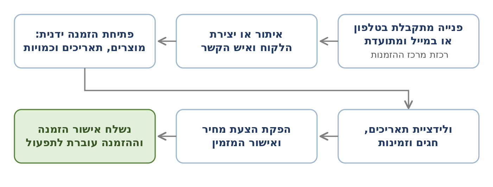

<!-- generated from: אפיון יד ושם מודול הזמנות חלק 2 מאושר 06-10 .docx | 2026-11-08 | do not edit by hand; regenerate from the docx -->

> **מקור:** מסמך 2 - תהליכי ההזמנות, גרסה מאושרת, 6.10.2026  
> **מיקום בניווט:** מסמך 2 - תהליכי ההזמנות › תהליכים עסקיים › קליטת הזמנה ידנית  
> **קודי ולידציה ואוטומציה בפרק:** A03-01, A03-02, A03-03, A03-04, A03-05, A03-06, A03-07, A03-08, A03-09, A03-10, V03-01, V03-02, V03-03, V03-04, V03-05, V03-06, V03-07  
> **הקודם:** [הזמנה מקוונת עצמאית, לקוח פרטי ומוסד](02-online-self-service-order.md) · **הבא:** [זיהוי, סיווג וניתוב מוסד לרכזת](04-institution-identification-routing.md) · [מקרא](../../INDEX.md)

# קליטת הזמנה ידנית

## תיאור התהליך

התהליך אינו שייך למרכז ההזמנות בלבד, והוא מבוצע על ידי הרכזות במחלקות השונות עבור כל פנייה שאינה עוברת במערכת המקוונת. כ-40 עד 60 אחוז מעבודת הרכזות הוא טיפול טלפוני ובמייל, הכולל הנחיית לקוחות בביצוע הזמנה באתר, שינויים, ביטולים והעברות בין מחלקות, ובחלק מהפניות נפתחות הזמנות ידניות. בהזמנות תלמידים כ-10 אחוז מההזמנות נפתחות ידנית עבור קבוצות שפנו ישירות, והיתר נקלטות במערכת המקוונת. הזמנות מורים, בארץ ובחו"ל, מגיעות כמעט אך ורק בפנייה ישירה בטלפון או במייל, ללא מסלול מקוון: הרכזת אוספת את הנתונים (תאריך, מספר משתתפים, חדרים נדרשים), בודקת זמינות ופותחת את ההזמנה, כולל שיבוץ ושריון חדרים. נפח הזמנות המורים בארץ נמוך, פחות מ-10 אחוז מנפח הזמנות התלמידים, ונפח הזמנות המורים מחו"ל ירד משמעותית מאז הקורונה. סוכני נסיעות מבצעים את הזמנותיהם במערכת המקוונת, ופניות המייל שלהם הן לרוב לעריכת הזמנה קיימת ולא לפתיחתה. המיוחדות, הנקלטות בהזנה ידנית בלבד.

בעת קבלת פנייה על הזמנה קיימת, הרכזת מאתרת את מספר ההזמנה ובודקת אם תוכן ההזמנה מתאים לקהל שאליו נכנסה; אי התאמה מנותבת למחלקה הנכונה. תיעוד הפנייה נקשר להזמנה, במקום העבודה הקיימת ב-Outlook במנותק מהמערכת, ללא חיבור בין פנייה להזמנה וללא חיפוש לפי מספר טלפון (ממשק Outlook מפורט בפרק הממשקים שבמסמך 1).

פתיחת ההזמנה הידנית זהה במהותה להזמנה המקוונת: אותה רשומת Opportunity, אותם מוצרים וחבילות ואותם כללי ויסות, כאשר הזמנות הנקלטות ידנית נספרות באותה מכסת ויסות של הערוץ המקוון, ובשונה מהערוץ המקוון שבו החריגה חוסמת, במערכת הפנימית החריגה אינה חוסמת: חריגה מוויסות הכניסות למוזיאון מוצגת לרכזת כהתראה והיא רשאית לאשרה לפי שיקול דעתה, וחריגה מוויסות ההדרכות ניתנת לעקיפה בידי בעל ההרשאה הייעודית בלבד.  ⟦💬 c291⟧ההזמנה נפתחת עם סטטוס חדש ושפה עברית, ואילו מספר הקבוצות ומספר המשתתפים נפתחים ריקים כשדות חובה כדי שיוזנו הערכים בפועל. הרכזת מזינה ⟦💬 c293⟧ את המוצרים, התאריכים, הכמויות ומבנה הקבוצות, לרבות אפיון לקבוצה לצד כל קבוצה. משתמש השייך למחלקת בית הספר מחויב בשיוך ההזמנה למוסד. כאשר הלקוח אינו קיים במערכת, נפתח כרטיס לקוח חדש בכפוף לתהליך האישור, בדומה לכרטיס הזמני במסלול המקוון (מפורט בפרק הזמנה מקוונת עצמאית); ההשקה לממשק הנהלת החשבונות מפורטת בפרק [הפקת חשבון וחיוב לקוח מול אלמוג](../../doc3-events-finance/05-processes/09-almog-invoicing-billing.md) שבמסמך 3. בעת פתיחת ההזמנה מוצג לרכזת חיווי חוב והתאמה של המוסד, הנמשך ממערכת הנהלת החשבונות, כך שהיא רואה אם למוסד חשבונות שאינם בהתאמה מלאה (המימוש בפרק [הפקת חשבון וחיוב לקוח מול אלמוג](../../doc3-events-finance/05-processes/09-almog-invoicing-billing.md) שבמסמך 3). לקוח פרטי המזמין דרך הרכזת משלם בכרטיס אשראי: ההזמנה תומכת בריבוי קישורי תשלום וריבוי חשבונות, והרכזת שולחת ללקוח קישור לתשלום. כללי דמי ההרשמה והטיפול חלים באופן זהה על הזמנה הנקלטת ידנית ועל הזמנה מקוונת: הזמנה הכוללת כניסה למוזיאון שנפתחה ידנית מחויבת בדמי הרשמה וטיפול, למעט מוסדות וקהלים המוחרגים מתשלום זה, כדוגמת בתי ספר וקבוצות חינוכיות מישראל וכוחות הביטחון ⟦💬 c294⟧ (המנגנון והתעריפים מפורטים בפרק הזמנה מקוונת עצמאית, ובנספח דמי ההרשמה והטיפול).

בהתאם להחלטת צוות יד ושם, אין עוד הצעות מחיר בתהליך זה אלא אישור הזמנה. אישור ההזמנה נשלח ללקוח עם פירוט כספי ולוז, וניתן לשלחו עם מקום לחתימה או  ⟦💬 c295⟧בלעדיו. כאשר נשלח אישור הזמנה ללא מקום לחתימה, השדה התקבל אישור חתום מסומן אוטומטית, בדיוק כמו בהזמנה הנכנסת מהמערכת המקוונת, ותכתובת המייל מצורפת לצרופות ההזמנה כאסמכתא. רק הזמנות שסומן בהן התקבל אישור חתום ניתנות להפקת חשבון (המימוש בפרק [הפקת חשבון וחיוב לקוח מול אלמוג](../../doc3-events-finance/05-processes/09-almog-invoicing-billing.md) שבמסמך 3). בהפקת אישור ההזמנה בוחר הרכז אילו מקטעים ייכללו בו: מקום לחתימה, פירוט שורות התשלום, לו"ז ההזמנה, לו"ז הקבוצה הראשונה והערות למזמין.

שינויים לאחר הפתיחה מנוהלים בכללי המערכת. שינוי מספר קבוצות אינו מפרק את השיבוצים הקיימים: בהוספת קבוצות השיבוצים הקיימים נשמרים, ובהסרת קבוצה משתחררים שיבוצי המשאבים הפיזיים בלבד, ואילו שיבוץ נותן השירות נשמר; קבוצה שמשובץ לה נותן שירות אינה ניתנת למחיקה, המערכת מציגה התראה לרכז ומאפשרת את המחיקה רק לאחר הסרה ידנית של נותן השירות. שינוי מספר משתתפים מעדכן את כמויות המוצרים המתומחרים לפי משתתף, ובהזמנה ששולמה או בשורה שהופק עבורה חשבון הכמויות אינן מתעדכנות אוטומטית והמערכת מציגה למשתמש הודעה שהעדכון לא הושלם אוטומטית ושיש להשלימו במערכת הפיננסית. אופן הטיפול המלא בכשלי הממשק מפורט בפרק הממשקים שבמסמך 1. שינוי מקום יום הפעילות מסיר מוצרים שאינם רלוונטיים למקום החדש ומחשב מחירים מחדש. שינוי תאריך אינו מסיר נותני שירות אוטומטית: שיבוצי המשאבים הפיזיים משתחררים, שיבוצי נותני השירות נשמרים, ההזמנה מסומנת דרוש טיפול בשיבוצים וההסרה ידנית בלבד (A09-09). בכל תרחיש שבו נדרשת הסרת נותן שירות נשלחת התראה או נוצרת משימה לרכז ולצוות הרלוונטי, וההסרה בפועל היא ידנית בלבד. לפתיחת הזמנה החוזרת על הזמנה קיימת משמשת פעולת שכפול הזמנה: ההזמנה משתכפלת עם כל הנתונים והסימונים שסומנו בהזמנת המקור, ימי הפעילות של ההזמנה החדשה נפתחים ללא תאריך, והלו"ז משתכפל במלואו אך ללא שיבוצי משאבים ונותני שירות; תשלומים, נעילה, חשבונות וצרופות אינם משתכפלים, וההזמנה החדשה נוצרת רק לאחר הזנת השינויים ושמירה ולא בעצם הלחיצה על השכפול. ביטולים, השהיות וזיכויים מפורטים בפרק [שינוי תאריך בהזמנה עם שיבוצים וסגירת הטיפול](09-guide-resource-scheduling.md) ובפרקי הכספים במסמך 3. ⟦💬 c297⟧ ⟦💬 c298⟧ ⟦💬 c300⟧ ⟦💬 c301⟧ ⟦💬 c302⟧ ⟦💬 c304⟧ ⟦💬 c305⟧

## שלבי התהליך

1. פנייה מתקבלת בטלפון או במייל, מתועדת ונקשרת ללקוח ולהזמנה; פנייה על הזמנה קיימת נבדקת להתאמת הקהל ומנותבת למחלקה הנכונה בעת הצורך.

2. הרכזת מאתרת את רשומת הלקוח ואיש הקשר, או פותחת כרטיס לקוח חדש בכפוף לתהליך האישור.

3. נפתחת הזמנה ידנית עם ברירות המחדל, ומוזנים המוצרים או החבילה, התאריכים, מספר הקבוצות והמשתתפים בכל קבוצה, ואפיון לקבוצה.

4. מתבצעת ולידציית תאריכים, חגים, ימי סגירה וימי ביקור רשמי, ובדיקת זמינות מול הוויסות והמשאבים; חריגה מוויסות הכניסות למוזיאון מוצגת כהתראה וניתנת לאישור לפי שיקול דעת הרכזת, וחריגה מוויסות ההדרכות ניתנת לעקיפה בידי בעל ההרשאה הייעודית בלבד.

5. נשלח אישור הזמנה עם פירוט כספי ולוז, עם או בלי מקום לחתימה; באישור ללא חתימה מסומן השדה התקבל אישור חתום אוטומטית, ותכתובת המייל מצורפת כאסמכתא.

6. המשאבים משוריינים והמוצרים התפעוליים יוצרים מפגשים (מפורט בפרק 12.9 שיבוץ מדריכים ומשאבים).

7. ללקוח פרטי נשלח קישור תשלום בכרטיס אשראי; ללקוח מוסדי נקבעים כללי החיוב לפי המסגרת התקציבית. ⟦💬 c309⟧

8. בקליטה ידנית הרכזת הפותחת את ההזמנה מסומנת כרכזת המטפלת ואין ניתוב אוטומטי; הניתוב האוטומטי חל על הזמנות הנכנסות מהמערכת המקוונת (מפורט בפרק 12.4 זיהוי, סיווג וניתוב מוסד לרכזת). ⟦💬 c310⟧

## ישויות ושדות בתהליך

| ישות | תפקיד בתהליך | שדות ייעודיים לתהליך |
| --- | --- | --- |
| הזמנה (Opportunity) | רשומת ההזמנה הידנית | סטטוס (ברירת מחדל חדש), שפה (ברירת מחדל עברית),  ⟦💬 c312⟧מספר קבוצות (שדה חובה, נפתח ריק), מספר משתתפים (שדה חובה, נפתח ריק), התקבל אישור חתום (מסומן אוטומטית רק כאשר מופק אישור הזמנה ללא מקום לחתימה, אחרת נותר ריק עד לסימון הרכז), ⟦💬 c314⟧ ערוץ קליטה ידני, מוסד (חובה למחלקת בית ספר) |
| פריט הזמנה (Opportunity Product) | שורות המוצרים והכמויות | כמות לפי שיטת תמחור, סטטוס תשלום שורה, הופק חשבון |
| לקוח ואיש קשר (Account, Contact) | המזמין ונציגו | כרטיס זמני לאישור בלקוח חדש, פרטי התקשרות, חסום להזמנות |
| פנייה | תיעוד הטלפון או המייל שממנו נולדה ההזמנה | קישור ללקוח ולהזמנה, ערוץ, תוכן הפנייה |
| קבוצה | כיתה או קבוצה בהזמנה | מספר משתתפים בקבוצה, אפיון לקבוצה |
| יום פעילות (GoMeddo Reservation) | מפגש ההזמנה ושריון משאביו | תאריך, מקום פעילות, סוג פעילות, סטטוס |
| אישור הזמנה | המסמך הנשלח ללקוח במקום הצעת מחיר | פירוט כספי, לוז, עם או בלי מקום לחתימה, אסמכתת מייל בצרופות |

## כללי ולידציה

| מזהה | הכלל | הודעת שגיאה |
| --- | --- | --- |
| V03-01 | תאריך ההזמנה נבדק מול כלל סוגי הפתיחות והסגירות, יד ושם סגור, קמפוס סגור, פעילות ספציפית סגורה ופתיחת מוזיאון חריגה, ומול חגים וימי ביקור רשמי, על בסיס לוח החגים העברי ⟦💬 c317⟧ | התאריך המבוקש אינו זמין לפעילות |
| V03-02 | מוסד המסומן חסום להזמנות אינו ניתן לשמירת הזמנה עבורו | המוסד חסום להזמנות |
| V03-03 | משתמש ממחלקת בית הספר אינו יכול לשמור הזמנה ללא שיוך מוסד | הזמנת בית ספר מחייבת מוסד |
| V03-04 | ⟦💬 c319⟧יצירת שני ימי פעילות באותו תאריך באותה הזמנה מתאפשרת, ומוצג חיווי כי כבר קיים יום פעילות בתאריך זה | קיים כבר יום פעילות בתאריך זה |
| V03-05 | שמירה נחסמת כאשר משתמש אחר שמר את ההזמנה בינתיים | נשמרו שינויים ממשתמש אחר, יש לרענן את הרשומה |
| V03-06 | הפקת חשבון מותנית בסימון התקבל אישור חתום על ההזמנה | לא ניתן להפיק חשבון להזמנה שלא אושרה |
| V03-07 | בהזמנה ששולמה או בשורה שהופק עבורה חשבון, שינוי כמויות אינו מתעדכן אוטומטית | ההזמנה שולמה, יש לעדכן ידנית |

## אוטומציות

| מזהה | טריגר | הפעולה האוטומטית |
| --- | --- | --- |
| A03-01 | פתיחת הזמנה חדשה | טעינת ברירות המחדל: סטטוס חדש, שפה עברית, קבוצה אחת, משתתף אחד |
| A03-02 | שינוי מספר קבוצות | ניתן לערוך את מספר הקבוצות, גם בעריכה מהמערכת המקוונת: שיבוצי נותני השירות של הקבוצות הקיימות נשמרים ואינם מוסרים אוטומטית, המערכת מסמנת דרוש טיפול בשיבוצים ומעלה התראה או משימה לרכז, השחרור או השינוי מתבצעים ידנית בלבד, וכמות המוצרים המתומחרים לפי קבוצה מתעדכנת ⟦💬 c321⟧ ⟦💬 c322⟧ |
| A03-03 | שינוי מספר משתתפים | עדכון כמות המוצרים המתומחרים לפי משתתף וחישוב מחדש של המשתתפים בכל קבוצה |
| A03-04 | שינוי מקום יום פעילות | הסרת מוצרים שאינם רלוונטיים למקום החדש וחישוב מחירים מחדש |
| A03-05 | שינוי תאריך יום פעילות | הסרת שיבוצי המשאבים (חדרים ומוזיאון) ועדכון רשימת התאריכים; שיבוצי נותני השירות אינם מוסרים בשום מצב אלא נשמרים, ההזמנה מסומנת דרוש טיפול בשיבוצים וההסרה ידנית בלבד. כאשר השינוי בוצע במערכת המקוונת נשלח יידוע אוטומטי למשבצות, לרכזת ההזמנה ולרכזת הלוגיסטית עם רשימת נותני השירות המשובצים, תוך ציון מי מהם נמצא ביום חוזה; שינוי שבוצע ישירות בתה"ל אינו מחייב יידוע אוטומטי ⟦💬 c325⟧ |
| A03-06 | ⟦💬 c327⟧שמירת הזמנה עם ביקור מוזיאון מחוץ לשעות הפעילות, המתאפשרת לבעלי הרשאה בלבד | שליחת הודעה אוטומטית לצוות תפעול המוזיאון |
| A03-07 | שליחת אישור הזמנה ללא מקום לחתימה | סימון אוטומטי של השדה התקבל אישור חתום |
| A03-08 | הזמנה של לקוח פרטי בערוץ הידני | יצירת קישור לטופס תשלום בכרטיס אשראי ושליחתו ללקוח, עם תמיכה בריבוי קישורים וריבוי חשבונות הטופס עצמו יתקבל מצוות יד ושם. |
| A03-09 | חריגה ממכסת הוויסות בהזנה ידנית | הצגת התראה לרכזת, ללא חסימה, וספירת ההזמנה במכסת הערוץ המקוון |
| A03-10 | לחיצה על שכפול הזמנה | פתיחת הזמנה חדשה עם כל הנתונים והסימונים של הזמנת המקור ועם הלו"ז המלא, ללא תאריכי ימי פעילות, ללא שיבוצי משאבים ונותני שירות וללא תשלומים, נעילה, חשבונות וצרופות; הרשומה נשמרת רק לאחר הזנת  ⟦💬 c328⟧השינויים |

## אוטומציות מרכזיות, מפרט מימוש

### פתיחת הזמנה ידנית ובניית הקבוצות

| טריגר | שמירת הזמנה ידנית חדשה על ידי הרכזת (אחרי שמירה). |
| --- | --- |
| שלבים | 1. ההזמנה נוצרת עם סטטוס חדש, שפה עברית וערוץ קליטה ידני; מספר הקבוצות ומספר המשתתפים נפתחים ריקים כשדות חובה. 2. ⟦💬 c333⟧ עם הזנת מספר הקבוצות והמשתתפים נבנות רשומות הקבוצות,  ⟦💬 c334⟧מספר המשתתפים מתחלק ביניהן, ולצד כל קבוצה מוזן אפיון לקבוצה. מספר המשתתפים בכל קבוצה ניתן לשינוי ידני. 3. כמויות המוצרים מתעדכנות לפי שיטת התמחור: חד פעמי כמות אחת, לפי קבוצה כמספר הקבוצות, לפי משתתף כמספר המשתתפים. הכמות שהוזמנה בהצעת המחיר תוחמת את הלו"ז: מספר שורות הלו"ז נגזר מהכמות שהוזמנה, ולא ניתן להוסיף ללו"ז מוצר בתשלום שלא הוזמן. 4. ⟦💬 c335⟧ שינוי מאוחר של מספר הקבוצות אינו מסיר שיבוצים: השיבוצים הקיימים נשמרים, ההזמנה מסומנת דרוש טיפול בשיבוצים ונוצרת התראה או משימה לרכז, והשינוי בשיבוצים ידני בלבד; אם ההזמנה שולמה או שורה הופק עבורה חשבון, הכמויות אינן מתעדכנות והמערכת מציגה הודעה שהעדכון לא הושלם אוטומטית ושיש להשלימו במערכת הפיננסית. ⟦💬 c337⟧ |
| בדיקת קבלה | הזמנה לשלוש כיתות של 30 תלמידים נוצרת עם שלוש קבוצות וכמויות מוצרים נכונות לפי שיטת התמחור, והגדלת מספר הקבוצות משלוש לארבע אינה מסירה שיבוצים ואינה בונה את הקבוצות מחדש: שלוש הקבוצות הקיימות ושיבוציהן נשמרים, נוספת קבוצה רביעית, נוצרת התראה או משימה לרכז, המערכת מציעה לחלק מחדש את המשתתפים בין הקבוצות ומעדכנת את הכמויות. ⟦💬 c341⟧ |

### אישור הזמנה וסימון התקבל אישור חתום

| טריגר | הפקת אישור הזמנה מההזמנה על ידי הרכזת (אחרי שמירה). |
| --- | --- |
| שלבים | 1. המערכת מפיקה אישור הזמנה במקום הצעת מחיר. הרכז קובע אילו מקטעים ייכללו בו, מתוך ערכי ברירת מחדל הניתנים לשינוי: פירוט כספי, לו"ז ההזמנה כולה, לו"ז הקבוצה הראשונה, מקום להערות ומקום לחתימה. 2. ⟦💬 c343⟧ באישור הנשלח ללא מקום לחתימה, השדה התקבל אישור חתום מסומן אוטומטית, בזהות מלאה להתנהגות ההזמנה המקוונת. 3. באישור עם מקום לחתימה, השדה מסומן רק עם קבלת האישור החתום מהלקוח, ותכתובת המייל או המסמך החתום מצורפים לצרופות ההזמנה כאסמכתא. 4. הפקת חשבון מתאפשרת רק להזמנות שסומן בהן התקבל אישור חתום (המימוש בפרק הפקת חשבון וחיוב לקוח מול אלמוג שבמסמך 3). |
| בדיקת קבלה | הזמנה שנשלח לה אישור ללא מקום לחתימה מסומנת אוטומטית התקבל אישור חתום וניתנת להפקת חשבון; הזמנה עם אישור לחתימה שטרם הוחזר חסומה להפקת חשבון. |

תרשים תהליך 03 - קליטת הזמנה ידנית

---

## הערות סקירה בפרק זה

> הערות הסקירה אינן חלק מהאפיון המחייב. הן מסמנות מקומות שבהם הטקסט עדיין בדיון. הסימון ⟦💬 cN⟧ בגוף הטקסט מפנה להערה כאן.

### ⟦💬 c291⟧ סגורה
- **c291** · טל שמרית · 2026-09-06 · סומנה כסגורה: בנוסף, ישנם מצבים בהם יש קישור בין הזמנה לבין אירוע (הצגה/ חזיון) / משתתפי ההזמנה מקושרים למשתתפים הצופים באירוע). ז"א למשל משתתפי בית הספר הופכים בתאריך ספציפי להיות משתתפי הצגה/ חזיון. / גם כשנכנסים להזמנה צריך לראות את הקישור (הכולל תאריך, שעה ומס' משתתפים), וגם כשנכנסים למופע הספציפי באירוע צריך לראות את הקישור לפרטי ההמנה. / את הקישור עושים ממסך "מרחבי פעילות חדשים", שם ניתן ללחוץ על מופע ולהוסיף כרשומה את המשתתפים. בכרטיז "המשתתף" מסמנים כי יש קשר בין הרישום לבין הזמנה/ אירוע" ואז ברשימת הנרשמים ניתן לראות כי חלק מן הנרשמים הם פנימיים וחלק חיצוניים. / כאשר יש מופע שכולו מורכב בחלקו/ כולו ממשתתפים חיצוניים אז המכסה היא 53 משתתפים, בהתאם למספר הכיסאות שייש באולם. במידה וזהו מופע שכולו מורכב ממשתתפים באירועים / הזמנות, אז מספר המשתתפים יכול להיות 60. אם אני זוכרת נכון)
  - **c292** · Lior Pridor · 2026-09-14 · סומנה כסגורה: מורכבות זו תיכלל במסמך 3.

### ⟦💬 c293⟧ סגורה
- **c293** · טל שמרית · 2026-09-06 · סומנה כסגורה: אין צורך שיגיע עם ברירת מחדל, שיגיע ריק כשדות חובה, שאנשים מראש יזינו את המספר הרצוי. זה עלול לגרום להם להתבלבל ולשכוח לעדכן את השדות האלו

### ⟦💬 c294⟧ סגורה
- **c294** · טל שמרית · 2026-09-06 · סומנה כסגורה: מדייקת: בתי ספר וקבוצות חינוכיות מישראל

### ⟦💬 c295⟧ סגורה
- **c295** · וייל דבורה · 2026-09-01 · סומנה כסגורה: בהפקת אישור הזמנה יש אפשרות לבחור אילו סקשנים להוסיף:מקום לחתימה,פירוט שורות תשלום,לו"ז,לוז של הקבוצה הראשונה,הערות למזמין
  - **c296** · Lior Pridor · 2026-09-15 · סומנה כסגורה: מקובל עלינו. בהפקת אישור ההזמנה תתאפשר בחירת הסעיפים להצגה: מקום לחתימה, פירוט שורות תשלום, לו"ז והערות למזמין. נבקש להביא לתשומת לבכם שעיצוב מתקדם של המסמך המופק מותנה ברכישת רכיב ייעודי להפקת מסמכים.

### ⟦💬 c297⟧ סגורה
- **c297** · Lior Pridor · 2026-09-14 · סומנה כסגורה: נוסף למסמך: בכל תרחיש שבו נדרשת הסרת נותן שירות נשלחת התראה או נוצרת משימה לרכז ולצוות הרלוונטי, וההסרה בפועל היא ידנית בלבד.

### ⟦💬 c298⟧ סגורה
- **c298** · טל שמרית · 2026-09-06 · סומנה כסגורה: נותני שירות לא מוסרים אוטומטית! אם משנים תאריך שאין בו שיבוץ נותן שירות, אז השיבוצים של המשאבים הפיזיים מתבטל והמערכת מאפשרת לשנות תאריך. / אם רוצים לשנות תאריך שכבר משובצים אליו נותני שירות, יש להתריע על כך, ורק לאחר שהרכז יסיר את נותני השירות ידנית ניתן יהיה לשנות תאריך
  - **c299** · Lior Pridor · 2026-09-14 · סומנה כסגורה: תוקן במסמך: נותני שירות אינם מוסרים אוטומטית בשינוי תאריך. בתאריך שאין בו שיבוץ נותן שירות משתחררים המשאבים הפיזיים והשינוי מתאפשר, ובתאריך שמשובצים אליו נותני שירות המערכת מתריעה ומאפשרת את השינוי רק לאחר שהרכז הסיר אותם ידנית.

### ⟦💬 c300⟧ סגורה
- **c300** · וייל דבורה · 2026-09-02 · סומנה כסגורה: בכל מקום שמסירים נותני שירות – צריך לשלוח התראות על כך לצוות המתאים

### ⟦💬 c301⟧ סגורה
- **c301** · וייל דבורה · 2026-09-02 · סומנה כסגורה: אין עדכונים ידניים במערכת הפיננסית! אם יש צורך לשנות מוצר שהופק עבורו חשבון- צריך לפתוח שורה נוספת עבור מוצר זה ולשנות את סטטוס השתלום אוטומטית בהתאם.

### ⟦💬 c302⟧ סגורה
- **c302** · Miri Yahud · 2026-09-06 · סומנה כסגורה: לא ברור - האם המערכת מעדכנת את ההפרשים ומעבירה למערכת הפיננסית לחיוב/זיכוי?
  - **c303** · Lior Pridor · 2026-09-14 · סומנה כסגורה: המערכת מחשבת את ההפרשים בעקבות השינוי ומעבירה אותם למערכת הפיננסית לצורך חיוב או זיכוי. התהליך מתואר בפרק תהליכי החיוב והזיכוי, ונוסיף בסעיף זה הפניה מפורשת אליו.

### ⟦💬 c304⟧ סגורה
- **c304** · Lior Pridor · 2026-09-14 · סומנה כסגורה: עודכן במסמך: בהוספת קבוצות נשמרים השיבוצים הקיימים, ובהסרת קבוצה משתחררים שיבוצי המשאבים הפיזיים בלבד. קבוצה שמשובץ לה נותן שירות אינה ניתנת למחיקה, המערכת מציגה התראה לרכז ומאפשרת את המחיקה רק לאחר הסרה ידנית של נותן השירות.

### ⟦💬 c305⟧ סגורה
- **c305** · וייל דבורה · 2026-09-02 · סומנה כסגורה: השיבוצים של הקבוצות הקיימות כן נשארות, שמרית?
  - **c306** · טל שמרית · 2026-09-06 · סומנה כסגורה: השיבוצים נשארים אם מוסיפים קבוצות, / אם מסירים קבוצות, רק השיבוצים של המשאבים הפיזיים מתבטלים, במידה ומשובצים נותני שירות לקבוצה מבוטלת, המערכת לא מאפשרת מחיקת קבוצה ללא הסרה ידנית של נותן השירות.
  - **c307** · Lior Pridor · 2026-09-14 · סומנה כסגורה: תוקן במסמך: שינוי מספר קבוצות אינו מפרק את השיבוצים הקיימים ושיבוצי הקבוצות הקיימות נשמרים, ובהסרת קבוצה משתחררים שיבוצי המשאבים הפיזיים בלבד, ואילו שיבוץ נותן השירות נשמר עד להסרה ידנית של הרכז.

### ⟦💬 c309⟧ סגורה
- **c309** · טל שמרית · 2026-09-06 · סומנה כסגורה: סעיף זה צריך להיות סעיף 5

### ⟦💬 c310⟧ סגורה
- **c310** · טל שמרית · 2026-09-06 · סומנה כסגורה: אין צורך בניתוב לרכז בפתיחת הזמנה ידנית בתהל, הרכזת בעצמה פותחת את ההזמנה ומסמנת שהיא הרכזת

### ⟦💬 c312⟧ סגורה
- **c312** · טל שמרית · 2026-09-06 · סומנה כסגורה: אין צורך שיגיע עם ברירת מחדל, שיגיע ריק כשדות חובה, שאנשים מראש יזינו את המספר הרצוי. זה עלול לגרום להם להתבלבל ולשכוח לעדכן את השדות האלו
  - **c313** · Lior Pridor · 2026-09-15 · סומנה כסגורה: מקובל עלינו. השדות יוצגו ריקים וכשדות חובה, ללא ערך ברירת מחדל, כך שהמזין יידרש להזין את המספר הנדרש.

### ⟦💬 c314⟧ סגורה
- **c314** · טל שמרית · 2026-09-06 · סומנה כסגורה: רק אם מפיקים אישור הזמנה ללא מקום לחתימה, אחרת שדה זה נשאר ריק, עד שהרכז מסמן.
  - **c315** · Lior Pridor · 2026-09-15 · סומנה כסגורה: מקובל עלינו. השדה יסומן רק בהפקת אישור הזמנה ללא מקום לחתימה, ובכל מקרה אחר יישאר ריק עד לסימון ידני של הרכז.

### ⟦💬 c317⟧ סגורה
- **c317** · וייל דבורה · 2026-09-03 · סומנה כסגורה: לפי כל סוגי הפתיחות והסגירות: יד ושם סגור\קמפוס סגור\פעילות ספציפית סגורה\פתיחת מוזיאון חריגה
  - **c318** · Lior Pridor · 2026-09-14 · סומנה כסגורה: סוכם שכללי ויסות, שעות פתיחה וסגירה וזמינות מוצרים לא ייכתבו באפיון ברמת פירוט זו. הבדיקה תתבצע מול כל סוגי הפתיחות והסגירות, ההגדרות ייושמו בקונפיגורציה לפי הנתונים שיד ושם תעביר ויתורגלו בבדיקות הקבלה.

### ⟦💬 c319⟧ סגורה
- **c319** · טל שמרית · 2026-09-06 · סומנה כסגורה: לא לחסום זאת, יש לאפשר זאת אך לתת חיווי כי קיים כבר יום פעילות בהזמנה זו.

### ⟦💬 c321⟧ סגורה
- **c321** · Lior Pridor · 2026-09-14 · סומנה כסגורה: עודכן במסמך: עריכת מספר הקבוצות, לרבות עריכה מהמערכת המקוונת, אינה מסירה את שיבוצי נותני השירות; השיבוצים נשמרים, ההזמנה מסומנת דרוש טיפול בשיבוצים ונוצרת התראה או משימה לרכז, והשחרור או השינוי מתבצעים ידנית בלבד.

### ⟦💬 c322⟧ סגורה
- **c322** · וייל דבורה · 2026-09-03 · סומנה כסגורה: יש לאפשר לערוך כמות  קבוצות, השיבוצים של הקבוצות הקיימות נשארים!!! / ההזמנה חוזרת לסטטוס "ממתין לשיבוץ" / בתהל – / כאשר מוסיפים\מורידים  קבוצות / המערכת צריכה לשאול האם רוצים לחלק אוטומטית את מספר המשתתפים לכמות הקבוצות החדשות, / *אם לוחצים כן- המשתתפים מתחלקים באופן שווה בין הקבוצות, / שינוי כמות המשתתפים בקבוצה מתעדכן כמובן גם בשיבוץ המשאבים , בעיקר חשוב במוזיאון, / *אם לא – להשאיר להזנה ידנית את כמות המשתתפים הנוספת\שהוסרה, את שאר הקבוצות להשאיר ללא שינוי. / ע"י המזמין במערכת המקוונת – / צריך לדייק בהמשך מה בדיוק נאפשר ולמי ומי מקבל מייל עדכון. בכל אופן אין הסרת שיבוצים אוטומטית, זה תלוי בסוג השיבוץ, תהיה הוספת קבוצות יתכן שרק לבתי ספר, לגבי הסרת קבוצות נדייק בהמשך.
  - **c323** · טל שמרית · 2026-09-06 · סומנה כסגורה: בהמשך נגדיר במדויק מה מאפשרים בעריכת ההזמנה במערכת המקוונת. / שינוי תאריך/ שעה כמובן שיתאפשר, / לגבי הוספת / הסרה של רכיבים/ משתתפים בהזמנה נדייק בהמשך. רוב הסיכויים שאת אותן העריכות נאפשר לכולם. ללא הבדל בין בתי ספר לסוכנים.
  - **c324** · Lior Pridor · 2026-09-14 · סומנה כסגורה: עודכן במסמך: ניתן לערוך את מספר הקבוצות, גם בעריכה מהמערכת המקוונת, ושיבוצי נותני השירות של הקבוצות הקיימות נשמרים ואינם מוסרים אוטומטית. המערכת מסמנת דרוש טיפול בשיבוצים ומעלה התראה או משימה לרכז, והשחרור או השינוי מתבצעים ידנית בלבד.

### ⟦💬 c325⟧ סגורה
- **c325** · וייל דבורה · 2026-09-03 · סומנה כסגורה: נותני שירות שמשובצים – נשארים, רק שיבוצי משאבים (חדרים, מוזיאון) מוסרים אוטומטית, / בנוסף – אם העריכה היא ע"י המזמין מהמערכת המקוונת אז המשבצות, רכזת ההזמנה והרכזת הלוגיסטית מקבלות את המייל עם רשימת נותני השירות שמשובצים. / ליד נותני שירות שזהו היום חוזה שלהם – צריך לציין זאת במייל.
  - **c326** · Lior Pridor · 2026-09-14 · סומנה כסגורה: תוקן במסמך: רק שיבוצי המשאבים (חדרים ומוזיאון) מוסרים אוטומטית, ואילו שיבוצי נותני השירות נשמרים בכל מצב, ההזמנה מסומנת דרוש טיפול בשיבוצים וההסרה ידנית בלבד. נשלח יידוע למשבצות, לרכזת ההזמנה ולרכזת הלוגיסטית עם רשימת נותני השירות המשובצים, תוך ציון מי מהם נמצא ביום חוזה.

### ⟦💬 c327⟧ סגורה
- **c327** · טל שמרית · 2026-09-06 · סומנה כסגורה: רק בעלי הרשאה יוכלו לשבץ מוזיאון לא בשעות הרגילות או לא בשעות שהמיוחדות שנוספו בפתיחה/ סגירת ימים.

### ⟦💬 c328⟧ סגורה
- **c328** · וייל דבורה · 2026-09-03 · סומנה כסגורה: נדרשת אוטומציה במערכת בנושא הצעת המחיר: כמובן שכל הנחה על שורת הצעת מחיר- מעדכנת את השורה בהתאם ואת הסה"כ, בנוסף סטטוס תשלום נמצא בכמה רמות: שורת הצעת מחיר, יום פעילות, והזמנה כאשר בכל שינוי של ססטוס- המידע מבעבע למעלה- לדוגמא הזמנה של לקוח פרטי שהייתה בסטטוס תשלום ויצרו לה שורת הצעת מחיר נוספת- השורה תהיה בסטטוס "טרם שולם" והיום פעילות וההזמנה יהפכו להיות בסטטוס "שולם חלקית" ,אם מדובר בהזמנה של מוסד סטטוס היום פעילות שהיו בסטטוס "הופק חשבון, יהפכו להיות בסטטוס "הופק חשבון חלקי". בכל פעם שיש השפעה על המחיר- צריך להתחשב מחדש סטטוס התשלום.
  - **c329** · Lior Pridor · 2026-09-14 · סומנה כסגורה: תוקן במסמך: כל הנחה בשורת הצעת המחיר מעדכנת את השורה ואת הסך הכולל, וסטטוס התשלום מנוהל בשלוש רמות: שורת הצעת מחיר, יום פעילות והזמנה. כל שינוי בסטטוס ברמת השורה מתעדכן כלפי מעלה, וכל שינוי המשפיע על המחיר מביא לחישוב מחדש של סטטוס התשלום.
  - **c330** · אשבל אור · 2026-09-22 · סומנה כסגורה: איפה?
  - **c331** · Lior Pridor · 2026-09-23 · סומנה כסגורה: צודקים, הנוסח לא נכנס לגרסה הקודמת. נוסף כעת בפרק הצעת מחיר, הנחות ואישור, מיד אחרי הפסקה על חסימת העריכה לאחר הפקת חשבון (מסומן כשינוי).

### ⟦💬 c333⟧ סגורה
- **c333** · טל שמרית · 2026-09-06 · סומנה כסגורה: אין צורך שיגיע עם ברירת מחדל, שיגיע ריק כשדות חובה, שאנשים מראש יזינו את המספר הרצוי. זה עלול לגרום להם להתבלבל ולשכוח לעדכן את השדות האלו

### ⟦💬 c334⟧ סגורה
- **c334** · טל שמרית · 2026-09-06 · סומנה כסגורה: עם אפשרות לשנות ידנית את מספר המשתתפים בכל קבוצה

### ⟦💬 c335⟧ סגורה
- **c335** · וייל דבורה · 2026-09-03 · סומנה כסגורה: הצעת המחיר משפיעה גם על הלוז. לדוגמא אם בהצעת המחיר יש 2 מוצרים של עדות- ניתן יהיה להוסיף 2 עדויות בלבד בלוז.
  - **c336** · Lior Pridor · 2026-09-14 · סומנה כסגורה: נוסף למסמך: הכמות שהוזמנה בהצעת המחיר תוחמת את הלו"ז, מספר שורות הלו"ז נגזר מהכמות שהוזמנה ולא ניתן להוסיף ללו"ז מוצר בתשלום שלא הוזמן.

### ⟦💬 c337⟧ סגורה
- **c337** · וייל דבורה · 2026-09-03 · סומנה כסגורה: ההודעה צריכה לחסום אפשרות להמשיך - ולא להיות רק התרעה.
  - **c338** · Lior Pridor · 2026-09-14 · סומנה כסגורה: עודכן במסמך: שינוי מאוחר של מספר הקבוצות אינו מסיר שיבוצים, ההזמנה מסומנת דרוש טיפול בשיבוצים והשינוי בשיבוצים ידני בלבד. כאשר ההזמנה שולמה או שהופק עבורה חשבון, הכמויות אינן מתעדכנות אוטומטית והמערכת מציגה הודעה שיש להשלים את העדכון ידנית במערכת הפיננסית.
  - **c339** · אשבל אור · 2026-09-22 · סומנה כסגורה: לא ניתן לבצע שינוי ידני במערכת הפיננסית
  - **c340** · Lior Pridor · 2026-09-23 · סומנה כסגורה: בוצע: המילה ידנית הוסרה, כאן ובפסקה המקבילה בתיאור קליטת ההזמנה הידנית.

### ⟦💬 c341⟧ סגורה
- **c341** · וייל דבורה · 2026-09-03 · סומנה כסגורה: שגוי, מפורט למעלה
  - **c342** · Lior Pridor · 2026-09-14 · סומנה כסגורה: תוקן במסמך: הגדלת מספר הקבוצות משלוש לארבע אינה מסירה שיבוצים ואינה בונה את הקבוצות מחדש, שלוש הקבוצות הקיימות ושיבוציהן נשמרים ונוספת קבוצה רביעית. נוצרת התראה או משימה לרכז, המערכת מציעה לחלק מחדש את המשתתפים בין הקבוצות ומעדכנת את הכמויות.

### ⟦💬 c343⟧ סגורה
- **c343** · טל שמרית · 2026-09-06 · סומנה כסגורה: הרכז יכול להחליט מה יופיע באישור ההזמנה, / יש סימונים של ברירת מחדל אך הרכז יכול לשנות לפי הצורך..... / עם פירוט/ בלי פירוט כספי / עם לוז/ בלי לוז של הקבוצה הראשונה / עם לוז/ בלי לוז של ההזמנה כולה / עם מקום להערות/ בלי מקום להערות / עם מקום לחתימה / בלי מקום לחתימה
