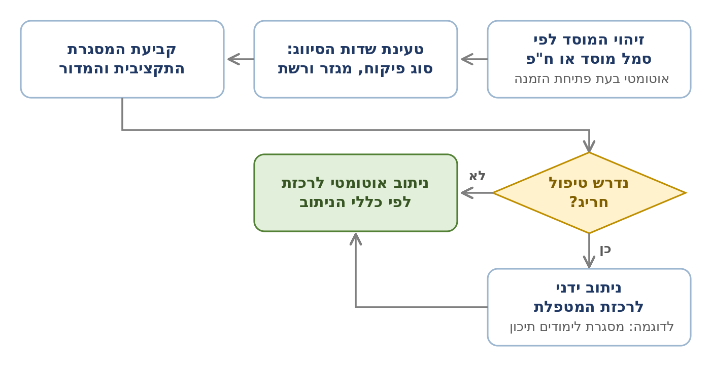

<!-- generated from: אפיון יד ושם מודול הזמנות חלק 2 מאושר 06-10 .docx | 2026-11-08 | do not edit by hand; regenerate from the docx -->

> **מקור:** מסמך 2 - תהליכי ההזמנות, גרסה מאושרת, 6.10.2026  
> **מיקום בניווט:** מסמך 2 - תהליכי ההזמנות › תהליכים עסקיים › זיהוי, סיווג וניתוב מוסד לרכזת  
> **קודי ולידציה ואוטומציה בפרק:** A04-01, A04-02, A04-03, A04-04, A04-05, A04-06, A04-07, V04-01, V04-02, V04-03, V04-04  
> **הקודם:** [קליטת הזמנה ידנית](03-manual-order-intake.md) · **הבא:** [הזמנות צבא, כוחות הביטחון ומשלחות](05-army-security-delegations.md) · [מקרא](../../INDEX.md)

# ⟦💬 c345⟧זיהוי, סיווג וניתוב מוסד לרכזת

## תיאור התהליך

התהליך מתבצע אוטומטית על ידי המערכת בעת קליטת הזמנה מהמערכת המקוונת, שבה אין רכז מזוהה מראש, ובמקרה חריג מטופל ידנית על ידי הרכזת. הזמנה הנפתחת ידנית בתה"ל, על ידי הרכז עצמו או על ידי הרכז הלוגיסטי של המחלקה, אינה עוברת ניתוב: הרכז האחראי נקבע בעת הפתיחה. הוא מחליף את המצב הקיים, שבו כללי ניתוב ההזמנה לרכזת נשענים כולם על ידע אישי של רכזת מרכזית: כיום, לאחר קבלת הזמנת תלמידים, הרכזת מנתבת אותה ידנית לרכזת התוכנית הרלוונטית לפי סוג בית הספר, רשתות חינוך (עמל, ליידי דייויס, אורט), בתי ספר דתיים, חרדים ועוד, ללא שדה סיווג מגזר או רשת בכרטיס המוסד.

הניתוב במערכת החדשה נגזר משני צירים: סיווג המוסד והמסגרת התקציבית. סיווג המוסד נשען על השדות הקיימים כבר היום ב-CRM, ובראשם סוג פיקוח (ממלכתי, ממלכתי דתי, חרדי, ערבי) ומוסד חרדי, ועליהם נוסף שדה רשת בלבד; אין צורך בקליטת נתוני סיווג, שכן המוסדות וערכי הסיווג קיימים. מקור הנתונים הוא שילוב של נתוני משרד החינוך לפי סמל מוסד ורשימות פנימיות שיד ושם מנהלת לגבי מוסדות שאינם מסווגים רשמית, בעיקר במגזר החרדי. הניתוב מביא בחשבון גם את סוג המוסד (בית ספר, סוכן נסיעות, ארגון וכדומה), שהוא שדה מהותי המקושר גם לחשבון, את קהל היעד, את שפת ההדרכה ואת ארץ המוצא עבור הקהל הרחב, וכן את האזור הגיאוגרפי של המוסד ואת הצוות הייעודי המטפל בקהל. שכבת הגיל (יסודי, חטיבה, תיכון) נטענת מהמוסד וקובעת את ההיצע והקטגוריה, והיא מובחנת מסוג המוסד; על בסיס שכבת הגיל ומספר התלמידים מחושבת אוטומטית גם המסגרת התקציבית הזמינה להזמנה.

מימוש הניתוב נעשה בהקצאת בעלות על ההזמנה: אוטומציה מופעלת רשומה קובעת את בעל ההזמנה לפי ערכי הסיווג והמסגרת התקציבית.  הזמנות שטרם שויכו לרכזת מנוהלות בבעלות ברירת מחדל ברמת המחלקה ומוצגות בתצוגה ייעודית לקליטה, המאפשרת איזון עומסים והחלפת מטפלים. ההזמנה משויכת דרך המסגרת התקציבית גם למדור, ותצוגות ברירת המחדל מסוננות לפי המחלקה, ללא הגבלה על הנראות, בהתאם לפרק ההרשאות. המסגרת התקציבית מקושרת למחלקה ולמדור ונושאת מספרים פנימיים המקושרים למערכת הנהלת החשבונות, והיא הנושאת את המחירון, כלומר מוצר כפול מסגרת תקציבית שווה מחיר, ומשמשת גם לניתוב ההזמנה ולפרטי הקשר שבאישור ההזמנה; היא קובעת אם להפיק חשבון אוטומטי, ואילו תזמון ההפקה נקבע לפי מאפייני המוסד (מפורט בפרק [הפקת חשבון וחיוב לקוח מול אלמוג](../../doc3-events-finance/05-processes/09-almog-invoicing-billing.md) שבמסמך 3); נשמרת הפרדה ברורה בין מסגרות המשמשות הזמנות לבין מסגרות המשמשות אירועים, כדי שלא ייעשה שימוש באותה מסגרת בשתי הרמות. לצורך הניתוב והנראות נתמך גם שיוך עובד לשתי מחלקות בו זמנית, על ידי מחלקת על: שתי מחלקות בית הספר, הכשרת מורים והדרכות חינוכיות, אוחדו בפועל למחלקת חינוך בישראל אך נותרו במערכת כשתי מחלקות, וחלק מהעובדים נותנים שירות לשתיהן. משתמש השייך למחלקת בית הספר מנותב אוטומטית למסלול בית הספר ושדה המוסד חובה עבורו, ומשתמש מחלקת ההנצחה מנותב למסלול ההנצחה. המחלקה נגזרת אוטומטית מהמשתמש המקים את ההזמנה, ולפיה מסוננות מסגרות התקציב המוצעות לבחירה ונטענות רשימות התומכים, השותפים ונושאי היום; מנהל מערכת רשאי לבחור מסגרת ידנית. הזמנות נכנסות, סטטוסן וניתובן מוצגים בלוח תפעול הזמנות (מפורט בפרק 11 מסכים מרכזיים).

בחריגים מתבצע ניתוב ידני: הזמנה שנכנסה לקהל שאינו תואם את תוכנה מועברת למחלקה הנכונה על ידי הרכזת המזהה את אי ההתאמה, וכן מקרים כדוגמת מסגרת לימודים תיכון המחייבים שיקול דעת. מוסד המסומן חסום להזמנות נעצר עוד בשלב השמירה ואינו מגיע לניתוב.

לזיהוי מהיר של ההזמנה לאורך כל המסכים, המסמכים והדוחות נקבעת לכל הזמנה תחילית למספר ההזמנה לפי המחלקה המטפלת, לדוגמה תחילית ייעודית להזמנות מחלקת צה"ל וכוחות הביטחון כפי שהיא מופיעה במספר ההזמנה SCB-0220275. התחילית נגזרת אוטומטית מהמחלקה או מהמסגרת התקציבית של ההזמנה בעת יצירתה, והיא חלק בלתי נפרד ממספר ההזמנה המוצג ללקוח ולגורמים הפנימיים.

לאחר הניתוב, ההמשך התפעולי של הרכזת מתנהל במסך הזמנות לטיפולי, המשרת הן את הרכזות הלוגיסטיות והן את רכזי התוכן. כל רכזת ורכז רואים את ההזמנות ואת האירועים שבהם הם מופיעים כרכז, והרכזת הלוגיסטית של המחלקה רואה את כלל ההזמנות והאירועים שבאחריות מחלקתה. המסך כולל תצוגות מובנות המיועדות לבדיקות שוטפות ולזיהוי חוסרים: ללא סינון, שהיא ברירת המחדל ומציגה את כל ההזמנות והאירועים ללא סינון; הזמנות שחסר בהן שיבוץ; הזמנות ללא אישור הזמנה; הזמנות לא מאושרות על ידי הרכז; הזמנות לא נעולות; הזמנות שאני יצרתי; הזמנות מקוונות שממתינות לאישור; הזמנות שעדיין לא שולמו ולא הופק להן חשבון; הזמנות בסטטוס הופק חשבון; והזמנות עם שיבוץ לאחר שינוי או ביטול. תצוגת הזמנות עם שיבוץ לאחר שינוי או ביטול מופיעה גם במסך ההזמנות לפי תאריכים, ובה הזמנה שעודכנה ויש בה שיבוץ מסומנת בחיווי חזותי עד לטיפול בה, וכך גם הזמנה שבוטלה ויש בה שיבוץ, המסומנת בחיווי נפרד עד להשלמת הטיפול; זהו מסך מתנקה, שלאחר טיפול בכלל שורותיו נותר ריק. בתצוגת הזמנות מקוונות שממתינות לאישור מוצגות הן הזמנות חדשות שנקלטו מהמערכת המקוונת והן הזמנות קיימות שעברו עדכון מקוון, כאשר ההזמנות שעודכנו מוצגות בצבע מובחן.

## שלבי התהליך

1. בעת פתיחת הזמנה מזוהה המוסד: בפתיחה ידנית בתה"ל לפי שם המוסד, סמל מוסד או ח"פ, ובמערכת המקוונת לפי סמל מוסד או ח"פ; סוכנים נדרשים גם לסיסמה, לרבות תמיכה באיפוס סיסמה. ⟦💬 c351⟧

2. נטענים שדות הסיווג מרשומת המוסד: סוג פיקוח, מוסד חרדי, רשת, סוג מוסד ושכבת גיל, וכן קהל היעד, שפת ההדרכה וארץ המוצא לקהל הרחב.

3. נקבעים המסגרת התקציבית והמדור של ההזמנה.

4. נגזרת תחילית מספר ההזמנה לפי המחלקה המטפלת או המסגרת התקציבית, והיא נשמרת כחלק ממספר  ⟦💬 c353⟧ההזמנה. בהעברת ההזמנה למחלקה אחרת מתעדכנת התחילית בהתאם.

5. כללי הניתוב מפעילים שיוך אוטומטי של ההזמנה לרכזת המתאימה או לתור המחלקה, לפי סיווג המוסד והמסגרת התקציבית.

6. הזמנה שלא נמצא לה כלל תואם נכנסת לתור המחלקה לניתוב ידני; בחריגים, כגון מסגרת לימודים תיכון או אי התאמה בין תוכן ההזמנה לקהל, מתבצע ניתוב ידני והעברה בין מחלקות.

7. הרכזת המשויכת ממשיכה בטיפול, וההזמנה מוצגת בלוח תפעול הזמנות ובמסך הזמנות לטיפולי עם סטטוס הניתוב.

8. הרכזת עוקבת אחר החוסרים בהזמנות ובאירועים שבאחריותה בתצוגות מסך הזמנות לטיפולי, ומטפלת בשורות המסומנות בצבע מובחן עד לניקוי התצוגה.

## ישויות ושדות בתהליך

| ישות | תפקיד בתהליך | שדות ייעודיים לתהליך |
| --- | --- | --- |
| לקוח (Account) | רשומת המוסד שממנה נטען הסיווג | סמל מוסד, ח"פ, סוג פיקוח, מוסד חרדי, רשת, שיוך לרשת (שדה חדש, המשמש גם למודל הלקוח המשלם בפרק הפקת חשבון וחיוב לקוח מול אלמוג שבמסמך 3), סוג מוסד, שכבת גיל, חסום להזמנות, ארץ מוצא, שם איש קשר, טלפון איש קשר ותפקיד איש קשר (שדות חדשים) |
| הזמנה (Opportunity) | הרשומה המנותבת | סוג קהל, שפת הדרכה, מסגרת תקציבית, תחילית מספר הזמנה לפי מחלקה, בעלים (רכזת או תור), סטטוס ניתוב |
| מסגרת תקציבית (Custom) | ציר הניתוב והחיוב | מדור, רשימת תומכים, רשימת שותפים, רשימת נושאי יום |
| מדור (Custom) | שיוך מחלקתי וסינון נראות | קיבוץ מסגרות תקציביות, בסיס לתצוגת ההזמנות של משתמשי המחלקה |
| ⟦💬 c355⟧מסך הזמנות לטיפולי (List Views) | מסך העבודה של הרכזת הלוגיסטית ורכז התוכן לאחר הניתוב | תצוגות מובנות (ללא, חסר שיבוץ, ללא אישור הזמנה, לא מאושרות על ידי הרכז, לא נעולות, שאני יצרתי, מקוונות הממתינות לאישור, לא שולמו וללא חשבון, הופק חשבון, שיבוץ לאחר שינוי או ביטול), סינון לפי רכז אחראי ולפי מחלקה, סימון צבע לשורות הממתינות לטיפול |

## כללי ולידציה

| מזהה | הכלל | הודעת שגיאה |
| --- | --- | --- |
| V04-01 | סמל מוסד הוא שדה חובה בהזמנת קבוצה חינוכית, ומשמש בסיס לזיהוי ולניתוב | נדרש סמל מוסד לזיהוי המוסד |
| V04-02 | משתמש ממחלקת בית הספר אינו יכול לשמור הזמנה ללא שיוך מוסד | הזמנת בית ספר מחייבת מוסד |
| V04-03 | מוסד המסומן חסום להזמנות אינו ניתן לשמירת הזמנה, וההזמנה אינה מגיעה לניתוב | המוסד חסום להזמנות; בהודעה יפורט הגורם ביד ושם שאליו ניתן לפנות ⟦💬 c358⟧ |
| V04-04 | הזמנה אינה נסגרת ללא מסגרת תקציבית משויכת | יש לשייך מסגרת תקציבית להזמנה |

## אוטומציות

| מזהה | טריגר | הפעולה האוטומטית |
| --- | --- | --- |
| A04-01 | זיהוי מוסד בעת פתיחת הזמנה | טעינת ערכי הסיווג: סוג פיקוח, מוסד חרדי, רשת, סוג מוסד, שכבת גיל, וקטגוריית הגיל להיצע |
| A04-02 | יצירת הזמנה עם סיווג טעון | הפעלת כללי הניתוב ושיוך ההזמנה לרכזת או לתור המחלקה לפי סיווג המוסד והמסגרת התקציבית |
| A04-03 | משתמש פותח השייך למחלקת בית הספר או ההנצחה | קביעת מסלול המחלקה אוטומטית, ובמחלקת בית הספר אכיפת חובת מוסד |
| A04-04 | שינוי מסגרת תקציבית בהזמנה | טעינה מחדש של רשימת התומכים, השותפים, מסגרות התקציב ונושאי היום לפי המחלקה: המחלקה נגזרת אוטומטית מהמשתמש המקים את ההזמנה, והמסגרות התקציביות המוצגות לבחירה מסוננות לפיה, עם אפשרות בחירה ידנית למנהל מערכת ⟦💬 c360⟧ |
| A04-05 | הזמנה ללא כלל ניתוב תואם | הכנסת ההזמנה לתור המחלקה לניתוב ידני והצגתה בלוח תפעול הזמנות |
| A04-06 | יצירת הזמנה חדשה | גזירת תחילית מספר ההזמנה מהמחלקה המטפלת או מהמסגרת התקציבית ושמירתה כחלק ממספר ההזמנה |
| A04-07 | עדכון או ביטול הזמנה שיש בה שיבוץ, וכן קליטת עדכון מקוון להזמנה קיימת | הצגת ההזמנה בצבע מובחן בתצוגות מסך הזמנות לטיפולי (צהוב כהה בהזמנה שבוטלה) עד לטיפול בה, ולאחר הטיפול החזרתה לצבע התקני והסרתה  ⟦💬 c362⟧מהתצוגה |

## אוטומציות מרכזיות, מפרט מימוש

### ניתוב הזמנה אוטומטי לרכזת

| טריגר | יצירת הזמנה חדשה, בערוץ המקוון או הידני, לאחר זיהוי המוסד וטעינת הסיווג (אחרי שמירה). |
| --- | --- |
| שלבים | 1. המערכת קוראת את ערכי הסיווג מרשומת המוסד: סוג פיקוח, מוסד חרדי, רשת וסוג מוסד, ואת סוג הקהל, שפת ההדרכה וארץ המוצא מההזמנה. 2. נקבעים המסגרת התקציבית והמדור, המשמשים ציר ניתוב לצד הסיווג. 3. כללי הניתוב מוחלים באוטומציה מופעלת רשומה לפי סדר עדיפות: כלל תואם משייך את ההזמנה לרכזת התוכנית הרלוונטית, לדוגמה רכזת רשתות חינוך, רכזת מוסדות דתיים או רכזת המגזר החרדי. 4. בהיעדר כלל תואם, ההזמנה נכנסת לתור המחלקה, מוצגת בלוח תפעול הזמנות ומנותבת ידנית; ההעברה בין מחלקות מתועדת. |
| בדיקת קבלה | הזמנה מקוונת מבית ספר ברשת מוגדרת מנותבת אוטומטית לרכזת הרשת ללא מגע ידני, והזמנה ממוסד ללא סיווג תואם מופיעה בתור המחלקה לניתוב ידני. |

תרשים תהליך 04 - זיהוי, סיווג וניתוב מוסד לרכזת

---

## הערות סקירה בפרק זה

> הערות הסקירה אינן חלק מהאפיון המחייב. הן מסמנות מקומות שבהם הטקסט עדיין בדיון. הסימון ⟦💬 cN⟧ בגוף הטקסט מפנה להערה כאן.

### ⟦💬 c345⟧ סגורה
- **c345** · טל שמרית · 2026-09-06 · סומנה כסגורה: כל הסעיף הזה די מיותר, / מי שפותח הזמנה ידנית יודע כבר מי הרכז האחראי. לרוב הרכז עצמו פותיח את ההזמנה, כך שאין צורך באף ניתוב וסיווג ההזמנה לרכז. זה שונה מהזמנה שנכנסת מהמערכת המקוונת
  - **c346** · Lior Pridor · 2026-09-14 · סומנה כסגורה: הסעיף נדרש משום שהזמנות נקלטות גם מהמערכת המקוונת של המוסדות, ובמקרים אלה אין רכז מזוהה מראש. בפתיחה ידנית הרכז הפותח מוגדר אוטומטית כרכז האחראי וללא שלב ניתוב. נשמח לאשר איתכם ניסוח זה ולעדכן את הסעיף בהתאם.
  - **c347** · אשבל אור · 2026-09-22 · סומנה כסגורה: נדייק בהמשך בהבחנה בין הזמנה במערתכ המקוונת לבין הזמנה שנפתחת ידנית בתהל (או ע"י הרכז עצמו, או ע"י הרכז הלוגיסטי של המחלקה)
  - **c348** · Lior Pridor · 2026-09-23 · סומנה כסגורה: מקובל. כבר בגרסה זו עודכן הסעיף כך שהניתוב חל על הזמנות מהמערכת המקוונת בלבד, והזמנה הנפתחת ידנית בתה"ל, על ידי הרכז או על ידי הרכז הלוגיסטי של המחלקה, אינה עוברת ניתוב. נשמח לדיוקים נוספים.

### ⟦💬 c351⟧ סגורה
- **c351** · וייל דבורה · 2026-09-03 · סומנה כסגורה: בפתיחה ידנית – לפי שם מוסד, במקוונת- סוכנים צריכים גם סיסמה, כולל תמיכה באיפוס סיסמה
  - **c352** · Lior Pridor · 2026-09-15 · סומנה כסגורה: פתיחה ידנית מתבצעת לפי שם המוסד. במערכת המקוונת הזדהות הסוכנים מתבצעת בשם משתמש וסיסמה, כולל תהליך איפוס סיסמה עצמאי, והכל נתמך ביכולות הסטנדרטיות של הפלטפורמה ללא פיתוח ייעודי.

### ⟦💬 c353⟧ סגורה
- **c353** · וייל דבורה · 2026-09-03 · סומנה כסגורה: אם הזמנה מועברת למחלקה אחרת , תחילית ההזמנה מתעדכנת

### ⟦💬 c355⟧ סגורה
- **c355** · טל שמרית · 2026-09-06 · סומנה כסגורה: מסך חשוב מאוד ולכן יש לדאוג שהנתונים שרואים בו (ללא קשר לתצוגות) יהיו נתונים שמסייעים לעבודה. / בנוסף דרך מסך זה ולמעשה דרך כל מסך שרואים בו את ההזמנות, יש אפשרות ללחוץ לחיצה אחת כדי לפתוח חלון של תצוגה מהירה ללא צורך לפתוח את ההזמנה כולה. / אלו הנתונים שרואים כיום בחלון הקופץ: / הצעת המחיר של התאריך / רשימת נותני השירות המשובצים / פרטים נוספים: / זמני כניסה למוזיאון:
  - **c356** · Lior Pridor · 2026-09-14 · סומנה כסגורה: מסך הזמנות לטיפולי הוא רשימה מסוננת, ופרק המסכים מתאר את הפונקציונליות בלבד. הנתונים המוצגים, התצוגות ותוכן חלון התצוגה המהירה יוגדרו על ידי יד ושם וייסגרו בבדיקות הקבלה.

### ⟦💬 c358⟧ סגורה
- **c358** · וייל דבורה · 2026-09-03 · סומנה כסגורה: צריך לפרט למי ביד ושם ניתן לפנות

### ⟦💬 c360⟧ סגורה
- **c360** · וייל דבורה · 2026-09-03 · סומנה כסגורה: גם מסגרות התקציב הם כמובן לפי המחלקה
  - **c361** · Lior Pridor · 2026-09-14 · סומנה כסגורה: נוסף למסמך: גם מסגרות התקציב נטענות לפי המחלקה, כאשר המחלקה נגזרת אוטומטית מהמשתמש המקים את ההזמנה והמסגרות המוצגות לבחירה מסוננות לפיה, עם אפשרות בחירה ידנית למנהל מערכת.

### ⟦💬 c362⟧ סגורה
- **c362** · וייל דבורה · 2026-09-03 · סומנה כסגורה: יש לנהל סטטוסי הזמנה וסטטוסי יום פעילות
  - **c363** · Lior Pridor · 2026-09-14 · סומנה כסגורה: ניהול הסטטוסים קיים בשתי הרמות: סטטוס ברמת ההזמנה וסטטוס ברמת יום הפעילות. נשמח לקבל מכם את רשימת הערכים הרצויה בכל אחת מהרמות ואת המעברים המותרים ביניהן, ונשלים את הפירוט במסמך בהתאם.
