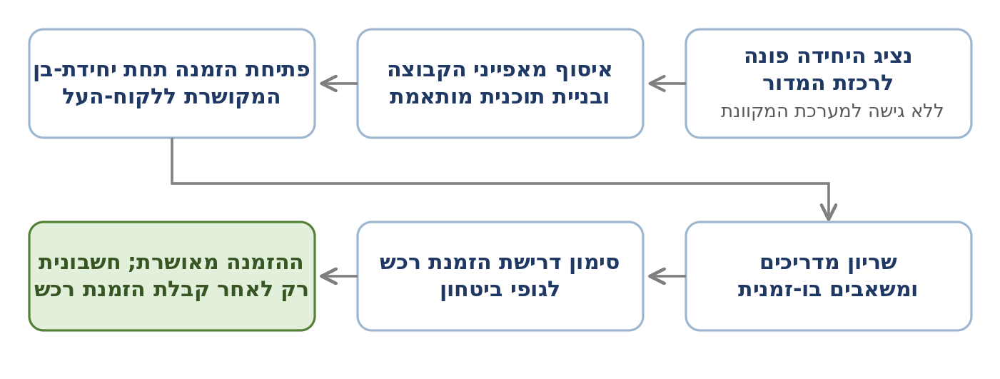

<!-- generated from: אפיון יד ושם מודול הזמנות חלק 2 מאושר 06-10 .docx | 2026-11-08 | do not edit by hand; regenerate from the docx -->

> **מקור:** מסמך 2 - תהליכי ההזמנות, גרסה מאושרת, 6.10.2026  
> **מיקום בניווט:** מסמך 2 - תהליכי ההזמנות › תהליכים עסקיים › הזמנות צבא, כוחות הביטחון ומשלחות  
> **קודי ולידציה ואוטומציה בפרק:** A05-01, A05-02, A05-03, A05-04, A05-05, A05-06, A05-07, A05-08, A05-09, A05-10, A05-11, V05-01, V05-02, V05-04, V05-05, V05-06  
> **הקודם:** [זיהוי, סיווג וניתוב מוסד לרכזת](04-institution-identification-routing.md) · **הבא:** [ביקורים רשמיים ותיעוד ביקורי תורמים](06-official-visits-donors.md) · [מקרא](../../INDEX.md)

# הזמנות צבא, כוחות הביטחון ומשלחות

## תיאור התהליך

מחלקת צה"ל וכוחות הביטחון היא אחד הלקוחות הגדולים והייחודיים של מודול ההזמנות, ובה ארבעה מדורים בעלי מאפיינים תפעוליים שונים: מדור צה"ל, מדור כוחות הביטחון, מדור משלחות ומדור עיר הבה"דים. בניגוד לבתי ספר ולקהל הרחב, רוב ההזמנות נקלטות ידנית: ליחידות הצבא אין גישה למערכת האזרחית, ואופי האוכלוסייה דורש קשר אנושי אישי וגמישות גבוהה בקביעת מועדים. במדור צה"ל, יחידת ההסברה, מערך חיילות בשירות חובה ביד ושם שהוכשרו להדריך טירונים, מקבלת את שיחות הטלפון ומזינה את ההזמנות; במדורי כוחות הביטחון והמשלחות, רכזות המדור עצמן מזינות. הקשר נוצר משילוב פניות יזומות של יד ושם, לפי גרפי גיוס בצה"ל ורוטינות הכשרה במשטרה ובכבאות, ופניות נכנסות ממפקדים, מקצינות חינוך וממתאמי קבוצות. הקובייה הייעודית במערכת המקוונת נשמרת במתכונתה הנוכחית בשלב זה.

קליטת ההזמנה מתבצעת בפעימה אחת, בשיחה אחת: הרכזת מגייסת מידע על הקבוצה, בונה תוכנית מותאמת אישית ומשריינת משאבים בו זמנית. לשם כך נדרש מסך הצעה אינטגרטיבי, שבו מזינים כמות משתתפים, חלון זמן וסוג קהל ומקבלים הצעת תאריכים פנויים עם פירוט המשאבים הזמינים (מוזיאון, כיתות, אולמות, הצגות). הוויסות מוגדר ברמת המחלקה ומיקום הפעילות בכל המחלקות ואינו יורד בשום מחלקה לרמת המדור: המכסה נפרדת לפי קהל, מיקום פעילות ותקופה, והחריגה מייצרת התראה ולא חסימה, שכן בפועל המחלקה כמעט תמיד קולטת את הקבוצה גם בחריגה לאחר סבב אישור פנים ארגוני המתנהל מחוץ למערכת (מפורט בפרק 12.12 ויסות ונעילה רב-רמתית); המכסות וכללי הוויסות המדויקים ייושמו בקונפיגורציה. ההבדל בין המדורים מהותי: מדור צה"ל מייצר נפח גדול ועובד בוויסות הדוק, ואילו במדור כוחות הביטחון רוב הקבוצות ייחודיות; ההבחנה ביניהם מתבטאת בערכי הקהל ומיקום הפעילות שבכללי המחלקה, ולא בכלל ויסות נפרד לכל מדור. מדור עיר הבה"דים מוחרג מוויסות ההדרכות הכמותי החל על הדרכות ביד ושם, אצל המזמין ובפעילות וירטואלית: למרכז החינוכי בעיר הבה"דים צוות מדריכים קבוע משלו, שאינו נשען על מערך ההדרכה בירושלים, והזמנותיו נפתחות ידנית, ולכן הזמנותיו אינן נספרות במכסות הוויסות (מפורט בפרק 12.12 ויסות ונעילה רב-רמתית). העיקרון המנחה שנקבע הוא התמקדות ב-90 אחוז מההזמנות שיעבדו אוטומטית, והותרת 10 אחוז מקרי הקצה למענה ידני. סימון סוג קבוצה, לדוגמה טירונים לוחמים, מציע אוטומטית תבנית פעילות מתאימה הניתנת לעריכה ידנית, כך שהתבנית חוסכת זמן מבלי לנעול את הרכזת. ⟦💬 c367⟧

ניהול הלקוחות במחלקה הוכרע במבנה לקוח אב ולקוח רזה: צה"ל וגופי הביטחון מנוהלים כלקוחות על, וכל יחידה תחתיהם נפתחת כלקוח רזה, סוג של לקוח בן שממולאים עבורו נתונים מעטים בלבד, ללא הקמה כספית מלאה. היחידות המרכזיות, בהיקף של כמאתיים יחידות, מוגדרות מראש כלקוחות בן, והמחלקה מוסיפה בעצמה לקוחות רזים מתחת ללקוח האב הקיים; יחידה קטנה ונדירה שאינה ברשימה נרשמת ישירות תחת לקוח העל באמצעות שם הקבוצה בלבד, ללא פתיחת כרטיס לקוח וללא רישום במערכת הנהלת החשבונות. רק לקוחות רזים נפתחים על ידי המחלקה, ויתר הלקוחות נפתחים כרגיל במקום אחד ומסודר. מבנה זה מאפשר דיווח והשוואה ברמת היחידה, שכן הדיווח מתבסס על הרשומה ולא על שדה, בדומה לניהול מוסדות חינוך ורשתות, ואותו עיקרון היררכי חל גם על גופים אזרחיים גדולים כדוגמת האוניברסיטה העברית ופקולטותיה. לצד זה, מקום הפעילות נבדל לעיתים מכתובת המוסד: הזמנה הרשומה על צה"ל עשויה להתקיים בבסיס ספציפי, ולכן נתמך שדה מקום פעילות ייעודי עם חיפוש נקודות ציון ומיקומים צבאיים שאינם מופיעים כיישוב, בממשק מבוסס Google; רשימת המקומות אינה כוללת את כל הבסיסים אוטומטית כדי לא להציף את המשתמש. יום פעילות בודד יכול לכלול מספר מקומות פעילות, לדוגמה פתיחה בעיר הבה"דים והמשך בבסיס אחר, כשהקבוצה נספרת פעם אחת וחישוב הנסיעות מנוהל כרשומה נפרדת המזכה את המדריך על המסלול בין המקומות.

בגופים מסווגים אנשי הקשר משתמשים בשמות קוד ללא מייל ארגוני, והתקשורת השוטפת מתנהלת במסרונים; במצב הקיים ההזמנה נשמרת על שם פרטי ללא שם משפחה או תפקיד, וניהול המעקב נופל על המייל האישי של רכזת המדור. לכן נדרשות תזכורות ב-SMS למדריכים ולמפקדים לצד ערוץ המייל, ואפשרות השתקת תזכורות אוטומטיות לפי מחלקה או לפי מסגרת תקציבית, שכן תזכורות אוטומטיות אינן רלוונטיות לקבוצות אלה. מאפייני הקבוצה נשמרים בשדה אפיון מובחן וניתן לחיתוך (חיל ספציפי, סוג קורס, רמת בכירות), במקום שדה ההערות החופשי, לצורך דוחות ניהוליים.

⟦💬 c369⟧השיבוץ מבוצע ככלל על ידי צוות המשבצות של מחלקת ההדרכה, ובמקרים מסוימים על ידי צוות המחלקה עצמו, כדוגמת מחלקת צה"ל בעיר הבה"דים ובהזמנות מיוחדות, אך לא לכל הזמנה: פעולה המסומנת כפעולה עצמאית מבוצעת על ידי הרכזת או גורם פנימי, והסימון ברמת יחידת תוכן בודדת (אל תשבץ) מעביר את המידע למשבצות מבלי שיוקצה מדריך לאותה שורה. חיילות יחידת ההסברה מוגדרות כזמינות תמיד ואינן נחסמות בשום מצב. ההתאמה בין נותן השירות למוצר נשמרת ככלל אכיף: לכל מוצר מוגדר סוג נותן השירות הרשאי לבצעו, ולכן ניתן לשבץ למוצר מדריך משלחת רק נותן שירות שהוסמך כמדריך משלחת, ומטריצת ההסמכות של מדריכי המשלחות, מדריכי עיר הבה"דים ויחידת ההסברה זמינה בתוך המערכת, כך שהרכזת רואה מי מוסמך לאיזו פעילות ללא פנייה טלפונית לצוות ההדרכה.  ⟦💬 c370⟧שיבוץ מדריך מעבר לשמונה שעות ביום אינו נחסם והמערכת מציגה למשבצת חיווי כי המדריך משובץ מעל שמונה שעות, ושיבוץ למיקום שונה ללא חלון נסיעה מספיק מציג התראה לפי כללי ביטול הזמן: עד 60 קילומטר שעה, עד 120 קילומטר שעתיים, ומעל לכך שלוש שעות (מפורט בפרק 12.10 הדרכות חוץ, הדרכות כפולות וחישוב מרחק וזמן).  ⟦💬 c372⟧הלוז המופק לקבוצה מופק מהמערכת בתבנית אחידה  לצורך עריכה ככל הנדרש. הפקת פלט מעוצב, הכולל מיתוג יד ושם או לוגו של החיל או הארגון, מחייבת כלי הפקת מסמכים של צד שלישי  ⟦💬 c374⟧שאינו נכלל בפתרון.

מדור משלחות מטפל בכעשרים משלחות בשנה, מחציתן צה"ל ומחציתן כוחות ביטחון. מבנה המשלחת: הזמנה אחת עם מספר ימי פעילות, שבכל יום משתתפים שונים, יום ראשון לסגל בלבד וימים נוספים לכלל המשתתפים; לכן ההזמנה תומכת במספר משתתפים מקסימלי ברמת ההזמנה עם מספר משתתפים שונה בכל יום פעילות. כל משלחת לפולין מקבלת שלושה ימי הכנה ביד ושם, אחד לסגל ושניים לכלל המשתתפים,  ⟦💬 c378⟧ותאריך המסע עצמו, המתקיים בדרך כלל חודשים לאחר מכן, נשמר כשדה רפרנס בהזמנה. אותו מבנה נכון גם למשלחות תלמידים לפולין, ופתרון אחד עונה לשני הקהלים. למשלחת מוקצים מדריכי משלחת ייעודיים המלווים את הקבוצה לאורך כל יום ההכנה, גם בזמן סדנאות המועברות על ידי מדריכים אחרים; מדריך משלחת הוא מוצר נפרד המחויב בתשלום מלא מכוח הסכם המכרז, גם כאשר הוא מלווה בלבד ואינו מעביר תוכן. ראש משלחת, תפקיד ייחודי למשלחות מרובות קבוצות, אחראי לתיאום חוצה קבוצות ואינו משויך לפעילות נקודתית בלוז; תגמולו משובץ כשורה נפרדת מחוץ ללוז (מפורט בפרק 12.9 שיבוץ מדריכים ומשאבים). במשלחות, החיוב מופנה לעיתים לא לגוף הצבאי אלא לסוכנות הנסיעות שזכתה במכרז, ולכן קיים שדה מובחן לזיהוי הגורם המחויב, הנבדל מהמזמין. בנוסף מוגדרים שני שדות עזר לדיווח: ראש משלחת או מסע, שבו נבחר נותן שירות אחד בסטטוס מדריך פולין, ומדריך משלחת או מסע, שבו נבחרים מספר נותני שירות בסטטוס מדריך פולין. השדות קיימים בהזמנת משלחת צה"ל או תלמידים וכן באירוע משלחת של הקהל הרחב לפולין, ובחירה בהם אינה מהווה שיבוץ אלא נתון לדיווח בלבד.

בהיבט הכספי, גופי הביטחון מחויבים בהזמנת רכש כתנאי להעלאת חשבונית לפורטל הספקים שלהם, כשלכל גוף פורטל שונה, המתנהל מחוץ למערכת. בכ-90 אחוז מהמקרים נדרשת הזמנת רכש לפני הפעילות. ההזמנה נושאת שדה למספר הזמנת הרכש ושני סימוני סטטוס: הזמנת רכש נדרשת והזמנת רכש התקבלה, ברמת שדות בלבד ללא רשומה נפרדת. שלושה ימים לפני מועד הפעילות, אם השדה ריק, נשלחת התראה לרכזת, כחיווי בלבד ומבלי לעצור את הפעילות; לעומת זאת, אישור קבלת הזמנת הרכש הוא תנאי להפקת החשבונית (המימוש בפרק [הפקת חשבון וחיוב לקוח מול אלמוג](../../doc3-events-finance/05-processes/09-almog-invoicing-billing.md) שבמסמך 3). חלק מהקבוצות אינן משלמות כלל, ומשלחות עוברות הליך מכרז נפרד.

מדור עיר הבה"דים מפעיל מרכז חינוכי נפרד שבו הפעילות רצה משמונה בבוקר עד עשר בלילה, עם משאבים עצמאיים שאינם תלויים במשאבי ירושלים. אופי השיבוץ שונה: מדריך אחד מקבל קבוצות לרצף הדרכות קצרות של כשעתיים וחצי, ושעות העבודה מחושבות משעת תחילת הפעילות הראשונה ועד שעת סיום הפעילות האחרונה, ולא כסכימת בלוקים נפרדים. לכלל המרכז מופק דוח לוז יומי לפי מדריך וכיתה, המחליף את ההפקה הידנית הקיימת. בניית הלו"ז במרכז נשענת על תבנית קבועה הקיימת כבר היום: סימון יום הפעילות כפעילות עיר הבה"דים פותח ארבע שורות לו"ז בבת אחת, הרכזת בוחרת את שעת ההתחלה בלבד, והמערכת משבצת אוטומטית את המוצרים והחדרים של רצף התחנות הקבוע, החיים שלפני, מיצג השואה וחזרה לחיים. דפוס זה נשמר במערכת החדשה כתבנית יום פעילות של המדור, הניתנת לעריכה ידנית לאחר הפתיחה.

## שלבי התהליך

1. הפנייה נקלטת בשיחת טלפון ליחידת ההסברה או לרכזת המדור, או בפנייה יזומה של יד ושם.

2. הרכזת מזינה במסך ההצעה האינטגרטיבי את מאפייני הקבוצה, כמות המשתתפים וחלון הזמן, ומקבלת תאריכים פנויים עם פירוט המשאבים הזמינים, בכפוף לוויסות המדור.

3.  ⟦💬 c380⟧ההזמנה נפתחת תחת לקוח רזה של היחידה, המקושר ללקוח העל, וניתן לפתוח את ההזמנה גם ישירות על לקוח העל; יחידה חדשה נפתחת כלקוח רזה על ידי המחלקה בנתונים מעטים. נקבע מקום הפעילות, ביד ושם או בבסיס, לרבות נקודת ציון, ויום פעילות יכול לכלול מספר מקומות.

4. נבנית תוכנית מותאמת: סימון סוג הקבוצה מציע תבנית אוטומטית הניתנת לעריכה, מוזן שדה האפיון המובחן של הקבוצה, והמשאבים משוריינים בו זמנית עם השיחה; ביום פעילות המסומן כפעילות עיר הבה"דים נפתחות ארבע שורות הלו"ז הקבועות מתוך שעת ההתחלה בלבד, על מוצריהן וחדריהן.

5. שורות המועברות על ידי גורם פנימי מסומנות "אל תשבץ", ויתר השורות עוברות לשיבוץ בהתאם למטריצת המדריכים הייעודית (מדריכי משלחות, מדריכי עיר הבה"דים, יחידת ההסברה).

6. במשלחות מוגדרים ימי הפעילות עם מספר משתתפים שונה לכל יום, תאריך המסע כשדה רפרנס, מדריכי משלחת וראש משלחת, והגורם המחויב, גוף ביטחוני או סוכנות הנסיעות הזוכה.

7. מופק לוז שיווקי ממותג עם אפשרות הוספת לוגו היחידה, ונשלח אישור לגורם המתאם; תזכורות נשלחות ב-SMS ובמייל, או מושתקות לפי המסגרת התקציבית בגופים מסווגים.

8. לאחר סגירת ההזמנה נשלחת דרישת הזמנת רכש לגוף; מספר הזמנת הרכש מוזן בהזמנה, ובקבלתה מסומן הסטטוס התקבלה כתנאי להפקת החשבונית לפורטל הספקים.

## ישויות ושדות בתהליך

| ישות | תפקיד בתהליך | שדות ייעודיים לתהליך |
| --- | --- | --- |
| לקוח על (Account) | צה"ל או גוף הביטחון כארגון אב | סוג רשומה גוף ביטחוני, היררכיית אב-בן |
| לקוח רזה (Account) | היחידה המזמינה תחת לקוח העל, בנתונים מעטים | קישור ללקוח אב, שם יחידה, סט שדות מצומצם, נפתח על ידי המחלקה |
| איש קשר (Contact) | נציג היחידה, לעיתים בשם קוד ללא מייל ארגוני | שם קוד, טלפון, ערוץ תקשורת מועדף (SMS) |
| הזמנה (Opportunity) | הזמנת הקבוצה או המשלחת | שדה אפיון קבוצה מובחן (חיל, סוג קורס, רמת בכירות), מספר משתתפים מקסימלי, תאריך מסע (רפרנס), גורם מחויב (גוף או סוכנות נסיעות), מספר הזמנת רכש, הזמנת רכש נדרשת, הזמנת רכש התקבלה, השתקת תזכורות |
| יום פעילות (GoMeddo Reservation) | יום בודד בהזמנה, לרבות ריבוי ימים במשלחת | מספר משתתפים ליום, מקומות פעילות מרובים, סימון אל תשבץ ברמת שורה |
| מקום פעילות (YV Location) | מקום הפעילות הנבדל מכתובת המוסד | בסיס או תחנה, נקודת ציון בממשק Google |
| מוצר (Product) | פעולות התוכן, לרבות מדריך משלחת כמוצר נפרד | מדריך משלחת בתשלום מלא מכוח המכרז, הגבלת נותן שירות מורשה |
| נותן שירות (Contact / GoMeddo Staff) | מדריכי משלחות, מדריכי עיר הבה"דים, יחידת ההסברה | מטריצת הסמכות ייעודית, חיילת יחידת הסברה זמינה תמיד, ראש משלחת כשיבוץ מחוץ ללוז |
| מסגרת תקציבית (Custom) | ציר החיוב והוויסות של המחלקה | ויסות לפי מחלקה ומיקום פעילות, השתקת תזכורות, כללי חיוב |

## כללי ולידציה

| מזהה | הכלל | הודעת שגיאה |
| --- | --- | --- |
| V05-01 | לגוף ביטחוני המסומן בדרישת הזמנת רכש, לא ניתן להפיק חשבונית ללא סימון הזמנת רכש התקבלה | נדרשת הזמנת רכש מאושרת לפני הפקת חשבונית |
| V05-02 | למוצר מדריך משלחת ניתן לשבץ אך ורק נותן שירות בעל הסמכת מדריך פולין ⟦💬 c383⟧ | ⟦💬 c384⟧רשימת נותני השירות במסך השיבוץ מסוננת מראש ומציגה רק נותני שירות בעלי ההסמכה וההרשאה לבצע את המוצר, ולכן אין התראה או ולידציה בעת השיבוץ |
| V05-04 | סכום המשתתפים ביום פעילות אינו עולה על מספר המשתתפים המקסימלי שהוגדר ברמת ההזמנה | חריגה ממספר המשתתפים המקסימלי של ההזמנה |
| V05-05 | לקוח רזה נפתח רק תחת לקוח אב קיים | יש לשייך את היחידה ללקוח אב |
| V05-06 | לשורת לוז המסומנת כפעולה עצמאית ניתן לשבץ רק מי שמסומן כעובד יד ושם | פעולה עצמאית מבוצעת על ידי עובד יד ושם בלבד |

## אוטומציות

| מזהה | טריגר | הפעולה האוטומטית |
| --- | --- | --- |
| A05-01 | פתיחת הזמנה תחת לקוח רזה | שיוך אוטומטי ללקוח העל לצורכי דיווח והשוואה ברמת היחידה |
| A05-02 | ⟦💬 c387⟧סימון שכבת הגיל בהזמנה (לדוגמה טירונים לוחמים) | הצעת תבנית פעילות אוטומטית מתאימה, הניתנת לעריכה ידנית |
| A05-03 | שלושה ימים לפני מועד הפעילות, כאשר שדה מספר הזמנת הרכש ריק | התראה לרכזת, כחיווי בלבד וללא עצירת הפעילות |
| A05-04 | חריגה ממכסת הוויסות של המחלקה | התראה ולא חסימה, לקראת סבב האישור הפנים ארגוני; הזמנות מדור עיר הבה"דים מוחרגות מהספירה ואינן נבדקות מול המכסה |
| A05-05 | ⟦💬 c388⟧שיבוץ למיקום שונה ללא חלון נסיעה מספיק. סדר החישוב הוא קבוע: תחילה מושלמות שעות ההדרכה למינימום השעות שבעדו משולם, ורק לאחר מכן מתווסף זמן הנסיעה, שעות ביטול הזמן, מחציתו לפני תחילת הפעילות ומחציתו בסיומה | התראת חפיפת מיקומים לפי כללי ביטול הזמן (עד 60 קילומטר שעה, עד 120 שעתיים, מעל שלוש שעות); זמן הנסיעה, שעות ביטול הזמן, מתחלק שווה בשווה, מחציתו לפני ההדרכה ומחציתו אחריה, וקיימת אפשרות override של נקודת המוצא ברמת השיבוץ ⟦💬 c390⟧ |
| A05-06 | הזמנה במסגרת תקציבית מושתקת תזכורות | אי שליחת תזכורות אוטומטיות לקבוצה, לרבות בגופים מסווגים |
| A05-07 | התקרבות מועד פעילות | תזכורות SMS למדריכים ולמפקדים, לצד ערוץ המייל |
| A05-08 | סימון אל תשבץ על יחידת תוכן | העברת המידע למשבצות ללא הקצאת מדריך לשורה זו |
| A05-09 | סיום יום עבודה בעיר הבה"דים | ⟦💬 c392⟧הפקת דוח לוז יומי לפי מדריך וכיתה, בעיר הבה"דים וביד ושם כאחד |
| A05-10 | הפקת לוז לקבוצה | יצירת לוז שיווקי בעיצוב יד ושם כברירת מחדל, עם אפשרות עריכה והוספת לוגו היחידה |
| A05-11 | סימון יום פעילות כפעילות עיר הבה"דים והזנת שעת התחלה | פתיחת ארבע שורות לו"ז ושיבוץ אוטומטי של המוצרים והחדרים לרצף התחנות הקבוע (החיים שלפני, מיצג השואה, חזרה לחיים), הניתן לעריכה ידנית |

## אוטומציות מרכזיות, מפרט מימוש

### בקרת הזמנת רכש לגופי ביטחון

| טריגר | סגירת הזמנה לגוף ביטחוני המסומן בדרישת הזמנת רכש (אחרי שמירה), ובדיקה מתוזמנת יומית מול מועד הפעילות. |
| --- | --- |
| שלבים | 1. עם סגירת ההזמנה מסומן השדה הזמנת רכש נדרשת בהתאם להגדרת הגוף, וממתינים למספר הזמנת הרכש כהתחייבות כספית מהארגון. 2. שלושה ימים לפני מועד הפעילות, אם שדה מספר הזמנת הרכש ריק, נשלחת התראה לרכזת המדור; הפעילות אינה נעצרת, ההתראה היא חיווי בלבד. 3. עם קליטת מספר הזמנת הרכש מסומן הסטטוס הזמנת רכש התקבלה, והרכזות רואות בכל עת אילו הזמנות ממתינות להזמנת רכש ואילו התקבלו. 4. הפקת החשבונית לפורטל הספקים של הגוף מותנית בסימון התקבלה (המימוש בפרק הפקת חשבון וחיוב לקוח מול אלמוג שבמסמך 3); במשלחות, החשבונית מופנית לגורם המחויב שהוגדר, לרבות סוכנות הנסיעות הזוכה. |
| בדיקת קבלה | הזמנת קורס משטרתי ללא מספר הזמנת רכש מייצרת התראה לרכזת שלושה ימים לפני הפעילות מבלי לעצור אותה, וניסיון להפיק חשבונית לפני סימון התקבלה נחסם. |

### ⟦💬 c395⟧תבנית פעילות אוטומטית לפי שכבת הגיל בהזמנה

| טריגר | סימון סוג הקבוצה בהזמנה חדשה של המדור (לפני שמירת התוכנית, בעת הבנייה). |
| --- | --- |
| שלבים | 1. הרכזת מסמנת את סוג הקבוצה בשדה האפיון המובחן, לדוגמה טירונים לוחמים או קבוצה בעלת תבנית ייעודית. 2. המערכת מציעה אוטומטית את תבנית הפעילות המתאימה לסוג הקבוצה, לדוגמה סיור במוזיאון לטירונים לוחמים, ושורות הלו"ז נוצרות על מוצריהן. 3. הרכזת עורכת את התבנית ידנית לפי צורכי הקבוצה, מוסיפה ומסירה שורות; התבנית חוסכת זמן ואינה נועלת את הרכזת. 4. שורות המועברות על ידי גורם פנימי מסומנות אל תשבץ ואינן נשלחות לשיבוץ המשבצות. |
| בדיקת קבלה | סימון טירונים לוחמים יוצר תוכנית מוצעת עם סיור במוזיאון בפעולה אחת, והרכזת מסירה שורה ומוסיפה שורה מבלי שהשינוי פוגע ביתר התוכנית. |

### חישוב שעות מדריך בעיר הבה"דים

| טריגר | שיבוץ מדריך לרצף הדרכות באותו יום במרכז עיר הבה"דים (אחרי שמירת השיבוצים). |
| --- | --- |
| שלבים | 1. המערכת מזהה רצף הדרכות של אותו מדריך באותו יום במרכז, לדוגמה שלוש הדרכות של כשעתיים וחצי. 2. שעות העבודה לתשלום מחושבות משעת תחילת הפעילות הראשונה ועד שעת סיום הפעילות האחרונה, ולא כסכימת בלוקים נפרדים. 3. החישוב מוזרם לרשומת תשלום המדריך (המימוש בפרק תשלום מדריכים ונותני שירות וקובץ מלם שבמסמך 3). 4. מהשיבוצים מופק דוח הלוז היומי של המרכז לפי מדריך וכיתה. |
| בדיקת קבלה | מדריך המשובץ לשלוש הדרכות רצופות בין 08:00 ל-16:00 מחויב לפי טווח אחד של שמונה שעות, ולא לפי שלושה בלוקים נפרדים, ומופיע בדוח הלוז היומי של המרכז. |

תרשים תהליך 05 - הזמנות צבא, כוחות הביטחון ומשלחות

---

## הערות סקירה בפרק זה

> הערות הסקירה אינן חלק מהאפיון המחייב. הן מסמנות מקומות שבהם הטקסט עדיין בדיון. הסימון ⟦💬 cN⟧ בגוף הטקסט מפנה להערה כאן.

### ⟦💬 c367⟧ סגורה
- **c367** · טל שמרית · 2026-09-06 · סומנה כסגורה: באף מחלקה הויסות אינו ברמת מדור.
  - **c368** · Lior Pridor · 2026-09-14 · סומנה כסגורה: תוקן במסמך: הוויסות מוגדר ברמת המחלקה ומיקום הפעילות, ובמקרים מסוימים נקבעת מכסה לפי קהל ספציפי ברמת המדור, והמכסות וכללי הוויסות המדויקים ייושמו בקונפיגורציה.

### ⟦💬 c369⟧ סגורה
- **c369** · טל שמרית · 2026-09-06 · סומנה כסגורה: השיבוץ של המדריכים בעיקרון אמור להיות ע"י המשבצות, אבל לעיתים ישנה חלוקה פנימית וצוות מחלקת צהל משבצים בעצמם (כמו בעיר הבהדים) או הזמנות "מיוחדות" מאוד.

### ⟦💬 c370⟧ סגורה
- **c370** · טל שמרית · 2026-09-06 · סומנה כסגורה: למה הכוונה? האם הכוונה לשיבוץ בודד? / בוודאי שיש מצב שמדריך עשה הדרכה של 6 שעות, ולאחר מכן עשה הדרכה של 3 שעות. / אשמח להסבר בנושא!!!
  - **c371** · Lior Pridor · 2026-09-14 · סומנה כסגורה: הכוונה אינה לחסום רצף הדרכות. הדרכה כפולה מותרת, ומדריך יכול לבצע הדרכה של שש שעות ואחריה הדרכה של שלוש; המערכת מחשבת השלמה למינימום שעות ההדרכה ומוסיפה זמן נסיעה בשני צידי השיבוץ, חצי לפני וחצי אחרי, ולכן נבדקת רק חפיפה בפועל.

### ⟦💬 c372⟧ סגורה
- **c372** · טל שמרית · 2026-09-06 · סומנה כסגורה: בפורמט וורד לצורך עריכה ככל הנדרש
  - **c373** · Lior Pridor · 2026-09-15 · סומנה כסגורה: הפקת הלו"ז בפורמט הניתן לעריכה מחייבת מוצר צד שלישי להפקת מסמכים. נבדוק את המוצר המתאים ונחזור אליכם עם המלצה ועם המשמעויות הנלוות, כך שהנושא ייסגר לפני תחילת שלב היישום.

### ⟦💬 c374⟧ סגורה
- **c374** · קרמר חנה · 2026-08-31 · סומנה כסגורה: מה הכוונה אינו נכלל בפתרון?
  - **c375** · Lior Pridor · 2026-09-14 · סומנה כסגורה: כל מסמך שיד ושם מעוניינים להפיק מעוצב מחייב מוצר צד שלישי.
  - **c376** · אשבל אור · 2026-09-22 · סומנה כסגורה: האם הפקת מסמך בוורד עם עיצוב מוגדר מראש מחייב רכישת מוצר צד ג?
  - **c377** · Lior Pridor · 2026-09-23 · סומנה כסגורה: כן. הפקת מסמך Word בעיצוב מוגדר מראש מחייבת כלי הפקת מסמכים של צד שלישי ברישיון נפרד.

### ⟦💬 c378⟧ סגורה
- **c378** · טל שמרית · 2026-09-06 · סומנה כסגורה: בנוסף לשדה זה, יש צורך בשני שדות נוספים: / "ראש משלחת/ מסע" בו ניתן לבחור נותן שירות אחד בסטטוס "מדריך פולין" / "מדריך משלחת/ מסע" בו ניתן לבחור מס' נותני שירות בעלי סטטוס "מדריך פולין". / שדות אלו נמצאים גם כאשר מדובר בהזמנה של משלחת צהל/ תלמידים וגם במצב בו פותחים אירוע של משלחת קהל רחב לפולין. / אלו שדות עזר לדיווחים. / בחירת מדריכי פולין בשדות אלו, אינו מהווה שיבוץ. אלו נתונים לידיעה בלבד.

### ⟦💬 c380⟧ סגורה
- **c380** · טל שמרית · 2026-09-06 · סומנה כסגורה: המערכת צריכה לאפשר לפתוח את ההזמנה גם על "לקוח העל".

### ⟦💬 c383⟧ סגורה
- **c383** · טל שמרית · 2026-09-06 · סומנה כסגורה: תיקון: מדריך פולין

### ⟦💬 c384⟧ סגורה
- **c384** · טל שמרית · 2026-09-06 · סומנה כסגורה: לא אמורה להיות התראה בכלל, בזמן השיבוץ המערכת תציג רק מדריכים בעלי הרשאה מתאימה
  - **c385** · Lior Pridor · 2026-09-14 · סומנה כסגורה: תוקן במסמך: רשימת נותני השירות במסך השיבוץ מסוננת מראש ומציגה רק נותני שירות בעלי ההסמכה וההרשאה לבצע את המוצר, ולכן אין התראה או ולידציה בעת השיבוץ.

### ⟦💬 c387⟧ סגורה
- **c387** · טל שמרית · 2026-09-06 · סומנה כסגורה: שם השדה שממלאים בו נתון זה הוא "שכבת גיל"

### ⟦💬 c388⟧ סגורה
- **c388** · טל שמרית · 2026-09-06 · סומנה כסגורה: עוד לפני שמוסיפים את חלון הזמן עבור הנסיעה, ראשית יש להשלים לשעות ההדרכה שעתידים לשלם ורק אז להוסיף את שעות ביטול הזמן. / ז"א, אם מדריך גר 80 ק"מ ממקום הפעילות, ועשה הדרכה של שעתיים וחצי, אז המערכת קודם משלימה לו לשלוש שעות, ואז מוסיפה שעה לפני תחילת העילות ושעה בסיום הפעילות. / אלו כללים לכל המערכת כולה!!!
  - **c389** · Lior Pridor · 2026-09-14 · סומנה כסגורה: תוקן במסמך: סדר החישוב קבוע, תחילה מושלמות שעות ההדרכה למינימום השעות שבעדו משולם ורק לאחר מכן מתווסף זמן הנסיעה, שעות ביטול הזמן, מחציתו לפני תחילת הפעילות ומחציתו בסיומה.

### ⟦💬 c390⟧ סגורה
- **c390** · וייל דבורה · 2026-09-03 · סומנה כסגורה: יש לחלק את הנסיעה מחצית לפני ההדרכה ומחצית אחרי
  - **c391** · Lior Pridor · 2026-09-14 · סומנה כסגורה: נוסף למסמך: זמן הנסיעה, שעות ביטול הזמן, מתחלק שווה בשווה, מחציתו לפני ההדרכה ומחציתו אחריה, וקיימת אפשרות לדריסה ידנית של נקודת המוצא ברמת השיבוץ.

### ⟦💬 c392⟧ סגורה
- **c392** · טל שמרית · 2026-09-06 · סומנה כסגורה: לא רק בעיר הבהדים יש צורך בהפקת לו"ז יומי. / גם ביד ושם משתמשים בזה.
  - **c393** · Lior Pridor · 2026-09-14 · סומנה כסגורה: דוח לו"ז יומי אינו ייחודי לעיר הבהדים והוא יהיה זמין גם ליד ושם. סוכם שדוחות, רשימות ודשבורדים תבנה יד ושם בעצמה לאחר העלייה לאוויר, ופרק המסכים מתאר את הפונקציונליות בלבד.

### ⟦💬 c395⟧ סגורה
- **c395** · טל שמרית · 2026-09-06 · סומנה כסגורה: התבנית צריכה להיות מושפעה לפי "שכבת הגיל בהזמנה", ללא צורך בהגדרה של כל קבוצה , זה סתם יקשה ויוסיף עבודה
