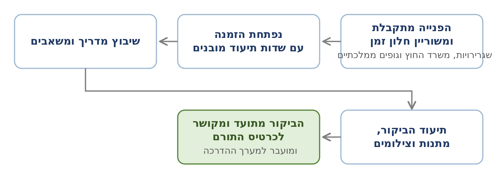

<!-- generated from: אפיון יד ושם מודול הזמנות חלק 2 מאושר 06-10 .docx | 2026-11-08 | do not edit by hand; regenerate from the docx -->

> **מקור:** מסמך 2 - תהליכי ההזמנות, גרסה מאושרת, 6.10.2026  
> **מיקום בניווט:** מסמך 2 - תהליכי ההזמנות › תהליכים עסקיים › ביקורים רשמיים ותיעוד ביקורי תורמים  
> **הקודם:** [הזמנות צבא, כוחות הביטחון ומשלחות](05-army-security-delegations.md) · **הבא:** [ניידות חינוכיות](07-educational-mobile-units.md) · [מקרא](../../INDEX.md)

# ביקורים רשמיים ותיעוד ביקורי תורמים ⟦💬 c397⟧

## תיאור התהליך

התהליך מכסה שתי אוכלוסיות ביקור בעלות מאפיינים ייחודיים: ביקורים רשמיים וביקורי תורמים. ביקורים רשמיים מגיעים ישירות משגרירויות, ממשרד החוץ, מהכנסת ומגופים ממלכתיים, ומשויכים לאגף ההנצחה, כאשר חלקם נפתחים גם במערכת המקוונת באמצעות סיור ייעודי, בעוד ביקורי אגף קש"ח משויכים לאגף קש"ח ונפתחים ידנית בתה"ל בלבד; רכזות אגף קשרי הקהל מתפעלות את הזמנות כלל אגפי יד ושם, למעט אגף בית הספר ואגף קש"ח.  ⟦💬 c399⟧הזמנות אגף קש"ח אינן נכנסות דרך המערכת המקוונת: מתוך 29 הזמנות האגף לשנת 2026, כולן נפתחו ידנית. גם במערכת החדשה ההזמנות ייפתחו בהזנה ידנית, בפנייה ישירה של הגורם המזמין.

לביקורים הרשמיים מאפיין תפעולי ייחודי: תיעדוף על פני הזמנות קיימות. המדור תופס חלונות זמן קיימים גם כאשר אין מקום פנוי, ומבקש מהזמנות אחרות לפנות מקום, תהליך המתבצע כיום בפנייה אישית. בנוסף, ביקור VIP פתאומי עשוי לחייב סגירה של האתר או המוזיאון לפרק זמן של 24 עד 72 שעות. במקרה זה ההזמנות המושפעות אינן מבוטלות אלא מושהות (Hold): הכסף נשמר, שיבוצי המשאבים הפיזיים משוחררים, שיבוצי נותני השירות נשמרים ואינם מתבטלים אוטומטית אף לא באופן זמני, ההזמנה מסומנת דרוש טיפול בשיבוצים והטיפול בהם ידני, וההזמנה מתעדכנת לתאריך חדש. תרחיש זה הוא חלק מצורך רוחבי של צוותי התפעול בכלי עריכה והשהיה של הזמנות בכמויות באירועי חירום, כדוגמת מלחמה, ביקורי ראשי מדינה וביטולי הצגות. מנגנון ההשהיה והעריכה בכמויות מפורט בפרק [ביטול, זיכוי והחזר ללקוחות מוסדיים](../../doc3-events-finance/05-processes/11-institutional-cancel-credit-refund.md), פרק [ביטול, זיכוי והחזר ללקוחות מוסדיים](../../doc3-events-finance/05-processes/11-institutional-cancel-credit-refund.md), וחסימת התאריכים לכלל הקהלים מפורטת בפרק 12.12 ויסות ונעילה רב-רמתית. ימי ביקור רשמי נלקחים בחשבון גם בוולידציית התאריכים של הזמנות התלמידים, לצד חגים וימי סגירה.

הכשל המרכזי במצב הקיים הוא שהמידע הניהולי על הביקור נשמר בהערות פנימיות חופשיות בתה"ל ואינו ניתן לחיפוש או להפקת דוחות. המערכת החדשה עוברת לתיעוד מובנה. בהתאם להנחיית הצוות, השדות הייעודיים הקיימים כבר היום נשמרים: שם מבקר (טקסט חופשי), תפקיד המבקר (טקסט חופשי, שינוי שם מהשדה "תפקיד"), מתנה שקיבל המבקר (טקסט חופשי, שינוי שם מהשדה "מתנה שקיבל"), טקס (סימון V) ואחמ (סימון V). לצדם מתווספים השדות: תאור המבקר (בחירה מרשימה: שגריר, שגריר חדש, נשיא, מלך/נסיך/קיסר, ראש ממשלה, קנצלר, משרד החוץ, תורם, תורם פוטנציאלי, אחר), סטטוס ביקור (בחירה מרשימה: ביקור ראשון, ביקור חוזר), פגישה (סימון V) וצילום הביקור (סימון V). בנוסף, שדה ההזמנה "מחלקה אחראית" משנה את שמו ל"מחלקה משותפת להזמנה", ובמסך ההזמנה רשימת המדינות מאפשרת בחירה של יותר ממדינה אחת, עד 10 מדינות. לאחר הביקור מצורפים לתיעוד תמונות מהצלם, פירוט המתנות שניתנו ורשימת המשתתפים, וכחלק מהתהליך ממולא טופס עם שמות המגיעים, לצורכי תיעוד ומתן הטבות.

ביקורי תורמים מנוהלים על ידי מחלקת קש"ח, האחראית על קשרי התורמים ועל תיעוד ביקוריהם ביד ושם. התהליך מתחיל בתכנון פנימי של הביקור: לוז ספציפי לכל תורם, פירוט הפגישות, מי מקבל את התורם ומה הוא מבצע במהלך היום. תיעוד זה הוא הבסיס של המחלקה ומשמש להצגת תמונת 360 של פעילות התורם. רק כאשר נדרשים משאבי הדרכה, מדריך בשפת התורם, חדר VIP או סיורים מודרכים, נפתחת ההזמנה התפעולית מול מערך ההדרכה, בדומה לכל הזמנה אחרת.

תפעולית, ביקור תורם אינו שונה מביקור אחר, פרט להגדרת מדריך לפי שפת התורם ולהערות פנימיות בין מתאמי המחלקה לצוות ההדרכה. הצורך מהמערכת החדשה הוא שהתיעוד הפנימי של הביקור ייווצר בתוך Salesforce, באובייקט ייעודי שיוגדר ,יקושר לכרטיס התורם, ומכל ביקור ניתן יהיה לעבור להזמנה התפעולית המקושרת ולהפך, כך שהמחלקה לא תעבוד במספר מערכות במקביל.

אופן המימוש המפורט של תיעוד הביקור הרשמי, לרבות סט השדות המובנה, כללי התיעדוף וקישור ביקור התורם להזמנה התפעולית, מאופיין לפני יישום מודול זה בתיאום עם אגף קשרי  ⟦💬 c400⟧קהל.

תרשים תהליך 06 - ביקורים רשמיים ותיעוד ביקורי תורמים

---

## הערות סקירה בפרק זה

> הערות הסקירה אינן חלק מהאפיון המחייב. הן מסמנות מקומות שבהם הטקסט עדיין בדיון. הסימון ⟦💬 cN⟧ בגוף הטקסט מפנה להערה כאן.

### ⟦💬 c397⟧ סגורה
- **c397** · שגיא תומר · 2026-09-06 · סומנה כסגורה: אוקיי - יש התייחסות להערה הקודמת שלי

### ⟦💬 c399⟧ סגורה
- **c399** · טל שמרית · 2026-09-06 · סומנה כסגורה: מדייקת: ביקורים רשמיים ומשלחות VIP  קשורים לאגף הנצחה, חלקם נפתחים במערכת המקוונת. יש להם סיור ייעודי לכך. / בעוד ביקורי קש"ח שייכים לאגף אחר, אגף קש"ח, וכל ההזמנות נפתחות ידנית בתה"ל.

### ⟦💬 c400⟧ סגורה
- **c400** · Miri Yahud · 2026-09-06 · סומנה כסגורה: נדרש להגדיר אוטומציות לתהליך, כגון: פתיחת בקשה, ניתוב לרכזת וכו'
  - **c401** · Lior Pridor · 2026-09-14 · סומנה כסגורה: תהליך זה משתמש באותן אוטומציות החלות על כל הזמנה במערכת: פתיחת הבקשה, ניתוב אוטומטי לרכזת האחראית, עדכון סטטוס ומשלוח התראות. אין צורך באוטומציות ייעודיות נוספות, והפירוט מופיע בפרק האוטומציות של ההזמנות.
