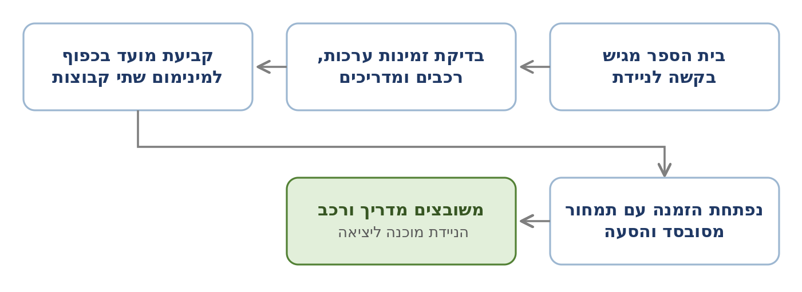

<!-- generated from: אפיון יד ושם מודול הזמנות חלק 2 מאושר 06-10 .docx | 2026-11-08 | do not edit by hand; regenerate from the docx -->

> **מקור:** מסמך 2 - תהליכי ההזמנות, גרסה מאושרת, 6.10.2026  
> **מיקום בניווט:** מסמך 2 - תהליכי ההזמנות › תהליכים עסקיים › ניידות חינוכיות  
> **קודי ולידציה ואוטומציה בפרק:** A07-01, A07-02, A07-03, A07-04, A07-05, A07-06  
> **הקודם:** [ביקורים רשמיים ותיעוד ביקורי תורמים](06-official-visits-donors.md) · **הבא:** [הצעת מחיר, הנחות ואישור](08-quote-discounts-approval.md) · [מקרא](../../INDEX.md)

# ניידות חינוכיות

## תיאור התהליך

ניידות חינוכיות הן ערכות חינוכיות הנשלחות לבתי ספר, והפעילות מתקיימת אצל המזמין ולא ביד ושם. התהליך נפתח בבקשת בית הספר ומנוהל על ידי רכזת הניידות. הדגם העסקי הוא בקשה ולא הזמנה אוטומטית: בית הספר מגיש בקשה, ורק לאחר בדיקת זמינות משולבת של שלושה משאבים, ערכות, רכבים ומדריכים, נקבע מועד ונפתחת ההזמנה. תנאי סף לקיום הפעילות הוא מינימום שתי קבוצות, והתמחור כולל סבסוד והסעה. הדרישה העסקית לתמחור ולסבסוד נכתבת בפרק זה, והמנגנון הכספי המלא מפורט בפרקי הכספים במסמך 3 (הפקת חשבון, ביטולים וזיכויים), ובנספח התשלומים.

במצב הקיים הניידות החינוכיות נמנות עם הפעילויות הנכנסות בהזנה ידנית בלבד, ואינן זמינות להזמנה במערכת המקוונת. אופן קידום הניידות למערכת המקוונת יתבצע מחוץ לפרויקט  ⟦💬 c404⟧הנוכחי.

טאב ניהול ניידות חינוכיות יכלול שדות בסיסיים בלבד (ללא תהליכים יעודיים).

## אוטומציות

| מזהה | טריגר | הפעולה האוטומטית |
| --- | --- | --- |
| A07-01 | הגשת בקשת ניידת על ידי בית ספר | נוצרת בקשה בסטטוס ממתין לבדיקת זמינות והיא מנותבת לרכזת הניידות; הזמנה אינה נפתחת אוטומטית |
| A07-02 | פתיחת הבקשה על ידי רכזת הניידות | המערכת מציגה את זמינות שלושת המשאבים בטווח התאריכים המבוקש: יחידות הערכה, רכבי ההסעה והמדריכים |
| A07-03 | מספר הקבוצות בבקשה קטן משתי קבוצות | הבקשה מסומנת כאינה עומדת בתנאי הסף, ואישורה מחייב אישור חריג |
| A07-04 | הגעה למספר המרבי של יציאות ניידת ליום, כמוגדר במוצר הניידת | הניידת אינה מוצגת כזמינה לאותו תאריך |
| A07-05 | אישור הבקשה על ידי רכזת הניידות | נפתחת הזמנה עם יום פעילות במקום המזמין, ומשוריינים הערכה, רכב ההסעה והמדריכים למועד שנקבע |
| A07-06 | קביעת מקום הפעילות בבקשה | מחיר הפעילות והסבסוד נשלפים מהמחירון לפי אזור הפעילות, ולהזמנה נוספת שורת  ⟦💬 c406⟧ההסעה |

תרשים תהליך 07 - ניידות חינוכיות

---

## הערות סקירה בפרק זה

> הערות הסקירה אינן חלק מהאפיון המחייב. הן מסמנות מקומות שבהם הטקסט עדיין בדיון. הסימון ⟦💬 cN⟧ בגוף הטקסט מפנה להערה כאן.

### ⟦💬 c404⟧ סגורה
- **c404** · וייל דבורה · 2026-09-03 · סומנה כסגורה: מדוע??
  - **c405** · טל שמרית · 2026-09-06 · סומנה כסגורה: בשל המורכבות, כרגע הוא יפותח במערכת המקוונת בתור בקשה ולא בתוך הזמנה סגורה. / זה כבר שיפור, אולי בעתיד נמצא פתרון יעיל יותר

### ⟦💬 c406⟧ ממתינה למענה מלם
- **c406** · וייל דבורה · 2026-09-03: יש טאב שלם בהזמנה לניהול ניידות, צריך להיות מוצג רק עבור ניידות כולל כל השדות: בחירת ציוד, הסעות,רשימת תחנות ומדריכים, ודוח לנהג
  - **c407** · Lior Pridor · 2026-09-27: פרק ניידות חינוכיות מגדיר את הבקשה, בדיקת הזמינות, התמחור וההסעה ברמת ההזמנה. טאב ייעודי בהזמנה לניהול הניידות, הכולל בחירת ציוד, הסעות, רשימת תחנות ומדריכים ודוח לנהג, חורג מהמתואר בפרק ואינו כלול במענה למכרז. נשמח לקבל את פירוט השדות והתהליך ולהעביר הערכת היקף.
  - **c408** · אשבל אור · 2026-09-28: מדובר בתהליך ידני לחלוטין. כלל השדות הועברו. מדובר על תהליך שהרכזת ממלאה ידנית לרוב מרשימה סגורה. מדוע הדבר לא נכלל כחלק מהתכולה?
  - **c409** · אשבל אור · 2026-10-06: טאב ניידות חינוכיות לא יכלול תהליכים. מדובר על שדות בסיסיים בלבד.
