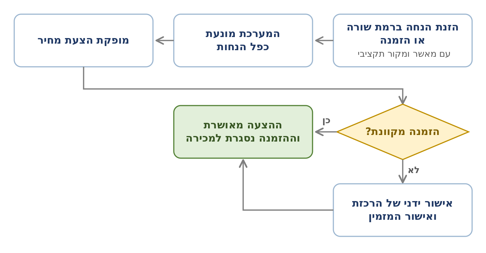

<!-- generated from: אפיון יד ושם מודול הזמנות חלק 2 מאושר 06-10 .docx | 2026-11-08 | do not edit by hand; regenerate from the docx -->

> **מקור:** מסמך 2 - תהליכי ההזמנות, גרסה מאושרת, 6.10.2026  
> **מיקום בניווט:** מסמך 2 - תהליכי ההזמנות › תהליכים עסקיים › הצעת מחיר, הנחות ואישור  
> **קודי ולידציה ואוטומציה בפרק:** A08-01, A08-02, A08-03, A08-04, A08-05, A08-06, A08-07, V08-01, V08-02, V08-03, V08-04, V08-05  
> **הקודם:** [ניידות חינוכיות](07-educational-mobile-units.md) · **הבא:** [שיבוץ מדריכים ומשאבים](09-guide-resource-scheduling.md) · [מקרא](../../INDEX.md)

# הצעת מחיר, הנחות ואישור

## תיאור התהליך

בהתאם להנחיית הצוות, המונח המחייב במערכת החדשה הוא אישור הזמנה ולא הצעת מחיר: אין יותר הצעות מחיר כמסמך נפרד, והמסמך היוצא למזמין הוא אישור הזמנה. ניתן להחליט אם אישור ההזמנה כולל מקום לחתימה או לא, אם הוא כולל פירוט כספי ואם הוא כולל לוז, וניתן לשלוח את אישור ההזמנה הסופי ללא מקום לחתימה. החתימה על אישור ההזמנה אינה מחייבת משפטית, והיא משמשת אישור בלבד. תכתובת מייל עם המזמין ניתנת לצירוף לצרופות ההזמנה כאסמכתא. אישור ההזמנה מופק בשפת הטופס של ההזמנה, עברית או אנגלית, בהתאם לשפה שבה בוצעה  ⟦💬 c412⟧ההזמנה, וכך גם החשבון הנגזר ממנה; להחזרת אישור חתום ולתשלום החשבון פועלות תזכורות אוטומטיות ויזומות בשתי השפות (מפורט בפרק 12.14 תזכורות ותקשורת יזומה). השדה "התקבל אישור חתום" הוא שדה הבקרה המרכזי: כאשר נשלח אישור הזמנה ללא מקום לחתימה, השדה מסומן V ישירות, בדיוק כפי שהזמנה הנכנסת מהמערכת המקוונת נכנסת עם סימון זה, ורק להזמנות המסומנות V בשדה זה המערכת יכולה להפיק חשבון. מנגנון הפקת החשבון עצמו מפורט בפרק [הפקת חשבון וחיוב לקוח מול אלמוג](../../doc3-events-finance/05-processes/09-almog-invoicing-billing.md) שבמסמך 3. שפת ההזמנה ניתנת לעריכה בכל שלב, וכל מסמך המופק לאחר השינוי מופק בשפה העדכנית. בהזמנה שנפתחה ללקוח ולא התקבל בה אישור, מוגדר תוקף: הזמנה בסטטוס פתוח שחלף תאריך התוקף שלה מבוטלת אוטומטית בריצה יומית, שיבוצי המשאבים הפיזיים ששוריינו עבורה משוחררים ונרשמת סיבת ביטול; שיבוצי נותני השירות, ככל שקיימים, נשמרים ואינם מבוטלים אוטומטית, ההזמנה מסומנת דרוש טיפול בשיבוצים והשחרור ידני בלבד. המנגנון נועד למצב שבו נשלחות ללקוח כמה חלופות לאותו ביקור, והלקוח בוחר אחת מהן.

התהליך מבוצע על ידי הרכזות במחלקות עבור הזמנות הנפתחות ידנית, ובאופן אוטומטי בהזמנה מקוונת. בקהל הרחב, התיאום והתמחור מתרחשים כחלק מפתיחת ההזמנה עצמה. סוג הקהל הוא שדה חובה בכל המערכת: בהזמנה מקוונת הוא מתמלא לבד, בהזמנה ידנית חובה למלאו, והוא משפיע ישירות על התמחור בשלב אישור ההזמנה. מחיר המוצר נגזר מהמחירון לפי קהל ולפי מיקום הפעילות. להזמנה יכולים להיות מספר ימי פעילות, ולכל יום פעילות יכולה להיות הצעת מחיר שונה, ואילו המסגרת התקציבית היא אחת לכל ההזמנה, ללא תלות במספר ימי הפעילות.

המערכת תומכת בהנחות בשלוש רמות, שורת הצעת מחיר, יום פעילות והזמנה, ללא כפל, כל אחת  ⟦💬 c414⟧עם מאשר ומקור תקציבי, ומתן הנחה כפוף להרשאות המשתמש.  ⟦💬 c416⟧סוגי ⟦💬 c417⟧ ההנחה: הנחה בשורת הצעת מחיר היא תמיד באחוזים (המחיר לאחר הנחה שווה למחיר המלא כפול היתרה באחוזים), והנחה על ההזמנה כולה היא תמיד בסכום (המחיר לאחר הנחה שווה למחיר המלא פחות סכום ההנחה); סוג ההנחה ברמת יום הפעילות ייקבע לאחר אישורכם. הנחת משרד החינוך והנחת מהשואה לתקומה אינן בשימוש בשנתיים האחרונות ואינן נכללות במערכת החדשה. בנוסף פועל מנגנון זוגות מוצרים (RightToDiscount): כאשר קיימים באותו יום מוצר נותן הנחה ומוצר מקבל הנחה, מוצר המקבל מקבל את ההנחה אוטומטית, והסרת המוצר הנותן מאפסת את ההנחה. במוצר דמי הרשמה המחיר נקבע לפי שעת ההתחלה של הביקור, בטווחי שעות מוגדרים, ומוסד המסומן כזכאי להנחת דמי הרשמה מקבל עליהם 100 אחוז הנחה אוטומטית. בנוסף, הזמנה הכוללת הדרכה של מדריך יד ושם או השכרת הדרכה קולית (אודיו גייד) מזכה בהנחה של 20 אחוז על דמי ההרשמה והטיפול בלבד, בכל שעות היום ובהתאמה לשעת הביקור המוזמנת. בכל הנחה, בשורה או בהזמנה, שדות מאשר ההנחה והתמיכה להנחה הם שדות חובה, ומוצג חיווי של ערך ההנחה באחוזים ובשקלים כאחד. סימון התמיכה (המקור התקציבי) נקבע ברמת ההזמנה ומחלחל ליום הפעילות ולשורות הצעת המחיר, וניתן לשנות את שם התומך בכל אחת מהרמות.

לאחר הפקת חשבון על סכום מסוים, כל שורות ההזמנה שנכללו בו מקבלות חיווי כי הופק עבורן חשבון, ואינן ניתנות לעריכה, לשמירת התאמה מלאה למערכת הנהלת החשבונות. אופן הטיפול בשינוי לאחר הפקת חשבון, ובכללו תוספת שורות, ביטול חשבון שטרם שולם, זיכויים, לינקים לתשלום ותשלום בפריסה, מפורט במסמך 3, בפרקי הכספים (הפקת חשבון, ביטולים וזיכויים).

סטטוס התשלום מנוהל בשלוש רמות: שורת הצעת מחיר, יום פעילות והזמנה. כל הנחה בשורת הצעת המחיר מעדכנת את השורה ואת הסך הכולל, וכל שינוי בסטטוס ברמת השורה מתעדכן כלפי מעלה, ליום הפעילות ולהזמנה. לדוגמה, הוספת שורה להזמנה של לקוח פרטי ששולמה יוצרת שורה בסטטוס טרם שולם, ויום הפעילות וההזמנה עוברים לסטטוס שולם חלקית; בהזמנה של מוסד, ימי פעילות בסטטוס הופק חשבון עוברים לסטטוס הופק חשבון חלקי. כל שינוי המשפיע על המחיר מביא לחישוב מחדש של סטטוס התשלום.

## שלבי  ⟦💬 c419⟧התהליך

1. נפתחת הזמנה, ידנית על ידי הרכזת או במערכת המקוונת, עם מילוי סוג הקהל המשפיע על התמחור, ומחירי המוצרים נשלפים מהמחירון לפי קהל ומיקום פעילות.

2. בהזמנה מרובת ימי פעילות נבנה תמחור נפרד לכל יום פעילות, תחת מסגרת תקציבית אחת להזמנה.

3. הרכזת מזינה הנחה ברמת שורה או ברמת הזמנה,  ⟦💬 c420⟧עם מאשר ההנחה והתמיכה להנחה, בכפוף להרשאותיה, ⟦💬 c421⟧ והמערכת מונעת כפל הנחות.

4. המערכת מחשבת את המחיר לאחר הנחה לפי סוג ההנחה (אחוז בשורת הצעת מחיר, סכום בהזמנה) ומחילה אוטומטית הנחות זוגות מוצרים והנחות דמי הרשמה.

5. מופק אישור הזמנה, עם או בלי מקום לחתימה, עם או בלי פירוט כספי ולוז, ונשלח למזמין.

6. בהזמנה מקוונת האישור אוטומטי והשדה התקבל אישור חתום מסומן V; בהזמנה ידנית השדה מסומן עם קבלת אישור חתום, או ישירות כאשר נשלח אישור ללא מקום לחתימה, עם אפשרות לצרף את תכתובת המייל כאסמכתא.

7. עם אישור המזמין ההזמנה נסגרת למכירה, והפקת חשבון מתאפשרת רק להזמנות המסומנות בשדה התקבל אישור חתום (פרק הפקת חשבון וחיוב מול אלמוג).

8. שינוי לאחר הפקת חשבון מטופל לפי הכללים המפורטים במסמך 3, בפרקי הכספים.

## ישויות ושדות בתהליך

| ישות | תפקיד בתהליך | שדות ייעודיים לתהליך |
| --- | --- | --- |
| הזמנה (Opportunity) | נשא ההנחות, הסכומים והאישור | סוג קהל (חובה, אחד מהתנאים המרכיבים את המסגרת התקציבית ואינו מתמחר בפני עצמו; המסגרת התקציבית היא הנושאת את המחירון והיא המשפיעה על התמחור), התקבל אישור חתום, הנחה ברמת הזמנה עם מאשר ומקור תקציבי, סטטוס כספי ⟦💬 c423⟧ |
| פריט הזמנה (Opportunity Product) | שורת המוצר והתמחור, לרבות הנחה ברמת שורה | סוג הנחה (אחוז בשורת הצעת מחיר, סכום בהזמנה), מאשר ההנחה, חיווי הופק חשבון (חוסם עריכה) |
| מחירון (Price Book) | מקור המחיר לפי קהל ומיקום פעילות | ⟦💬 c425⟧מחיר המוצר נגזר מהמסגרת התקציבית, כאשר המסגרת היא תוצאה של צירוף התנאים (קהל, שכבת גיל, מיקום, שעות, מוזיאון, גפן) והיא הנושאת את המחירון |
| מוצר (Product) | הגדרת מוצרי הנחה וזוגות מוצרים | נותן הנחה ומקבל הנחה (RightToDiscount), מחיר דמי הרשמה לפי טווחי שעת התחלה |
| מסגרת תקציבית | מקור תקציבי לסבסוד ולהנחה, אחת לכל הזמנה | הסעיף שאליו מנותב החיוב, מסגרת אחת לכל הזמנה; מתמלאת אוטומטית בהזמנה מקוונת ומשפיעה על התמחור בשלב הצעת המחיר |
| ארגון (מוסד) | מאפייני המוסד המשפיעים על החיוב | זכאות להנחת דמי הרשמה, ללא חיוב |

## כללי ולידציה

| מזהה | הכלל | הודעת שגיאה |
| --- | --- | --- |
| V08-01 | לא ניתן להזין הנחה ברמת ההזמנה כאשר קיימת הנחה ברמת שורה, ולהפך, אין כפל הנחות | לא ניתן לשלב הנחת הזמנה עם הנחת שורה |
| V08-02 | לא ניתן לשמור הנחה ללא מאשר וללא מקור תקציבי | הנחה מחייבת מאשר הנחה ותמיכה להנחה, למעט הנחה אוטומטית הנובעת ממוצר מזכה הנחה, כדוגמת הנחת 20 אחוז על דמי ההרשמה והטיפול בעקבות רכישת שירות הדרכה ⟦💬 c428⟧ |
| V08-03 | מתן הנחה כפוף להרשאות המשתמש | אין לך הרשאה למתן הנחה בגובה זה |
| V08-04 | לא ניתן להפיק חשבון להזמנה שהשדה התקבל אישור חתום אינו מסומן בה | הפקת חשבון מחייבת סימון התקבל אישור חתום |
| V08-05 | שורת הזמנה שהופק עבורה חשבון או שסטטוס התשלום שלה שולם חסומה לעריכה; שינוי מתבצע בהוספת שורות, בביטול חשבון שטרם שולם או בלינק תשלום על  ⟦💬 c434⟧הפרש | הופק חשבון לשורה זו, לא ניתן לערוך אותה ישירות |

## אוטומציות

| מזהה | טריגר | הפעולה האוטומטית |
| --- | --- | --- |
| A08-01 | הזמנה נקלטת מהמערכת המקוונת | אישור ההזמנה אוטומטי וסימון V בשדה התקבל אישור חתום |
| A08-02 | הזנה או עדכון של הנחה בשורה | חישוב המחיר לאחר הנחה לפי סוג ההנחה: אחוז בשורת הצעת מחיר, סכום בהזמנה |
| A08-03 | קיום מוצר נותן הנחה ומוצר מקבל הנחה באותו יום | החלת הנחת RightToDiscount על המוצר המקבל; הסרת המוצר הנותן מאפסת את ההנחה |
| A08-04 | הזמנה של מוסד המסומן כזכאי להנחת דמי הרשמה | הנחת 100 אחוז אוטומטית על מוצר דמי ההרשמה |
| A08-05 | בחירת שעת התחלה לביקור | קביעת מחיר מוצר דמי ההרשמה לפי טווח שעת השיבוץ לכניסה למוזיאון, ⟦💬 c436⟧ והחלת הנחת 20 אחוז על דמי ההרשמה כאשר ההזמנה כוללת הדרכה של מדריך יד ושם או אודיו גייד |
| A08-06 | הזמנה של מוסד המסומן ללא חיוב | ההזמנה אינה מגיעה למסך הכנת החשבונות (פרק הפקת חשבון וחיוב מול אלמוג) |
| A08-07 | הוספת מוצר להזמנה ששולמה | שליחת לינק לתשלום על ההפרש, בתמיכת ריבוי לינקים וריבוי חשבוניות |

## אוטומציות מרכזיות, מפרט מימוש

### מנוע חישוב ההנחות

| טריגר | הזנה, עדכון או הסרה של הנחה או של מוצר משפיע הנחה בהזמנה (לפני שמירה) |
| --- | --- |
| שלבים | 1. זיהוי רמת ההנחה, שורה או הזמנה, ובדיקת מניעת כפל: לא מתאפשר שילוב של שתי הרמות. 2. בדיקת הרשאת המשתמש למתן ההנחה, וחובת מילוי מאשר ומקור תקציבי. 3. חישוב המחיר לאחר הנחה לפי סוג ההנחה: אחוז בשורת הצעת מחיר, סכום בהזמנה. 4. סריקת זוגות המוצרים באותו יום: קיום מוצר נותן הנחה מחיל הנחה אוטומטית על המוצר המקבל, והסרתו מאפסת אותה. 5. בדיקת דמי ההרשמה והטיפול: הזמנה הכוללת הדרכה של מדריך יד ושם או אודיו גייד מקבלת 20 אחוז הנחה על דמי ההרשמה והטיפול בלבד. 6. עדכון סכום ההזמנה הכולל, לרבות תמחור נפרד לכל יום פעילות בהזמנה מרובת ימים. |
| בדיקת קבלה | הנחה של 10 אחוז בשורת הצעת מחיר של 1,000 מחושבת לתשלום של 900 ומוצג חיווי של 100 שקלים; הסרת מוצר נותן הנחה מאפסת את הנחת המוצר המקבל באותו יום |

### אישור הזמנה וסימון התקבל אישור חתום

| ⟦💬 c438⟧טריגר | הפקת אישור הזמנה מההזמנה, או קליטת הזמנה מהמערכת המקוונת (אחרי שמירה) בנוסף, בכל עת ניתן להפיק אישור הזמנה מעודכן בלחיצה על הפק אישור הזמנה ולשלחו במייל לאיש הקשר. |
| --- | --- |
| שלבים | 1. מופק מסמך אישור ההזמנה בהתאם להגדרות: עם או בלי מקום לחתימה, עם או בלי פירוט כספי ולוז, ונשלח למזמין. 2. בהזמנה מקוונת, ובאישור הזמנה שנשלח ללא מקום לחתימה, השדה התקבל אישור חתום מסומן V אוטומטית. 3. באישור עם מקום לחתימה, השדה מסומן עם קבלת האישור החתום מהמזמין, ותכתובת המייל ניתנת לצירוף לצרופות כאסמכתא. 4. הפקת חשבון מתאפשרת רק להזמנות המסומנות V בשדה, בהתאם לפרק הפקת חשבון וחיוב מול אלמוג. |
| בדיקת קבלה | הזמנה ידנית שנשלח בה אישור ללא מקום לחתימה מסומנת אוטומטית בהתקבל אישור חתום וניתנת להפקת חשבון; הזמנה ללא הסימון חסומה להפקת חשבון |

תרשים תהליך 08 - הצעת מחיר, הנחות ואישור

---

## הערות סקירה בפרק זה

> הערות הסקירה אינן חלק מהאפיון המחייב. הן מסמנות מקומות שבהם הטקסט עדיין בדיון. הסימון ⟦💬 cN⟧ בגוף הטקסט מפנה להערה כאן.

### ⟦💬 c412⟧ סגורה
- **c412** · וייל דבורה · 2026-09-03 · סומנה כסגורה: כמובן השפה ניתנת לעריכה בכל שלב, והפקת מסמכים לאחר שינוי השפה יקח את השפה העדכנית
  - **c413** · Lior Pridor · 2026-09-14 · סומנה כסגורה: שפת ההזמנה נקבעת ברמת ההזמנה וחלה על כל הקבוצות כברירת מחדל, עם אפשרות חריגה ידנית לקבוצה בודדת. השדה ניתן לעריכה בכל שלב, וכל הפקת מסמך מתבצעת בשפה העדכנית במועד ההפקה.

### ⟦💬 c414⟧ סגורה
- **c414** · אשבל אור · 2026-09-22 · סומנה כסגורה: נדרש סימון ברמת ההזמנה שיחלחל ליום הפעילות ושורות הצעת המחיר. ניתן לשנות בכל אחד מהרמות את שם התומך (המקור התקציבי) הנחה אפשרית בשלוש הרמות: שורת הצעת מחיר, יום פעילות, הזמנה
  - **c415** · Lior Pridor · 2026-09-23 · סומנה כסגורה: מקובל ועודכן: ההנחה תתאפשר בשלוש רמות, שורת הצעת מחיר, יום פעילות והזמנה, והתומך יסומן ברמת ההזמנה ויחלחל לרמות שמתחתיה, עם אפשרות שינוי בכל רמה. נבקש לאשר את סוג ההנחה ברמת יום הפעילות: לפי הערת דבורה, הנחה בשורה היא באחוזים והנחה להזמנה כולה בסכום.

### ⟦💬 c416⟧ סגורה
- **c416** · טל שמרית · 2026-09-06 · סומנה כסגורה: בשנתיים האחרונות אין לנו את ההננות האלה בשל המורכבות של התפעול מול בתי הספר, ייתכן וצריך שתהיה את האופציה אולי בעתיד. כרגע אין.

### ⟦💬 c417⟧ סגורה
- **c417** · טל שמרית · 2026-09-06 · סומנה כסגורה: סבסוד= הנחה. / את ההנחה ניתן לתת בשני אופנים, / במידה והיא בשורת הצעת המחיר- הנחה באחוזים (כולל חיווי כמה זה יוצא בשקלים) / במידה וההנחה היא להזמנה כולה, ניתן לתת הנחה בסכום (כולל חיווי כמה זה יצא באחוזים. / במערכת פריוריטי רק כך ניתן לתת הנחות. / בשונה מהמערכת שייש לנו כיום ניתן גם בשורת הצעת המחיר וגם בהזמנה כולה לתת הנחה גם באחוזים וגם בסכום. / ברגע שנותנים הנחה ולא משנה אם בשורת הצעת המחיר או בהזמנה כולה, חייב למלא את שם מאשר ההנחה, וג התמיכה להנחה. אלו שדות חובה כאשר יש הנחה.

### ⟦💬 c419⟧ סגורה
- **c419** · Miri Yahud · 2026-09-06 · סומנה כסגורה: יש לשים לב שלעיתים רכזות ישלחו מספר הזמנות ללקוח (הצעות מחיר) לאותם מועדים או מועד אחר, והלקוח יבחר אחד מהם. במקרה כזה יש לחול מנגנון של ביטול הזמנות "פתוחות" שהתוקף פג

### ⟦💬 c420⟧ סגורה
- **c420** · טל שמרית · 2026-09-06 · סומנה כסגורה: "מאשר ההנחה"

### ⟦💬 c421⟧ סגורה
- **c421** · טל שמרית · 2026-09-06 · סומנה כסגורה: "תמיכה להנחה"

### ⟦💬 c423⟧ סגורה
- **c423** · טל שמרית · 2026-09-06 · סומנה כסגורה: המסגרת התקציבית משפיעה על התמחור. / לכל מסגרת תקציבית יש סימון עפ"י איזה מחירון להשתמש במסגרת זו.
  - **c424** · Lior Pridor · 2026-09-14 · סומנה כסגורה: תוקן במסמך: המסגרת התקציבית היא הנושאת את המחירון והיא המשפיעה על התמחור, וסוג הקהל הוא אחד מהתנאים המרכיבים את המסגרת התקציבית ואינו מתמחר בפני עצמו.

### ⟦💬 c425⟧ סגורה
- **c425** · טל שמרית · 2026-09-06 · סומנה כסגורה: מקושר למסגרת התקציבית
  - **c426** · Lior Pridor · 2026-09-14 · סומנה כסגורה: תוקן במסמך: מחיר המוצר נגזר מהמסגרת התקציבית, כאשר המסגרת היא תוצאה של צירוף התנאים (קהל, שכבת גיל, מיקום, שעות, מוזיאון, גפן) והיא הנושאת את המחירון.

### ⟦💬 c428⟧ סגורה
- **c428** · וייל דבורה · 2026-09-03 · סומנה כסגורה: בהנחות האוטומטיות של מוצר מזכה הנחה- צריך לאפשר ללא מאשר הנחה
  - **c429** · טל שמרית · 2026-09-06 · סומנה כסגורה: נכון. כמו במצב של הדרכה+ דמי הרשמה וטיפול. אז דמי ההרשמה והטיפול מקבלים 20% הנחה מכיוון שהלקוח קיבל שירות הדרכה כלשהו.
  - **c430** · Lior Pridor · 2026-09-14 · סומנה כסגורה: נושא ההנחות והתמיכות נדון בפגישה ולא נסגר. עמדתנו היא מימוש ברמת שדה ולוגיקה ולא כישות ייעודית, וכן שבהנחה אוטומטית הנגזרת ממוצר מזכה לא יידרש מאשר הנחה; מיקום אחסון נתוני ההנחה והתנאים ייסגר בדיון ייעודי.
  - **c431** · אשבל אור · 2026-09-22 · סומנה כסגורה: להחלטת מלם לגבי אופן היישום של הנחה
  - **c432** · Lior Pridor · 2026-09-23 · סומנה כסגורה: עמדת מלם: ההנחה ממומשת ברמת שדה ולוגיקה ולא כישות ייעודית. מוצר מזכה הנחה ומוצר מקבל הנחה מוגדרים בנתוני המוצר, ההנחה חלה אוטומטית כאשר שניהם באותו יום פעילות, והנחה אוטומטית זו אינה מחייבת מאשר הנחה ותמיכה, כמנוסח בכלל הוולידציה.
  - **c433** · אשבל אור · 2026-09-28 · סומנה כסגורה: איפה תוגדר ההנחה? נדרשת הבהרה

### ⟦💬 c434⟧ סגורה
- **c434** · וייל דבורה · 2026-09-03 · סומנה כסגורה: כנ"ל אם סטטוס תשלום שווה "שולם"

### ⟦💬 c436⟧ סגורה
- **c436** · וייל דבורה · 2026-09-03 · סומנה כסגורה: לא נכון, המחיר הוא לפי שעת השיבוץ למוזיאון ולא לפי שעת ההזמנה.

### ⟦💬 c438⟧ סגורה
- **c438** · וייל דבורה · 2026-09-03 · סומנה כסגורה: שליחת אישור הזמנה היא לא רק מטריגר זה, אלא בכל עת ניתן ללחוץ על "הפק אישור הזמנה" ונוצר  קובץ אישור הזמנה עדכני , ניתן לשלוח אותו במייל לאיש הקשר וכו'
