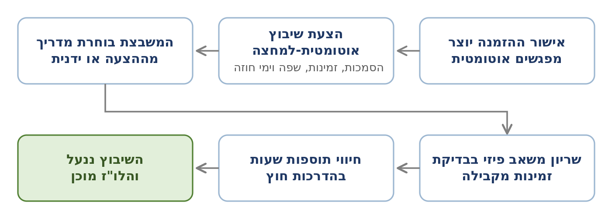

<!-- generated from: אפיון יד ושם מודול הזמנות חלק 2 מאושר 06-10 .docx | 2026-11-08 | do not edit by hand; regenerate from the docx -->

> **מקור:** מסמך 2 - תהליכי ההזמנות, גרסה מאושרת, 6.10.2026  
> **מיקום בניווט:** מסמך 2 - תהליכי ההזמנות › תהליכים עסקיים › שיבוץ מדריכים ומשאבים  
> **קודי ולידציה ואוטומציה בפרק:** A09-01, A09-02, A09-03, A09-05, A09-06, A09-07, A09-08, A09-09, A09-10, A09-11, A09-12, A09-13, A09-14, A09-15, V09-01, V09-02, V09-03, V09-04, V09-05  
> **הקודם:** [הצעת מחיר, הנחות ואישור](08-quote-discounts-approval.md) · **הבא:** [הדרכות חוץ, הדרכות כפולות וחישוב מרחק וזמן](10-external-double-tours-distance.md) · [מקרא](../../INDEX.md)

# שיבוץ מדריכים ומשאבים

## תיאור התהליך

תהליך השיבוץ הוא הליבה התפעולית של מודול ההזמנות, והוא מנוהל על ידי המשבצות לאחר אישור ההזמנה. מערך ההדרכה מבצע כ-1,000 עד 1,500 שיבוצי מדריכים בחודש למגוון רחב של קבוצות ופעילויות, והוא היחידה המשבצת את הנפח הגדול ביותר של ההזמנות. השיבוץ אינו מוגבל למדריכים בלבד: מסך השיבוצים משרת שיבוץ של כל סוגי נותני השירות, ובהם מרצים, עובדי יד ושם ואנשי עדות. מערך ההדרכה משבץ את קהלי הליבה (תלמידים, צבא שאינו בכירים וקהל רחב) וכן חלק מהזמנות מחלקות אחרות, בעוד מחלקות נוספות (מורים, סמינרים, קורסים, מגזר חרדי, בכירי ביטחון ועוד) משבצות עצמאית מתוך אותו מאגר מדריכים. אנשי עדות ומרצים משובצים על ידי הרכזים האחראים על הקבוצה.

מערך ההדרכה הוקם כמדור רוחבי בתוך מחלקת הדרכה וקהל רחב, והוא אחראי גם על הכשרת המדריכים, הסמכתם וניהול המיומנויות; בצוות פועלות ארבע משבצות, מתוכן שתי בנות שירות לאומי. עיקרון יסוד בכל שיבוץ הוא ההתאמה בין המוצר לנותן השירות: לכל מוצר מוגדרים כללי שיבוץ המגבילים את סוגי נותני השירות שניתן לשבץ אליו, ובחירת המוצר במסך השיבוץ מעלה רק את נותני השירות הרלוונטיים (מוצר עדות מציג אנשי עדות בלבד, מוצר הרצאה מציג מרצים בלבד).  ⟦💬 c441⟧עובד יד ושם גובר על כללי השיבוץ של מדריך ומרצה בלבד: כאשר מוצר מתיר שיבוץ מדריך או מרצה, ניתן לשבץ אליו גם בעל סטטוס עובד יד ושם. במוצר עדות ניתן לשבץ איש עדות בלבד ובמוצר הצגה שחקן בלבד, ובכל מוצר מוגדר איזה נותן שירות רשאי לתפעלו, למעט מוצרים שאינם מצריכים נותן שירות כדוגמת כיבוד והסעות.

במסכי השיבוץ מוצגים רק נותני שירות הרלוונטיים למוצר שנבחר, ובהיעדר הגבלת מוצר מוצגים כלל נותני השירות. המסך מאפשר סינון לפי זמינות במספר חתכים, מדריכי ה-25, יום חוזה, ומדריכים זמינים לפי הסמכות ולפי שפות, לצד הצגת מאפייני נותן השירות בעת הבחירה.

המערכת החדשה מממשת שיבוץ אוטומטי-למחצה: מנוע ההצעה מצליב את צורכי הקבוצה מול מטריצת ההסמכות, שפת ההדרכה, הזמינות המוצהרת, אי-חפיפה לשיבוצים קיימים וימי החוזה, ומציג הצעת שיבוץ. ההצעה מתחשבת גם במאפייני המוסד המזמין (למשל זיהוי שמדובר בבית ספר) ובהגדרת הקבוצה המוזנת בהזמנה: בהזמנת תלמידים, בעת הזנת הכיתות, נבחרת הגדרה ראשונית לקבוצה מתוך רשימה שיד ושם תגדיר, המאפשרת התאמת מדריך בעל ההסמכה המתאימה. ההצעה היא המלצה בלבד: אין שיבוץ סופי ללא אישור המשבצת או הרכז האחראי. השימוש בהצעה נתון לשיקול המשבצת ואינו חובה.

עבור אירועים מסוג השתלמויות, סמינרים, כנסים, קורסים והכשרות אין הצעת שיבוץ אוטומטית, שכן השיבוץ בהם נעשה ידנית. הצעת השיבוץ מסייעת בעיקר לצוות המשבצות בפעילויות המתקיימות ביד ושם, בעוד פעילות וירטואלית או חיצונית משובצת על ידי המחלקות עצמן, ולכן הפעלתה מבוססת על המסגרת התקציבית ועל מקום הפעילות. בכל מקרה נשמרת למשתמש היכולת לסנן ידנית לפי הפילטרים (הסמכות, שפה, זמינות, סוג מדריך) ולבחור את המדריך המתאים.

כאשר אין התאמה מלאה (אין מדריך מוסמך זמין לתאריך, או שהמדריך המוסמך תפוס בקבוצה אחרת), המערכת מציגה את ההתאמות החלקיות ומפרטת מה חסר, כך שעבודת הצוות מתמקדת במקרים אלה: תיאום חלופות מול הקבוצה, העברת מדריכים בין הזמנות או החלטה שהמדריך הזמין מתאים בכל זאת. נותן שירות המשובץ כבר בטווח השעות המבוקש מסומן כתפוס, אך בהתאם להנחיית הצוות, כאשר מבקשים לשבץ אדם ספציפי שכבר משובץ, המערכת מציגה אותו עם ציון היותו תפוס ועם אפשרות לראות מי כבר שיבץ אותו.

⟦💬 c442⟧שיבוץ יכול לדרוש מספר מדריכים לאותה פעילות, למשל מלווה קבוצה לכל היום לצד מדריך למוצר, או מדריך בליווי חונך, והמערכת תומכת בשיבוץ מספר נותני שירות לאותה שורת לוז. במודול ההזמנות ניתן לשבץ נותני שירות רק בהתאם למה שהוזמן ושולם: שיבוץ מדריך ראשי לקבוצה יוצר אוטומטית שיבוצים מחולחלים רק לשורות הלוז של אותה קבוצה שהמוצר בהן דורש הדרכה, ללא תשלום כפול; המדריך הראשי אינו מחלחל לשורה שנותן השירות בה הוא גורם אחר (עדות, הרצאה) ולשורה המסומנת כפעולה עצמאית. ⟦💬 c444⟧

שתי יכולות לוז הקיימות במערכת הנוכחית נשמרות במלואן במסך השיבוצים. הראשונה, איחוד קבוצות ברמת שורת לוז: שורת פעילות של קבוצה אחת מאוחדת עם קבוצה נוספת, כך ששתי הקבוצות חולקות את אותו נותן שירות ואת אותו משאב, השיבוץ מתבצע בקבוצה שממנה בוצע האיחוד, והקבוצות האחרות יורשות אותו.

השנייה, שורת הפסקה: שורת לוז מיוחדת ללא מוצר, הנושאת שעת התחלה ושעת סיום בלבד, הנוספת אחרי השורה הנוכחית. בניית הלוז עצמו ופעולת צור תבנית, היוצרת תבנית מסלול אחת ומחילה אותה על כל הקבוצות בהזמנה, מפורטות בפרק 12.1 בניית מוצרים, חבילות ותבניות יום פעילות, פרק [בניית מוצרים, חבילות ותבניות יום פעילות](01-products-bundles-templates.md).

שינוי והוספה של נותני שירות להזמנה קיימת מנוהלים כתהליך נפרד בתוך המודול, במסך ייעודי, בשלושה מקרי שימוש: החלפת נותן שירות שנבצר ממנו להגיע, הוספת נותן שירות מעבר לקבוע בהצעת המחיר לבקשת הלקוח, והוספה פנימית שיד ושם יוזמת. תוספות לבקשת לקוח נכנסות לשורת הזמנה ולהצעת המחיר ומופיעות בלוז הנשלח ללקוח; ראש משלחת אינו תוספת פנימית אלא מוצר בהצעת המחיר שהמזמין משלם עבורו, ולכן הוא נגזר מהצעת המחיר ונכנס לשורות הלו"ז, וכאשר הצעת המחיר כוללת מדריך משלחת מתאפשרת חפיפה בין שעות השיבוץ שלו לבין יתר שורות הלו"ז, משום שהוא מלווה את הקבוצה לאורך כל היום בעוד חלק מהתכנים מועברים על ידי מדריכים אחרים. תוספות פנימיות (מישוב, תיקון תקלה תפעולית כדוגמת הגעת שני אנשי עדות במקום אחד, ותגמול נותן שירות שפעל מעבר להצעת המחיר) נרשמות כשיבוץ מחוץ ללוז ואינן מוצגות ללקוח. כללי השיבוץ, ההתאמה בין סטטוס נותן השירות לבין סוג המוצר, חלים על כלל השיבוצים, לרבות שיבוצים מחוץ ללוז ותוספות פנימיות, ובכל פעולת שיבוץ, שינוי או הסרה מתועדת הסיבה בשדה הערות לצורכי דיווחים, בקרה ותגמול. במקביל ניתן להסיר שירות מדריך משורת לוז בודדת ולסמנה כפעולה עצמאית המבוצעת על ידי עובד יד ושם, ללא פגיעה בזכאות המדריך ששובץ להיקף המלא, כמפורט בפרק 12.5 הזמנות צבא, כוחות הביטחון ומשלחות. בעת שיבוץ נותן שירות מוצג על גבי המסך מספר השיבוצים שלו בחודש הנוכחי, בתשלום וללא תשלום. עבור עובד יד ושם המסומן כעובד במשרה חלקית מוצגות גם שעות ההדרכה שביצע החודש בתשלום וללא תשלום, ומוצגת התראה בחריגה ממכסת 35 שעות ההדרכה בתשלום לחודש שנקבעה בהסכם הקיבוצי. ⟦💬 c446⟧ ⟦💬 c447⟧

מדריכי ה-25, בעלי ימי חוזה, מקבלים עדיפות ראשונה בהצעה ביום החוזה שלהם, ומדריך 25 שטרם שובץ מוקפץ לראש תור ההצעה. מדריך שיש לו יום חוזה ואין בו שיבוץ בפועל אינו מקבל שיבוץ אוטומטי: השיבוץ מבוצע ידנית על ידי הרכזת הלוגיסטית הבכירה של מערך ההדרכה,  ⟦💬 c449⟧מתוך תצוגת ימי החוזה החסרים, שכן היא המכירה את הסיבה שבגינה המדריך לא  ⟦💬 c453⟧שובץ (חופש, מחלה, מילואים, מחסור בהדרכות או יום שבתון ביד ושם המזכה בתשלום), וממסך זה היא משבצת למדריך את הפעולה המתאימה. ההסכם מחייב גם מתן הדרכה אחת בחודש בממוצע למדריכים שאינם בקבוצת ה-25, והמערכת מתריעה על מדריכים שאינם מגיעים לרף באמצעות דוחות ניהוליים. פירוט ניהול ימי החוזה, הזמינות והסטטוסים מובא בפרק 12.13 זמינות מדריכים וניהול נותני שירות. זמינות מדריכי ה-25 מתעדכנת מראש כאשר ידוע על חופשה או מילואים מתוכננים, כדי למנוע הצעות שיבוץ והחלפות מיותרות.

לצד ההצעה נדרשת תצוגה יומית של כלל השיבוצים לאותו יום, המציגה את הקבוצות לפי קהלים (תלמידים, צבא, מורים, קהל רחב), את החוסרים ואת ההתאמות החלקיות, עם אינדיקציה ויזואלית למי שובץ ומי לא. מהתצוגה ניתן לגרור מדריך מהזמנה אחת לאחרת לאחר תיאום, מבלי להיכנס תחילה למסך ההזמנה ולהסיר את השיבוץ. מסך השיבוצים הוא רוחבי לכלל המערכת: כל משתמש משויך למחלקה ורשאי לגעת בהזמנות מחלקתו, ולצוות מערך ההדרכה גישה להזמנות כולן. לכל שיבוץ מוצגת בגלוי זהות המשבץ, לצורך פנייה ישירה בין צוותים בעת העברות וביטולים.

ביטול הזמנה אינו משחרר מדריכים אוטומטית: מוצגים שני דיאלוגי אזהרה, והשחרור ידני בלבד. כל פעולת ביטול או החלפה של שיבוץ מחייבת בחירת סיבת ביטול מתוך רשימה סגורה (picklist) ולא טקסט חופשי, והסיבות נתונות לשליטת יד ושם. במקרי חוסר ביום הפעילות עצמו (הודעת חולי של מדריך) הטיפול מתבצע בבוקר באיתור מדריכים חלופיים, לרבות עובדי משרד היוצאים להדרכה אד-הוק. עובד יד ושם או רכז המשובץ לפעולה מסומן כברירת מחדל ללא תשלום וללא תשלום נסיעות, בכל סוגי האירועים; שינוי לתשלום מפורט בפרק [תשלום מדריכים ונותני שירות וקובץ מלם](../../doc3-events-finance/05-processes/12-guide-provider-payment-malam-file.md) שבמסמך 3.

שינוי תאריך או שעה בהזמנה שיש בה שיבוצים מטופל באותה תפיסה של שליטה אנושית. שיבוצי נותני השירות אינם מבוטלים ואינם מוסרים אוטומטית, שיבוצי החדרים מבוטלים, ושיבוץ המוזיאון נוצר מחדש אוטומטית לפי זמינות המוזיאון כאשר השינוי מבוצע במערכת המקוונת, ומשוחרר ומשובץ מחדש ידנית כאשר השינוי מבוצע ישירות בתה"ל. ההזמנה מסומנת בשדה דרוש טיפול בשיבוצים, מופיעה בתצוגת הזמנות עם שיבוץ לאחר שינוי או ביטול, וכאשר השינוי בוצע במערכת המקוונת נשלח מייל לרשימת נמענים קבועה שתוגדר בקונפיגורציה וכן לרכז ההזמנה אם קיים, כאשר נושא המייל מדגיש כי מדובר בהזמנה ששונה לה התאריך וכולל את התאריך הישן ואת התאריך החדש. באחריות המשבצות לבטל או להעביר את השיבוצים ולעדכן את המדריכים. ⟦💬 c455⟧ ⟦💬 c460⟧

בהדרכות חוץ מחושבים בעת השיבוץ המרחק, שעות הנסיעה וביטול הזמן, והם נחשבים חלק מתפוסת המדריך; הנושא מפורט בפרק 12.10 הדרכות חוץ, הדרכות כפולות וחישוב מרחק וזמן, פרק הדרכות חוץ וחישוב מרחק. שיבוץ המשאבים הפיזיים (כיתות, אולמות, מוזיאון) על שלוש רמותיו, ברמת שורת לוז, ברמת קבוצה וברמת הזמנה, לרבות אישורי השירותים והלוז השבועי, מפורט בפרק 12.11 שיבוץ משאבים פיזיים, מוזיאון ותערוכות, פרק שיבוץ משאבים פיזיים. ויסות ההזמנות לפי קהלים, ימים ותקופות מפורט בפרק 12.12 ויסות ונעילה רב-רמתית.

## שלבי התהליך

1. עם אישור ההזמנה נוצרים אוטומטית מפגשים למוצרים התפעוליים, וסטטוס ההזמנה ויום הפעילות עובר לממתין לשיבוץ עבור מוצר הדורש נותן שירות.

2. המשבצת מפעילה את הצעת השיבוץ בלחיצת כפתור עבור שורות הלוז הדורשות מדריך.

3. מנוע ההצעה מצליב הסמכות, שפה, זמינות מוצהרת, אי-חפיפה וימי חוזה, ומציג התאמות מלאות והתאמות חלקיות עם פירוט החוסר, כשמדריכי 25 שטרם שובצו בראש התור. כאשר קיימת התאמה מלאה מוצג אוטומטית המדריך המתועדף לשיבוץ, והבחירה מתוך רשימת ההתאמות המלאות והחלקיות נדרשת רק כאשר אין התאמה מלאה או כאשר המשבצת מבקשת לשנות את השיבוץ. ⟦💬 c464⟧

4. מסך שיבוץ נותן השירות מציג את נותני השירות הרלוונטיים למוצר שנבחר בלבד, ובהיעדר הגבלת מוצר את כולם, ומאפשר סינון לפי מדריכי ה-25, לפי יום חוזה ולפי זמינות בהתאם להסמכות ולשפות.

5. המשבצת בוחנת את ההצעה, לרבות ארבע עד חמש ההדרכות האחרונות של כל מדריך מוצע, ומאשרת, מתקנת או בוחרת מדריך ידנית, לרבות שיבוץ מספר מדריכים לפעילות בעת הצורך.

6. שיבוץ מדריך ראשי לקבוצה מחלחל אוטומטית רק לשורות הלוז של הקבוצה מסוג הדרכה, ואינו חל על שורות המצריכות נותן שירות אחר (מרצה או איש עדות) ועל שורות המסומנות כפעולה עצמאית. ⟦💬 c466⟧

7. בעת בניית הלוז ניתן לאחד שורת פעילות של קבוצה עם קבוצות נוספות: בלחיצה על איחוד קבוצות נפתחת רשימת הקבוצות והמשתמש בוחר אילו מהן לאחד. השיבוץ מתבצע מהשורה שממנה בוצע האיחוד, ויתר השורות המאוחדות מוצגות באפור ואינן ניתנות לעריכת שיבוץ. כן ניתן להוסיף שורת הפסקה ללא מוצר עם שעות התחלה וסיום בלבד. ⟦💬 c468⟧

8. בהדרכת חוץ מחושבים המרחק, שעות הנסיעה וביטול הזמן והם נחסמים ביומן המדריך (פרק הדרכות חוץ וחישוב מרחק).

9. מקרים ללא התאמה מטופלים ידנית: תיאום חלופות מול הקבוצה, גרירת מדריך מהזמנה אחרת מהתצוגה היומית לאחר תיאום בין הצוותים, או שיבוץ עובד משרד אד-הוק.

10. המשאבים הפיזיים משובצים ומאושרים בהתאם לפרק שיבוץ משאבים פיזיים.

11. השיבוץ נשמר, סטטוס זמני (Tentative) הופך למאושר, והלוז מוכן.

12. שינוי או ביטול שיבוץ מחייב סיבת ביטול מרשימה סגורה, ומדווח אוטומטית לגורמים הרלוונטיים.

13. בשינוי תאריך או שעה בהזמנה שיש בה שיבוצים, שיבוצי נותני השירות אינם מבוטלים ואינם מוסרים אוטומטית בשום תרחיש: ההזמנה מסומנת דרוש טיפול בשיבוצים, בשינוי שבוצע במערכת המקוונת נשלח מייל לנמענים הקבועים ולרכז ההזמנה, והשינוי או השחרור מתבצעים ידנית בלבד. שיבוצי החדרים מבוטלים,  ⟦💬 c470⟧ושיבוץ המוזיאון נוצר מחדש אוטומטית לפי זמינותו בעריכה במערכת המקוונת, ומשוחרר ומשובץ מחדש ידנית בשינוי ישירות בתה"ל. ⟦💬 c472⟧

14. המשבצות מבטלות או מעבירות את השיבוצים, מעדכנות את המדריכים, ולוחצות על לחצן שיבוצים מבוטלים טופלו, המנקה את הסימון ומסיר את ההזמנה מתצוגת המעקב.

15. מדריך שיש לו יום חוזה ואין בו שיבוץ בפועל משובץ ידנית מתוך תצוגת ימי החוזה החסרים, לפי הסיבה המוכרת לרכזת הלוגיסטית הבכירה (פרק זמינות מדריכים וניהול נותני  ⟦💬 c475⟧שירות). מדריך שלא שובץ ביום חוזה זכאי ככלל לתשלום, ובמסך זה מוכרעת הזכאות לכל מדריך בנפרד: מדריך שבחופשה אינו מקבל תשלום על אותו יום, ומדריך שיד ושם לא שיבצה מקבל תשלום.

## ישויות ושדות בתהליך

| ישות | תפקיד בתהליך | שדות ייעודיים לתהליך |
| --- | --- | --- |
| מפגש (B25__Reservation__c) | יום הפעילות שאליו משובצים המדריכים והמשאבים, מקושר להזמנה | סטטוס (ממתין לשיבוץ, מאושר, מבוטל), סיבת ביטול (רשימה סגורה), מקום פעילות, זהות המשבץ |
| שיבוץ נותן שירות (GoMeddo) | רשומת השיבוץ של מדריך לשורת לוז או לקבוצה | סוג שיבוץ (רגיל, מחולחל, יום חוזה, מחלה, חופשה, מילואים), חיווי יום חוזה (isContractDay), חיווי לתשלום (isForPay), חיווי תפוס (isBusy), סיבת ביטול |
| צוות (B25__Staff__c) | ייצוג המדריך או נותן השירות לצורכי שיבוץ, מקושר לרשומת ה-Contact | קישור ל-Contact, זמינות, ימי חוזה |
| נותן שירות (Contact, סוג רשומה מדריך) | זהות האב של המדריך, המרצה, איש העדות או עובד יד ושם | סטטוס נותן שירות, מדריך 25, חיווי עובד יד ושם, שפות |
| מטריצת הסמכות (Custom) | קובעת מה רשאי המדריך להדריך, בסיס למנוע ההצעה | הסמכות לפי סוג קבוצה, שפות |
| זמינות מדריך (Custom) | הזמינות החודשית המוצהרת, קלט למנוע ההצעה | תאריך, זמינות (פירוט בפרק 12.13 זמינות מדריכים וניהול נותני שירות) |
| ימי חוזה (Custom) | מחויבות ימי העבודה של מדריכי ה-25 | יום בשבוע, היקף שעות (שלוש או שש), טווח תוקף, מוצר החוזה |
| הזמנה (Opportunity) ופריט הזמנה | מקור צורכי הקבוצה: סוג קהל, שפה, הגדרת קבוצה | הגדרה ראשונית לקבוצה (רשימה סגורה), שפת הדרכה, מספר קבוצות |
| משאב (B25__Resource__c) | המשאב הפיזי המשובץ לפעילות | פירוט בפרק שיבוץ משאבים פיזיים |

## כללי ולידציה

| מזהה | הכלל | הודעת שגיאה |
| --- | --- | --- |
| V09-01 | לא ניתן לשבץ נותן שירות בטווח שעות החופף לשיבוץ קיים שלו, לרבות שעות נסיעה וביטול זמן בהדרכות חוץ; חריג: חייל יחידת הסברה זמין תמיד. נותן שירות תפוס מוצג עם ציון תפוס וזהות המשבץ הקיים | נותן השירות משובץ כבר בשעות אלה |
| V09-02 | ביטול או החלפה של שיבוץ מחייבים בחירת סיבת ביטול מתוך הרשימה הסגורה | יש לבחור סיבת ביטול מהרשימה |
| V09-03 | ביטול הזמנה שיש בה מדריכים משובצים מחייב אישור שני דיאלוגי אזהרה; המדריכים אינם משתחררים אוטומטית והשחרור ידני בלבד | להזמנה משובצים מדריכים, השחרור מתבצע ידנית בלבד |
| V09-04 | נעילת יום פעילות כאשר חסרים שיבוצי נותני שירות מציגה דיאלוג אישור לפני המשך | חסרים שיבוצי נותני שירות, האם להמשיך? |
| V09-05 | עדכון שיבוץ שאושר וננעל מותר לגורם מאשר בלבד | אין לך הרשאה לעדכן שיבוץ נעול |

## אוטומציות

| מזהה | טריגר | הפעולה האוטומטית |
| --- | --- | --- |
| A09-01 | נוסף להזמנה מוצר הדורש נותן שירות | סטטוס ההזמנה וסטטוס יום הפעילות עוברים לממתין לשיבוץ |
| A09-02 | הפעלת הצעת השיבוץ בלחיצת כפתור | הצלבת הסמכות, שפה, זמינות, אי-חפיפה וימי חוזה; הצגת התאמות מלאות וחלקיות עם סיבת החוסר |
| A09-03 | למדריך יום חוזה בתוקף בתאריך הנבחר | המדריך מקבל עדיפות ראשונה בהצעה, מסומן isContractDay, ומוצר ברירת המחדל הוא מוצר החוזה |
| A09-05 | שיבוץ מדריך ראשי לקבוצה | נוצרים שיבוצים מחולחלים (Cascaded) ללא תשלום לכל שורות הלוז של הקבוצה |
| A09-06 | נותן השירות המשובץ הוא עובד יד ושם או רכז | ⟦💬 c480⟧השיבוץ מסומן ללא תשלום ותשלום נסיעות ללא, בכל סוגי האירועים, עם אפשרות שינוי ידני |
| A09-07 | ⟦💬 c482⟧שיבוץ נותן שירות ללא שלב אישור | השיבוץ נוצר עם ביצועו ואינו דורש אישור של אף גורם; דרישת האישור נותרת רלוונטית לשימוש במשאבים בלבד |
| ⟦💬 c484⟧A09-08 | ⟦💬 c486⟧ביטול הזמנה עם מדריכים משובצים במערכת המקוונת | מייל למשבצות, לרכזת הלוגיסטית עם שמות המדריכים וציון יום חוזה; ביטול ללא מדריכים שולח מייל לרכזת הלוגיסטית בלבד |
| A09-09 | ⟦💬 c488⟧שינוי תאריך או שעה במערכת המקוונת בהזמנה עם שיבוצי נותני שירות | שיבוצי נותני השירות אינם מבוטלים ואינם מוסרים אוטומטית בשום תרחיש ונותרים על כנם; שיבוצי החדרים משתחררים,  ⟦💬 c490⟧ושיבוץ המוזיאון נקבע מחדש לפי היום והשעה שהלקוח בוחר בעת עריכת ההזמנה, בהתאם לזמינות; ההזמנה מסומנת בשדה דרוש טיפול בשיבוצים ומופיעה בתצוגת הזמנות עם שיבוץ לאחר שינוי או ביטול; נשלח מייל לרשימת נמענים קבועה מהקונפיגורציה ולרכז ההזמנה אם קיים, בנושא המדגיש שינוי תאריך וכולל את התאריך הישן ואת החדש; שחרור ושיבוץ ידניים של המוזיאון חלים רק על שינוי, ביטול או עריכה המבוצעים ישירות בתה"ל ⟦💬 c492⟧ |
| A09-10 | יום חמישי בשעה 09:00 | נשלח מייל סידור עבודה שבועי לכל נותן שירות |
| A09-11 | לחיצה על לחצן שיבוצים מבוטלים טופלו בהזמנה | ניקוי השדה דרוש טיפול בשיבוצים, הסרת הלחצן מההזמנה והסרת ההזמנה מתצוגת הזמנות עם שיבוץ לאחר שינוי או ביטול |
| A09-12 | איחוד שורת לוז של קבוצה עם קבוצה אחת או עם מספר קבוצות, באמצעות פעולת איחוד קבוצות שבה בוחר המשתמש מתוך רשימת הקבוצות אילו קבוצות לאחד סביב אותה שורת לוז ⟦💬 c494⟧ | השיבוץ מתבצע בקבוצה שממנה בוצע האיחוד, ונותן השירות והמשאב מוחלים על הקבוצות המאוחדות ללא שיבוץ נפרד וללא תשלום כפול |
| A09-13 | פתיחת מסך שיבוץ נותן שירות משורת לוז שיש בה מוצר | מוצגים רק נותני שירות הרלוונטיים למוצר; בהיעדר הגבלת מוצר מוצגים כלל נותני השירות, לצד פילטרי מדריכי ה-25, יום חוזה, הסמכות ושפות |
| A09-14 | ביטול הזמנה עם נותני שירות משובצים, ישירות בתה"ל | המשאבים שאינם נותני שירות משתחררים אוטומטית; כאשר בהזמנה משובצים נותני שירות מוצגת התראה על כך ושאלה אם לבטל את ההזמנה בכל זאת, והשארת שיבוצי נותני השירות מחייבת אישור כפול של המשתמש, שכן ההזמנה מבוטלת ונותן השירות זכאי לתשלום |
| A09-15 | שיבוץ מדריך בעל יום חוזה להדרכה הקצרה משעות יום החוזה שלו | התשלום מושלם לשעות המוגדרות ביום החוזה, ובעת השיבוץ מוצג חיווי שקיימת השלמה ליום חוזה |

## ⟦💬 c497⟧אוטומציות מרכזיות, מפרט מימוש

### מנוע הצעת השיבוץ האוטומטית-למחצה

| טריגר | ⟦💬 c499⟧לחיצת כפתור הצעת שיבוץ על שורת לוז או הזמנה הדורשות נותן שירות; השימוש בכפתור אינו חובה והשיבוץ הידני זמין תמיד |
| --- | --- |
| שלבים | 1. שליפת צורכי הקבוצה מן ההזמנה: סוג הקבוצה וההגדרה הראשונית שנבחרה מהרשימה הסגורה, שפת ההדרכה, מאפייני המוסד המזמין, תאריך ושעות. 2. סינון מאגר נותני השירות לפי קריטריונים בינאריים: הסמכה מתאימה במטריצת ההסמכות, שפה תואמת, זמינות מוצהרת בתאריך, והיעדר חפיפה לשיבוץ קיים כולל שעות נסיעה וביטול זמן. 3. תעדוף: מדריכי 25 עם יום חוזה בתאריך שטרם שובצו מוקפצים לראש התור; מדריכים שאינם מגיעים לרף ההדרכה החודשי הממוצע מסומנים לתשומת לב. 4. הצגת התאמות מלאות, ולצדן התאמות חלקיות עם פירוט הרכיב החסר (אין זמינות, אין הסמכה, תפוס בקבוצה אחרת), לרבות זהות המשבץ שתפס. 5.  ⟦💬 c502⟧הצגת ארבע עד חמש ההדרכות האחרונות של כל מדריך מוצע עם תאריכיהן. בנוסף מוצג לכל נותן שירות מספר השיבוצים שלו בחודש הנוכחי, בתשלום וללא תשלום. עבור עובד יד ושם המסומן כעובד במשרה חלקית מוצגות שעות ההדרכה שביצע החודש, בתשלום וללא תשלום. 6. קבלה או תיקון של ההצעה על ידי המשבצת; בחירת ההצעה יוצרת את השיבוץ מיידית, ואין שלב אישור של אף גורם. ⟦💬 c504⟧ |
| בדיקת קבלה | להזמנת תלמידים עם הגדרת קבוצה ושפה מוגדרות מוצגים רק מדריכים מוסמכים, זמינים ופנויים, מדריך 25 לא משובץ בראש הרשימה, ולמדריך תפוס מוצגת סיבת החוסר וזהות המשבץ; אישור ההצעה יוצר שיבוץ מאושר |

### שינוי תאריך בהזמנה עם שיבוצים וסגירת הטיפול

| טריגר | שמירת שינוי תאריך או שעה בהזמנה שיש בה שיבוצי נותני שירות (אחרי שמירה), ובהמשך לחיצה על לחצן שיבוצים מבוטלים טופלו |
| --- | --- |
| שלבים | 1. זיהוי שינוי התאריך או השעה בהזמנה שיש בה שיבוצי נותני שירות, ושמירת התאריך הישן לצורך ההודעה. 2. שיבוצי נותני השירות אינם מבוטלים אוטומטית בשום תרחיש ונותרים על כנם, והשחרור שלהם ידני בלבד; שיבוצי החדרים משתחררים. בשינוי המבוצע ישירות בתה"ל השחרור והשיבוץ מחדש למוזיאון בהתאם לזמינותו מתבצעים ידנית, ובשינוי במערכת המקוונת הלקוח בוחר את היום והשעה החדשים בהתאם לזמינות. במערכת המקוונת ניתן לבחור את אותו פרק זמן רק כאשר יש מקום פנוי במוזיאון; בתה"ל בחירה מעבר לתפוסת המוזיאון מותרת למנהלים ולבעלי הרשאה מיוחדת בלבד, ומוצג חיווי של התפוסה בכל פרק זמן. 3. ⟦💬 c506⟧ ⟦💬 c510⟧ סימון השדה דרוש טיפול בשיבוצים על ההזמנה, והצגתה בתצוגת הזמנות עם שיבוץ לאחר שינוי או ביטול בצבע מובחן עד לטיפול. 4.  ⟦💬 c512⟧שליחת מייל לרשימת הנמענים הקבועה שהוגדרה בקונפיגורציה ולרכז ההזמנה אם קיים, בנושא המציין שינוי תאריך ובגוף ההודעה התאריך הישן והתאריך החדש. משלוח זה חל על עריכה שבוצעה במערכת המקוונת; שינוי שבוצע ישירות בתה"ל אינו מחייב הודעה אוטומטית. 5. המשבצות מבטלות או מעבירות את השיבוצים ומעדכנות את המדריכים, ולוחצות על לחצן שיבוצים מבוטלים טופלו, המוצג רק בהזמנות ששונו או בוטלו ויש בהן שיבוצים. 6. הלחיצה מנקה את השדה דרוש טיפול בשיבוצים, מסירה את הלחצן ומסירה את ההזמנה מהתצוגה, כך שהתצוגה מתנקה ונותרת ריקה לאחר טיפול בכל השורות. |
| בדיקת קבלה | שינוי תאריך בהזמנה עם שני מדריכים משובצים משאיר את שיבוצי נותני השירות על כנם, משחרר את שיבוצי החדרים, יוצר התראה ומשימה לרכז, בעריכה במערכת המקוונת שולח מייל הכולל את התאריך הישן והחדש ויוצר מחדש את שיבוץ המוזיאון לפי זמינותו, ובשינוי בתה"ל השחרור והשיבוץ מחדש של המוזיאון מבוצעים ידנית; לאחר לחיצה על שיבוצים טופלו ההזמנה יורדת מהתצוגה ⟦💬 c514⟧ |

### ביטול הזמנה ושחרור ידני של מדריכים

| טריגר | פעולת ביטול הזמנה או מפגש שיש בהם מדריכים משובצים (לפני שמירה, עם המשך אחרי שמירה) |
| --- | --- |
| שלבים | 1. בדיקת קיום מדריכים משובצים בהזמנה או במפגש המבוטל. ⟦💬 c516⟧2. בביטול ידני בתה"ל מוצגים שני דיאלוגי אזהרה עוקבים המפרטים כי מדריכים משובצים לא ישוחררו אוטומטית. בביטול במערכת המקוונת נבדקים תנאי הביטול בלבד, וכאשר משובצים נותני שירות נשלח מייל לצוות שהוגדר. 3. חיוב בחירת סיבת ביטול מתוך הרשימה הסגורה. 4. עדכון סטטוס ההזמנה או המפגש למבוטל; שיבוצי המדריכים נותרים על כנם עד לשחרור ידני על ידי המשבצת, בשונה משיבוצי החדרים המשתחררים אוטומטית (פרק שיבוץ משאבים פיזיים). 5. ⟦💬 c518⟧ שליחת מייל למשבצות, לרכזת ולרכזת הלוגיסטית עם שמות המדריכים המשובצים וציון האם למדריך יום חוזה בתאריך. משלוח זה חל על ביטול שבוצע במערכת המקוונת. |
| בדיקת קבלה | ביטול הזמנה עם שני מדריכים משובצים מציג שני דיאלוגים וסיבת ביטול חובה, המדריכים נותרים משובצים עד הסרה ידנית, ובביטול שבוצע במערכת המקוונת נשלח מייל הכולל את שמותיהם וציון יום החוזה |

תרשים תהליך 09 - שיבוץ מדריכים ומשאבים

---

## הערות סקירה בפרק זה

> הערות הסקירה אינן חלק מהאפיון המחייב. הן מסמנות מקומות שבהם הטקסט עדיין בדיון. הסימון ⟦💬 cN⟧ בגוף הטקסט מפנה להערה כאן.

### ⟦💬 c441⟧ סגורה
- **c441** · טל שמרית · 2026-09-03 · סומנה כסגורה: זה לא מדוייק, / עובד יד ושם גובר על מדריך/ מרצה. / בעדות ניתן לשבץ רק איש עדות / בהצגה ניתן לשבץ רק שחקן / בכל מוצר הרי רושמים איזה נותן שירות ניתן לשבץ עבור תפעול המוצר. (חוץ ממוצרים שלא מצריכים נותן שירות כמו אוכל/ הסעות וכו'). / רק כאשר מציינים במוצר שניתן לשבץ מדריך/ מרצה, אז המערכת צריכה לאשר גם מי שייש לו סטטוס "עובד יד ושם"

### ⟦💬 c442⟧ סגורה
- **c442** · טל שמרית · 2026-09-06 · סומנה כסגורה: לא תקף בהזמנות, רק באירועים מצב זה יכול להיות. / בהזמנה ניתן לשבץ נותני שירות עפ"י מה שהוזמן ומשולם ליד ושם. / אם הוזמנה הדרכה אחת, ניתן יהיה לשבץ בהזמנה רק מדריך/ עובד יד ושם אחד בתשלום. בנוסף יהיה ניתן לשבץ עובד יד ושם בשורה אשר תוגדר כ"פעולה עצמאית", שורה זו תהיה ללא תשלום. / במקרים בהם בהצעת המחיר יש מוצר "ראש משלחת" אז המוצר נכנס גם לשורות הלו"ז וההתנהגות איתו שונה, במקרה זה יש לאפשר חפיפה בשעות השיבוץ שלו לבין יתר הלו"ז. / מדריך המשלחת מתלווה לקבוצה לכל היום, חלק הוא מעביר וחלק מדריכים נוספים מעבירים , אשר המשמין משלם עבורם בהצעת המחיר.
  - **c443** · Lior Pridor · 2026-09-14 · סומנה כסגורה: תוקן במסמך: במודול ההזמנות ניתן לשבץ נותני שירות רק בהתאם למה שהוזמן ושולם, ושיבוץ מדריך ראשי לקבוצה יוצר אוטומטית שיבוצים מחולחלים רק לשורות הלו"ז של אותה קבוצה שהמוצר בהן דורש הדרכה, ללא תשלום כפול. המדריך הראשי אינו מחלחל לשורה שנותן השירות בה הוא גורם אחר (עדות, הרצאה) ולשורה המסומנת כפעולה עצמאית.

### ⟦💬 c444⟧ סגורה
- **c444** · וייל דבורה · 2026-09-03 · סומנה כסגורה: המדריך הראשי מחולחל רק לשורות לוז  עם מוצרים שדורשים הדרכה. / בנוסף- אם מסומן בשורת הלוז "פעולה עצמאית" המדריך הראשי לא יחולחל אליה.
  - **c445** · Lior Pridor · 2026-09-14 · סומנה כסגורה: תוקן במסמך: המדריך הראשי מחלחל רק לשורות הלו"ז של מוצרים הדורשים הדרכה, ואינו מחלחל לשורות שנותן השירות בהן הוא גורם אחר (עדות, הרצאה) או לשורה המסומנת כפעולה עצמאית.

### ⟦💬 c446⟧ סגורה
- **c446** · טל שמרית · 2026-09-06 · סומנה כסגורה: בנוסף, בעת שיבוץ נותן שירות, / יש להציג על גבי המסך כמה שיבוצים יש לו עד כה בחודש זה. / מס' שיבוצים בתשלום + מס' שיבוצים ללא תשלום / במידה ומדובר בעובד יד ושם אשר מסומן לו "עובד יד ושם במשרה חלקית", / יש להציג התראה על גבי המסך של מספר שעות ההדרכה  ללא תשלום שהוא ביצע החודש. / + יש להציג התראה על גבי המסך של מספר שעות ההדרכה  בתשלום שהוא ביצע החודש. / עפ"י ההסכם הקיבוצי עובד במשרה חלקית יכול להדריך עד 35 שעות הדרכה בתשלום בחודש. / ברגע שהעובד חורג מ 35 שעות הדרכה בתשלום, יש להציג התראה למשבצת כי העובד הנ"ל חורג ממכסת ההדרכות המותרת לו בתשלום ולא לאפשר את השיבוץ בתשלום.

### ⟦💬 c447⟧ סגורה
- **c447** · טל שמרית · 2026-09-06 · סומנה כסגורה: "ראש משלחת" נכנס לשורות הלו"ז ונגזר מהצעת המחיר, המזמין משלם לנו עבור זה. / רק במקרה שייש בהצעת מחיר מדריך משלחת, אז יש לאפשר חפיפה בשעות השיבוץ שלו לבין יתר הלו"ז. / מדריך המשלחת מתלווה לקבוצה לכל היום, חלק הוא מעביר וחלק מדריכים נוספים מעבירים , אשר המשמין משלם עבורם בהצעת המחיר.
  - **c448** · Lior Pridor · 2026-09-14 · סומנה כסגורה: תוקן במסמך: ראש משלחת אינו תוספת פנימית אלא מוצר בהצעת המחיר שהמזמין משלם עבורו, ולכן הוא נגזר מהצעת המחיר ונכנס לשורות הלו"ז. כאשר הצעת המחיר כוללת מדריך משלחת מתאפשרת חפיפה בין שעות השיבוץ שלו לבין יתר שורות הלו"ז.

### ⟦💬 c449⟧ נענתה על ידי מלם
- **c449** · טל שמרית · 2026-09-06: זהו מסך נפרד וייעוד לנושא, / מסך בו רואים את כל מדריכי ה 25 / מדריכים בעלי חוזה, אשר בטווח התאריכים היה צריך להיות להם יום חוזה והם לא משובצים, / הרכזת הלוגיסטית היעודית לכך, מסמנת האם היום חוזה לתשלום או לא, האם כולל נסיעות או לא, האם לדווח כיום חופש/ מחלה/ מילואים. / את מנגנון דיווח/ שיבוץ ימי החופש /מחלה/ מילואים/ ימי חוזה, יש להוסיף גם בכרטיס האישי של כל מדריך (מעבר למסך הייעודי של מדריכי ה 25).
  - **c450** · Lior Pridor · 2026-09-14: מסך ייעודי לניהול ימי החוזה של מדריכי ה-25, לרבות סימון יום חוזה לתשלום, כולל נסיעות או ללא, ודיווח חופשה, מחלה ומילואים, וכן מנגנון מקביל בכרטיס האישי של המדריך, אינם נכללים בתכולת שלב זה. נשמח לרכז את הדרישה כהרחבה ולתמחר אותה בנפרד.
  - **c451** · אשבל אור · 2026-09-23: מבקשים להבין מה הפתרון המוצע של מלם לצורך
  - **c452** · Lior Pridor · 2026-09-23: המצב במסמך כיום: השיבוץ ביום חוזה חסר מבוצע ידנית על ידי הרכזת הלוגיסטית מתוך תצוגת ימי החוזה החסרים, והיעדרויות נרשמות מאותה תצוגה, ממסכי השיבוץ או מכרטיס נותן השירות (פרק זמינות מדריכים וניהול נותני שירות). המסך הייעודי שתיארתם, עם סימון יום לתשלום, כולל נסיעות או ללא ודיווח חופשה, מחלה ומילואים, ייבחן, ונעביר הצעת פתרון והערכת היקף.

### ⟦💬 c453⟧ סגורה
- **c453** · Miri Yahud · 2026-09-07 · סומנה כסגורה: רצוי לעדכן את זמינות מדריכי ה 25 מראש, במידה וידוע על חופש, מילואים - מתוכננים , ע"מ למנוע שיבוצים של המערכת והחלפות
  - **c454** · Lior Pridor · 2026-09-14 · סומנה כסגורה: זמינות המדריכים נשקללת במנוע ההצעה, וסיבות אי השיבוץ (חופש, מחלה, מילואים) מטופלות מתצוגת ימי החוזה החסרים.

### ⟦💬 c455⟧ סגורה
- **c455** · Miri Yahud · 2026-09-07 · סומנה כסגורה: כל ההודעות למדריכים על ביטול הזמנה או עדכון תאריך - צריכות להיות אוטומטיות מהמערכת. בנוסף הן צריכות להיות מתועדות במערכת שההודעה נשלחה ותאריך השליחה
  - **c456** · Lior Pridor · 2026-09-15 · סומנה כסגורה: בפגישות האפיון סוכם שהודעות למדריכים בנושאי ביטול או שינוי תאריך יישלחו ביוזמת הרכז ולא באופן אוטומטי. בכל מקרה כל הודעה שנשלחת מתועדת בהזמנה, כולל הנמען ומועד השליחה. נשמח לאשר נקודה זו מחדש, ואם ברצונכם לעבור למשלוח אוטומטי נעדכן את המסמך בהתאם.
  - **c457** · וייל דבורה · 2026-09-17 · סומנה כסגורה: יש ליד ושם תיבת מייל yv.dev.logs@yadvashem.org.il  במטרה לשלוח לשם כל מייל שנשלח ליוזרים לצורך מעקב. האם בסלספורס יש מנגנון מובנה למעקב? אם אין כדאי לשלח לתיבה זו כל מייל בעותק נסתר.
  - **c458** · אשבל אור · 2026-09-23 · סומנה כסגורה: לא נדרשת הודעה אוטומטית במידה והישנוי בוצע ישירות בSF. הודעה נשלחת אוטומטית רק אם השינוי בוצע דרך המערכת המקוונת (פרטיים + סוכנים). סהו כלל רוחבי לכל נושא ההודעות האוטומטיות לגבי שינוי או ביטול הזמנות.
  - **c459** · Lior Pridor · 2026-09-23 · סומנה כסגורה: בוצע: נוסף כלל רוחבי בפרק תזכורות ותקשורת יזומה, והנוסח הותאם בתיאור שינוי התאריך, בשלבי התהליך ובתרחישי הבדיקה.

### ⟦💬 c460⟧ סגורה
- **c460** · טל שמרית · 2026-09-06 · סומנה כסגורה: השיבוץ אמור להתבטל, ויש לבצע שיבוץ חדש בהתאם לזמינות המוזיאון
  - **c461** · Lior Pridor · 2026-09-14 · סומנה כסגורה: הנושא הוכרע: שיבוץ המוזיאון אינו מתבטל אוטומטית. ההזמנה מסומנת בשדה דרוש טיפול בשיבוצים, נשלחת התראה לרכז, והשחרור והשיבוץ מחדש בהתאם לזמינות המוזיאון מבוצעים ידנית. הנוסח עודכן במסמך בהתאם.
  - **c462** · Lior Pridor · 2026-09-14 · סומנה כסגורה: טופל במסמך: שיבוץ המוזיאון משוחרר ומשובץ מחדש לפי זמינותו, ידנית.

### ⟦💬 c464⟧ סגורה
- **c464** · Miri Yahud · 2026-09-07 · סומנה כסגורה: במידה ויש התאמה מלאה, המערכת תציג אוטומטית את המדריך המתועדף לשיבוץ. רק במידה ואין התאמה מלאה או המשבצת מעוניינת לשנות שיבוץ, ניתן יהיה לבחור מתוך רשימת ההתאמות המלאות/חלקיות
  - **c465** · Lior Pridor · 2026-09-14 · סומנה כסגורה: הסעיף כבר קובע שבהתאמה מלאה מוצג אוטומטית המדריך המתועדף, והבחירה מהרשימה נדרשת רק בהיעדר התאמה מלאה או בשינוי יזום.

### ⟦💬 c466⟧ סגורה
- **c466** · טל שמרית · 2026-09-06 · סומנה כסגורה: פרט לשורות שמצריכות נותן שירות אחר (מרצה/ איש עדות) ופרט לשורות אשר סומן להן "פעולה עצמאית"
  - **c467** · Lior Pridor · 2026-09-14 · סומנה כסגורה: נוסף למסמך: חלחול שיבוץ המדריך הראשי מתבצע רק לשורות הלו"ז מסוג הדרכה, ואינו חל על שורות המצריכות נותן שירות אחר (מרצה או איש עדות) ועל שורות המסומנות כפעולה עצמאית.

### ⟦💬 c468⟧ סגורה
- **c468** · טל שמרית · 2026-09-06 · סומנה כסגורה: כאשר לוחצים על לחצן "איחוד קבוצות" נפתחת רשימה עם כל הקבוצות ומי שבונה את הלו"ז מחליט איזה קבוצות הוא רוצה לאחד. / השיבוץ לשורה מאוחדת מתבצע מהשורה והקבוצה בו לחצו על הלחצן "שיבוץ קבוצות" וכל יתר השורות המאוחדות הן אפורות ולא ניתן לערוך בהן את השיבוץ
  - **c469** · Lior Pridor · 2026-09-14 · סומנה כסגורה: האיחוד יתבצע כפי שסוכם: סימון איחוד קבוצות סביב שורת לו"ז אחת, כאשר השיבוץ נעשה מהשורה שממנה בוצע האיחוד ויתר השורות המאוחדות מוצגות כנגזרות ממנה. פירוט התנהגות המסך ייסגר בבדיקות הקבלה.

### ⟦💬 c470⟧ סגורה
- **c470** · אשבל אור · 2026-09-23 · סומנה כסגורה: בעריכת הזמנה במערכת המקוונת כמובן שנוצרת אוטומטית שיבוץ למוזיאון לפי הזמינות של המוזיאון.
  - **c471** · Lior Pridor · 2026-09-23 · סומנה כסגורה: בוצע: נוסף שבעריכה במערכת המקוונת שיבוץ המוזיאון נוצר מחדש אוטומטית לפי זמינותו, כאן ובתיאור התהליך.

### ⟦💬 c472⟧ סגורה
- **c472** · Miri Yahud · 2026-09-07 · סומנה כסגורה: מאד מסורבל - מציעה שבשינוי תאריך או שעה , במידה וניתן לשמור על שיבוצי המשאבים (חדרים, מוזיאון, נותני שירותים). ההזמנה תתעדכן אוטומטית והודעות ישלחו לגורמים הרלוונטיים אוטומטית. רק במידה ולא ניתן, להעביר לטיפול ידני (הרעיון לעבוד על חריגים בלבד - ולא על הכלל)
  - **c473** · Lior Pridor · 2026-09-14 · סומנה כסגורה: סוכם בפגישה ששיבוץ נותן שירות לעולם אינו מתבטל ואינו מוסר אוטומטית בשום תרחיש, גם לא בשינוי תאריך או שעה. המערכת תסמן דרוש טיפול בשיבוצים, תשלח התראה לנמענים הקבועים ולרכז ההזמנה, והשינוי או השחרור יבוצעו ידנית.
  - **c474** · Lior Pridor · 2026-09-14 · סומנה כסגורה: טופל במסמך: הכלל נוסח מחדש לפי ההחלטה: שיבוץ נותן שירות אינו מתבטל אוטומטית.

### ⟦💬 c475⟧ סגורה
- **c475** · וייל דבורה · 2026-09-06 · סומנה כסגורה: אם אין לו שיבוץ ביום חוזה- הוא בכל אופן יקבל תשלום, יש מסך שבו ניתן לראות את כל הימי חוזה של כל מדריכי החוזה שאין להם שיבוצים וניתן להחליט עבור כל אחד האם הוא זכאי או לא לקבל תשלום לדוגמא מדריך שבחופשה לא יקבל תשלום על יום זה, אך מדריך שיד ושם לא שיבץ – כן יקבל תשלום עבור יום זה
  - **c476** · טל שמרית · 2026-09-06 · סומנה כסגורה: נכון, הרחבתי על זה בעמוד 64

### ⟦💬 c480⟧ סגורה
- **c480** · טל שמרית · 2026-09-06 · סומנה כסגורה: עם אפשרות לשינוי
  - **c481** · Lior Pridor · 2026-09-14 · סומנה כסגורה: השורה כבר כוללת אפשרות שינוי ידני לסימון ללא תשלום וללא תשלום נסיעות.

### ⟦💬 c482⟧ סגורה
- **c482** · טל שמרית · 2026-09-06 · סומנה כסגורה: אין צורך באישור השיבוץ של נותן השירות
  - **c483** · Lior Pridor · 2026-09-14 · סומנה כסגורה: תוקן במסמך: שיבוץ נותן שירות אינו דורש אישור של אף גורם, ודרישת האישור נותרת רלוונטית לשימוש במשאבים בלבד.

### ⟦💬 c484⟧ סגורה
- **c484** · אשבל אור · 2026-09-23 · סומנה כסגורה: יש להוסיף אוטומציה נוספת בשם "ביטול הזמנה עם מדריכים משובצים" ישיריות בתהל. הפעולה האוטומטית: המשאבים הלא אנושיים משוחררים, ובמידה ויש נותני שירות נדרשת התראה שבהזמנה משובצים נותני שרות והאם בכ"ז יש לבטל את ההזמנה.  המשתמש צריך לאשר את השארת השיבוץ של נותני השרות פעמיים היות ומדובר במצב בו ההזמנה תבוטל ובכ"ז נצטרך לשלם לנותן השירות.
  - **c485** · Lior Pridor · 2026-09-23 · סומנה כסגורה: מקובל ונוספה אוטומציה A09-14 לטבלה. הפעולה תואמת את העיקרון שלפיו שיבוץ נותן שירות אינו מתבטל אוטומטית.

### ⟦💬 c486⟧ סגורה
- **c486** · טל שמרית · 2026-09-06 · סומנה כסגורה: רק במצב של ביטול במערכת המקוונת. / אם מישהו מבטל ישירות בתהל, אין צורך בהודעות, הוא ישר עושה את כל מה שצריך, מודיע למי שצריך ומעדכן במידת הצורך
  - **c487** · Lior Pridor · 2026-09-14 · סומנה כסגורה: כותרת התרחיש כבר מוגבלת לביטול הזמנה במערכת המקוונת.

### ⟦💬 c488⟧ סגורה
- **c488** · טל שמרית · 2026-09-06 · סומנה כסגורה: רק במצב של עריכה במערכת המקוונת. / אם מישהו עורך ישירות בתהל, אין צורך בהודעות, הוא ישר עושה את כל מה שצריך, מודיע למי שצריך ומעדכן במידת הצורך
  - **c489** · Lior Pridor · 2026-09-14 · סומנה כסגורה: כותרת התרחיש כבר מוגבלת לשינוי תאריך או שעה במערכת המקוונת.

### ⟦💬 c490⟧ סגורה
- **c490** · אשבל אור · 2026-09-23 · סומנה כסגורה: שיבוץ ידני קורה רק במקרה של שינוי\ביטול\ או עריכה ישירות בתהל. במקרה של שינוי תאריך\שעה במע' המקוונת אז בזמן עריכת ההזמנה הלקוח יבחר בהתאם לזמינות את היום\שעה החדשים.
  - **c491** · Lior Pridor · 2026-09-23 · סומנה כסגורה: מקובל ותוקן באוטומציה A09-09 ובשלב 2 של שינוי תאריך בהזמנה עם שיבוצים: שחרור ושיבוץ ידניים חלים רק על שינוי, ביטול או עריכה בתה"ל, ובמערכת המקוונת הלקוח בוחר יום ושעה חדשים לפי הזמינות.

### ⟦💬 c492⟧ סגורה
- **c492** · טל שמרית · 2026-09-06 · סומנה כסגורה: השיבוץ אמור להתבטל, ויש לבצע שיבוץ חדש בהתאם לזמינות המוזיאון
  - **c493** · Lior Pridor · 2026-09-14 · סומנה כסגורה: עודכן במסמך: בשינוי תאריך שיבוצי נותני השירות אינם מבוטלים אוטומטית ונותרים על כנם, שיבוצי החדרים משתחררים והמוזיאון משובץ מחדש בהתאם לזמינותו ידנית. ההזמנה מסומנת בשדה דרוש טיפול בשיבוצים ונשלח מייל לרכז ולרשימת הנמענים הקבועה הכולל את התאריך הישן והחדש.

### ⟦💬 c494⟧ סגורה
- **c494** · טל שמרית · 2026-09-06 · סומנה כסגורה: לא רק עם קבוצה אחת, לעיתים עם מספר קבוצות, בעת לחיצה על לחצן "איחוד קבוצות" בוחרים עם אילו קבוצות רוצים לאחד את הפעולה.
  - **c495** · Lior Pridor · 2026-09-14 · סומנה כסגורה: עודכן במסמך: ניתן לאחד שורת לו"ז של קבוצה עם קבוצה אחת או עם מספר קבוצות, באמצעות פעולת איחוד קבוצות שבה בוחר המשתמש מתוך רשימת הקבוצות אילו קבוצות לאחד סביב אותה שורת לו"ז.

### ⟦💬 c497⟧ סגורה
- **c497** · אשבל אור · 2026-09-23 · סומנה כסגורה: יש להוסיף אוטומציה נוספת: / מדריך עם יום חוזה שמשובץ להדרכה הקצרה מיום החוזה שלו- יש להשלים את התשלום לשעות המוגדרות ביום חוזה. ובשיבוץ צריך חיווי שיש השלמה ליום חוזה.
  - **c498** · Lior Pridor · 2026-09-23 · סומנה כסגורה: בוצע: נוספה אוטומציה A09-15 בטבלת האוטומציות של פרק זה.

### ⟦💬 c499⟧ סגורה
- **c499** · טל שמרית · 2026-09-06 · סומנה כסגורה: לא חייב להשתמש בלחצן זה, מי שמעוניין בהצעה לשיבוץ אוטומטי, לוחץ עליו
  - **c500** · Miri Yahud · 2026-09-07 · סומנה כסגורה: הייתי עושה ההיפך - כלומר כל השיבוצים יהיו אוטומטיים, מי שלא מעוניין שיעביר לידני. יש לשקול גם להעביר לידני מחלקות שמשבצות באופן ידני בלבד.
  - **c501** · Lior Pridor · 2026-09-14 · סומנה כסגורה: מקובל עלינו. לחצן ההצעה לשיבוץ אוטומטי אינו חובה: השיבוץ הידני נותר ברירת המחדל, והמשתמש לוחץ על הלחצן רק כאשר הוא מעוניין לקבל הצעת שיבוץ מהמערכת.

### ⟦💬 c502⟧ סגורה
- **c502** · טל שמרית · 2026-09-06 · סומנה כסגורה: בנוסף, בעת שיבוץ נותן שירות, / יש להציג על גבי המסך כמה שיבוצים יש לו עד כה בחודש זה. / מס' שיבוצים בתשלום + מס' שיבוצים ללא תשלום / במידה ומדובר בעובד יד ושם אשר מסומן לו "עובד יד ושם במשרה חלקית", / יש להציג התראה על גבי המסך של מספר שעות ההדרכה  ללא תשלום שהוא ביצע החודש.
  - **c503** · Lior Pridor · 2026-09-14 · סומנה כסגורה: הסעיף כבר מציג לכל נותן שירות את מספר השיבוצים החודשי בתשלום וללא תשלום, ולעובד במשרה חלקית את שעות ההדרכה שביצע החודש.

### ⟦💬 c504⟧ סגורה
- **c504** · טל שמרית · 2026-09-06 · סומנה כסגורה: אין צורך באישור השיבוץ של נותן השירות, / מדוע חשבת שייש צורך בזה?
  - **c505** · Lior Pridor · 2026-09-14 · סומנה כסגורה: תוקן במסמך: שיבוץ נותן שירות אינו דורש אישור של אף גורם, ובחירת המשבצת בהצעה יוצרת את השיבוץ מיידית.

### ⟦💬 c506⟧ סגורה
- **c506** · וייל דבורה · 2026-09-06 · סומנה כסגורה: במערכת המקוונת – רק אם יש מקום במוזיאון ניתן לבחור את אותו פרק זמן, בתהל- ניתן לבחור גם אם אין מקום במוזיאון אך צריך להיות חיווי של כמות התפוסה בכל פרק זמן.
  - **c507** · Lior Pridor · 2026-09-14 · סומנה כסגורה: הסעיף כבר מבחין בין המערכת המקוונת, שבה ניתן לבחור רק בקיום מקום פנוי במוזיאון, לבין תה"ל עם חיווי תפוסה.
  - **c508** · אשבל אור · 2026-09-23 · סומנה כסגורה: יש לאפשר שיבוץ מעבר לתפוסה במוזיאון רק למנהלים\בעלי הרשאה מיוחדת
  - **c509** · Lior Pridor · 2026-09-23 · סומנה כסגורה: מקובל ותוקן: בתה"ל שיבוץ מעבר לתפוסת המוזיאון מותר למנהלים ולבעלי הרשאה מיוחדת בלבד.

### ⟦💬 c510⟧ סגורה
- **c510** · טל שמרית · 2026-09-06 · סומנה כסגורה: השיבוץ אמור להתבטל, ויש לבצע שיבוץ חדש בהתאם לזמינות המוזיאון
  - **c511** · Lior Pridor · 2026-09-14 · סומנה כסגורה: עודכן במסמך: שיבוצי נותני השירות אינם מבוטלים אוטומטית, שיבוצי החדרים משתחררים והשיבוץ מחדש למוזיאון בהתאם לזמינותו מתבצע ידנית. במערכת המקוונת ניתן לבחור את אותו פרק זמן רק כאשר יש מקום פנוי במוזיאון, ובתה"ל ניתן לבחור גם כאשר אין מקום, עם חיווי תפוסה לכל פרק זמן.

### ⟦💬 c512⟧ סגורה
- **c512** · טל שמרית · 2026-09-06 · סומנה כסגורה: רק במצב של עריכה במערכת המקוונת. / אם מישהו עורך ישירות בתהל, אין צורך בהודעות, הוא ישר עושה את כל מה שצריך, מודיע למי שצריך ומעדכן במידת הצורך
  - **c513** · Lior Pridor · 2026-09-14 · סומנה כסגורה: הסעיף כבר מגביל את משלוח המייל לעריכה שבוצעה במערכת המקוונת.

### ⟦💬 c514⟧ סגורה
- **c514** · טל שמרית · 2026-09-06 · סומנה כסגורה: השיבוץ אמור להתבטל, ויש לבצע שיבוץ חדש בהתאם לזמינות המוזיאון
  - **c515** · Lior Pridor · 2026-09-14 · סומנה כסגורה: עודכן במסמך: בשינוי תאריך שיבוצי נותני השירות נשמרים על כנם ושיבוצי החדרים משתחררים, נוצרת התראה ומשימה לרכז ונשלח מייל הכולל את התאריך הישן והחדש, והשיבוץ מחדש בהתאם לזמינות המוזיאון מבוצע ידנית.

### ⟦💬 c516⟧ סגורה
- **c516** · טל שמרית · 2026-09-06 · סומנה כסגורה: רק בזמן ביטול הזמנה שמבוטלת ידנית בתהל, / הזמנה שמבוטלת במערכת המקוונת, רק צריכה לעמוד בתנאי הביטול. / במידה ומשובצים נותני שירות, המערכת שולחת מייל עם הודעה לצוות שהוגדר
  - **c517** · Lior Pridor · 2026-09-14 · סומנה כסגורה: הכלל שנקבע הוא ששיבוץ נותן שירות אינו משוחרר אוטומטית באף ערוץ; בביטול במערכת המקוונת לא יוצגו דיאלוגים למשתמש אלא תישלח התראה לצוות שהוגדר, והשחרור נשאר ידני בכל מקרה.

### ⟦💬 c518⟧ סגורה
- **c518** · טל שמרית · 2026-09-06 · סומנה כסגורה: מתאים רק לביטול במערכת המקוונת
  - **c519** · Lior Pridor · 2026-09-14 · סומנה כסגורה: הסעיף כבר מציין שמשלוח המייל חל על ביטול שבוצע במערכת המקוונת בלבד.
