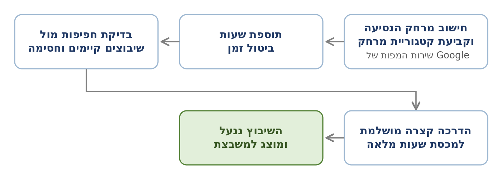

<!-- generated from: אפיון יד ושם מודול הזמנות חלק 2 מאושר 06-10 .docx | 2026-11-08 | do not edit by hand; regenerate from the docx -->

> **מקור:** מסמך 2 - תהליכי ההזמנות, גרסה מאושרת, 6.10.2026  
> **מיקום בניווט:** מסמך 2 - תהליכי ההזמנות › תהליכים עסקיים › הדרכות חוץ, הדרכות כפולות וחישוב מרחק וזמן  
> **קודי ולידציה ואוטומציה בפרק:** A10-01, A10-02, A10-03, A10-04, A10-05, A10-06, A10-07, A10-08, A10-09, A10-10, A10-11, V10-01, V10-02, V10-03  
> **הקודם:** [שיבוץ מדריכים ומשאבים](09-guide-resource-scheduling.md) · **הבא:** [שיבוץ משאבים פיזיים, מוזיאון ותערוכות](11-physical-resources-museum.md) · [מקרא](../../INDEX.md)

# הדרכות חוץ, הדרכות כפולות וחישוב מרחק וזמן

## תיאור התהליך

תהליך זה מנוהל על ידי המשבצת בעת שיבוץ הדרכת חוץ או שיבוץ שתי הדרכות באותו יום, והוא נגזר ישירות  ⟦💬 c522⟧מההסכם הקיבוצי של המדריכים. עבור הדרכת חוץ, המתקיימת אצל המזמין או בעיר הבה"דים, המדריך מתוגמל לא רק על שעות ההדרכה בפועל אלא גם על ביטול זמן הנגזר מהמרחק, וכן על השלמה למינימום השעות שהוזמן עבורן. עבור הדרכה המתקיימת ביד ושם או בבית וולין לא מתווסף ביטול זמן, והמערכת משלימה רק את שעות ההדרכה למינימום בהתאם למה שהוזמן. חוקיות החישוב וערכי הפרמטרים ניתנים לשינוי על ידי יד ושם, בכפוף להסכם הקיבוצי ולפרשנותו, ללא פיתוח.

היקף הפעילות הוא כ-400 נותני שירות בחודש ובממוצע כ-2,300 פעולות.  הפער המרכזי במצב הקיים: שעות ביטול הזמן וההשלמה למינימום אינן באות לידי ביטוי בלוח השיבוצים. חוקיות החישוב במערכת החדשה: המרחק מחושב הלוך ושוב, באמצעות ממשק API מול שירות המפות של Google, בין מרכז ישוב המגורים של המדריך, לפי הכתובת הרשומה בכרטיסו, לבין כתובת מקום הפעילות. החישוב מתבצע בעת השיבוץ, ולא רק בעת הפקת המשכורות. הפעולה מסווגת לאחת משלוש קטגוריות מרחק: קרוב עד 60 ק"מ, בינוני בין 60 ל-120 ק"מ, ורחוק מעל 120 ק"מ. בהדרכה קרובה מתווספת חצי שעה לפני ההדרכה וחצי שעה אחריה, בהדרכה בינונית שעה לפני ושעה אחרי, ובהדרכה רחוקה שעה וחצי לפני ושעה וחצי אחרי. בנוסף, המערכת משלימה תמיד את שעות ההדרכה למינימום של שלוש שעות, והדרכה שמשכה קצר ממכסת שעות המוצר מושלמת לקטגוריית השעות: עד שלוש, עד שש או עד שמונה שעות.  ⟦💬 c524⟧בעת השיבוץ ניתן לעקוף את ברירת המחדל במקרים מסוימים, למשל לחשב מרחק מנקודת מוצא אחרת מזו של מגורי המדריך, או לשלם כיוון אחד בלבד.

לכללי המרחק מתווספים כללי הקילומטראז' הקיימים: כאשר ההדרכה או ההרצאה מתקיימת באותה עיר שבה מתגורר נותן השירות, הקילומטראז' נקבע ל-10 ק"מ, כשווה ערך לתחבורה ציבורית; ⟦💬 c528⟧  ⟦💬 c530⟧כאשר ההדרכה ביד ושם, בבית וולין או וירטואלית, הקילומטראז' הוא 0 ואין תוספת שעות בגין ביטול זמן; וכאשר לאותו מדריך שתי פעילויות באותו יום ובאותו מיקום, הקילומטראז' נספר לפעולה הראשונה בלבד. יום פעילות אחד יכול לכלול מספר מקומות פעילות, לדוגמה פתיחה בעיר הבה"דים והמשך בבסיס אחר: במצב זה חישוב הנסיעות והקילומטראז' מתבצע כרשומה נפרדת המזכה את המדריך על מסלול הנסיעה בין המקומות, והקבוצה נספרת פעם אחת בלבד, במקום המצב הקיים שבו נפתחים שני ימי פעילות נפרדים באותו תאריך עם ספירה כפולה של הקבוצה ורישום מלאכותי של מקום מגורי המדריך. ברצף הדרכות קצרות במרכז עיר הבה"דים שעות העבודה מחושבות כטווח אחד, משעת תחילת הפעילות הראשונה ועד שעת סיום הפעילות האחרונה, ולא כסכימת בלוקים נפרדים, כמפורט בפרק 12.5 הזמנות צבא, כוחות הביטחון ומשלחות. ערכי הקילומטראז' וכללי החישוב מנוהלים כפרמטרים ואינם קבועים בקוד.

המערכת החדשה חוסמת את שעות ביטול הזמן ואת השעות שהושלמו למינימום ברקע ובאופן מקוון: שעות הנסיעה נחשבות חלק מתפוסת המדריך, רכזת אינה יכולה לשבץ מדריך בשעות החופפות, והיא מקבלת חיווי כאשר שעות השיבוץ חופפות בשל ביטול זמן או השלמה למינימום. הדרכה כפולה מותרת גם כאשר סך השעות ביום עולה על שמונה: שיבוץ מדריך מעבר לשמונה שעות ביום אינו נחסם, המערכת מציגה למשבצת חיווי כי המדריך משובץ מעל שמונה שעות, והשיבוץ מתאפשר (מפורט בפרק 12.5 הזמנות צבא, כוחות הביטחון ומשלחות). ⟦💬 c532⟧

⟦💬 c534⟧במערכת החדשה אין חסימה של שיבוץ כפול של מדריך להדרכות המתקיימות מחוץ ליד ושם באותו יום. השיבוץ מותר בשני המצבים: שתי פעולות הדרכה מחוץ ליד ושם באותו יום, ושילוב של הרצאה והדרכה מחוץ ליד ושם באותו יום, ובשניהם מוצגת התראה בלבד.

הסיבה להתראה היא ששעות התשלום של הדרכת חוץ רחבות משעות ההדרכה עצמן: לכל פעולה מתווספות שעות ביטול הזמן הנגזרות מהמרחק, ושעות ההשלמה למינימום. זמן הנסיעה מחושב חצי לפני הפעילות וחצי אחריה, וההשלמה למינימום מחושבת בהתאם, כך שאין תגמול כפול על אותה שעה. שעות אלה אינן מוצגות במסך השיבוץ אלא נשמרות ברשומת השיבוץ כשעות לתשלום, לצד שעות הפעילות המקוריות, ולכן כאשר קיימות שתי פעולות חוץ באותו יום מוצגת למשבצת התראה על החפיפה האפשרית בין טווחי השעות בפועל.

מכיוון שהמערכת החדשה מחשבת את שעות ביטול הזמן וההשלמה ביומן המדריך בזמן אמת, הכלל נאכף כהתראה בלבד ולא כחסימה, וניתן לשבץ מדריך למספר פעולות חוץ באותו יום. בהזמנה שמקום הפעילות שלה הוא עיר הבה"דים אף התראה אינה נדרשת, משום ששעות ההדרכה שם מחושבות כטווח רציף אחד, משעת ההגעה ועד שעת הסיום, ולכן אין כפל בתשלום.

ניהול הישובים ונקודות הציון: רשימת הישובים ונקודות הציון אינה מסונכרנת כיום באופן מקוון, וכל הוספה מחייבת פנייה ידנית. המערכת החדשה מאפשרת ליד ושם להוסיף ישובים ונקודות ציון באופן עצמאי, באמצעות ישות מקום הפעילות (YV Location) ושירות המפות, ללא תלות בעדכון ידני חיצוני.

⟦💬 c536⟧שני פלטים תפעוליים נלווים לתהליך. הראשון, פלט הנסיעה לנותן השירות, המקביל לדוח הנהג המופק כיום בניידות החינוכיות עם רשימת תחנות האיסוף והשעות: הפלט מרכז לכל פעולת חוץ את מקום הפעילות וכתובתו, שעות ההגעה והסיום, קטגוריית המרחק והקילומטראז' המחושב, ומופק לפני יום הפעילות. השני, פעולת חישוב ק"מ ממסך השיבוצים של נותן השירות, המחשבת בלחיצה אחת את סך הקילומטרים של הנסיעות שנבחרו, לצורכי בקרה לפני ההעברה לתשלום. בכל רשומת שיבוץ נשמרות שעות הפעילות המקוריות לצד השעות לתשלום לאחר תוספת ביטול הזמן וההשלמה למינימום, שכן קובץ מלם נקלט עם השעות המועשרות בעוד הבקרה האנושית מתבצעת מול השעות המקוריות (מפורט בפרק [תשלום מדריכים ונותני שירות](../../doc1-intro-architecture/02-current-state.md) בחלק  ⟦💬 c538⟧3).

עיבוד החיבור בין עבודת המדריך לבין הגמול הכספי אינו מתבצע במערכת התפעולית: המערכת התפעולית מספקת את המידע (שעות, קטגוריית מרחק, קילומטראז' ותוספות), וכללי התשלום, לרבות ההבחנה בין הדרכה ביד ושם להדרכת חוץ, ההשלמה למינימום וההקבלה בין המשולם למדריך לבין הנגבה מהמזמין, ממומשים כתנאים מוגדרים על בסיס החוקיות בקובץ המשכורות. חישוב התשלום עצמו והפקת הדוחות מפורטים בפרק [תשלום מדריכים ונותני שירות וקובץ מלם](../../doc3-events-finance/05-processes/12-guide-provider-payment-malam-file.md) שבמסמך 3, ובפרקי הכספים (הפקת חשבון, ביטולים וזיכויים).

## שלבי התהליך

1. המשבצת משבצת מדריך להדרכה, והמערכת מזהה את סוג המיקום: יד ושם, בית וולין, וירטואלי, אצל המזמין או עיר הבה"דים.

⟦💬 c541⟧2. בהדרכת חוץ נשלפות כתובת המדריך מכרטיסו וכתובת מקום הפעילות, והמרחק הלוך ושוב מחושב מול שירות המפות של Google בעת השיבוץ.

3. הפעולה מסווגת לקטגוריית מרחק (קרוב, בינוני, רחוק) ונגזרת תוספת ביטול הזמן: חצי שעה, שעה או שעה וחצי לפני ואחרי.

4. בעת הצורך המשבצת עוקפת את ברירת המחדל: נקודת מוצא אחרת, תשלום כיוון אחד בלבד, או תשלום מונית לכיוון אחד או לשני הכיוונים. ⟦💬 c543⟧

5.  ⟦💬 c545⟧שעות ⟦💬 c547⟧ ההדרכה מושלמות למינימום שלוש שעות ולקטגוריית מכסת המוצר (עד שלוש, עד שש, עד שמונה), בהתאם למה שהוזמן. השלמה זו חלה על שיבוצים שיש להם מזמין המשלם עבורם; כאשר אין מזמין משלם, בדרך כלל באירוע שיד ושם מפעיל, ההשלמה היא לעיגול השעה הקרובה. במקרים מסוימים, בהדרכות בלבד, נדרש לשלם למדריך פחות ממה שהוזמן: בעת השיבוץ מוחלף מוצר השיבוץ במוצר הדרכה קצר יותר, והתשלום למדריך נגזר ממנו.

6. שעות ההדרכה, שעות הנסיעה, ביטול הזמן וההשלמה נחסמות ביומן המדריך כתפוסות, בזמן אמת.

7. ניסיון לשבץ את המדריך להדרכה נוספת בשעות חופפות נחסם, והמשבצת מקבלת חיווי שהחפיפה נובעת מביטול זמן או מהשלמה למינימום.

.8.שיבוץ המדריך לפעולת הדרכה נוספת מחוץ ליד ושם באותו יום, או שילוב של הרצאה והדרכה מחוץ ליד ושם באותו יום, אינו נחסם: המערכת מציגה התראה בלבד והשיבוץ מתאפשר; בעיר הבה"דים אין התראה וניתן לשבץ מספר פעולות. ⟦💬 c549⟧

9. הקילומטראז' נקבע לפי הכללים: אותה עיר 10 ק"מ,  ⟦💬 c551⟧יד ושם, בית וולין או וירטואלי 0 ק"מ, ושתי פעילויות באותו יום ובאותו מיקום נספרות פעם אחת.

10. ממסך השיבוצים של נותן השירות מופעלת פעולת חישוב ק"מ המסכמת את הקילומטרים של הנסיעות שנבחרו, ומופק פלט הנסיעה לנותן השירות עם מקום הפעילות, השעות, הקטגוריה והקילומטראז'.

11. נתוני השיבוץ, הקטגוריה, התוספות והקילומטראז' נגזרים לרשומת תשלום המדריך, לצד השעות המקוריות והשעות לתשלום, לאחר בדיקה שהפעולה לא שולמה כבר (פרק [תשלום מדריכים ונותני שירות](../../doc1-intro-architecture/02-current-state.md)).

## ישויות ושדות בתהליך

| ישות | תפקיד בתהליך | שדות ייעודיים לתהליך |
| --- | --- | --- |
| שיבוץ נותן שירות (GoMeddo) | רשומת ההדרכה שעליה מחושבים המרחק והתוספות | סוג מיקום (יד ושם, בית וולין, וירטואלי, אצל המזמין, עיר הבה"דים), מרחק מחושב הלוך ושוב, קטגוריית מרחק (קרוב, בינוני, רחוק), שעות ביטול זמן לפני ואחרי, השלמה למינימום, עקיפת נקודת מוצא, תשלום כיוון אחד |
| נותן שירות (Contact, סוג רשומה מדריך) | מקור כתובת המגורים לחישוב המרחק | ישוב מגורים, כתובת רשומה |
| מקום פעילות (YV Location) | כתובת היעד של הדרכת החוץ, לרבות נקודות ציון שאינן כתובת רשומה | ישוב, נקודת ציון, כתובת; ניתן להוספה עצמאית על ידי יד ושם |
| מפגש (B25__Reservation__c) | יום הפעילות שאליו שייכת ההדרכה, בסיס לזיהוי שתי פעילויות באותו יום ובאותו מיקום | תאריך, מקום פעילות, שעות |
| פריט הזמנה (Opportunity Product) | מקור השעות שהוזמנו, הבסיס להשלמה למינימום | מכסת שעות המוצר, משך שהוזמן |

## כללי ולידציה

| מזהה | הכלל | הודעת שגיאה |
| --- | --- | --- |
| V10-01 | לא ניתן לשבץ מדריך בשעות החופפות לשיבוץ קיים שלו, כולל שעות הנסיעה, ביטול הזמן וההשלמה למינימום; החיווי מפרט שהחפיפה נובעת מתוספות ולא מהדרכה בפועל | השעות חופפות לשיבוץ קיים, כולל ביטול זמן והשלמת שעות |
| V10-02 | לא ניתן לשמור שיבוץ הדרכת חוץ ללא כתובת מדריך רשומה בכרטיסו וללא מקום פעילות מוגדר, שכן חישוב המרחק נשען עליהם | לא ניתן לחשב מרחק: חסרה כתובת מדריך או מקום פעילות |
| ⟦💬 c556⟧V10-03 | שיבוץ מדריך לשתי פעולות הדרכה מחוץ ליד ושם באותו יום, וכן שילוב של הרצאה והדרכה מחוץ ליד ושם באותו יום, מותר ואינו נחסם: המערכת מחשבת את זמן הנסיעה, חצי לפני הפעילות וחצי אחריה, ואת ההשלמה למינימום, ומציגה התראה בלבד למשבצת. בהזמנה שמקום הפעילות שלה עיר הבה"דים אין התראה, וניתן לשבץ מדריך למספר פעולות | ניתן לשבץ מדריך לשתי פעולות מחוץ ליד ושם באותו יום, ומוצגת התראה בלבד |

## אוטומציות

| מזהה | טריגר | הפעולה האוטומטית |
| --- | --- | --- |
| A10-01 | שמירת שיבוץ הדרכת חוץ (אצל המזמין או עיר הבה"דים) | חישוב המרחק הלוך ושוב מול Google בין ישוב מגורי המדריך למקום הפעילות, וסיווג לקטגוריה: קרוב, בינוני או רחוק |
| A10-02 | נקבעה קטגוריית מרחק | הוספת ביטול זמן: חצי שעה לפני ואחרי (קרוב), שעה לפני ואחרי (בינוני), שעה וחצי לפני ואחרי (רחוק), וחסימת השעות ביומן המדריך |
| A10-03 | משך ההדרכה קצר מהשעות שהוזמנו או ממכסת המוצר | השלמת השעות למינימום שלוש שעות ולקטגוריה: עד שלוש, עד שש או עד שמונה שעות, וחסימת השעות שהושלמו |
| A10-04 | ההדרכה מתקיימת בעיר מגורי המדריך | קילומטראז' נקבע ל-10 ק"מ |
| A10-05 | ההדרכה מתקיימת ביד ושם, בבית וולין או וירטואלית | קילומטראז' נקבע ל-0 וללא ביטול זמן; מבוצעת השלמה למינימום בלבד |
| ⟦💬 c559⟧A10-06 | לאותו מדריך שתי פעילויות באותו יום ובאותו מיקום, שיבוץ המותר ואינו נחסם | הקילומטראז' נספר לפעולה הראשונה בלבד, ושתי הפעילויות נספרות פעם אחת |
| A10-07 | הדרכת חוץ נשמרה | שעות הנסיעה המחושבות נכללות בתפוסת המדריך לצורך בדיקות חפיפה בכל שיבוץ עתידי |
| A10-08 | גזירת נתוני השיבוץ לרשומת תשלום המדריך | בדיקה שהפעולה לא שולמה כבר לפני יצירת שורת תשלום (פרק תשלום מדריכים ונותני שירות) |
| A10-09 | שמירת שיבוץ שנוספו לו ביטול זמן או השלמה למינימום | שמירת שעות הפעילות המקוריות לצד השעות לתשלום על רשומת השיבוץ, לצורכי הבקרה החודשית והקובץ למלם (פרק תשלום מדריכים ונותני שירות) |
| A10-10 | ניסיון שיבוץ פעולת הדרכה מחוץ ליד ושם למדריך שכבר משובץ באותו יום לפעולת הדרכה או הרצאה מחוץ ליד ושם | חסימת השיבוץ, למעט הזמנה שמקום הפעילות שלה עיר הבה"דים |
| A10-11 | הפעלת חישוב ק"מ ממסך השיבוצים של נותן השירות על נסיעות שנבחרו; האוטומציות בפרק זה חלות על שיבוצי הדרכה וסוגים דומים ואינן חלות על שיבוצים בעלי כללים נפרדים, כדוגמת מדריך פולין ⟦💬 c561⟧ | חישוב וסיכום הקילומטרים של הנסיעות שנבחרו והצגתם לבקרה לפני ההעברה לתשלום |

## אוטומציות מרכזיות, מפרט מימוש

### חישוב מרחק וביטול זמן בעת השיבוץ

| טריגר | שמירת שיבוץ מדריך להדרכה שסוג המיקום שלה הוא אצל המזמין או עיר הבה"דים (אחרי שמירה) |
| --- | --- |
| שלבים | 1. שליפת ישוב המגורים מכרטיס המדריך וכתובת מקום הפעילות מרשומת מקום הפעילות (YV Location). 2. קריאה לממשק ה-API של שירות המפות של Google וחישוב המרחק הלוך ושוב בין מרכז ישוב המגורים לבין מקום הפעילות. 3. סיווג הפעולה לקטגוריה: עד 60 ק"מ קרוב, 60 עד 120 ק"מ בינוני, מעל 120 ק"מ רחוק. 4. הוספת שעות ביטול הזמן לפני ואחרי ההדרכה לפי הקטגוריה (חצי שעה, שעה או שעה וחצי לכל צד) ורישומן על רשומת השיבוץ. 5. החלת עקיפות שהוגדרו בעת השיבוץ: נקודת מוצא שונה ממגורי המדריך או תשלום כיוון אחד בלבד. 6. עדכון תפוסת המדריך כך ששעות ההדרכה, הנסיעה וביטול הזמן חסומות לשיבוצים נוספים. |
| בדיקת קבלה | שיבוץ הדרכת חוץ שחישובה מניב 167 ק"מ מסווג רחוק, נוספות שעה וחצי לפני ושעה וחצי אחרי, והשעות מוצגות כתפוסות ביומן המדריך מיד עם השמירה |

### חסימת חפיפות והשלמה למינימום בזמן אמת

| טריגר | ניסיון שיבוץ מדריך לפעולה נוספת, או שמירת שיבוץ שמשכו קצר מהשעות שהוזמנו (לפני שמירה) |
| --- | --- |
| שלבים | 1. בעת שמירת שיבוץ, השלמת שעות ההדרכה למינימום שלוש שעות ולקטגוריית מכסת המוצר (עד שלוש, עד שש, עד שמונה) בהתאם למה שהוזמן, ורישום השעות שהושלמו כתפוסות. 2. בכל ניסיון שיבוץ חדש, בדיקת חפיפה מול מלוא התפוסה של המדריך: הדרכות בפועל, שעות נסיעה, ביטול זמן והשלמות. 3. בנמצא חפיפה, חסימת השיבוץ והצגת חיווי למשבצת המפרט שהחפיפה נובעת מביטול זמן או מהשלמה למינימום, ולא מהדרכה בפועל. 4. בשיבוץ שתי פעולות מחוץ ליד ושם באותו יום, לרבות שילוב של הרצאה והדרכה, השיבוץ אינו נחסם: המערכת מחשבת לכל פעולה את ביטול הזמן ואת ההשלמה למינימום ומציגה למשבצת התראה על החפיפה האפשרית בין טווחי השעות בפועל, והשיבוץ מתאפשר; בהזמנה שמקום הפעילות שלה עיר הבה"דים אף התראה אינה מוצגת. |
| בדיקת קבלה | מדריך שסיים הדרכת חוץ בינונית בשעה 13:00 אינו ניתן לשיבוץ להדרכה המתחילה ב-13:30, והמשבצת מקבלת חיווי שהשעה חסומה בגין ביטול זמן; שיבוץ לאותו מדריך הרצאה מחוץ ליד ושם באותו יום, בשעות שאינן חופפות, אינו נחסם ומוצגת התראה בלבד, ואילו שיבוץ שתי פעולות בעיר הבה"דים נשמר |

תרשים תהליך 10 - הדרכות חוץ, הדרכות כפולות וחישוב מרחק וזמן

---

## הערות סקירה בפרק זה

> הערות הסקירה אינן חלק מהאפיון המחייב. הן מסמנות מקומות שבהם הטקסט עדיין בדיון. הסימון ⟦💬 cN⟧ בגוף הטקסט מפנה להערה כאן.

### ⟦💬 c522⟧ סגורה
- **c522** · Miri Yahud · 2026-09-07 · סומנה כסגורה: חישוב מרחק וזמן, צריך להיות מבוסס על קריטריונים, בכפוף להסכם הקיבוצי ולפרשנות שלו, באופן שניתן לשנות את ערכי הפרמטרים וחוקיות החישוב
  - **c523** · Lior Pridor · 2026-09-14 · סומנה כסגורה: תיאור התהליך כבר קובע שחוקיות החישוב וערכי הפרמטרים ניתנים לשינוי על ידי יד ושם ללא פיתוח.

### ⟦💬 c524⟧ סגורה
- **c524** · וייל דבורה · 2026-09-06 · סומנה כסגורה: השלמת השעות כך היא רק לשיבוצים שיש מזמין שמשלם עבורם. כשאין מזמין שמשלם- בדר"F באירוע שיד ושם מפעיל- ההשלמה היא לעיגול השעה הקרוב, 3 4 5 6 7 8 שעות.
  - **c525** · Lior Pridor · 2026-09-14 · סומנה כסגורה: ההבחנה מתבצעת לפי סוג הרשומה: בשיבוץ המשויך להזמנה עם מזמין משלם מתבצעת השלמה למינימום שעות ההדרכה המשולם, ואילו בפעילות שיד ושם מפעיל ללא מזמין משלם ההשלמה היא לעיגול השעה הקרובה. נשמח לאשר איתכם את כללי ההבחנה ולעגן אותם במסמך.
  - **c526** · אשבל אור · 2026-09-23 · סומנה כסגורה: מכיוון שייש השפעה כספית, נדייק ונחדד את הנושא במסמך ג / בו נעביר במדוייק את כללי השיבוץ האפשריים והמותרים בהזמנות וברירות המחדל של שיבוץ נותני השירות השונים. כולל תשלום נסיעות וק"מץ
  - **c527** · Lior Pridor · 2026-09-23 · סומנה כסגורה: מקובל. כללי השיבוץ, ברירות המחדל ותשלום הנסיעות והק"מ יעוגנו במסמך 3 על בסיס הכללים שתעבירו.

### ⟦💬 c528⟧ סגורה
- **c528** · שגיא תומר · 2026-09-06 · סומנה כסגורה: חישוב הקילומטראז' צריםך להיות מבוסס פרמטרים ולא Hard Coded
  - **c529** · טל שמרית · 2026-09-06 · סומנה כסגורה: אבל אם המדריך ביצע הדרכת חוץ בעיר המגורים שלו, אז הק"מ צריך להיות 10. / שווה ערך כספי לתחב"צ. / כנ"ל לגבי הרצאה, אם היא מתקיימת בעיר בה מתגורר המרצה, אז משולם 10 ק"מ קבוע.

### ⟦💬 c530⟧ סגורה
- **c530** · טל שמרית · 2026-09-06 · סומנה כסגורה: על הדרכות אלה לא משלמים תוספת שעות עבור ביטול זמן
  - **c531** · Lior Pridor · 2026-09-14 · סומנה כסגורה: הפסקה כבר קובעת שבהדרכה ביד ושם, בבית וולין או וירטואלית הקילומטראז' אפס ואין תוספת שעות בגין ביטול זמן.

### ⟦💬 c532⟧ סגורה
- **c532** · טל שמרית · 2026-09-06 · סומנה כסגורה: חסימה זו מיותרת. / הרי יש לנו הדרכות כפולות שסך השעות שלהן עולה על 8 שעות, למשל הדרכה של 3 שעות + הדרכה של 6 שעות. / לא יודעת באיזה הקשר הנושא דובר. / אפשר לתת התראה שמציינת המדריך משובץ כבר מעל 8 שעות . אבל יש לאפשר זאת.
  - **c533** · Lior Pridor · 2026-09-14 · סומנה כסגורה: תוקן במסמך: הדרכה כפולה מותרת גם כאשר סך השעות ביום עולה על שמונה, שיבוץ מדריך מעבר לשמונה שעות אינו נחסם, והמערכת מציגה למשבצת חיווי כי המדריך משובץ מעל שמונה שעות.

### ⟦💬 c534⟧ סגורה
- **c534** · טל שמרית · 2026-09-06 · סומנה כסגורה: זה ממש לא נכון, / היום יש לנו בעיה עם הנושא הזה, כיוון שאין ביטוי לשעות שמשלמים עבור ביטול הזמן, / אבל ביקשנו למצוא לנושא פתרון. לא לאפשר 2 הדרכות חוץ באותו היום, זה לא פתרון, זו חסימה וכשנגיע למצב שצריך לעשות זאת, לא נדע איך לעקוף את הנושא. / בנוסף, אם מדריך עשה באותו מקום (מחוץ ליד ושם) גם הרצאה ולאחר מכן הדרכה, אין עם זה בעיה, על אחת הפעולות הוא יקבל את שעות ביטול הזמן, ועל השניה לא.
  - **c535** · Lior Pridor · 2026-09-14 · סומנה כסגורה: עודכן במסמך: אין חסימה של שיבוץ כפול של מדריך מחוץ ליד ושם באותו יום, לא לשתי פעולות הדרכה ולא לשילוב של הרצאה והדרכה. בשני המצבים השיבוץ מתאפשר ומוצגת התראה בלבד, והמערכת מחשבת זמן נסיעה חצי לפני וחצי אחרי והשלמה למינימום.

### ⟦💬 c536⟧ סגורה
- **c536** · טל שמרית · 2026-09-06 · סומנה כסגורה: לא הבנתי את ההקשר
  - **c537** · Lior Pridor · 2026-09-14 · סומנה כסגורה: ההקשר הוא כללי התשלום לנותני השירות: הסעיף עוסק באופן שבו המערכת מחשבת את שעות התשלום ואת תוספת זמן הנסיעה לכל שיבוץ. נשלים במסמך ניסוח מפורט ובהיר יותר של הסעיף ונציג אותו לאישורכם.

### ⟦💬 c538⟧ סגורה
- **c538** · וייל דבורה · 2026-09-06 · סומנה כסגורה: הבקרה האנושית תמיד צריכה את כל הנתונים שנקלטים במלמ ובנוסף- נתוני עזר
  - **c539** · Lior Pridor · 2026-09-15 · סומנה כסגורה: מקובל עלינו. מסכי הבקרה האנושית יציגו את מלוא הנתונים הנקלטים במל"ם וכן נתוני עזר נדרשים. פירוט רשימת השדות והתצוגות ייכלל במסמך 3 ויובא לאישורכם.

### ⟦💬 c541⟧ סגורה
- **c541** · קרמר חנה · 2026-09-06 · סומנה כסגורה: יש עלויות בשימוש בשירות של GOOGLE?
  - **c542** · Lior Pridor · 2026-09-14 · סומנה כסגורה: אין עלות נוספת. השימוש בשירות המפות לחישוב מרחק וזמן נסיעה מתבצע במסגרת המכסה הכלולה ברישוי הקיים.

### ⟦💬 c543⟧ סגורה
- **c543** · וייל דבורה · 2026-09-06 · סומנה כסגורה: אפשרי גם תשלום מונית צד אחר או שניים
  - **c544** · Lior Pridor · 2026-09-14 · סומנה כסגורה: הפסקה כבר כוללת תשלום מונית לכיוון אחד או לשני הכיוונים.

### ⟦💬 c545⟧ סגורה
- **c545** · טל שמרית · 2026-09-06 · סומנה כסגורה: השלמת השעות היא רק לשיבוצים שיש מזמין שמשלם עבורם (הזמנות). / כשאין מזמין שמשלם- בדר"כ באירוע שיד ושם מפעיל- ההשלמה היא לעיגול השעה הקרוב, 3 4 5 6 7 8 שעות.
  - **c546** · Lior Pridor · 2026-09-14 · סומנה כסגורה: הפסקה כבר מבחינה בין השלמה לשיבוץ עם מזמין משלם לבין עיגול לשעה הקרובה כשאין מזמין משלם.

### ⟦💬 c547⟧ סגורה
- **c547** · אשבל אור · 2026-09-23 · סומנה כסגורה: במקרים מסויימים , יש צורך לשלם למדריך פחות ממה שהוזמן. בעת השיבוץ, מחליפים את מוצר השיבוץ למוצר הדרכה קצר יותר. / זה קורה רק בהדרכות
  - **c548** · Lior Pridor · 2026-09-23 · סומנה כסגורה: מקובל ונוסף לשלב 5: בהדרכות בלבד ניתן בעת השיבוץ להחליף את מוצר השיבוץ במוצר הדרכה קצר יותר, והתשלום למדריך נגזר ממנו.

### ⟦💬 c549⟧ סגורה
- **c549** · טל שמרית · 2026-09-06 · סומנה כסגורה: יש לדון בנושא, זה ממש לא נכון, / כפי שכתבתי למעלה, היום יש לנו בעיה עם הנושא הזה, כיוון שאין ביטוי לשעות שמשלמים עבור ביטול הזמן, / אבל ביקשנו למצוא לנושא פתרון. לא לאפשר 2 הדרכות חוץ באותו היום, זה לא פתרון, זו חסימה וכשנגיע למצב שצריך לעשות זאת, לא נדע איך לעקוף את הנושא. / בנוסף, אם מדריך עשה באותו מקום (מחוץ ליד ושם) גם הרצאה ולאחר מכן הדרכה, אין עם זה בעיה, על אחת הפעולות הוא יקבל את שעות ביטול הזמן, ועל השניה לא.
  - **c550** · Lior Pridor · 2026-09-14 · סומנה כסגורה: עודכן במסמך: שיבוץ המדריך לפעולת הדרכה נוספת מחוץ ליד ושם באותו יום, או לשילוב של הרצאה והדרכה מחוץ ליד ושם באותו יום, אינו נחסם ומוצגת התראה בלבד. בעיר הבה"דים אין התראה וניתן לשבץ מספר פעולות.

### ⟦💬 c551⟧ סגורה
- **c551** · טל שמרית · 2026-09-06 · סומנה כסגורה: זה תקף רק עבור הדרכות. / עבור הרצאות, נמתין לנוהל ההרצאות המעודכן, נכון להיות, כן משלמים ק"מ להרצאה גם אם היא מתקיימת ביד ושם או בבית ווהלין. / ברירת המחדל של פעולה וירטואלית תמיד תהיה ללא נסיעות. עם אפשרות לשינוי במקרי קיצון. (שהמרצה מבצע פעולה וירטואלית למזמין, אבל הוא מבצע זאת מתוך יד ושם, אז כן מגיע לו תשלום ק"מ לנסיעות)
  - **c552** · Lior Pridor · 2026-09-14 · סומנה כסגורה: כללי התשלום להרצאות, לרבות תשלום קילומטראז' בהרצאה המתקיימת ביד ושם או בבית וולין, נגזרים מנוהל ההרצאות המעודכן. כל עוד הנוהל לא נמסר לנו, ההרצאות אינן נכללות בתכולת חלק 2 של האפיון, ועם קבלתו נבחן את השפעתו ונשלב את הכללים במסמך.
  - **c553** · אשבל אור · 2026-09-28 · סומנה כסגורה: תשלומים על כלל נגזרותיהם יפורטו בחלק 3

### ⟦💬 c556⟧ סגורה
- **c556** · טל שמרית · 2026-09-06 · סומנה כסגורה: יש התייחסות לנושא זה בעמודים הקודמים, זה לא נכון
  - **c557** · Lior Pridor · 2026-09-14 · סומנה כסגורה: תוקן במסמך: הכלל V10-03 הוסר. שיבוץ כפול של מדריך מחוץ ליד ושם באותו יום מותר ומוצגת התראה בלבד, בכפוף לחישוב זמן הנסיעה ולהשלמה למינימום.

### ⟦💬 c559⟧ סגורה
- **c559** · טל שמרית · 2026-09-06 · סומנה כסגורה: נכון מאוד!!!  זה הכלל הנכון / סעיף זה סותר את מה שנאמר בעמודים הקודמים בנושא ובסעיף V10-03.
  - **c560** · Lior Pridor · 2026-09-14 · סומנה כסגורה: עודכן במסמך: הכלל A10-06 נשמר והכלל הסותר V10-03 הוסר. שתי פעילויות באותו יום ובאותו מיקום נספרות פעם אחת, והשיבוץ הכפול מותר.

### ⟦💬 c561⟧ סגורה
- **c561** · וייל דבורה · 2026-09-06 · סומנה כסגורה: כל פעולות האוטומציה הנל הם רק לגבי שיבוצים של הדרכה ועוד כמה סוגים, ישנם שיבוצים כמו מדריך פולין שיש עבורו כללים אחרים
  - **c562** · Lior Pridor · 2026-09-14 · סומנה כסגורה: הפסקה כבר מסייגת שהאוטומציות חלות על שיבוצי הדרכה בלבד ואינן חלות על שיבוצים בעלי כללים נפרדים.
