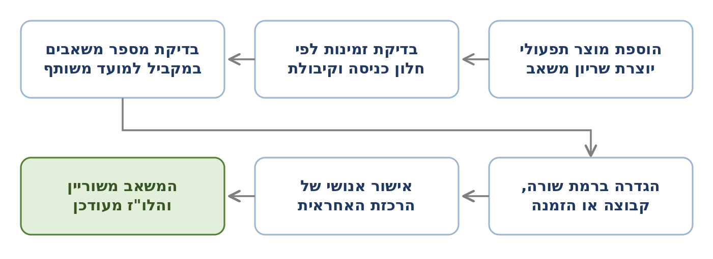

<!-- generated from: אפיון יד ושם מודול הזמנות חלק 2 מאושר 06-10 .docx | 2026-11-08 | do not edit by hand; regenerate from the docx -->

> **מקור:** מסמך 2 - תהליכי ההזמנות, גרסה מאושרת, 6.10.2026  
> **מיקום בניווט:** מסמך 2 - תהליכי ההזמנות › תהליכים עסקיים › שיבוץ משאבים פיזיים, מוזיאון ותערוכות  
> **קודי ולידציה ואוטומציה בפרק:** A11-01, A11-02, A11-03, A11-04, A11-05, A11-06, A11-07, A11-08, A11-09, A11-10, A11-11, A11-12, A11-13, A11-14, A11-15, V11-01, V11-02, V11-03, V11-04, V11-05, V11-06, V11-07, V11-08, V11-09, V11-10  
> **הקודם:** [הדרכות חוץ, הדרכות כפולות וחישוב מרחק וזמן](10-external-double-tours-distance.md) · **הבא:** [ויסות ונעילה רב-רמתית](12-regulation-locking.md) · [מקרא](../../INDEX.md)

# שיבוץ משאבים פיזיים, מוזיאון ותערוכות

## תיאור התהליך

שיבוץ המשאבים הפיזיים מנוהל כולו בשכבת GoMeddo, ומקיף כ-27 כיתות, שני אולמות, חדר ישיבות, חדרי שיח טכנולוגיים, מבואות ומרחבי שיח, מתחם כיבוד וחדר השאלות הגדולות, לצד המוזיאון, ⟦💬 c566⟧ בית הכנסת, התערוכות המתחלפות והמרחבים הפתוחים. לכל משאב מוגדרים מספר משתתפים מקסימלי, צורת ישיבה כברירת מחדל, אפשרות שינוי תצורה, התרת כיבוד ושייכות לאזור, וכן צורת הקיבולת: המוזיאון מנוהל לפי תפוסה של 100 משתתפים בכל עשר דקות ללא ציון שעת יציאה, בעוד כיתה או מרחב מוגדרים בשעת כניסה ובשעת סיום. ⟦💬 c568⟧ שתי כיתות יכולות להתאחד לחלל אחד, ובמקרה כזה שתיהן ננעלות אוטומטית; חדר שיח טכנולוגי משובץ כחדר ישיבות ייעודי, ללא הכנסת קבוצות נוספות במקביל. השריון מתבצע בשני ערוצים: על ידי הלקוח בעת הזמנה מקוונת, ועל ידי הרכזת בעת יצירת יום פעילות או אירוע, כאשר אישורי השירותים מבוצעים בבקרה אנושית של הרכזת האחראית. בהמשך יתווספו משאבים נוספים, ובהם עשר כיתות חכמות ומתחם בבקעת הקהילות.

הדרישה הקריטית מבין כלל הדרישות, היא יכולת עצמאית של יד ושם להוסיף, לשנות ולהגדיר מוצרים ומשאבים חדשים בעצמה (חיזיון, הצגה, בית כנסת וכדומה), כל אחד עם כללי התפוסה והשימוש שלו, ללא תלות בצוות פיתוח. לצד זאת מוגדרות במערכת הגדרות המדריכים (שפות והכשרות) לבניית פילטרים לשיבוץ.

המוזיאון מנוהל כמשאב הנקבע לפי שעת כניסה ותפוסה מקסימלית. לא ניתן להכניס את כל המשתתפים בו-זמנית, ולכן הכניסות מחולקות לחלונות בהפרשים של עשר דקות, לפי כללי קיבולת של עד 100 משתתפים בכל עשר דקות. השיבוץ למוזיאון מתבצע ברמת הקבוצה: כל קבוצה מקבלת חלון כניסה ומדריך, וצוות האוזניות מקבל את החלוקה לתדרים. נהוג לשריין מראש תפוסה מלאה (לדוגמה 35  ⟦💬 c570⟧מקומות) כדי שאף גורם אחר לא יתפוס את חלון הזמן. מנגנון חלונות הכניסה, הקצאתם לקהלים והוויסות מפורטים בפרק 12.12 ויסות ונעילה רב-רמתית.

בית הכנסת הוא משאב בעל אופי כפול, ומוגדר במודל דו-מצבי: במצב הראשון הוא מתפקד ככיתה, בתפיסה בלעדית של החלל לאורך זמן עבור אירוע; במצב השני הוא מתפקד ככניסה למוזיאון, עם הכנסת עד שלוש קבוצות במקביל בהפרשי זמן, עד כ-100 איש. אופן השימוש נבחר בעת השריון, וקיימת יכולת לנעול את המשאב לטובת קבוצת VIP. עיקרון השימוש הכפול, שריון מלא של החלל לצד שריון תפוסה חלקית במקביל לקבוצות אחרות, חל גם על שאר חללי האירועים.

יכולת נעילת ה-VIP בבית הכנסת מורחבת לכלל המשאבים הרלוונטיים כפעולת סגירת משאב לפעילות פרטית: ניתן לסגור משאב לפעילות פרטית גם כאשר נותר בו מקום פנוי, לדוגמה המוזיאון או בית הכנסת, כך שאף גורם נוסף אינו יכול להשתבץ לאותו טווח. הסגירה מתבצעת מתוך השיבוץ עצמו, בידי בעלי הרשאה בלבד, והיא נפרדת וללא תלות במסך הפתיחה והנעילה המערכתית של מרכז ההזמנות, המפורט בפרק 12.12 ויסות ונעילה רב-רמתית.

המערכת תומכת בשריון משאבים ללא לוז: שריון כיתות ואולמות לפני שנקבע הלוז המלא, כדי שלא ייתפסו על ידי גורם אחר, וכן שריון מוקדם של חדרים לצורך הכנת תיקים מספר ימים לפני האירוע. שמירת מקום ללא הזמנה מחייבת סיבה ומבקש ונוצרת בסטטוס ממתין לאישור, אלא אם המשתמש הוא מנהל שיבוצים, שאז השיבוץ נוצר ישירות בסטטוס מאושר. היקף הבקשות לשיבוצים פנימיים ללא הזמנה (פגישות, ביקורי מקהלה והכנות) עומד על כחמש עד שש בקשות בשבוע.

המערכת מציעה משאבים על בסיס מאפייני המוצר ומאפייני קהל היעד של ההזמנה, לדוגמה סדנה לתלמידים מופנית לכיתות באגף הישן. פעולה שאינה דורשת חדר, כדוגמת שיחת פתיחה, מסומנת בצ'ק-בוקס ייעודי המציין שאין צורך במשאב, כך שהשיבוץ אינו נחסם בהיעדר חדר. נתמכת בדיקת זמינות של מספר משאבים באותו יום, לדוגמה מוזיאון, אולם ובית כנסת, לאיתור תאריך שבו כל המשאבים פנויים יחד, וכן קבוצות מקבילות הנכנסות בסבב למוזיאון, לחדרי השיח ולסדנאות.

מנוע הזמינות פועל לפי כללי מערכת תה"ל הקיימת: בדיקת חפיפה משולשת (שיבוץ המתחיל בתוך הטווח, מתחיל לפני ומסתיים בתוך, או זהה), עם מרווחי ביטחון של חמש דקות לפני שעת ההתחלה ועשר דקות אחרי שעת הסיום. שיבוץ קיים מסוג שריון או יום שלם נחשב שיבוץ לכל דבר ואינו מאפשר שיבוץ נוסף מעליו; שריון אינו נדרס ואינו משוחרר אוטומטית, ורק בהמרת שריון של אותה הזמנה לשיבוץ בפועל אין הוא נספר כתפוס, ואילו כל שחרור אחר של שריון מתבצע ידנית לאחר התראה. שיבוץ בסטטוס מבוטל אינו נספר. לכל חדר שעות פתיחה וסגירה לכל יום בשבוע, כאשר הגדרת 00:00 בפתיחה ובסגירה מבטלת את בדיקת השעות ליום זה. חדר שקיבולתו קטנה ממספר המשתתפים מושבת לבחירה, ומוצגים רק חדרים במיקום יום הפעילות ומסוג המשאב המוגדר במוצר. ⟦💬 c572⟧

⟦💬 c574⟧באירועים, עם פתיחת מוצר בעל תאריך ושעה מוגדרים, מתבצע שריון אוטומטי ומיידי של המשאבים הנדרשים, כדוגמת המוזיאון, עוד לפני פתיחת ההרשמה. במוצר חוזר הרץ לאורך זמן, מנגנון אוטומטי משרין את המשאב הנדרש לכל מופע חדש שנוסף, ומאפשר ביטול והעברה של הכלל כולו ללא טיפול ידני בכל תאריך. תהליך הקמת המוצר והגדרותיו מפורט בפרק 12.1 בניית מוצרים, חבילות ותבניות יום פעילות, פרק [בניית מוצרים, חבילות ותבניות יום פעילות](01-products-bundles-templates.md).

כל בקשת שיבוץ ממחלקות יד ושם מגיעה למסך אישורי השירותים של הרכזת האחראית, המאשרת או מתערבת לפי התאמת המשאב לסוג הקבוצה. לאחר האישור מופק לוז שבועי מרוכז, מיום ראשון עד שבת, המציג את כלל המשאבים בצבעים לפי קהלי המחלקות, לצד הכמויות, ההערות וצורת הסידור; דוגמת הלוז השבועי מובאת בנספח 28.  ⟦💬 c576⟧הלוז מופק להדפסה גם כסדר יום מלא לתאריך נבחר מתוך לוח השנה של השיבוצים, ובו כלל השיבוצים, החדרים, הכיבוד, ההערות והקבוצות, ולצדו מופק דוח כיבודים לחדרים לתקופה נבחרת, המצורף בדרך כלל ללוז השבועי ומשמש להזמנת הכיבוד בפועל. במסכי המשאבים בעלי התפוסה הגבוהה, המוזיאון, עיר הבה"דים וחדר השאלות הגדולות, ⟦💬 c578⟧ ניתן לעבור בין תצוגת היום המפורטת לבין תצוגת התפוסה הכללית, גריד שבועי או חודשי, ולחזור אליה בפעולה אחת. מהמסך מופקת טבלת שעות חריגות, פעילות מעבר לשעות 7:00 עד 18:00, המופצת לצוותי האחזקה, הניקיון, האבטחה והקב"ט, והם מסיקים ממנה היכן נדרשת הפעלת מיזוג ותאורה ובאיזה אגף ניתן לכבות. סימני הכיבוד מסומנים בוויזואל ייעודי ועל בסיסם מתבצעת ההזמנה התפעולית של הכיבוד. הלוז ניתן להפקה גם בתצוגות חתך נוספות: לפי משאב, לפי קיבוץ ולפי שיבוצים ללא הזמנה, וכל שיבוץ נושא חיווי לסוגו (שורת לוז, קבוצה, שריון, שיבוץ ללא הזמנה) לצורך חיתוך בדוחות. בנוסף לשני מסמכים אלה שולח צוות התפעול בימים רביעי וחמישי לוז לרשימת תפוצה רחבה, ובו שעות הפעילות בסוף כל יום ושעות פעילות חריגות; המערכת תכלול לחצן הפותח תיבת מייל עם שני הקבצים ובנוסח קבוע הניתן לעריכה. הלוז הנשלח לרשימת התפוצה אינו כולל את שמות המדריכים.

התקשורת מול צוות התפעול: בדוח המופק לצוות התפעול מובלטים סידור מיוחד, סמיכות וצפיפות פעילויות, ופעילות קודמת שהסתיימה מאוחר בערב הקודם. ההבלטה ויזואלית בלבד ואינה אוטומציה חוסמת, כדי לא לחסום שינויים תפעוליים מוסכמים. כפתור סידור מיוחד קיים כבר במערכת. ציוד אודיו ואוזניות אינו משאב חלל: הזמנות האוזניות מופקות אוטומטית משורות הלוז, כמפורט בפרק [סמינרים](../../doc3-events-finance/05-processes/04-seminars.md) שבמסמך 3.

## שלבי התהליך

1. הגדרת המשאב על ידי יד ושם בשירות עצמי: שם, סוג משאב, מיקום, קיבולת, שעות פתיחה וסגירה לכל יום בשבוע, ולצדם דגלי ההתנהגות: דורש אישור, תומך כיבוד, תומך שינוי סידור, ניתן לפיצול, ובמשאב דו-מצבי הגדרת שני אופני  ⟦💬 c581⟧השימוש. לרשימה זו יתווספו מאפיינים נוספים, ולכל מאפיין ייקבע ערך ברירת מחדל.

2. עם הוספת מוצר תפעולי להזמנה או לאירוע נוצרת דרישת שיבוץ משאב, והמערכת מסננת את החדרים לפי מיקום יום הפעילות ולפי סוג המשאב המוגדר במוצר.

3. בדיקת זמינות: חפיפה משולשת עם מרווחי חמש דקות לפני ועשר דקות אחרי, החרגת שיבוצי שריון ויום שלם של אותה הזמנה ושיבוצים מבוטלים, בדיקת שעות הפתיחה ליום, ובדיקת קיבולת מול מספר המשתתפים.

4. בחירת החדר ויצירת השיבוץ: בסטטוס מאושר, או בסטטוס ממתין לאישור כאשר החדר מסומן דורש אישור.

5. במשאב דו-מצבי (בית הכנסת) נבחר אופן השימוש בעת השריון: תפיסה בלעדית ככיתה או הכנסת עד שלוש קבוצות במקביל לפי תפוסה, עם אפשרות נעילה לקבוצת VIP.

6. שיבוץ המוזיאון ברמת הקבוצה: חלון כניסה ומדריך לכל קבוצה, בהתאם למנגנון החלונות והוויסות (פרק [ויסות ונעילה רב-רמתית](12-regulation-locking.md)).

7. שיבוץ למספר תאריכים: בדיקת תפוסה לכל תאריך בנפרד והצגת התאריכים התפוסים בדיאלוג  ⟦💬 c583⟧לבחירה. ניתן לשריין את התאריכים הפנויים גם כאשר חלק מהתאריכים בטווח תפוסים, לבטל את טווח התאריכים כולו בפעולה אחת, ולהסיר ממנו תאריכים בודדים.

8. שריון ללא הזמנה או לפני קביעת הלוז המלא, לרבות שריון מוקדם להכנת תיקים, עם סיבה ומבקש ובכפוף לאישור.

9. סימון נדרש כיבוד או נדרש שינוי סידור, בכפוף לתמיכת החדר, עם הערה מחייבת.

10. סגירת משאב לפעילות פרטית מתוך השיבוץ, על ידי בעל הרשאה בלבד, גם כאשר נותר במשאב מקום פנוי.

11. עדכונים שוטפים: שינוי מספר משתתפים מעדכן את השיבוץ, וביטול הזמנה או מפגש משחרר את שיבוצי החדרים אוטומטית ומיידית, ואילו שיבוצי נותני השירות נשמרים, ההזמנה מסומנת דרוש טיפול בשיבוצים ונשלחת התראה לרכז. הגדלת מספר המשתתפים מעבר לתפוסת המשאב נחסמת; בשיבוץ מוזיאון ההוספה מתאפשרת רק כאשר יש מקום פנוי, וחריגה מ-35 משתתפים בקבוצה נחסמת, ורק בעלי הרשאה יכולים לחרוג מכלל זה, למעט המסגרות התקציביות תגלית ופעילות חו"ל, שבהן מותרים עד 50 משתתפים. ⟦💬 c585⟧

12. הפקת דוח לצוות התפעול עם הבלטות באדום לסידור מיוחד, לצפיפות פעילויות ולפעילות שהסתיימה מאוחר.

13. הפקת הלוז השבועי המרוכז ודוח הכיבודים לתקופה, והדפסת סדר היום המלא לתאריך נבחר מלוח השנה של השיבוצים.

## ישויות ושדות בתהליך

| ישות | תפקיד בתהליך | שדות ייעודיים לתהליך |
| --- | --- | --- |
| משאב (GoMeddo Resource) | החדר, האולם, המוזיאון, בית הכנסת, התערוכה או המרחב הפתוח | סוג משאב, מיקום, קיבולת, שעות פתיחה וסגירה לכל יום  ⟦💬 c588⟧(00:00 מבטל בדיקה), דורש אישור, תומך כיבוד, תומך שינוי סידור, ניתן לפיצול, אופן שימוש (דו-מצבי), נעילת VIP |
| מפגש (GoMeddo Reservation) | שריון המשאב למועד, יום הפעילות | מוצר (נושא המפגש, אינו שדה חובה), סוג שיבוץ (רגיל, שריון, יום שלם), סטטוס (מאושר, ממתין לאישור, מבוטל), מספר משתתפים, נדרש כיבוד, נדרש שינוי סידור, הערות, סיבה ומבקש (בשריון ללא הזמנה), סיבת ביטול, סימון סידור מיוחד. שדות נוספים ליום הפעילות מפורטים בנספח השדות |
| הזמנה (Opportunity) | ההזמנה שאליה שייך השיבוץ | קישור למפגשים, מספר קבוצות ומשתתפים |
| רישום (Registration__c), רמת קבוצה | הקבוצה המשובצת לחלון כניסה ולמדריך | חלון כניסה, מדריך משובץ, מספר משתתפים בקבוצה |
| מוצר (Product) | קובע את סוג המשאב הנדרש לפעולה | סוג משאב נדרש, סיווג הפעילות |
| מקום פעילות (YV Location) | מיקום יום הפעילות המסנן את החדרים | מיקום, היררכיית מבנה וקומה |

## כללי ולידציה

| מזהה | הכלל | הודעת שגיאה |
| --- | --- | --- |
| V11-01 | לא ניתן לשמור שיבוץ החופף לשיבוץ קיים: שיבוץ המתחיל בתוך הטווח, מתחיל לפני ומסתיים בתוך, או זהה. הטווח הנבדק כולל חמש דקות לפני שעת ההתחלה ועשר דקות אחרי שעת הסיום | החדר תפוס בטווח המבוקש |
| V11-02 | שעת ההתחלה אינה יכולה להקדים את שעת הפתיחה של החדר ביום זה, אלא אם הוגדרו 00:00 בפתיחה ובסגירה | שעת ההתחלה מוקדמת משעת פתיחת החדר |
| V11-03 | שעת הסיום אינה יכולה לחרוג משעת הסגירה של החדר ביום זה, אלא אם הוגדרו 00:00 בפתיחה ובסגירה | שעת הסיום מאוחרת משעת סגירת החדר |
| V11-04 | חדר שקיבולתו קטנה ממספר המשתתפים בקבוצה מושבת לבחירה | מספר משתתפים לא תואם |
| V11-05 | סימון נדרש כיבוד או נדרש שינוי סידור מחייב מילוי שדה הערות | נדרשת הערה לבקשת כיבוד או שינוי סידור |
| V11-06 | שמירת מקום ללא הזמנה על ידי משתמש שאינו מנהל שיבוצים מחייבת מילוי סיבה ומבקש | שריון ללא הזמנה מחייב סיבה ומבקש |
| V11-07 | ביטול יום פעילות, מפגש או אירוע מחייב בחירת סיבת ביטול | חובה לבחור סיבת ביטול |
| V11-08 | במשאב דו-מצבי חובה לבחור את אופן השימוש בעת השריון | חובה לבחור אופן שימוש למשאב |
| ⟦💬 c591⟧V11-09 | שדה המוצר (נושא המפגש) אינו שדה חובה במפגש, שכן לא לכל מפגש מקושר מוצר או נושא, וקיימים מפגשים והזמנות ללא נושא כגון תיאום ביקור בארכיון או בספרייה ⟦💬 c593⟧ ⟦💬 c594⟧ ⟦💬 c595⟧ ⟦💬 c596⟧ | ניתן לשמור מפגש ללא מוצר; בחירת המוצר (נושא המפגש) אינה חובה |
| V11-10 | סגירת משאב לפעילות פרטית מתוך השיבוץ מותרת לבעלי הרשאה בלבד; משתמש ללא הרשאה אינו יכול לסגור משאב שנותר בו מקום פנוי | אין לך הרשאה לסגור משאב לפעילות פרטית |

## אוטומציות

| מזהה | טריגר | הפעולה האוטומטית |
| --- | --- | --- |
| A11-01 | בדיקת תפוסה כאשר קיים שיבוץ מסוג שריון או יום שלם השייך לאותה הזמנה | ⟦💬 c598⟧השיבוץ, לרבות שיבוץ מסוג שריון, נחשב תפוס ואינו משוחרר או נדרס אוטומטית; החריג היחיד הוא המרת שריון של אותה הזמנה לשיבוץ בפועל, וכל שחרור אחר הוא ידני בלבד |
| A11-02 | בדיקת תפוסה כאשר קיים שיבוץ בסטטוס מבוטל | השיבוץ אינו נספר בחישוב התפוסה |
| A11-03 | ליום הפעילות מוגדר מיקום | מוצגים רק חדרים באותו מיקום |
| A11-04 | למוצר מוגדר סוג משאב | מוצגים רק חדרים מסוג תואם |
| A11-05 | שיבוץ חדר המסומן דורש אישור | השיבוץ נוצר בסטטוס ממתין לאישור במקום מאושר |
| A11-06 | שיבוץ חדר שאינו תומך כיבוד או שינוי סידור | שדה נדרש כיבוד או נדרש שינוי סידור מתאפס אוטומטית |
| A11-07 | שיבוץ חדר המסומן ניתן לפיצול | נוצרים אוטומטית שיבוצים מקבילים לכל חדרי המשנה |
| A11-08 | ⟦💬 c600⟧שינוי מספר המשתתפים בקבוצה | מספר המבקרים בשיבוץ החדר של הקבוצה מתעדכן אוטומטית בהתאם למספר המשתתפים המעודכן; חריגה מקיבולת המשאב נחסמת, וחריגה מ-35 משתתפים בקבוצה נחסמת, ורק בעלי הרשאה יכולים לחרוג מכלל זה |
| A11-09 | ביטול הזמנה או מפגש | כל שיבוצי החדרים משתחררים אוטומטית ומיידית. מדריכים אינם משתחררים אוטומטית, כמפורט בפרק ביטול, זיכוי והחזר ללקוחות מוסדיים, פרק ביטול, זיכוי והחזר ללקוחות מוסדיים |
| A11-10 | שיבוץ חדר למספר תאריכים | בדיקת תפוסה לכל תאריך בנפרד והצגת התפוסים בדיאלוג לבחירה |
| A11-11 | ⟦💬 c602⟧שמירת מקום ללא הזמנה על ידי כל משתמש; הבקשה ממתינה לאישור מנהלת השיבוצים, למעט בעלי הרשאה הפטורים מאישור | השיבוץ נוצר ישירות בסטטוס מאושר |
| A11-12 | פתיחת מוצר בעל תאריך ושעה מוגדרים | שריון אוטומטי ומיידי של המשאבים הנדרשים, לפני פתיחת  ⟦💬 c604⟧ההרשמה |
| A11-13 | הוספת מופע חדש למוצר חוזר | שריון אוטומטי של המשאב הנדרש למופע; שינוי או ביטול הכלל מעדכן את כלל המופעים ללא טיפול ידני בכל תאריך |
| A11-14 | הפקת דוח לצוות התפעול | הבלטה בצביעה באדום של סידור מיוחד, צפיפות וסמיכות פעילויות, ופעילות קודמת שהסתיימה מאוחר |
| A11-15 | סגירת משאב לפעילות פרטית מתוך השיבוץ על ידי בעל הרשאה | המשאב נחסם לשיבוצים נוספים באותו טווח גם כאשר נותר בו מקום פנוי, ללא תלות בכללי הנעילה המערכתית של מרכז ההזמנות |

## אוטומציות מרכזיות, מפרט מימוש

### בדיקת זמינות ויצירת שיבוץ חדר

| טריגר | בחירת חדר לשורת לוז, למפגש או לשריון, לפני שמירה. |
| --- | --- |
| שלבים | 1. סינון מקדים: הצגת חדרים במיקום יום הפעילות בלבד ומסוג המשאב המוגדר במוצר בלבד. 2. חישוב הטווח הנבדק: שעת ההתחלה פחות חמש דקות עד שעת הסיום ועוד עשר דקות. 3. בדיקת חפיפה משולשת מול השיבוצים הקיימים: שיבוץ המתחיל בתוך הטווח, מתחיל לפני ומסתיים בתוך, או זהה, מסמן את החדר כתפוס. 4. החרגות: שיבוץ מסוג שריון או יום שלם השייך לאותה הזמנה, ושיבוץ בסטטוס מבוטל, אינם נספרים. 5. בדיקה מול שעות הפעילות שהוגדרו לחדר באותו יום בשבוע: חדר שהשעות המבוקשות חורגות משעת הפתיחה או משעת הסגירה שלו אינו מוצג כזמין. חדר שלא הוגדרו לו שעות פעילות ליום מסוים, כלומר ששעת הפתיחה ושעת הסגירה שלו הן 00:00, אינו מוגבל בשעות ומוצג כזמין לכל שעה באותו יום. 6. השבתת חדרים שקיבולתם קטנה ממספר המשתתפים, עם תגית מספר משתתפים לא תואם. 7. יצירת השיבוץ בסטטוס מאושר, או ממתין לאישור בחדר הדורש אישור; בחדר הניתן לפיצול נוצרים שיבוצים לכל חדרי המשנה. |
| בדיקת קבלה | שיבוץ חדר בשעה המתחילה שבע דקות לאחר סיום שיבוץ קיים נחסם (בתוך מרווח עשר הדקות), ואילו שיבוץ מחדש של חדר המוחזק בשריון של אותה הזמנה נשמר בהצלחה. |

### שריון משאב ללא הזמנה ואישורו

| טריגר | שמירת מקום למשאב ללא הזמנה מקושרת, לרבות שריון לפני קביעת הלוז ושריון מוקדם להכנת תיקים, לפני שמירה. |
| --- | --- |
| שלבים | 1. המשתמש בוחר משאב, תאריך וטווח שעות ללא הזמנה מקושרת. 2. שדות סיבה ומבקש נאכפים כשדות חובה. 3. אם המשתמש אינו מנהל שיבוצים, השיבוץ נוצר בסטטוס ממתין לאישור ומועבר לאישור מנהל השיבוצים; אם המשתמש הוא מנהל שיבוצים, השיבוץ נוצר ישירות בסטטוס מאושר. 4. המשאב המשוריין נחשב תפוס בבדיקות הזמינות של כלל המשתמשים עד לשחרורו או ביטולו. |
| בדיקת קבלה | רכזת המשריינת כיתה להכנת תיקים שלושה ימים לפני אירוע, ללא הזמנה, נדרשת לסיבה ולמבקש, והשיבוץ ממתין לאישור; אותה פעולה על ידי מנהל שיבוצים נשמרת מאושרת מיידית. |

תרשים תהליך 11 - שיבוץ משאבים פיזיים, מוזיאון ותערוכות

---

## הערות סקירה בפרק זה

> הערות הסקירה אינן חלק מהאפיון המחייב. הן מסמנות מקומות שבהם הטקסט עדיין בדיון. הסימון ⟦💬 cN⟧ בגוף הטקסט מפנה להערה כאן.

### ⟦💬 c566⟧ סגורה
- **c566** · טל שמרית · 2026-09-06 · סומנה כסגורה: וגם מתחם כיבוד וחדר השאלות הגדולות, / בהמשך יהיו משאבים נוספים, עוד 10 כיתות חכמות, ומתחם בבקעת הקהילות.
  - **c567** · Lior Pridor · 2026-09-14 · סומנה כסגורה: הפסקה כבר מונה את מתחם הכיבוד ואת חדר השאלות הגדולות, ומעגנת הוספת משאבים חדשים בשירות עצמי.

### ⟦💬 c568⟧ סגורה
- **c568** · טל שמרית · 2026-09-06 · סומנה כסגורה: וכן צורת קיבולת, מוזיאון לפי תפוסה של 100 משתתפים בכל 10 דקות ללא צורך לציין מתי היציאה, לעומת כיתה/ מרחב שמגדירים שעת כניסה ושעת סיום.
  - **c569** · Lior Pridor · 2026-09-14 · סומנה כסגורה: הפסקה כבר כוללת את צורת הקיבולת: מוזיאון מאה משתתפים בכל עשר דקות מול כיתה או מרחב בשעת כניסה וסיום.

### ⟦💬 c570⟧ סגורה
- **c570** · וייל דבורה · 2026-09-06 · סומנה כסגורה: רק בפעולות מתוכננו ע"י יד ושם
  - **c571** · Lior Pridor · 2026-09-14 · סומנה כסגורה: מקובל עלינו שהמנגנון יחול רק על פעילויות המתוכננות על ידי יד ושם. הכלל ייכתב במסמך 3 ויוצג לכם לאישור.

### ⟦💬 c572⟧ סגורה
- **c572** · טל שמרית · 2026-09-06 · סומנה כסגורה: בוודאי שזהו שיבוץ לכל דבר, אי אפשר לשבץ עליו
  - **c573** · Lior Pridor · 2026-09-14 · סומנה כסגורה: עודכן במסמך: שיבוץ קיים מסוג שריון או יום שלם נחשב שיבוץ לכל דבר ואינו מאפשר שיבוץ נוסף מעליו, ואינו נדרס או משוחרר אוטומטית. החריג היחיד הוא המרת שריון של אותה הזמנה לשיבוץ בפועל, וכל שחרור אחר מתבצע ידנית לאחר התראה.

### ⟦💬 c574⟧ סגורה
- **c574** · טל שמרית · 2026-09-06 · סומנה כסגורה: תקף לאירועים בלבד
  - **c575** · Lior Pridor · 2026-09-14 · סומנה כסגורה: הפסקה כבר מגבילה את השריון האוטומטי לאירועים בלבד.

### ⟦💬 c576⟧ סגורה
- **c576** · טל שמרית · 2026-09-06 · סומנה כסגורה: בנוסף לשני מסמכים אלה, צוות התפעול שולח ביום רביעי/חמישי לוז לרשימת תפוצה רחבה לצורך מידע אודות שעות פעילות בסוף כל יום, הכולל מידע על שעות פעילות חריגות. אולי אפשר להוסיף כפתור שישר יפתח תיבת מייל עם שני המיילים ונוסח קבוע, כך שצוות התפעול (איציק/ מורן) יוכלו לערוך את תוכן המייל במידת הצורך?
  - **c577** · Lior Pridor · 2026-09-24 · סומנה כסגורה: מבחינתנו אין בעיה לייצר תבנית מייל שתישלח מהמערכת על ידי המשתמש, והמייל ניתן לעריכה לפני השליחה. במידה והמסמכים המצורפים צריכים להיות מעוצבים, יש לבחון שימוש במוצר צד ג׳ להפקת מסמכים. ניתן לדון בנושא בנפרד לאחר אישור האפיון.

### ⟦💬 c578⟧ סגורה
- **c578** · טל שמרית · 2026-09-06 · סומנה כסגורה: גם בחדר השאלות הגדולות
  - **c579** · Lior Pridor · 2026-09-14 · סומנה כסגורה: הפסקה כבר מונה את חדר השאלות הגדולות בין מסכי המשאבים בעלי התפוסה הגבוהה.

### ⟦💬 c581⟧ סגורה
- **c581** · וייל דבורה · 2026-09-06 · סומנה כסגורה: יש כמובן מאפיינים נוספים 2. צריך ערכי ברירת מחדל
  - **c582** · Lior Pridor · 2026-09-14 · סומנה כסגורה: רשימת השדות המלאה של המשאב וערכי ברירת המחדל לא ייכתבו באפיון ברמת פירוט זו; נבקש שתעבירו את השדות והערכים, והם ייושמו בקונפיגורציה ויתורגלו בבדיקות הקבלה.

### ⟦💬 c583⟧ סגורה
- **c583** · וייל דבורה · 2026-09-06 · סומנה כסגורה: יש לאפשר לבחור לשריין את התאריכים הפנויים גם אם יש תאריכים תפוסים בטווח הנבחר
  - **c584** · טל שמרית · 2026-09-06 · סומנה כסגורה: חשוב שאם נבחר טווח תאריכים , תהיה אפשרות לבטל את טווח התאריכים יחד, וכן לאפשר להסיר תאריכים ספציפיים במידה וצריך.

### ⟦💬 c585⟧ סגורה
- **c585** · טל שמרית · 2026-09-06 · סומנה כסגורה: מדובר בפעולה שמאפשרים ישירות בתהל, / במידה ומספר המשתתפים גדל וחורג מהתפוסה המותרת, אז לא לאפשר זאת. / במידה ומדובר בשיבוץ מוזיאון, יש לאפשר הוספת משתתפים רק אם יש מקום במוזיאון וכל עוד לא חורג מ 35 משתתפים בקבוצה. במידה וחורג מ 35 משתתפים, יש לתת חיווי כי מספר המשתתפים בקבוצה גדול מ 35 ולבקש לשנות את מספר המשתתפים.
  - **c586** · Lior Pridor · 2026-09-14 · סומנה כסגורה: עודכן במסמך: הגדלת מספר המשתתפים מעבר לתפוסת המשאב נחסמת, ובשיבוץ מוזיאון ההוספה מתאפשרת רק כאשר יש מקום פנוי. כאשר מספר המשתתפים בקבוצה עולה על 35 מוצג חיווי ללא חסימה.

### ⟦💬 c588⟧ סגורה
- **c588** · טל שמרית · 2026-09-06 · סומנה כסגורה: למה הכוונה?
  - **c589** · Lior Pridor · 2026-09-14 · סומנה כסגורה: נבהיר את כוונת הסעיף בגוף המסמך כך שיהיה ברור מה נכלל בו. הנושא נדון גם במסמך הנושאים להכרעה המצורף, בפרק העוסק במשאבים פיזיים, מוזיאון וקיבולת.

### ⟦💬 c591⟧ סגורה
- **c591** · טל שמרית · 2026-09-06 · סומנה כסגורה: לא מובן הסעיף
  - **c592** · Lior Pridor · 2026-09-14 · סומנה כסגורה: תוקן במסמך: הכלל V11-09 נוסח מחדש כך ששדה המוצר, נושא המפגש, אינו שדה חובה. לא כל מפגש מקושר למוצר, וקיימים מפגשים והזמנות ללא נושא.

### ⟦💬 c593⟧ סגורה
- **c593** · Lior Pridor · 2026-09-14 · סומנה כסגורה: תוקן במסמך: שדה המוצר אינו שדה חובה במפגש, שכן לא לכל מפגש מקושר מוצר או נושא.

### ⟦💬 c594⟧ סגורה
- **c594** · Lior Pridor · 2026-09-14 · סומנה כסגורה: תוקן במסמך: נושא המפגש אינו שדה חובה, וקיימות הזמנות ומפגשים ללא נושא, כגון תיאום ביקור בארכיון או בספרייה.

### ⟦💬 c595⟧ סגורה
- **c595** · וייל דבורה · 2026-09-06 · סומנה כסגורה: לא תמיד יש מוצר

### ⟦💬 c596⟧ סגורה
- **c596** · טל שמרית · 2026-09-06 · סומנה כסגורה: נושא המפגש לא חובה

### ⟦💬 c598⟧ סגורה
- **c598** · טל שמרית · 2026-09-06 · סומנה כסגורה: למה????? זהו שיבוץ לכל דבר
  - **c599** · Lior Pridor · 2026-09-14 · סומנה כסגורה: עודכן במסמך: השיבוץ, לרבות שיבוץ מסוג שריון, נחשב תפוס ואינו משוחרר או נדרס אוטומטית. החריג היחיד הוא המרת שריון של אותה הזמנה לשיבוץ בפועל, וכל שחרור אחר הוא ידני בלבד.

### ⟦💬 c600⟧ סגורה
- **c600** · טל שמרית · 2026-09-06 · סומנה כסגורה: כתבתי הערה בנושא בסעיף 12.11.2 סעיף 11
  - **c601** · Lior Pridor · 2026-09-14 · סומנה כסגורה: עודכן במסמך: האוטומציה של שינוי מספר המשתתפים נוסחה לפי הכלל שנקבע, כך ששינוי מספר המשתתפים מעדכן את השיבוץ וחריגה מקיבולת המשאב נחסמת. מעל 35 משתתפים בקבוצה מוצג חיווי ללא חסימה.

### ⟦💬 c602⟧ סגורה
- **c602** · טל שמרית · 2026-09-06 · סומנה כסגורה: לא רק מנהל השיבוצים יכול לעשות זאת, כל משתמש יכול לעשות זאת, השיבוץ שלו מגיע בתור בקשה ואז מנהלת השיבוצים צריכה לאשר זאת. ישנם אנשים בעלי הרשאה אשר לשיבוץ שלהם אין צורך באישור.
  - **c603** · Lior Pridor · 2026-09-14 · סומנה כסגורה: הפסקה כבר קובעת שמירת מקום על ידי כל משתמש בכפוף לאישור מנהלת השיבוצים, למעט בעלי הרשאה הפטורים מאישור.

### ⟦💬 c604⟧ סגורה
- **c604** · וייל דבורה · 2026-09-06 · סומנה כסגורה: כולל לטווח רחוק לדוגמא: שיבוץ מוזיאון ל35 איש לכל יום שישי שבו התאריך זמין לבחירה במערכת המקוונת, מכיוון שהמערכת המקוונת מוסיפה בכל פעם תאריכים נוספים קדימה- השיבוץ  צריך להתווצר אוטומטית הלאה
  - **c605** · Lior Pridor · 2026-09-14 · סומנה כסגורה: אנו מבינים את הצורך בשיבוץ מתמשך לטווח רחוק, שבו שיבוץ חוזר נוצר אוטומטית עבור תאריכים הנפתחים במערכת המקוונת. אופן המימוש נדון מולכם במסגרת הנושאים להכרעה בפרק המשאבים הפיזיים והקיבולת, ונעדכן את המסמך בהתאם להחלטה המשותפת.
