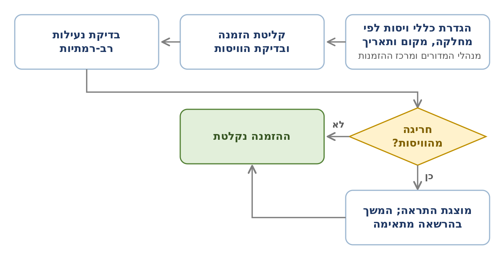

<!-- generated from: אפיון יד ושם מודול הזמנות חלק 2 מאושר 06-10 .docx | 2026-11-08 | do not edit by hand; regenerate from the docx -->

> **מקור:** מסמך 2 - תהליכי ההזמנות, גרסה מאושרת, 6.10.2026  
> **מיקום בניווט:** מסמך 2 - תהליכי ההזמנות › תהליכים עסקיים › ויסות ונעילה רב-רמתית  
> **קודי ולידציה ואוטומציה בפרק:** A12-01, A12-02, A12-03, A12-04, A12-05, A12-06, A12-08, A12-09, A12-10, A12-11, A12-12, V12-01, V12-02, V12-03, V12-04, V12-05, V12-06, V12-07  
> **הקודם:** [שיבוץ משאבים פיזיים, מוזיאון ותערוכות](11-physical-resources-museum.md) · **הבא:** [זמינות מדריכים וניהול נותני שירות](13-guide-availability-service-providers.md) · [מקרא](../../INDEX.md)

# ויסות ונעילה רב-רמתית

## תיאור התהליך

⟦💬 c609⟧הוויסות במוזיאון הוא מנגנון מרכזי לשליטה בכניסות למוזיאון בשעות העומס, שהן השעות המבוקשות ביותר, ולחלוקת התפוסה בין הקהלים השונים. חלון הוויסות המחייב הוא בין 09:30 ל-13:30, ⟦💬 c611⟧ וכל יתר שעות היום פתוחות לכלל הקהלים ללא ויסות.  ⟦💬 c613⟧חלון זה מוגדר כפרמטר הניתן לשינוי על ידי יד ושם ללא פיתוח. אין קשר בין שעות הוויסות לבין טווחי השעות הקובעים את דמי ההרשמה והטיפול: אלו שני נתונים נפרדים לחלוטין. ויסות ההדרכות היומי הוא מנגנון נוסף מעבר לוויסות הכניסות למוזיאון.  ⟦💬 c615⟧הוויסות נדרש משום שהקיבולת היומית של המדריכים מוגבלת ומהווה משאב מצומצם המתחלק בין הקהלים, ובשל השונות העונתית בביקושים. כל קהל פועל בעונת שיא אחרת: סוכני נסיעות מזמינים זמן רב מראש, קבוצות צבא מתמקדות בימי ראשון וחמישי, ובתי ספר מזמינים בעיקר עם פתיחת שנת הלימודים ולפי לוח הבגרויות. כללי הוויסות מוגדרים על ידי מנהלי המחלקות ומרכז ההזמנות, באמצעות קבוצת ההרשאה ניהול ויסות ונעילה, ונאכפים על כלל ערוצי ההזמנה.

הוויסות בנוי מארבעה ממדים: ויסות לפי כניסות למוזיאון, שבו מוקצית לכל מחלקה מכסה באחוזים מסך הכניסות בשעות העומס לכל יום בשבוע, ובמקרים מסוימים מוגדרת המכסה לפי קהל ספציפי ברמת מדור, לדוגמה פיצול עונתי של מחלקת הדרכה וקהל רחב לקבוצות חינוכיות מחו"ל ולכל השאר; ויסות לפי מספר מדריכים יומי, המגביל את מספר ההדרכות היומיות בעברית לפי מחלקה, ובמקרים מסוימים לפי קהל ספציפי ברמת מדור, כדי למנוע מהקהל המזמין הראשון לנצל את כלל מלאי המדריכים; ויסות נפרד לשפות, המנוהל לפי כל שפה בנפרד ואינו נכלל בוויסות ההדרכות בעברית, כאשר הזמנת הדרכה באנגלית מאושרת מיידית ויתר השפות מוגשות כבקשה הממתינה לאישור יד ושם; וויסות לפי מוצרים מסוימים בעלי קיבולת מצומצמת, כדוגמת הרצאות ועדויות, פר קבוצות ופר תאריכים. כל כלל תלוי תאריכים וניתן לתיחום לפי טווח תאריכים. ⟦💬 c617⟧ ⟦💬 c619⟧ ⟦💬 c620⟧ ⟦💬 c621⟧ ⟦💬 c622⟧ ⟦💬 c623⟧ ⟦💬 c624⟧ ⟦💬 c625⟧ ⟦💬 c626⟧ ⟦💬 c627⟧ ⟦💬 c628⟧ ⟦💬 c629⟧ ⟦💬 c630⟧ ⟦💬 c631⟧

אכיפת הוויסות נבדלת בין הערוצים, בהתאם להנחיית הצוות: במערכת המקוונת הוויסות הוא חסימה, ומי שפותח הזמנה החורגת מהוויסות אינו יכול להזמין, אלא אם מרכז ההזמנות פתח כלל חדש ליום המסוים. במערכת הפנימית הוויסות פועל ברמת התראה ואינו חוסם, ורמת האכיפה נגזרת מסוג הוויסות: חריגה מוויסות הכניסות למוזיאון מוצגת כהתראה וההזמנה ניתנת לשמירה לפי שיקול דעת העובד, ואילו חריגה מוויסות ההדרכות, בעברית ובשפות, ניתנת לעקיפה בידי בעל ההרשאה הייעודית בלבד. התראה על חריגה נשלחת גם לרכז ההזמנה ולמרכז ההזמנות, שכן אין רכז ברמת המוצר והרכז מקושר להזמנה בלבד. הוויסות לפי מספר מדריכים נאכף במערכת המקוונת, בהתחשב בכך שצבא אינו מזמין במקוון, וקהל רחב באנגלית אינו מוגבל במכסת מדריכים.

מנגנון הכניסה למוזיאון בנוי על חלונות כניסה של עשר דקות, הנוצרים בין שעת הפתיחה לשעת הסגירה של המוזיאון. הקצאת חלונות הכניסה לקהלים מוגדרת בקונפיגורציה לפי הנתונים שתעביר יד ושם ואינה נכתבת באפיון. הקיבולת לכל חלון נגזרת ממשאב המוזיאון ועומדת על עד 100 מבקרים בכל חלון של עשר דקות, והתפוסה היומית המקסימלית של המוזיאון היא 2,400 מבקרים ביום; ערכים אלה ניתנים לשינוי בקלות על ידי יד ושם. ימי סגירה מקצרים את יום הפעילות או מבטלים אותו. הקצאות שלא נוצלו משתחררות אוטומטית שבועיים לפני מועד הפעילות ונפתחות לכלל הקהלים, במקום חודש לפני המועד הנהוג היום, והזמנות הנקלטות ידנית נספרות באותה מכסה של הערוץ המקוון. אופק ההזמנה במערכת המקוונת עומד על 12 חודשים קדימה, לסוכני נסיעות, לפרטיים ולבתי ספר, במקום חצי שנה כיום, ולוח הוויסות נבנה בהתאם לאופק זה; אכיפת האופק מפורטת בפרק הזמנה מקוונת עצמאית. בהקשר זה נכללים גם מרחבי השיח, משאב בסגנון המוזיאון המוגבל לקבוצות מודרכות, שצפוי להתרחב משני מרחבים כיום לכעשרה. ⟦💬 c634⟧ ⟦💬 c636⟧ ⟦💬 c637⟧ ⟦💬 c639⟧

⟦💬 c640⟧מטריצת ויסות הכניסות למוזיאון בהזמנות מקוונות מוגדרת באחוזים מסך הכניסות פר מחלקה ופר יום בשבוע, בשעות הוויסות בלבד (נספח 20):

| ⟦💬 c642⟧מחלקה (ניתן לאחד מספר מחלקות לאותו ויסות, ובמקרים מסוימים להגדיר ויסות לפי קהל ספציפי ברמת מדור) | יום א | יום ב | יום ג | יום ד | יום ה | יום ו |
| --- | --- | --- | --- | --- | --- | --- |
| צה"ל | 40% | 10% | 10% | 10% | 20% |  |
| הדרכות חינוכיות | 40% | 40% | 40% | 40% | 40% |  |
| מורים |  |  |  |  |  |  |
| הדרכה וקהל רחב | 10% | 30% | 30% | 30% | 30% |  |
| מרכז הזמנות | 10% | 20% | 20% | 20% | 10% |  |
| מח' חו"ל |  |  |  |  |  |  |
| פרוייקטורית תוכן |  |  |  |  |  |  |
| סה"כ | 100% | 100% | 100% | 100% | 100% | 0% |

לצד ויסות הכניסות מופעל ויסות שני, כמותי, של הדרכות: מספר ההדרכות בעברית המבוצעות על ידי מדריכי יד ושם, פר מחלקה ופר יום. כללי הוויסות המפורטים, לרבות היקף התחולה וההחרגות, סימון המחלקות והמוצרים הכפופים לוויסות, סימון מסגרות תקציביות מוחרגות וההרשאה לחריגה מהוויסות, יוגדרו בקונפיגורציה לפי השדות והכללים שתעביר יד ושם ולא ייכתבו באפיון ברמת פירוט זו (נספח 21): ⟦💬 c645⟧

| ⟦💬 c648⟧מחלקה (ניתן לאחד מספר מחלקות לאותו ויסות, ובמקרים מסוימים להגדיר ויסות לפי קהל ספציפי ברמת מדור) | יום א | יום ב | יום ג | יום ד | יום ה |
| --- | --- | --- | --- | --- | --- |
| הדרכות חינוכיות | 18 | 37 | 37 | 37 | 18 |
| צה"ל וכוחות הבטחון | 37 | 18 | 18 | 18 | 37 |
| הדרכה וקהל רחב | 20 | 20 | 20 | 20 | 20 |

ויסות ההדרכות סופר את כלל ההזמנות במערכת, ללא קשר להיכן וכיצד נפתחו, כלומר גם הזמנות מקוונות וגם הזמנות שנפתחו ידנית במערכת הפנימית. הוויסות חל על הדרכות המתקיימות ביד ושם, בבית ווהלין, אצל המזמין ובאופן וירטואלי, ומחריג את עיר הבה"דים, שלה מדריכים ייעודיים והזמנותיה נפתחות ידנית ואינן נספרות במכסה.  ⟦💬 c650⟧גם ויסות ההדרכות מתאפס שבועיים לפני מועד הפעילות: היתרות שלא נוצלו נפתחות לכלל המחלקות, אך המכסה היומית הכוללת של ההדרכות בעברית ושל ההדרכות בשפות ממשיכה לחול. לכל כלל ויסות מוגדרים תאריך התחלה ותאריך סיום. ערכי המטריצה הכמותית הם סקיצה ראשונה ולא מספרים סופיים, והם ייקבעו על ידי יד ושם לפני  ⟦💬 c652⟧ההטמעה.

לצד הוויסות נדרשת נעילה רב-רמתית של פעילויות ומשאבים, המופעלת במספר רמות: סגירת אתר יד ושם כולו, סגירת המוזיאון בלבד, סגירת משאב מסוים, סגירה של סוגי פעילויות, וסגירה לפי שפה. מנגנון הנעילה משמש גם באירועי חירום: סגירת האתר בעת מלחמה, או ביקור VIP פתאומי המחייב סגירה לפרק זמן של 24 עד 72 שעות. נעילת אתר יד ושם סוגרת גם את המוזיאון, בעוד שנעילת המוזיאון בלבד אינה מונעת כניסה לאתר. כל מוצר מסווג בעת פתיחתו לפי מאפיין סיווג, וכל מה שמסווג כפעילות הדורשת מדריך ניתן לנעילה בלחיצה אחת, לדוגמה ביום גיבוש של כלל המדריכים. בהתאם להנחיית הצוות, הסגירה אינה חייבת להיות תמיד בשתי המערכות: נדרשת הפרדה בין נעילה במערכת המקוונת בלבד לבין נעילה גם במערכת הפנימית, שכן הדרכה ידנית באמצעות עובד יד ושם אינה גורעת ממלאי המדריכים. סגירה לפי שפה מאפשרת, כאשר כל המדריכים בשפה מסוימת תפוסים, להתיר הדרכות בעברית בלבד ולמנוע הדרכות באנגלית.

באותה מידה שבה נדרשת נעילה, נדרשת גמישות בפתיחה מיוחדת: פתיחת המוזיאון בשעה מוקדמת או מאוחרת במיוחד עבור קבוצה גדולה שקיבלה אישור פרטני, פתיחת המוזיאון ביום השואה אחר הצהריים למוזמנים בלבד תוך נעילה מוחלטת בבוקר, והארכת שעות הפעילות בתאריך נקודתי. הזמנה הנשמרת עם ביקור במוזיאון מחוץ לשעות הפעילות שולחת מייל אוטומטי לצוות תפעול המוזיאון. בנוסף ניתן להגדיר חריגה נקודתית ממכסת ויסות המדריכים בתאריך מסוים, להגדלה או להקטנה של המכסה ולציון הגורם שלו מוקצית ההגדלה או ההקטנה, לדוגמה ביום השואה או בליל המוזיאונים; ההגדרה מתבצעת בקונפיגורציה על ידי יד ושם. ⟦💬 c654⟧

כל כלל סגירה או פתיחה שהוגדר ניתן לעריכה בדיעבד, מבלי להיכנס לכל משאב ותאריך בנפרד: המערכת מאפשרת לבחור בבת אחת מספר משאבים וטווח תאריכים, לרבות טווח שאינו רציף (לדוגמה כל יום שני וחמישי בלבד), ולשנות או לבטל את הכללים בפעולה אחת. יכולת זו מחליפה את המצב הקיים, שבו הוספת תאריכים לכלל מתבצעת תאריך אחר תאריך.

## שלבי התהליך

1. הגדרת כללי הוויסות כרשומות קונפיגורציה: ממד הוויסות (כניסות, מדריכים, שפה, מוצר), הקהל, המכסה או האחוז, טווח התאריכים, ימי השבוע, חלון שעות הוויסות (ברירת מחדל 09:30 עד 13:30) ומיקום הפעילות.

2. יצירת חלונות הכניסה למוזיאון: חלונות של עשר דקות בין שעת הפתיחה לשעת הסגירה, בקיבולת של עד 100 מבקרים לחלון ועד 2,400 מבקרים ליום, והקצאת דקות החלון לקהלים כרשומות קונפיגורציה.

3. הזנת מטריצת האחוזים פר מחלקה ופר יום לשעות הוויסות, לפי כלל ההקצאה שנבחר:  ⟦💬 c658⟧מחלקה שלא הוגדר לה ויסות אינה כפופה לכללי הוויסות ורשאית להזמין ללא מגבלת מכסה, ויתרת אחוזים שלא חולקה נפתחת לכלל הקהלים.

4. בעת הזמנה מקוונת נבדקים הוויסות והזמינות; הזמנה החורגת נחסמת ומוצגים מועדים חלופיים זמינים בלבד.

5. בעת הזמנה במערכת הפנימית נבדק הוויסות; חריגה מוויסות הכניסות למוזיאון מוצגת כהתראה על גבי המסך וההזמנה ניתנת לשמירה לפי שיקול דעת המשתמש, וחריגה מוויסות ההדרכות ניתנת לעקיפה בידי בעל ההרשאה הייעודית בלבד. ההתראה נשלחת לרכז ההזמנה ולרשימת נמענים שתוגדר בקונפיגורציה על ידי יד ושם; אין רכז ברמת המוצר, שכן הרכז מקושר להזמנה בלבד. ⟦💬 c660⟧

6.  ⟦💬 c662⟧ויסות ההדרכות היומי: מחלקה שהוגדר לה ויסות רשאית להשתמש רק במכסת ההדרכות שהוקצתה לה, ומחלקה שלא הוגדר לה ויסות משתמשת בהדרכות ללא הגבלה; שבועיים לפני מועד הפעילות יתרת ההדרכות שלא נוצלה פתוחה לשימוש כלל המחלקות. הספירה כוללת את ההזמנות בכל הערוצים, למעט הזמנות שמקום הפעילות שלהן עיר הבה"דים. במערכת המקוונת ההזמנה נחסמת בהגעה למכסה; בתה"ל מוצגת התראה והמשתמש נדרש לאשר בלחצן שהוא מודע לחריגה, ורק בעלי הרשאה יכולים לחרוג מהוויסות. הוויסות חל על הזמנות, והפעילות יכולה להתקיים ביד ושם, בבית ווהלין, אצל המזמין או באופן וירטואלי. אירועים אינם כלולים בוויסות, למעט סוג האירוע שיאושר על ידי יד ושם, שבו מסומן לכל אירוע אם הוא כלול בוויסות. בכל מחלקה ובכל מוצר או סוג פעילות יומית מסומן אם הם כלולים בוויסות, והזמנות המבוצעות על ידי חיילי יחידת ההסברה מוחרגות באמצעות סימון במסגרת התקציבית שלהן.

7. שבועיים לפני מועד הפעילות מתאפס הוויסות: התפוסה והמכסות שלא נוצלו נפתחות לכלל הקהלים.

8. הגדרת נעילות: אתר, מוזיאון, משאב, סוג פעילות או שפה, בהפרדה בין המערכת המקוונת למערכת הפנימית, לפי תאריכים, שעות וקהלים.

9. פתיחה מיוחדת: פתיחת שעות חריגות בתאריך נקודתי, לרבות פתיחה למוזמנים בלבד תוך נעילת יתר היום.

10. עריכת כללים קיימים בדיעבד: בחירת מספר משאבים וטווחי תאריכים, גם שאינם רציפים, ושינוי או ביטול בפעולה אחת.

## ישויות ושדות בתהליך

| ישות | תפקיד בתהליך | שדות ייעודיים לתהליך |
| --- | --- | --- |
| כלל ויסות (קונפיגורציה) | מגבלות הכניסה, ההדרכה, השפה והמוצר | ממד הוויסות, קהל, מחלקה, מכסה או אחוז, טווח תאריכים, ימי שבוע, שעות, מיקום פעילות, תקופת שחרור ההקצאה |
| הקצאת חלון כניסה (קונפיגורציה) | שיוך דקות החלון לקהלים | ⟦💬 c667⟧קהל, טווח תאריכים; הגדרת חלונות הכניסה והקצאתם לקהלים נשמרות כפרמטרים בקונפיגורציה |
| משאב (GoMeddo Resource), מוזיאון ומרחבי שיח | מקור הקיבולת לחלונות והנעילה ברמת המשאב | קיבולת, שעות פתיחה וסגירה, סטטוס נעילה |
| מקום פעילות (YV Location) | היררכיית מבנה, קומה וכיתה לנעילה מדורגת | מיקום אב, רמת ההיררכיה |
| מוצר (Product) | סיווג הפעילות לנעילה לפי סוג | מאפיין סיווג (פעילות הדורשת מדריך), שפת הדרכה |
| הזמנה (Opportunity) | ההזמנה הנבדקת מול הוויסות והנעילות | קהל, מועד, שעת כניסה למוזיאון, ערוץ קליטה (מקוון או ידני) |

## כללי ולידציה

| מזהה | הכלל | הודעת שגיאה |
| --- | --- | --- |
| V12-01 | הזמנה מקוונת החורגת מכלל ויסות נחסמת, ולמזמין מוצגים מועדים זמינים בלבד | אין זמינות במועד המבוקש |
| V12-02 | ⟦💬 c670⟧הזמנה במערכת הפנימית החורגת מוויסות הכניסות למוזיאון אינה נחסמת ומוצגת התראה בלבד; חריגה מוויסות ההדרכות בעברית או בשפות מוצגת כהתראה, ורק בעל הרשאה מתאימה רשאי לעקוף אותה | ההזמנה חורגת מהוויסות המותר; בהודעה יפורטו סוג הוויסות והערכים, לדוגמה שובצו כבר 51 מדריכים במקום 50 המותרים ⟦💬 c672⟧ |
| V12-03 | לא ניתן לשמור הזמנה או שיבוץ על משאב, סוג פעילות, שפה או תאריך נעולים, בהתאם לתחולת הנעילה בערוץ | המועד או המשאב נעולים להזמנה |
| V12-04 | חלונות כניסה נוצרים רק בין שעת הפתיחה לשעת הסגירה של המוזיאון; לא ניתן לשבץ קבוצה לחלון מחוץ לשעות אלה ללא פתיחה מיוחדת | חלון הכניסה מחוץ לשעות פעילות המוזיאון |
| V12-05 | סך המשתתפים המשובצים לחלון כניסה אינו עולה על קיבולת משאב המוזיאון, עד 100 מבקרים לחלון של עשר דקות ועד 2,400 מבקרים ליום | חלון הכניסה בתפוסה מלאה |
| V12-06 | ⟦💬 c674⟧כללי הוויסות, לרבות אופן הטיפול במחלקה שלא הוגדרה לה מכסת ויסות, ייקבעו בקונפיגורציה לפי השדות והנתונים שתעביר יד ושם | אין מכסת ויסות למחלקה זו במועד המבוקש |
| V12-07 | הזמנה החורגת ממכסת ההדרכות היומית של המחלקה נחסמת במערכת המקוונת ומוצגת כהתראה בלבד במערכת הפנימית; רשימת ההחרגות מהספירה תוגדר בקונפיגורציה לפי הטבלה שתעביר יד ושם ⟦💬 c676⟧ | מכסת ההדרכות היומית של המחלקה מוצתה |

## אוטומציות

| מזהה | טריגר | הפעולה האוטומטית |
| --- | --- | --- |
| A12-01 | הגדרת שעות פתיחה וסגירה למוזיאון לתאריך | יצירת חלונות כניסה של עשר דקות בין שעת הפתיחה לשעת הסגירה, עם קיבולת ממשאב המוזיאון |
| A12-02 | הגדרת יום סגירה | קיצור יום הפעילות או ביטולו, לרבות ביטול חלונות הכניסה שנגרעו |
| A12-03 | הגעת מועד שבועיים לפני מועד הפעילות | איפוס הוויסות: שחרור אוטומטי של ההקצאות והמכסות שלא נוצלו, בוויסות הכניסות ובוויסות ההדרכות כאחד, ופתיחת התפוסה הנותרת לכלל הקהלים |
| A12-04 | קליטת הזמנה ידנית | ההזמנה נספרת באותה מכסת ויסות של הערוץ המקוון, בוויסות הכניסות ובוויסות ההדרכות; ויסות ההדרכות סופר את כלל ההזמנות במערכת ללא קשר להיכן וכיצד נפתחו |
| A12-05 | חריגה מהוויסות במערכת הפנימית | ⟦💬 c679⟧הצגת הודעה על גבי המסך ושליחת התראה לנמענים שיוגדרו; בחריגה מוויסות ההדרכות נדרשת הרשאה ייעודית לעקיפה |
| A12-06 | נעילת אתר יד ושם | נעילה אוטומטית גם של המוזיאון; נעילת המוזיאון בלבד אינה נועלת את האתר |
| A12-08 | נעילה לפי סיווג פעילות הדורשת מדריך | נעילת כלל המוצרים המסווגים כך בלחיצה אחת, בתחולה שנבחרה (מקוונת בלבד או גם פנימית) |
| A12-09 | שמירת הזמנה עם ביקור במוזיאון מחוץ לשעות הפעילות | שליחת מייל אוטומטי לצוות תפעול המוזיאון |
| A12-10 | עריכה או ביטול של כלל סגירה או פתיחה על מספר משאבים וטווחי תאריכים | החלת השינוי בפעולה אחת על כל המשאבים והתאריכים שנבחרו, לרבות טווח לא רציף |
| A12-11 | חישוב זמינות בשעות הוויסות ליום שבו לא חולקו כל 100 האחוזים | כללי חלוקת האחוזים, לרבות אופן הטיפול ביתרה שלא הוקצתה, ייקבעו בקונפיגורציה ואינם נכתבים באפיון ברמה זו ⟦💬 c681⟧ |
| A12-12 | שמירת הזמנה הכוללת הדרכה בעברית של מדריך יד ושם, ביד ושם, אצל המזמין או וירטואלית | ההזמנה נספרת במכסת ההדרכות היומית של המחלקה; הזמנה שמקום הפעילות שלה עיר הבה"דים אינה נספרת |

## אוטומציות מרכזיות, מפרט מימוש

### יצירת חלונות הכניסה למוזיאון והקצאתם לקהלים

| טריגר | הגדרה או עדכון של שעות הפתיחה והסגירה של המוזיאון לתאריך, או הגדרת יום סגירה, אחרי שמירה. |
| --- | --- |
| שלבים | 1. יצירת חלונות כניסה בהפרשים של עשר דקות, מהשעה הפתיחה ועד שעת הסגירה של המוזיאון באותו תאריך. 2. קביעת קיבולת כל חלון מתוך הקיבולת המוגדרת במשאב המוזיאון. 3. הקצאת חלונות הכניסה לקהלים מוגדרת בקונפיגורציה לפי הנתונים שתעביר יד ושם ואינה נקבעת באפיון. 4. ⟦💬 c684⟧ ביום סגירה, קיצור טווח החלונות או ביטול כלל חלונות היום. 5. בתקופה המוגדרת לפני המועד, שחרור ההקצאות שלא נוצלו ופתיחת החלונות לכלל הקהלים. |
| בדיקת קבלה | חלונות הכניסה נוצרים לכל יום פעילות בהתאם לפרמטרים שהוגדרו בקונפיגורציה, וכלל הקהלים רשאים להשתבץ לכל חלון פנוי בכפוף למטריצת הוויסות. ⟦💬 c686⟧ |

### אכיפת ויסות בעת הזמנה

| טריגר | בחירת מועד ושעה בהזמנה, במערכת המקוונת או במערכת הפנימית, לפני שמירה. |
| --- | --- |
| שלבים | 1. בדיקה האם מועד ההזמנה נופל בחלון שעות הוויסות (09:30 עד 13:30 כברירת מחדל); מחוץ לחלון זה אין ויסות כניסות וכל השעות פתוחות. 2. איתור כללי הוויסות החלים על ההזמנה לפי הקהל, המחלקה, התאריך, השעה, השפה, המוצר ומיקום הפעילות. 3. חישוב הניצול הנוכחי של המכסה: בוויסות הכניסות לפי אחוז המחלקה מסך הכניסות באותו יום, ובוויסות ההדרכות לפי מספר ההדרכות היומי של המחלקה, בספירת כלל ההזמנות בכל הערוצים ובהחרגת הזמנות עיר הבה"דים. 4. כללי הוויסות והחסימה, לרבות אופן הטיפול במחלקה שלא הוגדר לה ויסות, ייקבעו בקונפיגורציה לפי הנתונים שתעביר יד ושם. 5. ⟦💬 c688⟧ במערכת המקוונת: אם ההזמנה חורגת מהמכסה, המועד נחסם ומוצגים למזמין מועדים זמינים בלבד, אלא אם נפתח כלל חדש ליום זה על ידי מרכז ההזמנות. 6. במערכת הפנימית: אם ההזמנה חורגת, השמירה מתאפשרת ומוצגת הודעת התראה על גבי המסך; אין חסימה. 7. בכל חריגה שאושרה נשלחת התראה לרכז ההזמנה ולמרכז ההזמנות. 8. החל משבועיים לפני מועד הפעילות הבדיקה אינה מופעלת, שכן הוויסות התאפס. |
| בדיקת קבלה | הזמנת בית ספר מקוונת לשעה 11:00 ביום שבו מכסת הדרכות חינוכיות מוצתה נחסמת ומציגה חלופות, אותה הזמנה לשעה 14:30 נשמרת ללא בדיקת ויסות, רכזת השומרת את אותה הזמנה במערכת הפנימית מקבלת הודעת חריגה על המסך ללא חסימה, ומאחר שמדובר בוויסות הדרכות נדרשת הרשאה ייעודית כדי לעקוף את החריגה ולשמור, והתראה נשלחת למרכז ההזמנות, והזמנה זהה בעיר הבה"דים אינה נספרת  ⟦💬 c690⟧במכסה. יש להבחין בין שני סוגי הוויסות: ויסות המוזיאון חל רק על מוצרים הדורשים כניסה למוזיאון, וויסות ההדרכות חל רק על פעולות הדורשות הדרכה. |

### נעילה רב-רמתית בכמויות ובהיררכיה

| טריגר | הגדרת כלל נעילה או פתיחה על ידי משתמש בעל הרשאת ניהול ויסות ונעילה, אחרי שמירה. |
| --- | --- |
| שלבים | 1. בחירת רמת הנעילה: אתר, מוזיאון, משאב בודד, סוג פעילות או שפה, ובחירת התחולה: המערכת המקוונת בלבד או גם המערכת הפנימית. 2. בחירת מספר משאבים וטווחי תאריכים בבת אחת, לרבות טווח לא רציף של ימים נבחרים בשבוע. 3. החלת הנעילה: נעילת אתר נועלת גם את המוזיאון; נעילה לפי סיווג נועלת את כל הפעילויות הדורשות מדריך. כללי הנעילה וזמינות המוצרים אינם נכתבים באפיון ברמת פירוט זו: יד ושם תעביר את השדות והישויות הנדרשים, והנעילה תוגדר בקונפיגורציה ברמת מוצר או ברמת סיווג. בנוסף ניתן לחסום סוג פעילות לתאריך מסוים או לטווח תאריכים. 4. ⟦💬 c692⟧ ⟦💬 c694⟧ ⟦💬 c697⟧ פתיחה מיוחדת מוגדרת באותו מנגנון: הרחבת שעות בתאריך נקודתי או פתיחה למוזמנים בלבד תוך נעילת יתר היום. 5. עריכה בדיעבד: בחירת כללים קיימים ושינוים או ביטולם בפעולה אחת, ללא מעבר על כל משאב ותאריך בנפרד. |
| בדיקת קבלה | נעילת כל הפעילויות המודרכות ליום גיבוש מדריכים מתבצעת בלחיצה אחת במערכת המקוונת בלבד, והזמנה ידנית עם הדרכת עובד יד ושם באותו יום נשמרת ללא חסימה. |

תרשים תהליך 12 - ויסות ונעילה רב-רמתית

---

## הערות סקירה בפרק זה

> הערות הסקירה אינן חלק מהאפיון המחייב. הן מסמנות מקומות שבהם הטקסט עדיין בדיון. הסימון ⟦💬 cN⟧ בגוף הטקסט מפנה להערה כאן.

### ⟦💬 c609⟧ סגורה
- **c609** · טל שמרית · 2026-09-07 · סומנה כסגורה: תיקון: "הויסות במוזיאון"
  - **c610** · Lior Pridor · 2026-09-14 · סומנה כסגורה: הפסקה כבר פותחת בניסוח הוויסות במוזיאון.

### ⟦💬 c611⟧ סגורה
- **c611** · וייל דבורה · 2026-09-07 · סומנה כסגורה: השעות צריכות להיות ניתנות לשינוי בקלות, אין קשר בין השעות של דמי הרשמה וטיפול לבין שעות הויסות, זה 2 נתונים נפרדים לגמרי
  - **c612** · Lior Pridor · 2026-09-14 · סומנה כסגורה: שעות הוויסות מוגדרות כפרמטר בקונפיגורציה הניתן לשינוי על ידכם ללא פיתוח, ואנו מפרידים בינן לבין שעות דמי ההרשמה והטיפול; הערכים ייקבעו לפי מה שתעבירו ויתורגלו בבדיקות הקבלה.

### ⟦💬 c613⟧ סגורה
- **c613** · טל שמרית · 2026-09-07 · סומנה כסגורה: אלו שעות המשפיעות על תשלום דמי הרשמה וטיפול, לא קשור לויסות הכניסות למוזיאון
  - **c614** · Lior Pridor · 2026-09-14 · סומנה כסגורה: נפריד בין שעות דמי ההרשמה והטיפול לבין שעות ויסות הכניסות למוזיאון; ערכי השעות לא ייקבעו באפיון אלא יוגדרו בקונפיגורציה לפי הנתונים שתעבירו.

### ⟦💬 c615⟧ סגורה
- **c615** · טל שמרית · 2026-09-07 · סומנה כסגורה: זהו ויסות נוסף מעבר לויסות הכניסות למוזיאון
  - **c616** · Lior Pridor · 2026-09-14 · סומנה כסגורה: מקובל שמדובר בוויסות נוסף מעבר לוויסות הכניסות למוזיאון; פירוט הכללים לא ייכתב באפיון ברמה זו ויוגדר בקונפיגורציה לפי הטבלאות שתעבירו.

### ⟦💬 c617⟧ סגורה
- **c617** · טל שמרית · 2026-09-07 · סומנה כסגורה: לעדויות / הרצאות , צריך תהיה מכסה יומית לפי מוצר. / צריך שיתמוך גם בניידות, אולם בניידות זה יהיה כמו שכתוב בסעיף 12.7 , בקשה ולא הזמנה. / יש צורך במכסה יומית לכלל הניידות, שמכילה בתוכה מס' ניידות שונות שלכל אחת יש מלאי נפרד אבל הויסות של כולן הוא יחד בגלל כמות הבנות שירות המוגבלת. / לדוגמא: / יש 6 בנות שירות שמתפצלות לזוגות, ועל כן, ניתן להשתמש ביום ב 3 ניידות סה"כ, כאשר צריך לקחת בחשבון איזה ניידת מוזמנת וכמה עותקים יש ממנה. / ושוב, בשל המורכבות, מדובר בבקשה ולא הזמנה.
  - **c618** · Lior Pridor · 2026-09-14 · סומנה כסגורה: מכסות יומיות לפי מוצר, לרבות עדויות והרצאות, וכן מכסה משותפת לכלל הניידות, יוגדרו כפרמטרים בקונפיגורציה; נבקש שתעבירו את טבלת המכסות והכללים.

### ⟦💬 c619⟧ סגורה
- **c619** · Lior Pridor · 2026-09-14 · סומנה כסגורה: הפסקה כבר קובעת ויסות לפי מחלקה ובמקרים מסוימים לפי קהל ספציפי ברמת מדור.

### ⟦💬 c620⟧ סגורה
- **c620** · Lior Pridor · 2026-09-14 · סומנה כסגורה: הפסקה כבר קובעת שאנגלית מאושרת מיידית ויתר השפות מוגשות כבקשה לאישור.

### ⟦💬 c621⟧ סגורה
- **c621** · Lior Pridor · 2026-09-14 · סומנה כסגורה: הפסקאות כבר מתארות ויסות לפי מחלקה ובמקרים מסוימים לפי קהל או מדור.

### ⟦💬 c622⟧ סגורה
- **c622** · Lior Pridor · 2026-09-14 · סומנה כסגורה: הפסקה כבר קובעת שוויסות השפות הוא בנוסף לוויסות בעברית ומנוהל לפי כל שפה בנפרד.

### ⟦💬 c623⟧ סגורה
- **c623** · Lior Pridor · 2026-09-14 · סומנה כסגורה: הפסקה כבר קובעת שהוויסות הכמותי הוא להדרכות בעברית ושליתר השפות קיים ויסות נפרד.

### ⟦💬 c624⟧ סגורה
- **c624** · Lior Pridor · 2026-09-14 · סומנה כסגורה: הפסקה כבר מבדילה בין ויסות ההדרכות בעברית לבין ויסות נפרד לכל שפה.

### ⟦💬 c625⟧ סגורה
- **c625** · Lior Pridor · 2026-09-14 · סומנה כסגורה: ויסות השפות יופעל בנוסף לוויסות ההדרכות בעברית ולפי כל שפה בנפרד; הכללים יוגדרו בקונפיגורציה לפי מה שתעבירו.

### ⟦💬 c626⟧ סגורה
- **c626** · Lior Pridor · 2026-09-14 · סומנה כסגורה: הוויסות יוגדר לפי מחלקה ובמקרים מסוימים לפי קהל או מדור, כולל פיצול עונתי; ההגדרות ייעשו בקונפיגורציה לפי מה שתעבירו ולא ייקבעו באפיון ברמה זו.

### ⟦💬 c627⟧ סגורה
- **c627** · Lior Pridor · 2026-09-14 · סומנה כסגורה: ויסות ההדרכות בעברית ייבדל מוויסות יתר השפות; המכסות וההתניות לכל שפה יוגדרו בקונפיגורציה לפי הנתונים שתעבירו.

### ⟦💬 c628⟧ סגורה
- **c628** · טל שמרית · 2026-09-07 · סומנה כסגורה: ויסות הדרכות זה אינו נכלל בויסות ההדרכות בעברית, אלא בנוסף, ההגבלה היא לפי כל שפה בנפרד. / הזמנה עבור הדרכה באנגלית ישר מאושרת, / לעומת יתר השפות שהן בגדר בקשה וממתינות לאישור יד ושם

### ⟦💬 c629⟧ סגורה
- **c629** · טל שמרית · 2026-09-07 · סומנה כסגורה: ויסות לפי מחלקה, ובמקרים מסויימים לפי קהל ספציפי, לדוגמא בקייץ נרצה לפצל את מחלקת הדרכה וקהל רחב לקבוצות חינוכיות מחו"ל ולכל השאר

### ⟦💬 c630⟧ סגורה
- **c630** · טל שמרית · 2026-09-07 · סומנה כסגורה: עבור הדרכות בעברית, ליתר השפות ויסות נפרד. / בהמשך מפורטים ההתניות לויסות זה ומי כלול בו.

### ⟦💬 c631⟧ סגורה
- **c631** · טל שמרית · 2026-09-07 · סומנה כסגורה: ויסות כניסה למוזיאון הוא לפי מחלקה, ובמקרים מסוימים לפי קהל ספציפי (ברמת מדור), לדוגמא אולי בקיץ נרצה לפצל את מחלקת הדרכה וקהל רחב לקבוצות חינוכיות מחו"ל ולכל השאר
  - **c632** · Lior Pridor · 2026-09-14 · סומנה כסגורה: ויסות הכניסות יוגדר ברמת מחלקה ובמקרים מסוימים לפי קהל או מדור; החיתוכים המדויקים יוגדרו בקונפיגורציה לפי מה שתעבירו ויתורגלו בבדיקות הקבלה.
  - **c633** · Lior Pridor · 2026-09-14 · סומנה כסגורה: טופל במסמך: נוסף שוויסות הכניסות מוגדר לפי מחלקה ובמקרים מסוימים לפי קהל ברמת מדור, כולל הפיצול העונתי.

### ⟦💬 c634⟧ סגורה
- **c634** · וייל דבורה · 2026-09-06 · סומנה כסגורה: צריך להיות קל לשינוי
  - **c635** · Lior Pridor · 2026-09-14 · סומנה כסגורה: ערכי הקיבולת, החלונות והתפוסה היומית יוגדרו כפרמטרים בקונפיגורציה הניתנים לשינוי על ידכם ללא פיתוח.

### ⟦💬 c636⟧ סגורה
- **c636** · Lior Pridor · 2026-09-14 · סומנה כסגורה: עודכן במסמך: הקצאת הדקות לקהלים הוסרה מתיאור התהליך, ונותר מנגנון חלונות הכניסה בלבד. ההקצאה עצמה מוגדרת בקונפיגורציה לפי הנתונים שתעבירו.

### ⟦💬 c637⟧ סגורה
- **c637** · טל שמרית · 2026-09-07 · סומנה כסגורה: למחוק, זה היה בעבר
  - **c638** · Lior Pridor · 2026-09-14 · סומנה כסגורה: עודכן במסמך: חלוקת דקות החלון הקבועה הוסרה, והקצאת חלונות הכניסה לקהלים מוגדרת בקונפיגורציה לפי הנתונים שתעבירו.

### ⟦💬 c639⟧ סגורה
- **c639** · וייל דבורה · 2026-09-06 · סומנה כסגורה: היה בעבר, כבר לא רלוונטי חלוקת הדקות הזו.

### ⟦💬 c640⟧ סגורה
- **c640** · טל שמרית · 2026-09-07 · סומנה כסגורה: ויסות כניסה למוזיאון צריך להיות בצורת החשיבה הבאה: / מחלקות שייש להן ויסות, יכולות להשתמש רק באחוזים המוקצים להן. / מחלקה שלא צויין לה ויסות, יכולה להשתמש במוזיאון ללא הגבלה. / שבועיים לפני מועד הפעילות, כולם יכולים להשתמש בכל הכניסות למוזיאון. / במערכת המקוונת- יש לחסום כאשר מגיעים למכסה המותרת. / במערכת תהל- יש לתת התראה, ועל המשתמש ללחוץ על לחצן בשביל לאשר שהוא מודע לכך שחרג מהויסות.
  - **c641** · Lior Pridor · 2026-09-14 · סומנה כסגורה: מודל הוויסות שתיארתם יוגדר בקונפיגורציה: מחלקה ללא ויסות אינה מוגבלת, שבועיים לפני מועד הפעילות נפתחות היתרות, במערכת המקוונת חסימה ובמערכת הפנימית התראה הדורשת אישור המשתמש; נבקש שתעבירו את הטבלה המלאה.

### ⟦💬 c642⟧ סגורה
- **c642** · טל שמרית · 2026-09-07 · סומנה כסגורה: יש לאפשר לאחד מחלקות לאותו הויסות. / ובמקרים מסויימים יהיה ויסות לפי קהל ספציפי (עפ"י מדור), לדוגמא ייתכן בקייץ נרצה לפצל את מחלקת הדרכה וקהל רחב לקבוצות חינוכיות מחו"ל ולכל השאר
  - **c643** · Lior Pridor · 2026-09-14 · סומנה כסגורה: נאפשר קיבוץ של מספר מחלקות לאותו ויסות וכן ויסות לפי קהל או מדור במקרים מסוימים; ההגדרות ייעשו בקונפיגורציה לפי מה שתעבירו.
  - **c644** · Lior Pridor · 2026-09-14 · סומנה כסגורה: טופל במסמך: נוספה האפשרות לאחד מחלקות לאותו ויסות ולהגדיר ויסות לפי קהל ברמת מדור.

### ⟦💬 c645⟧ סגורה
- **c645** · טל שמרית · 2026-09-07 · סומנה כסגורה: ויסות הדרכות יומי צריך להיות בצורת החשיבה הבאה: / מחלקות שייש להן ויסות, יכולות להשתמש רק במספר ההדרכות המוקצות להן. / מחלקה שלא צויין לה ויסות, יכולה להשתמש בהדרכות ללא הגבלה. / שבועיים לפני מועד הפעילות, כולם יכולים להשתמש ביתרת ההדרכות שלא נוצלו. / במערכת המקוונת- יש לחסום כאשר מגיעים למכסה המותרת. / במערכת תהל- יש לתת התראה, ועל המשתמש ללחוץ על לחצן בשביל לאשר שהוא מודע לכך שחרג מהויסות המותר. רק בעלי הרשאה יוכלו לחרוג מן הויסות. / כללים לויסות הדרכות: / הפעילות יכולה להתקיים ביד ושם, בית ווהלין, אצל המזמין ווירטואלי. / הויסות הוא עבור הזמנות / כמעט וכלל האירועים לא שייכים לויסות המדריכים, חוץ מאירועים מסוג "סירים מערכת מקוונת", בהם נצטרך לסמן האם האירוע כלול בויסות המדריכים או לא. / בתוך כל מחלקה נסמן האם המחלקה מקושרת לויסות ההדרכה או לא, מחלקה שלא מסומן לה כלום, יכולה להשתמש בהדרכות כמה שהיא צריכה. / הזמנה שאמורה להתקיים ע"י חיילי יחידת ההסברה אינה כלולה בויסות זה. יש לאפשר לסמן זאת במסגרת התקציבית שלהם. / בתוך כל מוצר/ סוג פעילות יומית, צריך יהיה להגדיר האם יש צורך בויסות. תלוי איך המערכת תבנה  ואז נדע טוב יותר.
  - **c646** · Lior Pridor · 2026-09-14 · סומנה כסגורה: כללי ויסות ההדרכות שפירטתם לא ייכתבו באפיון ברמת פירוט זו; נבקש שתעבירו את השדות והכללים, והם ייושמו בקונפיגורציה ויתורגלו בבדיקות הקבלה.
  - **c647** · Lior Pridor · 2026-09-14 · סומנה כסגורה: טופל במסמך: נוסף שכללי ויסות ההדרכות, ההחרגות והרשאת החריגה ייקבעו בקונפיגורציה לפי מה שתעביר יד ושם.

### ⟦💬 c648⟧ סגורה
- **c648** · טל שמרית · 2026-09-07 · סומנה כסגורה: יש לאפשר לאחד מחלקות לאותו הויסות. / ובמקרים מסויימים יהיה ויסות לפי קהל ספציפי (עפ"י מדור), לדוגמא ייתכן ובקייץ נרצה לפצל את מחלקת הדרכה וקהל רחב לקבוצות חינוכיות מחו"ל ולכל השאר
  - **c649** · Lior Pridor · 2026-09-14 · סומנה כסגורה: נאפשר איחוד מחלקות לאותו ויסות וכן ויסות לפי קהל או מדור במקרים מסוימים; ההגדרות ייעשו בקונפיגורציה לפי מה שתעבירו.

### ⟦💬 c650⟧ סגורה
- **c650** · טל שמרית · 2026-09-07 · סומנה כסגורה: בוודאי שייש הגבלת מכסה שבועיים לפני, פשוט שבועיים לפני, כל היתרות נפתחות לכלל המחלקות. עדיין צריך לא לאפשר לעבור את מכסה ההדרכות היומית המותרת בעברית ואת מכסת ההדרכות המותרת בשפות
  - **c651** · Lior Pridor · 2026-09-14 · סומנה כסגורה: נחדד שהמכסה היומית בעברית ובשפות נותרת בתוקף גם שבועיים לפני מועד הפעילות, ומה שנפתח הוא היתרות שלא נוצלו לכלל המחלקות; הערכים יוגדרו בקונפיגורציה.

### ⟦💬 c652⟧ סגורה
- **c652** · וייל דבורה · 2026-09-06 · סומנה כסגורה: יש להוסיף לכל ויסות תאריך התחלה וסיום
  - **c653** · Lior Pridor · 2026-09-14 · סומנה כסגורה: נוסיף לכל כלל ויסות תאריך התחלה ותאריך סיום כחלק מהגדרות הקונפיגורציה שיד ושם תתחזק.

### ⟦💬 c654⟧ סגורה
- **c654** · טל שמרית · 2026-09-07 · סומנה כסגורה: וגם אפשרות לחריגה מהויסות מדריכים הקיים, / למשל לאפשר בתאריך ספציפי (יום השואה/ מוזיאונים) להגדיל את מספר ההדרכות שקיים בויסות ולציין למי להקצות את ההגדלה. / באותה המידה לאפשר בתאריך ספציפי להקטין את מכסת ההדרכות ולציין כמה מוקצה ולמי.
  - **c655** · Lior Pridor · 2026-09-14 · סומנה כסגורה: נאפשר חריגה נקודתית מוויסות המדריכים בתאריך מסוים, להגדלה או להקטנה של המכסה ולציון הגורם שלו מוקצית ההגדלה או ההקטנה; ההגדרה תתבצע בקונפיגורציה.
  - **c656** · Lior Pridor · 2026-09-14 · סומנה כסגורה: טופל במסמך: נוספה חריגה נקודתית ממכסת ויסות המדריכים בתאריך מסוים, להגדלה או להקטנה, עם ציון הגורם.

### ⟦💬 c658⟧ סגורה
- **c658** · טל שמרית · 2026-09-07 · סומנה כסגורה: זה לא נכון, / מחלקה שאין לה ויסות יכולה להזמין כמה שהיא צריכה, פשוט כללי הויסות לא חלים עליה, זה לא אומר שהיא לא יכולה להזמין
  - **c659** · Lior Pridor · 2026-09-14 · סומנה כסגורה: מחלקה שלא הוגדר לה ויסות אינה מוגבלת ויכולה להזמין כרגיל, וכללי ההקצאה לא ייקבעו באפיון אלא בקונפיגורציה לפי מה שתעבירו.

### ⟦💬 c660⟧ סגורה
- **c660** · טל שמרית · 2026-09-07 · סומנה כסגורה: אין דבר כזה רכז מוצר, נעדכן המשך את מי יש לעדכן בהתראה זו. / התראה חריגה בויסות הדרכות לא בהכרח צריכה להגיע למרכז ההזמנות.
  - **c661** · Lior Pridor · 2026-09-14 · סומנה כסגורה: תוקן במסמך: אין רכז ברמת המוצר, שכן הרכז מקושר להזמנה בלבד. התראת חריגה בוויסות נשלחת לרכז ההזמנה ולרשימת נמענים שתוגדר בקונפיגורציה על ידי יד ושם.

### ⟦💬 c662⟧ סגורה
- **c662** · טל שמרית · 2026-09-07 · סומנה כסגורה: ויסות ההדרכות אינו כולל הדרכות באירועים, / לא חל על כל המחלקות, / ולא חל על כל המוצרים (למשל ניידות חינוכיות)
  - **c663** · Lior Pridor · 2026-09-14 · סומנה כסגורה: היקף התחולה של ויסות ההדרכות, לרבות החרגת אירועים, מחלקות ומוצרים כגון ניידות חינוכיות, יוגדר בקונפיגורציה לפי הרשימה שתעבירו.
  - **c664** · אשבל אור · 2026-09-23 · סומנה כסגורה: יש לתקן סעיף זה, בהקשר הויסות באירועים עפ"י הכללים הרשומים מעלה: / ויסות הדרכות יומי צריך להיות בצורת החשיבה הבאה: / מחלקות שייש להן ויסות, יכולות להשתמש רק במספר ההדרכות המוקצות להן. / מחלקה שלא צויין לה ויסות, יכולה להשתמש בהדרכות ללא הגבלה. / שבועיים לפני מועד הפעילות, כולם יכולים להשתמש ביתרת ההדרכות שלא נוצלו. / במערכת המקוונת- יש לחסום כאשר מגיעים למכסה המותרת. / במערכת תהל- יש לתת התראה, ועל המשתמש ללחוץ על לחצן בשביל לאשר שהוא מודע לכך שחרג מהויסות המותר. רק בעלי הרשאה יוכלו לחרוג מן הויסות. / כללים לויסות הדרכות: / הפעילות יכולה להתקיים ביד ושם, בית ווהלין, אצל המזמין ווירטואלי. / הויסות הוא עבור הזמנות / כמעט וכלל האירועים לא שייכים לויסות המדריכים, חוץ מאירועים מסוג "סירים מערכת מקוונת", בהם נצטרך לסמן האם האירוע כלול בויסות המדריכים או לא. / בתוך כל מחלקה נסמן האם המחלקה מקושרת לויסות ההדרכה או לא, מחלקה שלא מסומן לה כלום, יכולה להשתמש בהדרכות כמה שהיא צריכה. / הזמנה שאמורה להתקיים ע"י חיילי יחידת ההסברה אינה כלולה בויסות זה. יש לאפשר לסמן זאת במסגרת התקציבית שלהם. / בתוך כל מוצר/ סוג פעילות יומית, צריך יהיה להגדיר האם יש צורך בויסות. תלוי איך המערכת תבנה  ואז נדע טוב יותר.
  - **c665** · Lior Pridor · 2026-09-23 · סומנה כסגורה: שלב 6 נוסח מחדש לפי הכללים שהעברתם (מסומן כשינוי). נבקש להבהיר לאיזה סוג אירוע הכוונה במונח סירים מערכת מקוונת, ונעדכן את הנוסח בהתאם.

### ⟦💬 c667⟧ סגורה
- **c667** · טל שמרית · 2026-09-07 · סומנה כסגורה: זה כבר לא נכון,
  - **c668** · Lior Pridor · 2026-09-14 · סומנה כסגורה: עודכן במסמך: שדה דקות החלון עם הערכים הקבועים הוסר, והגדרת חלונות הכניסה והקצאתם לקהלים נשמרות כפרמטרים בקונפיגורציה.

### ⟦💬 c670⟧ סגורה
- **c670** · טל שמרית · 2026-09-07 · סומנה כסגורה: כאשר מדובר על חריגה בויסות מוזיאון- התראה בלבד / כאשר מדובר על חריגה בויסות מדריכים בעברית/ שפות, התראה ורק בעי הרשאה יוכלו לעקוף זאת
  - **c671** · Lior Pridor · 2026-09-14 · סומנה כסגורה: נבחין בין חריגה בוויסות המוזיאון, שבה תוצג התראה בלבד, לבין חריגה בוויסות ההדרכות בעברית ובשפות, שבה תוצג התראה והעקיפה תתאפשר לבעלי הרשאה בלבד.

### ⟦💬 c672⟧ סגורה
- **c672** · וייל דבורה · 2026-09-06 · סומנה כסגורה: נא לפרט את מצב הויסות שאותו חורגים לדוגמא "שובצו כבר 51 מדריכים במקום 50 המותרים"
  - **c673** · Lior Pridor · 2026-09-14 · סומנה כסגורה: הודעת החריגה תציג את המכסה שהוגדרה ואת הניצול בפועל, לדוגמה מספר המדריכים ששובצו מול המכסה המותרת. הנוסח המדויק והערכים יוגדרו בקונפיגורציה לפי הנתונים שתעבירו.

### ⟦💬 c674⟧ סגורה
- **c674** · טל שמרית · 2026-09-07 · סומנה כסגורה: זה לא נכון, / מחלקה שאין לה ויסות יכולה להזמין כמה שהיא צריכה, פשוט כללי הויסות לא חלים עליה, זה לא אומר שהיא לא יכולה להזמין
  - **c675** · Lior Pridor · 2026-09-14 · סומנה כסגורה: תוקן במסמך: הכלל שקבע חסימה של מחלקה ללא מכסת ויסות הוסר. כללי הוויסות, לרבות אופן הטיפול במחלקה שלא הוגדרה לה מכסת ויסות, ייקבעו בקונפיגורציה לפי השדות והנתונים שתעבירו.

### ⟦💬 c676⟧ סגורה
- **c676** · טל שמרית · 2026-09-07 · סומנה כסגורה: ומחריגה גם מוצרים ספציפיים (כמו ניידות) ומחריגה גם אירועים (כנסים, השתלמויות וכו')
  - **c677** · Lior Pridor · 2026-09-14 · סומנה כסגורה: עודכן במסמך: הזמנה החורגת ממכסת ההדרכות היומית של המחלקה נחסמת במערכת המקוונת ומוצגת כהתראה במערכת הפנימית. פירוט ההחרגות מהספירה הוסר מגוף האפיון, ורשימת ההחרגות תוגדר בקונפיגורציה לפי הטבלה שתעבירו.

### ⟦💬 c679⟧ סגורה
- **c679** · טל שמרית · 2026-09-07 · סומנה כסגורה: כאשר מדובר על חריגה בויסות מוזיאון- התראה בלבד / כאשר מדובר על חריגה בויסות מדריכים בעברית/ שפות, התראה ורק בעי הרשאה יוכלו לעקוף זאת
  - **c680** · Lior Pridor · 2026-09-14 · סומנה כסגורה: רמת האכיפה תוגדר כרשומת תצורה נפרדת לכל סוג ויסות, כך שניתן יהיה לקבוע התראה בלבד לוויסות מוזיאון והתראה עם עקיפה בהרשאה לוויסות מדריכים.

### ⟦💬 c681⟧ סגורה
- **c681** · וייל דבורה · 2026-09-06 · סומנה כסגורה: 
  - **c682** · Lior Pridor · 2026-09-14 · סומנה כסגורה: עודכן במסמך: הפסקה על יתרת האחוזים שלא הוקצתה הוסרה. כללי חלוקת האחוזים, לרבות אופן הטיפול ביתרה שלא הוקצתה, ייקבעו בקונפיגורציה ואינם נכתבים באפיון ברמה זו.

### ⟦💬 c684⟧ סגורה
- **c684** · טל שמרית · 2026-09-07 · סומנה כסגורה: למחוק
  - **c685** · Lior Pridor · 2026-09-14 · סומנה כסגורה: עודכן במסמך: הסעיף המשייך חלונות כניסה לקהלים לפי דקות הוסר, והקצאת חלונות הכניסה לקהלים מוגדרת בקונפיגורציה לפי הנתונים שתעבירו.

### ⟦💬 c686⟧ סגורה
- **c686** · טל שמרית · 2026-09-07 · סומנה כסגורה: למחוק
  - **c687** · Lior Pridor · 2026-09-14 · סומנה כסגורה: עודכן במסמך: הדוגמה של חלונות כניסה בכל עשר דקות ושיוכם לקהלים הוסרה. חלונות הכניסה נוצרים לכל יום פעילות לפי הפרמטרים שהוגדרו בקונפיגורציה, וכלל הקהלים רשאים להשתבץ לכל חלון פנוי בכפוף למטריצת הוויסות.

### ⟦💬 c688⟧ סגורה
- **c688** · טל שמרית · 2026-09-07 · סומנה כסגורה: זה לא נכון
  - **c689** · Lior Pridor · 2026-09-14 · סומנה כסגורה: תוקן במסמך: הסעיף בדבר החלת כלל ההקצאה הוסר. כללי הוויסות והחסימה, לרבות אופן הטיפול במחלקה שלא הוגדר לה ויסות, ייקבעו בקונפיגורציה לפי הנתונים שתעבירו.

### ⟦💬 c690⟧ סגורה
- **c690** · וייל דבורה · 2026-09-06 · סומנה כסגורה: יש שוני בין ויסות המוזיאון לויסות  ההדרכות. ויסות המוזיאון הוא רק למוצרים הדורשים כניסה למוזיאון, ויסות הדרכות הוא רק לפעולות הדורשות הדרכה.
  - **c691** · Lior Pridor · 2026-09-14 · סומנה כסגורה: ההבחנה נכונה: ויסות המוזיאון חל רק על מוצרים הדורשים כניסה למוזיאון, וויסות ההדרכות חל רק על פעילויות הדורשות מדריך. השיוך ייעשה לפי סיווג המוצר ויוגדר בקונפיגורציה.

### ⟦💬 c692⟧ סגורה
- **c692** · Lior Pridor · 2026-09-14 · סומנה כסגורה: כללי הנעילה וזמינות המוצרים לא נכתבים באפיון ברמה זו. יד ושם תעביר את השדות והישויות הנדרשים, ונגדיר בקונפיגורציה נעילה ברמת מוצר או סיווג.
  - **c693** · Lior Pridor · 2026-09-14 · סומנה כסגורה: טופל במסמך: נוסף שכללי הנעילה והזמינות ייקבעו בקונפיגורציה ברמת מוצר או סיווג.

### ⟦💬 c694⟧ סגורה
- **c694** · Lior Pridor · 2026-09-14 · סומנה כסגורה: נשמח לחדד את הדרישה: ככל שנדרשת היכולת המתוארת, נבחן את אופן מימושה ונחזור אליכם עם התייחסות מפורטת עד לסגירת האפיון.
  - **c695** · וייל דבורה · 2026-09-17 · סומנה כסגורה: צריך לאפשר לחסום סוג פעילות לתאריך מסוים.
  - **c696** · Lior Pridor · 2026-09-23 · סומנה כסגורה: מקובל ונוסף: ניתן לחסום סוג פעילות לתאריך מסוים או לטווח תאריכים.

### ⟦💬 c697⟧ סגורה
- **c697** · וייל דבורה · 2026-09-06 · סומנה כסגורה: נעילה לפי סיווג ? אם רוצים לנעול לפי סיווג צריך להתאים כל מוצר לסיווג לדוגמא איך נועלים רק את המורצש ל ביקור בארכיון ובספריה לרגל שיפוץ?
