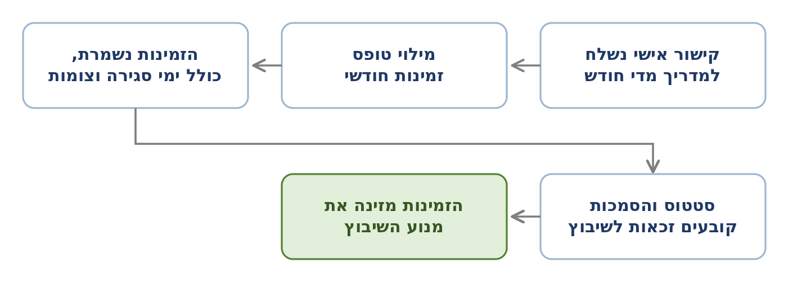

<!-- generated from: אפיון יד ושם מודול הזמנות חלק 2 מאושר 06-10 .docx | 2026-11-08 | do not edit by hand; regenerate from the docx -->

> **מקור:** מסמך 2 - תהליכי ההזמנות, גרסה מאושרת, 6.10.2026  
> **מיקום בניווט:** מסמך 2 - תהליכי ההזמנות › תהליכים עסקיים › זמינות מדריכים וניהול נותני שירות  
> **קודי ולידציה ואוטומציה בפרק:** A13-01, A13-02, A13-03, A13-04, A13-05, A13-06, A13-07, A13-08, A13-10, A13-13, V13-01, V13-02, V13-03, V13-04, V13-05, V13-06, V13-07, V13-09  
> **הקודם:** [ויסות ונעילה רב-רמתית](12-regulation-locking.md) · **הבא:** [תזכורות ותקשורת יזומה](14-reminders-proactive-communication.md) · [מקרא](../../INDEX.md)

# זמינות מדריכים וניהול נותני שירות

## תיאור התהליך

תהליך זה מרכז את ניהול מאגר נותני השירות ואת איסוף הזמינות החודשית המזינה את מנוע השיבוץ. הזמינות נמסרת על ידי המדריך, וניהול נותני השירות מתבצע על ידי מערך ההדרכה. נותני שירות הוא מושג גג המאחד את כלל סוגי האנשים המשולבים בפעילויות יד ושם: מדריכים, מרצים, אנשי עדות, עובדי יד ושם, צלמים, חזנים, שחקנים, מתנדבים ופרילנסרים, ולאדם אחד יכולים להיות סטטוס אחד או יותר. יד ושם מעסיקה למעלה מ-400 מדריכים, מתוכם כ-250 פעילים, ובסך הכול מתוגמלים כ-400 נותני שירות בחודש, בשתי צורות התקשרות עיקריות: מדריכים שכירים המקבלים תשלום דרך מלם, ונותני שירות (ספקים) המקבלים תשלום כנגד חשבונית, ובתוכם קבוצת שכר סופרים, נותני שירות ללא תיק ברשויות המס שיד ושם משלמת עבורם את המע"מ ומנהלת את התשלום במקומם. פורום המדריכים כולל את כל סוגי המדריכים ללא תלות במקור שכרם. במצב הקיים אין בעל תפקיד חוצה ארגון המרכז את אוכלוסיות נותני השירות שאינם מדריכים (מרצים, אנשי עדות, צלמים): כל מחלקה מזמנת את נותני השירות שהיא מכירה ועובדת איתם, מרצה או צלם חדש נפתח במערכת לפי צורך נקודתי, והיסטוריית הפעילות של כל נותן שירות, הזמינה במערכת, מהווה את הכלי העיקרי לסינון. מנגנון התשלום מפורט בפרק [תשלום מדריכים ונותני שירות וקובץ מלם](../../doc3-events-finance/05-processes/12-guide-provider-payment-malam-file.md) שבמסמך 3.

כל נותן שירות מיוצג ברשומת Contact בסוג רשומה מדריך, המהווה זהות אב, וייצוגו לצורכי שיבוץ הוא רשומת צוות (Staff) ב-GoMeddo. סטטוס נותן השירות קובע אילו מוצרים הוא רשאי לבצע, וקיימים מספר סטטוסים המשפיעים על השיבוץ ועל תנאי התשלום: מדריך 25, מדריך רגיל, ובנוסף בנות שירות לאומי וחיילות יחידת ההסברה, שלגביהן קיימת התייחסות נפרדת: שמותיהן נשמרים בכרטיס האישי ברישום ידני כדי לזהות בעתיד מי עברה את קורס ההכשרה, כמפורט בפרק [סמינרים](../../doc3-events-finance/05-processes/04-seminars.md) וקורסים בחלק 3 של האפיון. כל סטטוס של נותן שירות הוא בעל תוקף, ולכן הסטטוסים מנוהלים כרשומות מתוארכות עם תאריכי תחילה וסיום, ולא כערך שדה יחיד. בכרטיס נותן השירות מנוהלים שלושה שדות מרשימת השדות החדשים שהעביר צוות יד ושם: סימון עובד יד ושם במשרה מלאה, סימון עובד יד ושם במשרה חלקית ושדה אחוז משרה. השדות נרשמים ידנית ומשמשים לתיעוד ולזיהוי בלבד; המערכת אינה מחשבת אחוזי משרה ואינה גוזרת מהם כללי שיבוץ. נותן שירות מסוג חייל יחידת הסברה מוגדר כזמין תמיד ואינו נחסם בשום מצב.

מדריך מסוג נותן שירות, מדריך כספים בלשון המחלקה, מתקשר עם יד ושם בהסכם למתן שירותים ואינו כלול בהסכם הקיבוצי. קיום ההסכם החתום מנוהל בכרטיס נותן השירות בשדה החזיר חוזה חתום, לצד תוקפו. השדה מתמלא ידנית על ידי מערך ההדרכה, והוא תנאי לשיבוץ: מדריך כספים שלא חתם על הסכם למתן שירותים אינו ניתן לשיבוץ בהדרכות. החריג היחיד הוא מדריכי עיר הבה"דים שקיבלו הארכה לחתימה על החוזה, המסומנים ככאלה בכרטיסם. גזירת התשלום למדריכי הכספים מפורטת בפרק [תשלום מדריכים ונותני שירות](../../doc1-intro-architecture/02-current-state.md).

לכל מדריך מוגדרת מטריצת הסמכות הקובעת מה הוא רשאי להדריך, וכן שפות. המטריצה כוללת שפות וסוגי קהל, כדוגמת תלמידי תיכון, טירונים וחינוך מיוחד: קורס ההכשרה הגנרי מעניק את מטריצת הבסיס, וההסמכות הנוספות מתווספות בהמשך. מערך ההדרכה מוסיף ומסיר הסמכות למדריכים לאורך זמן, וההסמכות והשפה משמשים פילטרים קבועים במסכי השיבוצים לצד סוג המדריך והזמינות; גם מטריצות המדריכים הייעודיים, מדריכי המשלחות, מדריכי עיר הבה"דים ויחידת ההסברה, זמינות בתוך המערכת, כמפורט בפרק 12.5 הזמנות צבא, כוחות הביטחון ומשלחות. קליטת מדריך מתבצעת בתיאום מול משאבי אנוש ובמקביל למערכת התפעולית: מדריך אינו נפתח במערכת חודשים מראש אלא ברגע שיש לו הדרכה ראשונה ולאחר השלמת הקליטה במשאבי אנוש, ומשאבי אנוש מצדם אינם פותחים מדריך עד שקיים תאריך הדרכה ראשון. הקליטה כפופה לחוקיות המחייבת רישום לפי תעודת זהות, וההעברה מקורס ההכשרה פותחת כרטיס זמני הטעון אישור של מערך ההדרכה בטרם יהפוך לכרטיס קבוע בצורה ידנית. ההסכם הקיבוצי והתנאים הייחודיים למדריך נשמרים בצד משאבי אנוש, ואין סנכרון בין כרטיס המדריך לבין מערכת משאבי האנוש; ניתן להוסיף בכרטיס שדות פנימיים של יד ושם, כגון סימון הגשת תיאום מס ותוקפו, וכן צרופות לשמירת מסמכים, בכפוף לבחינת חוק הגנת הפרטיות.

איסוף הזמינות: מערך ההדרכה שולח למדריכים את לוח הזמינות לחודש העוקב, כשבועיים עד שלושה לפני תחילת החודש בהתאם להסכם הקיבוצי. במערכת החדשה המדריכים מקבלים במייל קישור לטופס זמינות חודשי, עם כניסה באמצעות מספר תעודת זהות. הטופס מציג הערות ותאריכים מיוחדים, ימי צום, ימי גיבוש, טיולים שנתיים וימי סגירת האתר, שבהם לא ניתן לסמן זמינות, ומאפשר התחשבות באוכלוסיות שונות, למשל מדריכים שאינם זמינים בימי צום. מודל טופס הזמינות הקיים נשמר וממשיך גם במערכת החדשה, על שני מאפייניו המרכזיים: אפשרות לסמן עד שני טווחי שעות ליום (לדוגמה זמינות בבוקר ובאחר הצהריים עם הפסקה ביניהם), ואפשרות עריכה של הזמינות כל עוד התאריך לא חלף והמדריך אינו משובץ בו, לצד חיווי כי המדריך עדכן את זמינותו. ⟦💬 c700⟧ יצירת הטופס מתבצעת לחודש נבחר, ובעקבותיה נשלח לנותן השירות קישור אישי במייל. במסך הזמינות של נותן השירות מוצג לוח הזמינויות של החודש עם ניווט לשבוע הקודם ולשבוע הבא, וניתן לערוך את טווחי הזמינות ידנית: להסיר טווח, לשחזר טווח שהוסר, להוסיף טווח שני באותו יום, ולהוסיף תאריך זמינות שלא הוגדר קודם. נתוני הזמינות מוצגים בזמן השיבוץ. הזמינות המוצהרת היא אחד הקריטריונים של מנוע ההצעה, ואולם המערכת מאפשרת תמיד לשבץ מדריך, בין אם מילא את הטופס ובין אם לא: אי-מילוי הטופס אינו חוסם שיבוץ ידני.

מסך ריכוז הזמינויות: לצד הצגת הזמינות בכרטיס נותן השירות הבודד, מנוהל מסך ריכוז רוחבי המציג את הזמינויות שמילאו כלל המדריכים לחודש נתון. המסך משמש את מערך ההדרכה, את המשבצות ואת הרכזת הלוגיסטית הבכירה, לשני צרכים: מעקב אחר מילוי הטפסים ותכנון השיבוץ החודשי. המסך מציג לכל מדריך את סטטוס מילוי הטופס (מילא או טרם מילא), את התאריכים שסימן ואת טווחי השעות בהם, ואת מספר הזמינויות שסומנו מול מספר הזמינויות ששובצו בפועל, וניתן לסנן בו לפי חודש, לפי סטטוס מילוי, לפי תאריך ולפי סוג המדריך.

בשל המחויבות החוזית, סדר העבודה מתחיל דווקא מהמדריכים שמסרו זמינות מצומצמת, כדי להבטיח את עמידת יד ושם בהתחייבויותיה כלפיהם. בכרטיס נותן השירות מוצגות הזמינויות שמילא בטופס, לצד חיווי כמה מהזמינויות שובצו בסופו של דבר.

ימי חוזה: קיימים 25 תקנים למדריכים בעלי מעמד מיוחד, מדריכי ה-25, המחויבים מראש לעשרה חודשים בשנה, פעם עד שלוש פעמים בשבוע, חלקם להיקף שלוש שעות וחלקם שש שעות, ובעלי מטריצת הסמכות רחבה ככל האפשר. הם מקנים ליד ושם זמינות יומית קבועה של כ-15 מדריכים גם ללא מילוי טופס זמינות. יד ושם מחויבת לשלם למדריך ה-25 על ימי החוזה שלו גם כאשר ההדרכה בוטלה עד 24 שעות מראש, וגם ביום שבתון, יום סגירה או תקופת מלחמה ללא הדרכות. יום חוזה אינו ייחודי למדריכי ה-25: ניתן להגדיר יום חוזה גם למדריכים אחרים, כאשר תקופת החוזה שלהם משתנה בהתאם לצרכים ולהחלטת מערך ההדרכה. מדריכים אלה אינם מקבלים תשלום עבור יום חוזה החל על מועד שבו יד ושם אינו עובד, בשונה ממדריכי ה-25 המקבלים תשלום גם במועדים אלה, לדוגמה יום כיפור. ביום חוזה שאין בו הדרכה נדרשים המדריכים להגיע ליד ושם ולבצע עבודות חלופיות לבקשת מערך ההדרכה. מדריך שלא התייצב ליום החוזה שלו אינו זכאי לתשלום, ומדריך מה-25 שאינו יכול להגיע ליום חוזה יורד לו יום חופש, בביצוע מערך ההדרכה. חופש ומחלה צוברים זכאות בהתאם להיקף ההדרכה, והחישוב מתבצע בצד מלם.

השלמת ההיקף ביום חוזה: מדריך המחויב להיקף שעות מקבל תשלום על מלוא ההיקף גם אם שובץ להדרכה קצרה יותר, ובלבד שאין אפשרות להשלים לו את ההיקף; מנגד, מדריך המחויב לשלוש שעות ששובץ בפועל לשש שעות מקבל תשלום על שש השעות שביצע. בזמן השיבוץ עצמו המערכת מציגה למשבצת חיווי כי מדובר ביום חוזה של נותן השירות, אך אינה מסמנת אוטומטית V בשדה יום חוזה לצורך השלמת ההיקף, שכן קיימים מקרים רבים שבהם מדריך בעל יום חוזה של שש שעות מבצע ביד ושם שתי הדרכות של שלוש שעות כל אחת. הסימון נותר בשליטת המשבצת, ומותנה בקיום יום חוזה בתוקף לנותן השירות באותו תאריך.

תצוגת ימי החוזה החסרים: המסך מציג אך ורק ימי חוזה שבהם המדריך אינו משובץ ומאפשר לעדכן כל יום בנפרד, והוא הכלי המרכזי לסגירת ימי החוזה מול מחויבות התשלום. השיבוץ ממסך זה ידני ואינו אוטומטי, ומבוצע על ידי הרכזת הלוגיסטית הבכירה של מערך ההדרכה, המכירה את סיבת אי-השיבוץ: חופש, מחלה, מילואים, מחסור בהדרכות או יום שבתון ביד ושם המזכה בתשלום. המסך מציג לכל שורה את שם נותן השירות, את התאריך ואת היום בשבוע, את היקף השעות שבחוזה ואת מוצר  ⟦💬 c702⟧החוזה, את סטטוס נותן השירות ואת סיבת אי-השיבוץ אם נרשמה, וניתן לסנן בו לפי טווח תאריכים, לפי מחלקה ולפי סוג המדריך. מהמסך מבוצעות הפעולות הבאות ישירות: שיבוץ יום חוזה עם מוצר החוזה המתאים, שיבוץ מחלה, שיבוץ חופשה, שיבוץ מילואים, וסימון שאין צורך לשבץ את נותן השירות בתאריך זה בצירוף הערה המפרטת את הסיבה. אותן פעולות זמינות גם מתוך כרטיס נותן השירות עצמו. הריצה היומית שיצרה בעבר שיבוץ יום חוזה אוטומטי בוטלה, כמפורט בפרק 12.9 שיבוץ מדריכים ומשאבים.

היעדרויות: מחלה, חופשה ומילואים נרשמות כשיבוצים ייעודיים ביומן המדריך, עם שעות 00:00 עד 00:00,  ⟦💬 c704⟧ללא נסיעות, ובחירת נותן השירות בהן חובה. הרישום מתבצע בשני מסלולים שווי ערך: ממסכי השיבוץ וממסך שיבוץ ימי החוזה החסרים, וכן ישירות מתוך כרטיס נותן השירות של המדריך, בפעולה ייעודית היוצרת את שיבוץ ההיעדרות ביומנו. מדריך שאינו יכול להגיע מודיע לצוות המשבץ, ומקרי חוסר ביום הפעילות מטופלים בבוקר באיתור מדריכים חלופיים, כמפורט בפרק 12.9 שיבוץ מדריכים ומשאבים.

מעקב ביטולים: כל פעולת ביטול או החלפה של שיבוץ מחייבת בחירת סיבה מתוך רשימה סגורה, הנתונה לשליטת יד ושם וניתנת להרחבה (המדריך ⟦💬 c706⟧ ביטל, הקבוצה בוטלה, מעבר להדרכה אחרת, שינוי מצורכי המערכת, וניסיון לצורכי בדיקות פנימיות המוחרג מניתוח הביטולים). המנגנון מאפשר זיהוי מדריך המבטל שיבוצים שוב ושוב וזיהוי מדריך שבוטלו לו שיבוצים שלא באשמתו, והפקת דוח מבטלים סדרתיים לשיחות עם יחידות התוכן על בסיס נתונים, ללא חשיפת שמות.

תקשורת עם המדריכים: הוחלט שלא להקים פורטל מדריכים בשלב זה, ולהעדיף תקשורת אוטומטית מהמערכת (מייל, ובהמשך SMS). המדריכים אינם נדרשים לאשר או לדווח דבר, ומחויבות יד ושם מכוח ההסכם הקיבוצי מסתכמת בהצגת המידע: כל מדריך מקבל סידור עבודה שבועי וריכוז חודשי המפרט עבור מה הוא עתיד לקבל תשלום, לרבות מקום הפעילות ושם הקבוצה (פרק [תשלום מדריכים ונותני שירות](../../doc1-intro-architecture/02-current-state.md)). נושא הפורטל ייבחן מחדש לאחר הקמת מערכת פריוריטי.

תיק המדריך והמידע הרגיש: כרטיס נותן השירות מרכז את צורת ההעסקה, מטריצת ההסמכות, השפות, הזמינות, ימי החוזה וההשתלמויות, לצד היסטוריית השיבוצים והתשלום. הנתונים הרגישים, לרבות תעודת זהות, תעריפים אישיים, מישובים וציונים, נחשפים אך ורק למורשים מתוך מערך ההדרכה באמצעות הרשאות ברמת השדה.  תיק המדריך במערכת כולל את המידע המתואר כאן בלבד, ואינו תיק אישי במובן של משאבי אנוש לשמירת מסמכים אישיים.

מישובים: מישוב הוא הליך שבו מדריך מיומן או עובד יד ושם מלווה מדריך אחר במהלך הדרכה בשטח לצורך הערכת ביצועיו. המישוב מתלבש על הזמנה קיימת לאחר שנסגרה, והוא שקוף למזמין שאינו משלם עבורו: הוצאת המישוב יורדת מסעיף תקציבי נפרד של מערך ההדרכה ולא מהסעיף התקציבי של ההזמנה, והשיבוץ נרשם כשיבוץ מחוץ ללוז שאינו מוצג ללקוח. המישוב מקושר להזמנה שעליה בוצע, באופן המאפשר זיהוי הקבוצה, סוג ההדרכה והמסגרת התקציבית, וכן שליפה בכל רגע של ההזמנות הממתינות למישוב. בביטול הקבוצה מתעדכנים הן המדריך והן הממשב. המנגנון מאפשר הפקת פילוח של מדריכים והממשבים שלהם, במקום הרישום הקיים בהערות בלבד, ותוצאות המישוב נשמרות בתיק האישי כרשומה מסוג דוח מישוב. ⟦💬 c708⟧ ⟦💬 c710⟧

## שלבי התהליך

1. מדריך חדש נקלט במערכת עם הדרכתו הראשונה, לאחר השלמת הקליטה במשאבי אנוש: נפתח כרטיס נותן שירות עם סטטוס מתוארך, מטריצת הסמכות ושפות, או שכרטיס נרשם שהשלים קורס מדריכים מומר לכרטיס נותן שירות ללא פתיחה מחדש.

2. במדריך מסוג נותן שירות מסומן בכרטיס קיום ההסכם למתן שירותים ותוקפו, וכן סימוני עובד יד ושם.

3. מערך ההדרכה מעדכן לאורך זמן את מטריצת ההסמכות, השפות והסטטוסים המתוארכים של כל מדריך.

4. לקראת החודש העוקב נוצר טופס הזמינות לחודש הנבחר ונשלח לכל המדריכים במייל קישור אישי, הכולל את התאריכים החסומים, ההערות ותאריך סגירת  ⟦💬 c713⟧הטופס. ערכים אלה מוזנים על ידי המשבצות במסך ייעודי. לוח הזמינות מציג תאריך עברי ולועזי, הטופס מופק בעברית ובאנגלית, ויום שיש בו הערה ויום חסום מסומנים כל אחד בצבע שונה.

5. המדריך נכנס לטופס באמצעות מספר תעודת זהות ומסמן את זמינותו, עד שני טווחי שעות ליום; הזמינות נשמרת ומוצגת בזמן השיבוץ.

6. מערך ההדרכה עוקב במסך ריכוז הזמינויות אחר מי מילא את הטופס ומי טרם, אילו תאריכים סומנו וכמה מהם שובצו בפועל.

7. במסך הזמינות של נותן השירות מתבצעות עריכות נקודתיות: הסרת טווח, שחזור טווח שהוסר, הוספת טווח שני באותו יום והוספת תאריך זמינות חדש  על ידי משתמשים מורשים.

8. מנוע השיבוץ משתמש בזמינות, בהסמכות, בשפה ובסטטוסים כקריטריונים, וסדר העבודה מתחיל מהמדריכים שמסרו זמינות מצומצמת; שיבוץ ידני אפשרי תמיד, גם למדריך שלא מילא את הטופס.

9. בעת שיבוץ בתאריך שבו לנותן השירות יום חוזה מוצג למשבצת חיווי יום חוזה, וסימון ה-V בשדה יום חוזה נותר בשליטתה ומותנה בקיום יום חוזה בתוקף באותו תאריך.

10. היעדרויות (מחלה, חופשה, מילואים) נרשמות כשיבוצים ייעודיים החוסמים את היום, ממסכי השיבוץ, ממסך ימי החוזה החסרים או ישירות מכרטיס נותן השירות.

11. הרכזת הלוגיסטית הבכירה עוברת על תצוגת ימי החוזה החסרים ומבצעת לכל שורה את הפעולה המתאימה: שיבוץ יום חוזה, שיבוץ מחלה, חופשה או מילואים, או סימון שאין צורך לשבץ בצירוף הערת סיבה.

12. ביטולים והחלפות שיבוץ מתועדים עם סיבה מרשימה סגורה, ומופקים דוחות מעקב.

13. מישוב משובץ על הזמנה שנסגרה כשיבוץ מחוץ ללוז, שקוף למזמין, ועלותו נזקפת לסעיף התקציבי של מערך ההדרכה; בביטול הקבוצה מתעדכנים המדריך והממשב.

14. בכרטיס נותן השירות מוצגים הזמינויות שמולאו מול השיבוצים בפועל, ההשתלמויות, ימי החוזה, המישובים והמידע הרגיש בהתאם להרשאות.

## ישויות ושדות בתהליך

| ישות | תפקיד בתהליך | שדות ייעודיים לתהליך |
| --- | --- | --- |
| נותן שירות (Contact, סוג רשומה מדריך) | זהות האב של המדריך ונותן השירות | צורת העסקה (שכיר מלם, נותן שירות, שכר סופרים), החזיר חוזה חתום ותוקפו, חיווי עובד יד ושם, עובד יד ושם במשרה מלאה, עובד יד ושם במשרה חלקית, אחוז משרה, שפות, סימון תיאום מס ותוקפו, צרופות |
| סטטוס נותן שירות (רשומה מתוארכת) | הסטטוסים המשפיעים על השיבוץ ועל תנאי התשלום, כל אחד בעל תוקף | סוג סטטוס (מדריך 25, מדריך רגיל, בת שירות לאומי ועוד), תאריך תחילה, תאריך סיום |
| זמינות מדריך (Custom) | הזמינות החודשית המוצהרת, קלט למנוע השיבוץ | תאריך, טווח שעות ראשון, טווח שעות שני, מקור (טופס חודשי), חיווי שובץ בפועל |
| טופס זמינות חודשי (Titan Forms) | ערוץ ההזנה של המדריך | חודש הטופס, כניסה לפי תעודת זהות, עד שני טווחי שעות ליום, תאריך סגירת הטופס, תאריכים חסומים (צום, גיבוש, סגירת אתר, טיולים שנתיים), הערות |
| מטריצת הסמכות (Custom) | קובעת מה רשאי המדריך להדריך | הסמכות לפי סוג קבוצה, שפות |
| ימי חוזה (Custom) | מחויבות ימי העבודה, של מדריכי ה-25 ושל מדריכים נוספים שהוגדר להם יום חוזה | יום בשבוע, היקף שעות (שלוש או שש), טווח תוקף החוזה (עשרה חודשים בשנה למדריכי ה-25, תקופה משתנה למדריכים אחרים), מוצר החוזה, זכאות במועדי אי-עבודה של יד ושם |
| שיבוץ נותן שירות (GoMeddo) | לרבות שיבוצי היעדרות, יום חוזה ומישוב | סוג שיבוץ (מחלה, חופשה, מילואים, יום חוזה, מישוב), שעות 00:00 בהיעדרות, חיווי יום חוזה (סימון V), אין צורך לשבץ והערת סיבה, סיבת ביטול |
| צוות (B25__Staff__c) | ייצוג המדריך במנוע השיבוץ של GoMeddo | קישור ל-Contact |
| רישום (Registration__c) | כרטיס הנרשם לקורס מדריכים, המקור להמרה לנותן שירות | סטטוס השלמה, קורס מדריכים ותאריכו |

## כללי ולידציה

| מזהה | הכלל | הודעת שגיאה |
| --- | --- | --- |
| V13-01 | שיבוץ מסוג מחלה, חופשה או מילואים נשמר עם שעות 00:00 עד 00:00 וללא נסיעות, ובחירת נותן השירות בו חובה | יש לבחור נותן שירות לרישום ההיעדרות |
| V13-02 | בטופס הזמינות לא ניתן לסמן זמינות בתאריכים חסומים: ימי צום שהוגדרו, ימי גיבוש, סגירת אתר וטיולים שנתיים | תאריך זה חסום ואינו פתוח לסימון זמינות |
| V13-03 | סטטוס נותן שירות נשמר עם תאריכי תוקף; לא ניתן לשמור סטטוס ללא תאריך תחילה | סטטוס נותן שירות מחייב תאריכי תוקף |
| V13-04 | ביטול או החלפה של שיבוץ מחייבים סיבת ביטול מהרשימה הסגורה | יש לבחור סיבת ביטול מהרשימה |
| V13-05 | שדות רגישים בכרטיס נותן השירות (תעודת זהות, תעריפים אישיים, מישובים וציונים) אינם ניתנים לצפייה או לעריכה למי שאינו מורשה במערך ההדרכה | אין לך הרשאה לצפות בנתון זה |
| V13-06 | סימון V בשדה יום חוזה על שיבוץ מתאפשר רק כאשר לנותן השירות קיים יום חוזה בתוקף באותו תאריך; הסימון אינו נעשה אוטומטית בעת השיבוץ | לנותן השירות אין יום חוזה בתוקף בתאריך זה |
| V13-07 | מדריך מסוג נותן שירות (מדריך כספים) שלא חתם על הסכם למתן שירותים אינו ניתן לשיבוץ בהדרכות; חריג: מדריכי עיר הבה"דים שקיבלו הארכה לחתימה על החוזה | לנותן השירות אין הסכם חתום בתוקף, לא ניתן לשבצו |
| V13-09 | בטופס הזמינות ניתן לסמן עד שני טווחי שעות ליום, ולא ניתן למלא את הטופס לאחר תאריך הסגירה שהוגדר לחודש | הטופס נסגר למילוי, או שסומנו יותר משני טווחי שעות ליום |

## אוטומציות

| מזהה | טריגר | הפעולה האוטומטית |
| --- | --- | --- |
| A13-01 | מועד ההיערכות החודשי, כשבועיים עד שלושה לפני תחילת החודש | יצירת טופס הזמינות לחודש הנבחר ושליחת מייל לכל המדריכים עם קישור אישי, הכולל את התאריכים החסומים, ההערות ותאריך סגירת הטופס |
| A13-02 | שליחת טופס זמינות על ידי מדריך, לאחר הזדהות בתעודת זהות | יצירת רשומות הזמינות של המדריך לחודש, לרבות שני טווחי השעות ליום, המוצגות בזמן השיבוץ ומזינות את מנוע ההצעה |
| A13-03 | שיבוץ מדריך בתאריך שלגביו הצהיר זמינות | עדכון חיווי שובץ בפועל על רשומת הזמינות, לצורך הצגת היחס בין זמינויות שמולאו לשיבוצים בכרטיס ובמסך הריכוז |
| ⟦💬 c718⟧A13-04 | בוטל: אין טופס ייעודי לימי חופשה; היעדרויות נרשמות כמפורט ב-A13-05 |  |
| A13-05 | רישום שיבוץ מסוג מחלה, חופשה או מילואים | קביעת שעות 00:00 עד 00:00, נסיעות ללא, וסימון התאריך כלא מזכה בתשלום יום חוזה |
| A13-06 | נותן השירות הוא חייל יחידת הסברה | מסומן זמין תמיד, ללא חסימה בשום מצב |
| A13-07 | יום חמישי בשעה 09:00 | שליחת מייל סידור עבודה שבועי לכל נותן שירות |
| A13-08 | השלמת קורס מדריכים והסמכה | המרת כרטיס הנרשם לכרטיס נותן שירות תוך שמירת ציון הקורס ותאריכו, ללא פתיחה חוזרת (מפורט בפרק סמינרים וקורסים) |
| A13-10 | הפעלת פעולת רישום היעדרות מתוך כרטיס נותן השירות | יצירת שיבוץ ההיעדרות (חופשה, מחלה או מילואים) ביומן המדריך בשעות 00:00 עד 00:00 וללא נסיעות, זהה לרישום ממסכי השיבוץ |
| A13-13 | שיבוץ נותן שירות בתאריך שבו קיים לו יום חוזה בתוקף | הצגת חיווי יום חוזה למשבצת, ללא סימון אוטומטי של שדה יום חוזה |

## אוטומציות מרכזיות, מפרט מימוש

### מחזור הזמינות החודשי וריכוז הזמינויות

| טריגר | ריצה מתוזמנת לקראת החודש העוקב, כשבועיים עד שלושה לפני תחילתו, בהתאם להסכם הקיבוצי (אחרי שמירה, ברמת המערכת) |
| --- | --- |
| שלבים | 1. הכנת לוח החודש העוקב: טעינת התאריכים החסומים (ימי צום, ימי גיבוש, סגירת אתר, טיולים שנתיים), ההערות שהגדיר מערך ההדרכה ותאריך סגירת הטופס. 2. יצירת טופס הזמינות לחודש ושליחת מייל לכל המדריכים הפעילים עם קישור אישי. 3. כניסת המדריך לטופס באמצעות מספר תעודת זהות; התאריכים החסומים מוצגים ואינם ניתנים לסימון, וניתן לסמן עד שני טווחי שעות ליום. 4. שמירת הסימונים כרשומות זמינות מדריך, הזמינות בזמן אמת למנוע ההצעה ולמסכי השיבוץ. 5. הצגת התמונה הרוחבית במסך ריכוז הזמינויות: מי מילא ומי טרם מילא, התאריכים והשעות שסומנו, וכמה מהזמינויות שובצו בפועל, בחתכים לפי חודש, סטטוס מילוי, תאריך וסוג מדריך. 6. מדריך שלא מילא את הטופס נותר ניתן לשיבוץ ידני; מדריכי ה-25 מכוסים בימי החוזה גם ללא מילוי. |
| בדיקת קבלה | מדריך המקבל את הקישור, מזדהה בתעודת זהות ומסמן עשרה ימים, מופיע כזמין בעשרת הימים במסך השיבוץ, אינו יכול לסמן יום צום חסום ואינו יכול למלא את הטופס לאחר תאריך הסגירה, ובמסך ריכוז הזמינויות מוצג כמי שמילא לצד מדריך שטרם מילא, עם מספר הימים ששובצו בפועל |

### סטטוסים מתוארכים והשפעתם על השיבוץ

| טריגר | יצירה או עדכון של רשומת סטטוס על נותן שירות (לפני שמירה לבדיקת התוקף, אחרי שמירה להחלה) |
| --- | --- |
| שלבים | 1. שמירת הסטטוס כרשומה מתוארכת עם סוג, תאריך תחילה ותאריך סיום; סטטוס ללא תוקף אינו נשמר. 2. חישוב הסטטוסים הפעילים של נותן השירות לכל תאריך נתון: מדריך 25, מדריך רגיל, בת שירות לאומי, וכל סטטוס נוסף שיוגדר. 3. הזנת הסטטוסים הפעילים למנוע ההצעה ולפילטרים במסכי השיבוץ: הסטטוס קובע אילו מוצרים רשאי נותן השירות לבצע ואת תנאי התשלום הנגזרים (פרק תשלום מדריכים ונותני שירות). 4. במדריך מסוג נותן שירות, בדיקת קיום ההסכם החתום כתנאי לשיבוץ. 5. בפקיעת תוקף סטטוס, הפסקת השפעתו על השיבוץ מהתאריך הקובע, תוך שמירת ההיסטוריה בכרטיס. |
| בדיקת קבלה | מדריך שסטטוס מדריך 25 שלו הסתיים בסוף השנה אינו מקבל עדיפות יום חוזה בשנה העוקבת, מדריך כספים ללא הסכם חתום נחסם לשיבוץ, והיסטוריית הסטטוס נשמרת בכרטיס |

תרשים תהליך 13 - זמינות מדריכים וניהול נותני שירות

---

## הערות סקירה בפרק זה

> הערות הסקירה אינן חלק מהאפיון המחייב. הן מסמנות מקומות שבהם הטקסט עדיין בדיון. הסימון ⟦💬 cN⟧ בגוף הטקסט מפנה להערה כאן.

### ⟦💬 c700⟧ סגורה
- **c700** · וייל דבורה · 2026-09-06 · סומנה כסגורה: כרגע אין תאריך סגירה של הטופס אלא ניתן לערוך כל עוד התאריך לא עבר ויש חיווי שהמדריך ערך את הזמינות
  - **c701** · טל שמרית · 2026-09-07 · סומנה כסגורה: המדריך יכול לערוך את הטופס רק זה תאריך שעדיין לא עבר ואם זה תאריך שהוא לא משובץ בו

### ⟦💬 c702⟧ סגורה
- **c702** · וייל דבורה · 2026-09-06 · סומנה כסגורה: המערכת צריכה להציף \ להציג רק ימי חוזה שבהם המדריך לא שובץ- ולתת פשרות לעדכן כל אחד מהימים בנפרד.
  - **c703** · Lior Pridor · 2026-09-14 · סומנה כסגורה: הפסקה כבר קובעת שהמסך מציג אך ורק ימי חוזה שבהם המדריך אינו משובץ ומאפשר לעדכן כל יום בנפרד.

### ⟦💬 c704⟧ סגורה
- **c704** · וייל דבורה · 2026-09-06 · סומנה כסגורה: לוודא
  - **c705** · טל שמרית · 2026-09-07 · סומנה כסגורה: אכן ללא נסיעות

### ⟦💬 c706⟧ סגורה
- **c706** · טל שמרית · 2026-09-07 · סומנה כסגורה: סיבה נוספת היא "נסיון" כאשר אנחנו בודקים ומנתחים ביטולים, צריך להסיר את סיבת הביטול "נסיון", היא לטסטים פנימיים.
  - **c707** · Lior Pridor · 2026-09-14 · סומנה כסגורה: הפסקה כבר כוללת את סיבת ניסיון לבדיקות פנימיות ומחריגה אותה מניתוח הביטולים.

### ⟦💬 c708⟧ סגורה
- **c708** · טל שמרית · 2026-09-07 · סומנה כסגורה: אין דבר כזה. / המישוב הוא לא עבור ההזמנה, אלא עבור המדריך,
  - **c709** · Lior Pridor · 2026-09-14 · סומנה כסגורה: המישוב הוא אכן הערכה של המדריך ובקרת איכות עליו. לצורך כך הוא נרשם על ההזמנה שבה בוצע, כדי לאפשר זיהוי הקבוצה, סוג ההדרכה והמסגרת התקציבית, והמימוש הוא בשדה מדריך משוב ובאוטומציה הזוקפת את המדריך המבצע למסגרת תקציבית אחרת.

### ⟦💬 c710⟧ סגורה
- **c710** · טל שמרית · 2026-09-07 · סומנה כסגורה: לתקן ל " ולא מהסעיף התקציבי של ההזמנה".
  - **c711** · Lior Pridor · 2026-09-14 · סומנה כסגורה: תוקן במסמך: הוצאת המישוב יורדת מסעיף תקציבי נפרד של מערך ההדרכה ולא מהסעיף התקציבי של ההזמנה, והמישוב שקוף למזמין שאינו משלם עבורו.

### ⟦💬 c713⟧ סגורה
- **c713** · וייל דבורה · 2026-09-06 · סומנה כסגורה: כמובן צריך מקום שבו המשבצות יכולות להזין את הערכים האלה, בלוח הזמינויות צריך להיות מוצג תאריך עברי ולועזי, הטופס צריך להיות בעברית ובאנגלית, ביום שיש הערה יש לכך חיווי ויזאולי צבע התאריך שונה, גם יום חסום הוא בעל צבע שונה.
  - **c714** · Lior Pridor · 2026-09-14 · סומנה כסגורה: הפסקה כבר כוללת מסך הזנה למשבצות, תאריך עברי ולועזי, טופס בעברית ובאנגלית וצבע שונה ליום הערה וליום חסום.

### ⟦💬 c718⟧ סגורה
- **c718** · טל שמרית · 2026-09-07 · סומנה כסגורה: אשמח להסבר לגבי סעיף זה
  - **c719** · Lior Pridor · 2026-09-14 · סומנה כסגורה: צודקים, ההפניה הקודמת הייתה שגויה. אוטומציה A13-04 בוטלה משום שאין טופס ייעודי לימי חופשה; היעדרויות נרשמות כשיבוצים ייעודיים ממסכי השיבוץ, ממסך ימי החוזה החסרים או מכרטיס נותן השירות, כמפורט ב-A13-05.
