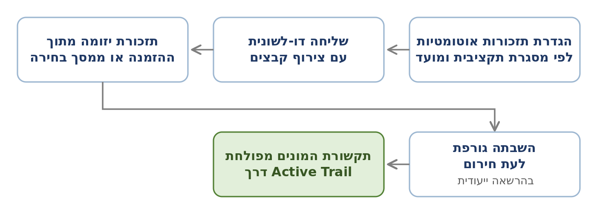

<!-- generated from: אפיון יד ושם מודול הזמנות חלק 2 מאושר 06-10 .docx | 2026-11-08 | do not edit by hand; regenerate from the docx -->

> **מקור:** מסמך 2 - תהליכי ההזמנות, גרסה מאושרת, 6.10.2026  
> **מיקום בניווט:** מסמך 2 - תהליכי ההזמנות › תהליכים עסקיים › תזכורות ותקשורת יזומה  
> **קודי ולידציה ואוטומציה בפרק:** A25-01, A25-02, A25-03, A25-04, A25-05, A25-06, A25-07, A25-08, A25-09, A25-10, V25-01, V25-02, V25-03, V25-04, V25-05, V25-06, V25-07, V25-08  
> **הקודם:** [זמינות מדריכים וניהול נותני שירות](13-guide-availability-service-providers.md) · **הבא:** [יוזרים, הרשאות והסבת נתונים](15-users-permissions-migration.md) · [מקרא](../../INDEX.md)

# תזכורות ותקשורת יזומה

## תיאור התהליך

המערכת שולחת תזכורות אוטומטיות ותזכורות יזומות בשתי שפות, עברית ואנגלית, בהתאם לשפת ההזמנה, חלקן עם צירוף קבצים. מנוע התזכורות מבוסס רשומות תצורה, תבניות תזכורת, ואינו קשיח בקוד: כל תבנית מגדירה את התוכן, את מועד השליחה, את הנמען, את השפות ואת הצרופות, ומנהל המערכת מוסיף ומעדכן תבניות ללא פיתוח. תבניות התזכורת שיוקמו בפרויקט הן אלה המפורטות במסמך זה ובנספח תבניות התקשורת; תבניות נוספות מוקמות על ידי מנהלי המערכת ביד ושם ללא פיתוח, ובמהלך ההדרכות יוסבר להם כיצד ליצור ולעדכן תבניות. בקרת התדירות מנוהלת ברמת המסגרת התקציבית, והפעלת התזכורות מסומנת ברמת ההזמנה או האירוע, אוטומטית או ידנית, כך שלכל אירוע נשלט האם תישלחנה תזכורות.

כלל תחולה מרכזי, בהתאם להנחיית הצוות: תזכורות אוטומטיות לפי תאריכים נשלחות רק לנרשמים עם רישום לתאריך בודד, הזמנות ונרשמי אירועים כדוגמת הצגות, סיורי יום שישי וחיזיון, ואינן נשלחות לנרשמי השתלמויות, סמינרים וקורסים, שבהם ההרשמה היא לכל תאריכי האירוע. באירועים רב-תאריכיים ההחלטה נתונה למנהל האירוע, הרשאי להגדיר משלוח תזכורת לפני היום הראשון או הודעה נקודתית במועד שיבחר. ⟦💬 c723⟧

מערך התזכורות הממופה מהחומרים שהעביר הצוות, כולן דו-לשוניות וכוללות שדות ממוזגים של מספר ההזמנה ותאריך הביקור: אישור הזמנה בנוסח טרם שולם ובנוסח שולם, הנשלח עם יצירת ההזמנה או עדכונה; תזכורת לקראת הביקור, הנשלחת אוטומטית שבועיים לפני הביקור וניתנת גם לשליחה ידנית, בצירוף אישור ההזמנה והלו"ז ללא שמות המדריכים; תזכורת להחזרת אישור הזמנה חתום, הנשלחת אוטומטית  ⟦💬 c726⟧חודש לפני הביקור להזמנות שטרם הוחזר בהן אישור, בצירוף אישור ההזמנה; מייל חשבון אוטומטי לדמי הרשמה וטיפול, בצירוף אישור ההזמנה והחשבון, שמועדו נגזר מהמסגרת התקציבית ומתנאי התשלום (לסוכני נסיעות שלושה ימים לפני הביקור); מייל חשבון אוטומטי לשירותים נוספים, הנשלח לפי תנאי התשלום של המוסד ובכפוף לסימון בהזמנה; תזכורת ידנית לתשלום ההזמנה בשני נוסחים, עם לינק לתשלום או עם חשבון; ומייל ריכוז שבועי לנותני השירות. פירוט נהלי הכניסה באישור ההזמנה משתנה לפי מיקום הפעילות: הזמנה המתקיימת אצל המזמין או וירטואלית אינה כוללת נהלי כניסה למוזיאון. מועדי המשלוח של כלל התזכורות מנוהלים כרשומות תצורה וניתנים לשינוי ללא פיתוח.

אישור ההזמנה מוקם בארבעה נוסחים, לפי שילוב שפת ההזמנה (עברית או אנגלית) ומצב התשלום (שולם או טרם שולם), כאשר ההבדל בין הנוסחים בגוף המכתב הוא שורת שולם עם, ובה ארבע הספרות האחרונות של כרטיס האשראי, המופיעה בפירוט העלות בהזמנה ששולמה. על גבי כל אישור הזמנה מופיעים שני מקטעי נוסח קבועים, בעברית ובאנגלית לפי שפת ההזמנה.  ⟦💬 c728⟧הראשון, כללי התנהגות במוזיאון על פי הנוסח המעודכן (נספח 26): כניסה בלבוש הולם ומכובד, איסור הכנסת מזון, שתייה ותיקים, איסור צילום ועישון, שימוש במערכות שמע של יד ושם בלבד, הגעה 15 דקות לפני מועד הסיור והצגת אישור ההזמנה לנציג יד ושם, כניסה למוזיאון עד שעה לפני מועד סגירת האתר, כניסה מגיל 10 ומעלה בהצגת תעודה מזהה, ואיסור כניסת תינוקות בעגלה או במנשא. השני, תנאים לשינוי וביטול על פי הנוסח המלא (נספח 25): קישור לעמוד עריכת ההזמנות באתר יד ושם וכתובת המייל הייעודית לביטולים, אי החזר דמי הרשמה וטיפול להזמנה מבוטלת בכל שלב ובכל מקרה, אפשרות לשנות תאריך ללא הגבלה על מספר העריכות, ללא תשלום נוסף עבור דמי הרשמה וטיפול, ⟦💬 c733⟧ חלון ביטול או שינוי של שלושה ימי עבודה שאינם כוללים ימי שישי וערבי חג, חיוב של 100 אחוז מגובה החיוב בגין השירותים בביטול או שינוי שלא בהתאם לתנאים, פטור מתשלום בביטול ביום הפעילות מחמת כוח עליון (מצב חירום על פי גורם ממשלתי מוסמך), וזכות יד ושם לבטל או לשנות הזמנה בנסיבות מיוחדות בהודעה מוקדמת ללקוח.  ⟦💬 c735⟧שני המקטעים נקלטים למאגר התבניות כתוכן פרמטרי,  ⟦💬 c737⟧בכפוף לכלל שלפיו הזמנה המתקיימת אצל המזמין או וירטואלית אינה כוללת את נהלי הכניסה למוזיאון. מקטעי הנוסח הקבוע מנוהלים במספר נוסחים (כשלושה), בהתאם לתכולת ההזמנה ולמקום הפעילות, כפי שיועברו על ידי יד ושם, והמערכת משייכת לכל הזמנה את הנוסח המתאים. להודעות הנשלחות ללקוח בעת ביטול או עדכון הזמנה, לרבות הודעות אי ההחזר בביטול סמוך למועד, מצורף קובץ נוהל הביטולים, והצירוף מוגדר ברמת תבנית ההודעה. נוסח אישור ההזמנה ייבנה על בסיס הפורמט הנהוג היום, ותוכנו יהיה ניתן לעריכה בקלות.

מלאי התזכורות המרוכז מונה עשר תזכורות: ארבע אוטומטיות למזמין (תזכורת לקראת הביקור שבועיים מראש, תזכורת להחזרת אישור חתום חודש מראש, מייל חשבון לדמי הרשמה וטיפול ומייל חשבון לשירותים נוספים), ארבע ידניות בשליטת הרכזת (תזכורת לקראת הביקור, תזכורת להחזרת אישור חתום, תזכורת לתשלום עם לינק ותזכורת לתשלום עם חשבון), מייל הריכוז השבועי לנותני השירות, ותזכורת ביקור נוספת ארבעה ימים לפני המועד הקיימת במערכת הקיימת. ⟦💬 c739⟧ תנאי סינון של המערכת הקיימת נשמרים במנוע החדש: תזכורת החזרת האישור החתום נשלחת רק להזמנות שנוצרו לפני יותר מארבעה ימים. כמו כן נשמר דפוס התצורה שלפיו כפתור התזכורת הידנית מוצג רק במסכים שבהם דגל הצגת התזכורת פעיל, כך שהצגת הפעולה נשלטת בהגדרת המסך ולא בקוד.

משלוח יזום מתוך ההזמנה או האירוע: מתוך הזמנה או אירוע ניתן לשלוח את הלו"ז לנותני השירות המשובצים, ברמת יום פעילות, ברמת ההזמנה או ברמת האירוע כולו. בלחיצה על הלחצן המערכת משלבת את הלו"ז המפורט בגוף המייל (הפקתו כקובץ מעוצב מצורף מותנית בכלי הפקת מסמכים של צד שלישי) ומציגה את שמות נותני השירות המשובצים; המשתמש בוחר למי לשלוח ולמי לא, ויכול להזין ידנית כתובות מייל נוספות. למשלוח זה תבנית קבועה הניתנת לעריכה. בנוסף, מתוך הצרופות שבהזמנה ניתן לשלוח לאיש הקשר צרופה (אישור הזמנה, לו"ז, חשבון וכדומה): בהתאם לסוג הצרופה נפתחת הודעה מוכנה מראש, הכוללת נתונים מפרטי ההזמנה, מלל קבוע ואת הצרופה, וניתנת לעריכה לפני המשלוח.

מייל הריכוז השבועי לנותני השירות נשלח בכל יום חמישי בשעה 09:00 לכל נותן שירות, עם הלוז המשובץ לו לשבוע הבא, ראשון עד שבת. הדיווח כולל את כל השיבוצים, בתשלום או ללא תשלום, וציון סוג הפעילות (הדרכה, משוב, הרצאה, פתיחה וכדומה), כך שנותן השירות יודע באיזו קבוצה הוא משובץ ובאיזה תפקיד. לצדו נשלח באירועים מרובי ימים לוז יומי לנותני השירות של אותו יום עם התראה על שינויים, כמפורט בפרק [סמינרים](../../doc3-events-finance/05-processes/04-seminars.md) שבמסמך 3.

לצד התזכורות ללקוחות פועלת תקשורת יזומה פנימית: מייל אוטומטי לצוות תפעול המוזיאון בעת שמירת הזמנה עם ביקור מוזיאון החורג משעות הפעילות; מיילים למשבצות, לרכזות ולרכזות הלוגיסטיות בביטול ובשינוי הזמנות שבוצעו במערכת המקוונת, עם ציון ימי חוזה (מפורט בפרק [שינוי תאריך בהזמנה עם שיבוצים וסגירת הטיפול](09-guide-resource-scheduling.md)); ויידוע הגורם האחראי בביטול מפגש המקושר להצגה (פרק [אירועים](../../doc1-intro-architecture/03-architecture.md) פתוחים לקהל). הרכזת שולחת תזכורת יזומה מתוך ההזמנה או ממסך בחירה, ולמדור צה"ל וכוחות. בעבודה מול גופים מסווגים, שבהם אנשי הקשר מזוהים בשמות קוד ללא מייל ארגוני והתקשורת מתנהלת בוואטסאפ ובמסרונים, תזכורות אוטומטיות אינן רלוונטיות, ולכן ניתן להשתיק תזכורות לפי מחלקה או לפי מסגרת תקציבית. בנוסף נשלחת לרכזת התראה שלושה ימים לפני מועד הפעילות כאשר שדה הזמנת הרכש ריק, כחיווי בלבד וללא עצירת הפעילות (מפורט בפרק 12.5 הזמנות צבא, כוחות הביטחון ומשלחות). כלל רוחבי: הודעות אוטומטיות על שינוי או ביטול של הזמנה נשלחות רק כאשר השינוי או הביטול בוצעו במערכת המקוונת (לקוחות פרטיים וסוכנים); שינוי או ביטול המבוצעים ישירות בתה"ל אינם מפעילים הודעה אוטומטית.

בתקופת המלחמה נשלחו עדכוני החירום לכלל האוכלוסיות ידנית, מייל אחר מייל וברשימות BCC מתוך ה-CRM, והצורך בכלי מובנה עלה מכלל הצוותים. לעת חירום קיים מנגנון השבתה גורף של התזכורות האוטומטיות, בהרשאה ייעודית. ההשבתה חלה על התזכורות האוטומטיות בלבד, שרובן צופות פני 10 ימים עד שבועיים קדימה (לקראת ביקור, הפקת חשבון וכדומה), ואינה חוסמת את התקשורת היזומה: גם בעת חירום ניתן לשלוח הודעות לכלל הפעילויות של יום, מחלקה או תקופה, לרבות עדכון על קיום סיורים וירטואליים. תקשורת המונים מפולחת, מייל לאוכלוסיות שלמות, נשלחת מתוך המערכת דרך Active Trail, זמינה לצוותים עצמם ללא תלות בגורם שיווק חיצוני, וכוללת פעולות בכמויות לתרחישי חירום. כל הודעה שנשלחה לרשימת נרשמים מתועדת ברשומת  ⟦💬 c743⟧האירוע.

## שלבי התהליך

1. מוגדרות תבניות התזכורת ברשומות התצורה: תוכן דו-לשוני, מועד יחסי לתאריך הביקור או לאירוע, נמענים, צרופות ותנאי הפעלה, בבקרת תדירות ברמת המסגרת התקציבית.

2.  ⟦💬 c748⟧ברמת ההזמנה או האירוע מסומן האם התזכורות פעילות, אוטומטיות או ידניות; אירועי רישום לכל הסדרה (השתלמויות, סמינרים, קורסים) מוחרגים מתזכורות מבוססות תאריך.

3. מנוע התזכורות רץ מדי יום, מאתר את הרשומות העומדות בתנאי כל תבנית, בוחר את נוסח השפה לפי שפת ההזמנה, מצרף את הקבצים הנדרשים ושולח.

4. הרכזת שולחת תזכורות יזומות מתוך ההזמנה או ממסך בחירה, לרבות משלוח חוזר ידני של תזכורות אוטומטיות.

5. תקשורת המונים מפולחת נשלחת דרך Active Trail לפי חתכי קהל, מחלקה, תאריך ופעילות, במייל.

6. בעת חירום מופעלת ההשבתה הגורפת של התזכורות האוטומטיות בידי בעל ההרשאה, והתקשורת היזומה ממשיכה לפעול.

7. כל משלוח מתועד על ההזמנה או האירוע, כבסיס לבקרה ולמענה לפניות.

## ישויות ושדות בתהליך

| ישות | תפקיד בתהליך | שדות ייעודיים לתהליך |
| --- | --- | --- |
| תבנית תזכורת (קונפיגורציה) | הגדרת התוכן, המועד והתנאים של כל תזכורת | נוסח עברית, נוסח אנגלית, מועד יחסי, נמענים, צרופות (אישור הזמנה, לו"ז ללא שמות, חשבון, נוהל ביטולים), מקטע כללי התנהגות במוזיאון, מקטע תנאים לשינוי וביטול, רשימת מחלקות מוגדרת מראש, ותק מזערי של ההזמנה, דגל הצגת תזכורת במסך, תנאי הפעלה, סטטוס פעיל |
| הזמנה (Opportunity) | ההקשר של התזכורת ומקור השדות הממוזגים | שפת הזמנה, תאריך ביקור, סטטוס תשלום, סטטוס החזרת אישור חתום, סימון הפעלת תזכורות, מיקום פעילות |
| אירוע ורישום | נמעני תזכורות באירועי תאריך בודד | סוג רישום (תאריך בודד או כל הסדרה), סימון הפעלת תזכורות |
| איש קשר | נמען התזכורת | כתובת מייל, טלפון נייד |
| מסגרת תקציבית | בקרת התדירות וכללי המשלוח | ⟦💬 c751⟧הסעיף שאליו מנותב החיוב, מסגרת אחת לכל הזמנה; מתמלאת אוטומטית בהזמנה מקוונת ומשפיעה על התמחור; בפרק זה היא משמשת כאחת מאמות המידה לקביעת נמעני התזכורת |
| שיבוץ נותן שירות (GoMeddo) | מקור הנתונים למייל הריכוז השבועי וללוז היומי | שיבוצי השבוע, סוג פעילות, סימון בתשלום או ללא תשלום |
| Active Trail | ביצוע הדיוור ההמוני המפולח | רשימות תפוצה, ערוץ (מייל, SMS, וואטסאפ) |

## כללי ולידציה

| מזהה | הכלל | הודעת שגיאה |
| --- | --- | --- |
| V25-01 | ⟦💬 c754⟧תזכורת אוטומטית מבוססת תאריך אינה נשלחת לנרשם אירוע מסוג השתלמות, סמינר או קורס, שבהם הרישום הוא לכל תאריכי האירוע; מנהל האירוע רשאי להגדיר עבורם תזכורת או הודעה במועד שיבחר | אין |
| V25-02 | סימון הפעלת התזכורות ברמת ההזמנה או האירוע נקבע אוטומטית לפי כללי התזכורת ואינו מוזן ידנית בכל הזמנה ⟦💬 c756⟧ | אין |
| V25-03 | הפעלת ההשבתה הגורפת וביטולה מותרות לבעלי ההרשאה הייעודית בלבד | אין הרשאה להשבתת תקשורת |
| V25-04 | שפת התזכורת ומסמכיה נקבעת לפי שפת ההזמנה; תבנית ללא נוסח בשפת ההזמנה אינה נשלחת ונרשמת לטיפול | אין |
| V25-05 | ⟦💬 c758⟧אישור הזמנה ותזכורות להזמנה המתקיימת אצל המזמין או וירטואלית אינם כוללים את נהלי הכניסה למוזיאון; יוגדרו נהלים ייעודיים לפעילות ניידות ולפעילות המתקיימת אצל המזמין | אין |
| V25-06 | פעולת שליחת התזכורת הידנית מוצגת רק במסכים שבהם דגל הצגת התזכורת פעיל בהגדרת המסך | אין |
| V25-07 | תזכורת להחזרת אישור הזמנה חתום נשלחת רק להזמנות שנוצרו לפני יותר מארבעה ימים ושטרם הוחזר בהן אישור חתום | אין |
| V25-08 | כל אישור הזמנה כולל את מקטע התנאים לשינוי וביטול, ואת כתובת המייל הייעודית לביטולים כטקסט מלא, בשפת ההזמנה | אין |

## אוטומציות

| מזהה | טריגר | הפעולה האוטומטית |
| --- | --- | --- |
| A25-01 | שבועיים לפני תאריך הביקור | משלוח תזכורת לקראת הביקור, בצירוף אישור ההזמנה והלו"ז ללא שמות המדריכים |
| A25-02 | חודש לפני הביקור, כשטרם הוחזר אישור חתום | משלוח תזכורת להחזרת אישור הזמנה חתום, בצירוף אישור ההזמנה |
| A25-03 | הגעת מועד החיוב לפי המסגרת התקציבית ותנאי התשלום | משלוח מייל חשבון אוטומטי, דמי הרשמה וטיפול או שירותים נוספים, בצירוף אישור ההזמנה והחשבון |
| A25-04 | יצירת הזמנה או עדכונה | משלוח אישור הזמנה באחד מארבעת הנוסחים, עברית או אנגלית לפי שפת ההזמנה ובנוסח טרם שולם או שולם לפי מצב התשלום, בצירוף מסמך האישור ובו מקטעי כללי ההתנהגות והתנאים לשינוי וביטול |
| A25-05 | יום חמישי בשעה 09:00 | משלוח מייל ריכוז שבועי לכל נותן שירות עם הלוז לשבוע הבא, ראשון עד שבת, כולל שיבוצים ללא תשלום וסוג הפעילות |
| A25-06 | שמירת הזמנה עם ביקור מוזיאון החורג משעות הפעילות | מייל אוטומטי לצוות תפעול המוזיאון |
| A25-07 | ביטול או שינוי הזמנה | מיילים לצוותים וללקוח לפי התרחיש, רק כאשר הביטול או השינוי בוצעו במערכת המקוונת, בצירוף קובץ נוהל הביטולים להודעות הנשלחות ללקוח, כמפורט בפרק שינוי תאריך בהזמנה עם שיבוצים וסגירת הטיפול ובמסמך 3 |
| A25-08 | הפעלת מתג ההשבתה הגורפת | עצירת כלל התזכורות האוטומטיות עד לביטול ההשבתה, ללא חסימת תקשורת יזומה ודיוור המוני |
| A25-09 | שליחת תזכורת ידנית בידי הרכזת מתוך ההזמנה או ממסך בחירה | משלוח אחת מארבע התזכורות הידניות, תזכורת לקראת הביקור, תזכורת להחזרת אישור חתום, תזכורת לתשלום עם לינק או תזכורת לתשלום עם חשבון, בנוסח ובצרופות שהוגדרו בתבנית, ותיעוד המשלוח על  ⟦💬 c761⟧ההזמנה בנוסף תתאפשר שליחה ידנית של הלו"ז לפני הביקור ולנותני השירות המשובצים, ברמת ההזמנה כולה או ברמת יום פעילות בודד, עם אפשרות להסיר נמענים מהרשימה ולהוסיף נמענים נוספים, וכן שליחת צרופות מתוך ההזמנה בנוסח תבנית מוכן הניתן לעריכה. |
| A25-10 | ארבעה ימים לפני תאריך הביקור | משלוח תזכורת ביקור שנייה למזמין בצירוף אישור ההזמנה, בהתאם להגדרה הקיימת במערכת הקיימת ולרשימת המחלקות שבתבנית; הפעלת התבנית כפופה להכרעת יד ושם בין תזכורת ביקור אחת לשתיים |

## אוטומציות מרכזיות, מפרט מימוש

### מנוע התזכורות מבוסס רשומות התצורה

| טריגר | ריצה מתוזמנת יומית של מנוע התזכורות (תהליך מתוזמן, אחרי שמירה). |
| --- | --- |
| שלבים | 1. שליפת כל תבניות התזכורת הפעילות, ולכל תבנית איתור ההזמנות והרישומים העומדים בתנאיה: מרחק מתאריך הביקור, סטטוס (תשלום, החזרת אישור), השתייכות לרשימת המחלקות שבתבנית, ותק מזערי של ההזמנה במקרה של תזכורת האישור החתום, וסימון הפעלת תזכורות דלוק. 2. החרגת נרשמי אירועים שרישומם לכל הסדרה (השתלמויות, סמינרים, קורסים) מתזכורות מבוססות תאריך, והחרגת כלל הרשומות כאשר מתג ההשבתה הגורפת פעיל. 3. בחירת נוסח השפה לפי שפת ההזמנה, מיזוג השדות (מספר הזמנה, תאריך ביקור) וצירוף הקבצים המוגדרים, לרבות התאמת נוסח הנהלים למיקום הפעילות. 4. משלוח ההודעה ותיעודה על הרשומה, כולל מועד, תבנית וערוץ. 5. רישום חריגים, נמען ללא כתובת או תבנית חסרה, לטיפול הרכזת. בהזמנה מתועדות כלל התזכורות שנשלחו עבורה, ידניות ואוטומטיות, לרבות מועד השליחה, נוסח המייל שנשלח והצרופות שצורפו לו. ⟦💬 c764⟧ |
| בדיקת קבלה | הזמנה עם ביקור בעוד שבועיים ותזכורות פעילות מקבלת את תזכורת הביקור בשפת ההזמנה עם הצרופות; רישום לסמינר באותו טווח אינו מקבל תזכורת; הפעלת מתג החירום עוצרת את המשלוח של יום המחרת. |

### מייל ריכוז שבועי לנותני השירות

| טריגר | כל יום חמישי בשעה 09:00 (תהליך מתוזמן). |
| --- | --- |
| שלבים | 1. שליפת כל נותני השירות שלהם שיבוץ אחד לפחות בשבוע הקרוב, ראשון עד שבת. 2. הרכבת הלוז האישי: תאריך, שעות, קבוצה, מקום, סוג הפעילות (הדרכה, משוב, הרצאה, פתיחה), כולל שיבוצים ללא תשלום. 3. משלוח המייל לכל נותן שירות ותיעוד המשלוח. |
| בדיקת קבלה | נותן שירות עם הדרכה בתשלום ומשוב ללא תשלום באותו שבוע מקבל ביום חמישי ב-09:00 מייל אחד ובו שתי השורות עם ציון סוג הפעילות. |

### השבתה גורפת לעת חירום

| טריגר | הפעלת מתג ההשבתה בידי בעל ההרשאה הייעודית (אחרי שמירה). |
| --- | --- |
| שלבים | 1. אימות ההרשאה הייעודית להשבתת תקשורת לעת חירום. 2. עצירת כלל התזכורות האוטומטיות מרגע ההפעלה, ללא מחיקת ההגדרות, כך שביטול ההשבתה מחזיר את הפעילות כסדרה. 3. השארת ערוצי התקשורת היזומה פעילים: שליחה יזומה מהזמנה, פעולות בכמויות ודיוור המוני מפולח, לרבות הודעות על סיורים וירטואליים. 4. תיעוד מועד ההפעלה, המפעיל ומועד הביטול. |
| בדיקת קבלה | לאחר הפעלת המתג לא נשלחת אף תזכורת אוטומטית מתוזמנת, ובמקביל נשלחת בהצלחה הודעה יזומה מפולחת לכלל נרשמי יום נתון. |

תרשים תהליך 14 - תזכורות ותקשורת יזומה

## כללי התזכורות והדוחות האוטומטיים הקיימים

הסעיף שלהלן מתעד את כללי האוטומציה הפעילים כיום במערכת הקיימת, כפי שהתקבלו מצוות יד ושם בקובץ הגדרות התזכורות. הם מוקמים כרשומות תצורה הניתנות לעריכה בידי המשתמש המורשה ולא כקוד קשיח. כל התבניות דו-לשוניות, עברית ואנגלית, וכוללות שדות ממוזגים של מספר ההזמנה ותאריך הפעילות.

### תזכורות ללקוח לקראת הביקור

שבע תזכורות אוטומטיות מוגדרות על ישות ההזמנה, כל אחת בשני נוסחים, וכולן רצות בבדיקה יומית מול מועד הפעילות:

| התזכורת | תזמון מול מועד הפעילות | הצרופה הנשלחת |
| --- | --- | --- |
| תזכורת להחזרת אישור הזמנה חתום | 30 יום לפני | אישור ההזמנה. הנוסח כולל אזהרה כי אי אישור ההזמנה תוך שבוע מיום שליחת ההודעה עשוי לגרום לביטולה |
| תזכורת לקראת הביקור, לו"ז | 14 יום לפני | הלו"ז ללא שמות המדריכים |
| תזכורת לקראת הביקור, אישור | 4 ימים לפני | אישור ההזמנה. הנוסח מדגיש הגעה בזמן, שכן איחור פוגע ביכולת לבצע את התוכנית |
| תזכורת לקראת ביקור לאירוע | בבדיקה יומית | אישור ההזמנה. במערכת הקיימת הכלל מוגדר כשלד בלבד ואינו פעיל, ויש להשלימו במערכת החדשה |

### הפקת חשבון אוטומטית ומשלוחו

הפקת החשבון האוטומטית פועלת מדי יום, למעט שבת, חגים וימי צום, ⟦💬 c766⟧ על ישות יום הפעילות, ומפיקה חשבון בקובץ PDF הנשלח ללקוח בעברית או באנגלית לפי שפת ההזמנה. חמישה תזמונים מוגדרים, ולכל אחד נוסח נפרד בשתי השפות:

| התזמון | סוג החיוב | הערה |
| --- | --- | --- |
| ⟦💬 c768⟧3 ימים לפני הפעילות | דמי הרשמה וטיפול | התזמון המרכזי לגביית דמי ההרשמה |
| 21 יום לפני הפעילות | חשבון כללי | לפי תנאי התשלום של המוסד |
| 10 יום לפני הפעילות | חשבון כללי | לפי תנאי התשלום של המוסד |
| יום אחד לאחר הפעילות | שירותים נוספים | מופק בכפוף לסימון בהזמנה |
| שלושה ימים לאחר הפעילות | שירותים נוספים | מופק בכפוף לסימון בהזמנה |

נוסח המייל המצורף לחשבון מפנה את הלקוח לתנאי התשלום שבאישור ההזמנה, ומציין כי אם נרכשו שירותים נוספים יישלח בהמשך חשבון נוסף בהתאם לכללי דמי ההרשמה והטיפול המפורסמים באתר יד ושם. המערכת החדשה תשמר את חמשת התזמונים כרשומות תצורה, כך שניתן יהיה לשנות את מספר הימים ואת תנאי ההפעלה ללא  ⟦💬 c770⟧פיתוח.

### מייל ריכוז שבועי לנותני השירות

בכל יום חמישי בשעה 09:00 נשלח לכל נותן שירות מייל המרכז את הלוח המשובץ לו לשבוע העוקב, מיום ראשון עד שבת, בצירוף קובץ הלו"ז. הריכוז כולל את כלל השיבוצים, בתשלום וללא תשלום, וכן את סוג הפעילות.

### דוחות תפעול וסקרים אוטומטיים

כעשרים כללי שליחה של דוחות תפעול וסקרי משוב, הנשלחים לרשימת נמענים פנימית קבועה בקובץ Excel . עיקרם: דוח כניסות יומי למוזיאון ודוח פעילות יומי ביד ושם, הנשלחים לפנות בוקר; דוח ימי פעילות בחלוקה לקבוצות; ודוחות סקרי משוב לפי קהל, בהם השתלמויות מורים, סמינרים מחו"ל, קבוצות בתי ספר, כוחות הביטחון, חזיון אור קולי, סיור במשכן האוספים, תיאטרון וניידות חינוכיות. תדירויות השליחה המוגדרות במערכת הן יומי לפנות בוקר, יומי בשעה 08:00, יומי בשעה 11:00, יומי בשעה 12:30 ללא שבת, יומי בשעה 19:50, שבועי בימי שלישי ושישי, ושבועי בימי חמישי. במערכת החדשה יומרו כללים אלה לדוחות ולדשבורדים מתוזמנים של Salesforce, המופצים לרשימות תפוצה מוגדרות במקום לרשימת נמענים קשיחה, ופירוטם המלא מובא בנספח הדוחות.

---

## הערות סקירה בפרק זה

> הערות הסקירה אינן חלק מהאפיון המחייב. הן מסמנות מקומות שבהם הטקסט עדיין בדיון. הסימון ⟦💬 cN⟧ בגוף הטקסט מפנה להערה כאן.

### ⟦💬 c723⟧ סגורה
- **c723** · וייל דבורה · 2026-09-06 · סומנה כסגורה: צריך תזכורת לפני היום הראשון גם לאירועים אלה?
  - **c724** · טל שמרית · 2026-09-08 · סומנה כסגורה: זו צריכה להיות בחירת מנהל האירוע, האם לשלוח מראש, האם לשלוח ביום ספציפי תזכורת או הודעה כלשהי שהוא רוצה.
  - **c725** · Lior Pridor · 2026-09-14 · סומנה כסגורה: טופל במסמך: נוסף שבאירועים רב-תאריכיים מנהל האירוע רשאי להגדיר תזכורת לפני היום הראשון או הודעה במועד שיבחר.

### ⟦💬 c726⟧ סגורה
- **c726** · טל שמרית · 2026-09-08 · סומנה כסגורה: צריכה להיות יכולת להגדיר/ לשנות בקלות את מועד שליחת התזכורת האוטומטית.
  - **c727** · Lior Pridor · 2026-09-14 · סומנה כסגורה: הפסקה כבר קובעת שמועד השליחה מוגדר בתבנית הניתנת לעדכון על ידי מנהל המערכת ללא פיתוח.

### ⟦💬 c728⟧ סגורה
- **c728** · טל שמרית · 2026-09-08 · סומנה כסגורה: צריכה להיות גישה קלה לעדכון הנוסח. נוסח זה מתאים להזמנות בהן יש כניסה למוזיאון, יש לאפשר מס' נוסחים בהתאם לתכולת ההזמנה ומיקום ההזמנה.
  - **c729** · Lior Pridor · 2026-09-14 · סומנה כסגורה: נוסח המייל ניתן לעדכון בקלות על ידי מנהל המערכת. לגבי ריבוי נוסחים לפי תכולת ההזמנה ומיקומה, כל נוסח נוסף מחייב תהליך אוטומטי נפרד, ולכן נבחן מול תכולת ההסכם את מספר התבניות הנתמכות ונחזור אליכם.
  - **c730** · אשבל אור · 2026-09-23 · סומנה כסגורה: מדובר על כ3 נוסחים סה"כ
  - **c731** · Lior Pridor · 2026-09-27 · סומנה כסגורה: אנא העבירו את הנוסחים ואת הכללים מתי נשלח כל אחד מהם. משמעות הדבר היא אוטומציה נוספת.
  - **c732** · אשבל אור · 2026-09-28 · סומנה כסגורה: יועבר בהמשך

### ⟦💬 c733⟧ סגורה
- **c733** · וייל דבורה · 2026-09-06 · סומנה כסגורה: אין הגבלה במספר הפעמים שניתן לערוך את ההזמנה.
  - **c734** · Lior Pridor · 2026-09-14 · סומנה כסגורה: אין במסמך הגבלה על מספר העריכות, ואישור נשלח עם יצירת ההזמנה או עדכונה.

### ⟦💬 c735⟧ סגורה
- **c735** · וייל דבורה · 2026-09-06 · סומנה כסגורה: צריך לקחת את הפורמט שיש היום וליצור אישרו הזמנה בהתאם. התוכן צריך להיות ניתן לעריכה בקלות.
  - **c736** · Lior Pridor · 2026-09-14 · סומנה כסגורה: הנוסח מבוסס על הקיים בנספח, ותבניות התקשורת ניתנות לעריכה על ידי מנהל המערכת ללא פיתוח.

### ⟦💬 c737⟧ סגורה
- **c737** · טל שמרית · 2026-09-08 · סומנה כסגורה: מעולה
  - **c738** · Lior Pridor · 2026-09-14 · סומנה כסגורה: תודה. לא נדרש שינוי בנוסח, והסעיף נותר כפי שהוא.

### ⟦💬 c739⟧ סגורה
- **c739** · טל שמרית · 2026-09-08 · סומנה כסגורה: בנוסף, / ישנם אפשרויות למשלוח ייזום של הודעות מתוך ההזמנה/ אירוע. / יש אפשרות מתוך הזמנה/ אירוע, לשלוח את הלו"ז לנותני השירות המשובצים ביום פעילות או בהזמנה או האירוע כולו. / כשלוחצים על לחצן זה, המערכת מפיקה לו"ז מפורט שמצטרף למייל, רואים את שמות נותני השירות המשובצים, ואפשר להחליט למי לשלוח ולמי לא, כמו כן, צריך אפשרות להוסיף שדה מו ניתן להזין ידנית גם כתובות מייל נוספות שיקבלו את הלו"ז. למצב זה יש פורמט (תבנית) קבוצה, אשר ניתנת לעריכה. / דרך הצרופות בהזמנות, ניתן לשלוח ישירות לאיש הקשר צרופה שרוצים (אישור הזמנה, לו"ז, חשבון וכו'). בהתאם לסוג הצרופה קופצת הודעה כתובה (תבנית מוכנה מראש) אשר ניתנת לעריכה, ההודעה המוכנה מראש מכילה מס' נתונים מפרטי ההזמנה, מלל שקבענו וכן את הצרופה הרלוונטית.
  - **c740** · Lior Pridor · 2026-09-14 · סומנה כסגורה: כלל היכולות שתוארו נתמכות: שליחה יזומה של לוח הזמנים מתוך ההזמנה או האירוע לנותני השירות המשובצים, בחירת הנמענים מתוך רשימת המשובצים והוספת כתובות ידנית, תבנית הניתנת לעריכה, ושליחת צרופות מתוך ההזמנה עם הודעה מוכנה מראש הניתנת לעריכה.
  - **c741** · אשבל אור · 2026-09-23 · סומנה כסגורה: נא לפרט בסעיף את התוכן שרשמת
  - **c742** · Lior Pridor · 2026-09-23 · סומנה כסגורה: בוצע: התוכן נוסף כפסקה בפרק זה, מיד אחרי מלאי התזכורות (מסומן כשינוי).

### ⟦💬 c743⟧ סגורה
- **c743** · וייל דבורה · 2026-09-06 · סומנה כסגורה: יש תזכורות (דוחות) נוספים שנשלחים אוטומטית מידי יום: / דוחות למנהלים / .דוחות למערכת הסקרים – שליחת נתונים למייל של חברת ESURVEY. / .בדוחות הספיים יש יותר סוגים  מהפורט כאן.
  - **c744** · Lior Pridor · 2026-09-14 · סומנה כסגורה: הדוחות התקופתיים למנהלים וממשק הנתונים למערכת הסקרים אינם נכללים בתכולת האפיון הנוכחי. נשמח לקבל את הרשימה המלאה של הדוחות הנדרשים ולבחון אותה במסגרת נפרדת.
  - **c745** · אשבל אור · 2026-09-23 · סומנה כסגורה: מדוע דוחות מנהליים לא בתכולה? הכוונה בדוחות כספיים לחשבונות אוטומטיים שמופקים במערכת ונשלחים ללקוחות. / דןח לESURVEY מדובר ביצוא דוח אקסל במבנה מוגדר מראש.
  - **c746** · Lior Pridor · 2026-09-23 · סומנה כסגורה: ייצוא דוחות והפקת דוחות מנהליים כלולים, וכך גם הדוחות הכספיים. דוחות המופקים ללקוח ומחייבים מיתוג ועיצוב תלויים במוצר צד ג׳ להפקת מסמכים. הדוח לחברת eSurvey ימומש כיצוא דוח אקסל במבנה קבוע, בדומה לדוחות הסקרים המתוזמנים המתוארים בסעיף דוחות תפעול וסקרים אוטומטיים; נבקש להעביר את מבנה הקובץ.

### ⟦💬 c748⟧ סגורה
- **c748** · טל שמרית · 2026-09-08 · סומנה כסגורה: לכל ההזמנות מופעלת התזכורת, לא צריך לסמן בכל זמנה כי יש צורך במשלוח תזכורת. / הכלל נקבע לפי התזכורת עצמה, בה נגידר מי מקבל את התזכורת (איזו מחלקה של ההזמנה או סעיף תקציבי של המחלקה) וכמה זמן מראש לשלוח את התזכורת
  - **c749** · Lior Pridor · 2026-09-14 · סומנה כסגורה: הכלל יוגדר ברמת התזכורת עצמה ולא בסימון פרטני בכל הזמנה: בתזכורת ייקבעו קהל הנמענים לפי מחלקה או מסגרת תקציבית וכן פרק הזמן מראש למשלוח. ההגדרה ניתנת לעדכון על ידי מנהל המערכת ללא פיתוח.

### ⟦💬 c751⟧ סגורה
- **c751** · טל שמרית · 2026-09-08 · סומנה כסגורה: לא הבנתי איך זה קשור לתזכורות?
  - **c752** · Lior Pridor · 2026-09-14 · סומנה כסגורה: הפסקה מסבירה שהמסגרת התקציבית משמשת כאחת מאמות המידה לקביעת נמעני התזכורת.

### ⟦💬 c754⟧ סגורה
- **c754** · טל שמרית · 2026-09-08 · סומנה כסגורה: יש לאפשר למנהל האירוע האם לשלוח תזכורת ביום ספציפי או הודעה כלשהי שהוא רוצה.
  - **c755** · Lior Pridor · 2026-09-14 · סומנה כסגורה: הפסקה כבר קובעת שמנהל האירוע רשאי להגדיר תזכורת או הודעה במועד שיבחר.

### ⟦💬 c756⟧ סגורה
- **c756** · טל שמרית · 2026-09-08 · סומנה כסגורה: שזה זה צריך להתמלא לבד עפ"י הכללים של התזכורת, לא אמורים למלא אותו ידנית בכל הזמנה שפותחים או נפתחת במערכת המקוונת
  - **c757** · Lior Pridor · 2026-09-14 · סומנה כסגורה: הפסקה כבר קובעת שהסימון נקבע אוטומטית לפי כללי התזכורת ואינו מוזן ידנית.

### ⟦💬 c758⟧ סגורה
- **c758** · טל שמרית · 2026-09-08 · סומנה כסגורה: נרצה להוסיף נהלים שונים לפעילות ניידות, לפעילות אצל המזמין.
  - **c759** · Lior Pridor · 2026-09-14 · סומנה כסגורה: הפסקה כבר קובעת שיוגדרו נהלים ייעודיים לפעילות ניידות ולפעילות המתקיימת אצל המזמין.

### ⟦💬 c761⟧ סגורה
- **c761** · וייל דבורה · 2026-09-06 · סומנה כסגורה: צריך גם תזכורת ידנית לשליחת לוז לפני הביקור. / ואפשרות לשליחה ידנית של הלוז לכל נותני השירות המשובצים  עם אפשרות צ'קבוקס להסיר חלק מהרשימה, ולהוסיף נמענים נוספים, ניתן לשלוח לוז ברמת ההזמנה כולה וברמת יום פעילות בודד.
  - **c762** · טל שמרית · 2026-09-08 · סומנה כסגורה: נכון, ויש גם למשלוח הודעות דרך הצרופות, הרחבתי על זה לפני מספר עמודים

### ⟦💬 c764⟧ סגורה
- **c764** · וייל דבורה · 2026-09-06 · סומנה כסגורה: יש צורך לראות בהזמנה מתי נשלח עבורה כל אחד מהתזכורות, גם ידנית וגם אוטומטית. האם ניתן לראות את המייל והצרופה שנשלחו?
  - **c765** · Lior Pridor · 2026-09-14 · סומנה כסגורה: הפסקה קובעת שבהזמנה מתועדות כלל התזכורות, מועד השליחה, נוסח המייל והצרופות.

### ⟦💬 c766⟧ סגורה
- **c766** · טל שמרית · 2026-09-08 · סומנה כסגורה: צריך גם במועדים נוספים לא לשלוח תזכורות (יום חג/ כיפור)
  - **c767** · Lior Pridor · 2026-09-14 · סומנה כסגורה: הפסקה כבר מחריגה שבת, חגים וימי צום ממנגנון ההפקה והמשלוח האוטומטי.

### ⟦💬 c768⟧ סגורה
- **c768** · טל שמרית · 2026-09-08 · סומנה כסגורה: 3 ימים לפני הפעילות לא 21 ימים
  - **c769** · Lior Pridor · 2026-09-14 · סומנה כסגורה: הפסקה כבר תוקנה לשלושה ימים לפני הפעילות.

### ⟦💬 c770⟧ סגורה
- **c770** · וייל דבורה · 2026-09-06 · סומנה כסגורה: לכל מוסד מופק 21 יום מראש חשבון עבור דמי הרשמה וטיפול , החשבון עבור שאר ההזמנה מופק לפי הכללים שבמאפייני המוסד.
  - **c771** · טל שמרית · 2026-09-08 · סומנה כסגורה: 3 ימים, לא 21
  - **c772** · Lior Pridor · 2026-09-14 · סומנה כסגורה: נושא הפקת החשבון עבור דמי הרשמה וטיפול מרוכז במסמך הנושאים להכרעה המצורף, בפרק העוסק בתמחור, בהנחות ובדמי ההרשמה, ויוכרע שם יחד עם יתר כללי החיוב.
  - **c773** · אשבל אור · 2026-09-23 · סומנה כסגורה: לא מוכר מסמך נושאים להכרעה האם הכוונה לחלק ג?
  - **c774** · Lior Pridor · 2026-09-23 · סומנה כסגורה: הכוונה למסמך 3, לפרק הפקת חשבון וחיוב לקוח מול אלמוג; בסבב זה נכתבו שני תזמונים שונים (21 ימים ו-3 ימים), ונבקש הכרעה אחת; התזמון מנוהל כפרמטר.
