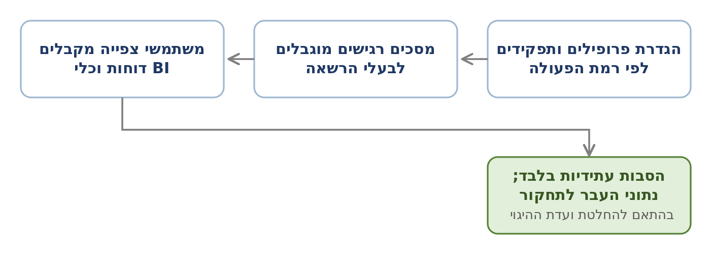

<!-- generated from: אפיון יד ושם מודול הזמנות חלק 2 מאושר 06-10 .docx | 2026-11-08 | do not edit by hand; regenerate from the docx -->

> **מקור:** מסמך 2 - תהליכי ההזמנות, גרסה מאושרת, 6.10.2026  
> **מיקום בניווט:** מסמך 2 - תהליכי ההזמנות › תהליכים עסקיים › יוזרים, הרשאות והסבת נתונים  
> **הקודם:** [תזכורות ותקשורת יזומה](14-reminders-proactive-communication.md) · **הבא:** [וולידציות, אבטחת מידע ותבניות תקשורת במערכת](../07-validations-security-templates.md) · [מקרא](../../INDEX.md)

# יוזרים, הרשאות והסבת נתונים

## תיאור התהליך

מודל ההרשאות של מודול ההזמנות שומר על השקיפות הקיימת כיום: כלל המשתמשים רואים את כלל המידע במערכת, והמידע היחיד המוגבל לצפייה הוא המידע הרגיש בכרטיס נותן השירות (תעודת זהות, תעריפים אישיים ומישובים), הנגיש לבעלי הרשאה בלבד. ההבחנה בין המשתמשים היא ברמת הפעולות: הפרופיל וקבוצות ההרשאה קובעים אילו פעולות מותר לכל משתמש לבצע (צפייה בלבד, יצירה ועריכה, או מלא), וסוג ההרשאה ניתן להגדרה לכל משתמש בנפרד. לצד זאת מוגדרות הרשאות ברמת השדה לשדות רגישים אלה, ולפי הגדרות Salesforce רק מנהל המערכת מגדיר הרשאות משתמשים.

מנגנון ההרשאה הקיים מזהה את המשתמש מול ה-CRM ושולף עבורו שני נתונים: ⟦💬 c776⟧ רשימת התפקידים (Roles) המצטברים שלו, והיחידה העסקית (Business Unit) שאליה הוא משויך. היחידה העסקית קובעת את היקף הנראות ואת התצוגות: יחידת yadvashem רואה את הכול, ולצדה יחידות בית ספר, אגף קשרי קהל ותרבות (הנצחה), שירותי ייעץ ומידע (ארכיון) וביקורים רשמיים באגף ההנצחה. התפקידים מצטברים לארבע רמות הרשאה: רכז בסיסי, רכז בכיר, כספים ומנהל מערכת, ולצדן תפקידים ייעודיים לפעולה או למשאב. אין בהכרח קשר בין התפקיד הארגוני ביד ושם לבין רמת ההרשאה במערכת, ולכן הקיבוץ נעשה לפי מה שמותר למשתמש לבצע ולפי מה שעליו לראות, ולא לפי שיוך ארגוני בלבד. דיוק ההרשאות הפרטניות לאנשים ספציפיים מתבצע בשלב היישום. צוותים אורגניים חוצי-יחידות מקובצים בקבוצות ציבוריות (Public Groups).

הכללים המרכזיים במטריצת הפעולות של המערכת הקיימת, הנשמרים במערכת החדשה, הם: אין הבחנה בין האגפים בהיקף הנראות, וכלל המשתמשים רואים ויוצרים הזמנות במערכת; נעילת הזמנה ושחרורה מותרים למנהל הנעילות ולמנהל המערכת בלבד; הפקת חשבונית מותרת לתפקידי הכספים בלבד; הוספה ועריכה של שורות לו"ז מותרות רק לבעלי תפקיד עריכת הלו"ז, וליתר המשתמשים ניתנת צפייה בלבד;  ⟦💬 c780⟧שכפול הזמנה מותר לכלל המשתמשים; ⟦💬 c782⟧ כפתורי אישור המייל והאישור החתום מוצגים לכלל המשתמשים; שיבוץ בחריגה מתפוסה ועקיפת הגבלות חדרים מותרים למנהל השיבוצים בלבד; פעולות המבואה, תשלום, ביטול וחתימה, מותרות לרכז המבואה ולמנהל המערכת; הדוחות מאופשרים לכלל המשתמשים, למעט דוחות ספציפיים שיוגדרו כטעוני הרשאה, ובהם הדוחות הכספיים; ⟦💬 c784⟧  ⟦💬 c786⟧עריכת כרטיס נותן שירות מותרת לבעלי הרשאה ייעודית, ושיבוץ ימי חוזה חסרים מותר לבעלי הרשאה נפרדת ממנה; עדכון עלות חומרי הלימוד מותר לבעל התפקיד הייעודי. ⟦💬 c787⟧ ⟦💬 c788⟧ ⟦💬 c789⟧

המיפוי המוצע מתפקידי המערכת הקיימת אל הפרופילים וקבוצות ההרשאה ב-Salesforce, כבסיס להקמה בשלב היישום:

| תפקיד | תוכן ההרשאה | מיפוי מוצע ב-Salesforce |
| --- | --- | --- |
| יחידה עסקית (Business Unit) | היקף הנראות של ההזמנות והתצוגות | נראות לכלל המשתמשים, ללא הגבלה לפי מחלקה או מדור |
| Division Filter Off As Default | ראיית כלל האגפים ללא סינון | גורם רוחב בראש היררכיית ה-Role, עם הרשאת צפייה רוחבית על ההזמנה |
| רכז מרכז הזמנות | קליטת הזמנות, תיאום וניהול שוטף | פרופיל רכזת הזמנות של מרכז ההזמנות |
| בית ספר, רכז לוגיסטיקה בסיסי | רכז מדור ברמת הבסיס | פרופיל רכזת מדור |
| בית ספר, רכז לוגיסטיקה ראשי | רכז בכיר, לרבות עריכת נותני שירות ושיבוץ ימי חוזה | פרופיל מנהלת מערך ההדרכה, או פרופיל רכזת מדור בתוספת קבוצת הרשאה לניהול נותני שירות וימי חוזה |
| תפקידי לוגיסטיקה וכספים ומנהל הזמנות | הפקת חשבונית, ביטול וזיכוי | פרופיל רכזת כספית בתוספת ההרשאה הכספית |
| הפק ושלח חשבון אוטומטי | הפעלת ההפקה והשליחה האוטומטית של חשבון | קבוצת הרשאה נפרדת מההרשאה הכספית הכללית (מפורט בפרק הפקת חשבון וחיוב לקוח מול אלמוג שבמסמך 3) |
| Lock Reservations Manager | נעילה ושחרור של הזמנות | קבוצת הרשאה ניהול ויסות ונעילה |
| Scheduling Administrator | שיבוץ בחריגה מתפוסה ועקיפת הגבלות חדרים | קבוצת הרשאה מנהל שיבוצים |
| Scheduling Resource Reservation Administrator, Scheduling Big Questions Room Administrator | שריון משאב וניהול חדר השאלות הגדולות | קבוצות הרשאה ייעודיות למשאב, בכפוף להכרעה על שימור הגרנולריות |
| Closed Days Administrator | ניהול הימים הסגורים | קבוצת הרשאה ניהול ימים סגורים |
| רכז מרכז הזמנות מבואה | תשלומים, חתימות וביטולים במבואה | קבוצת הרשאה פעולות מבואה (מפורט בפרק כניסה והזמנה בעמדות קיוסק שבמסמך 3) |
| Museum Coordinator | ניהול ושיבוץ המוזיאון | קבוצת הרשאה שיבוץ וניהול המוזיאון |
| עדכון מבקרים בפועל ברמת ההזמנה, עדכון מבקרים בפועל ברמת הקבוצה | עדכון מספר המבקרים שהגיעו, בשתי רמות נפרדות | שתי קבוצות הרשאה נפרדות (מפורט בפרק ניהול נוכחות בפועל וסימון הגעה שבמסמך 3) |
| תהל, הוספת לוז ליום פעילות | הוספה ועריכה של שורות לו"ז | קבוצת הרשאה עריכת לו"ז; בהיעדרה, צפייה בלבד בלו"ז |
| Study Material Cost Administrator | שינוי מחירי חומרי הלימוד וסימון חריגה מעלות | קבוצת הרשאה ניהול עלות חומרי לימוד (מפורט בפרק כנסי מורים שבמסמך 3) |
| Reporter | הפקת דוחות | קבוצת הרשאה דוחות; דוחות כספיים מוגבלים לבעלי ההרשאה הכספית |
| בית ספר, מערכת הזמנות צפייה בלבד; רכז מרכז הזמנות קריאה | צפייה בלבד | פרופיל לצפייה בלבד, או חלופת דוחות ודשבורדים ללא יוזר מלא |
| System Administrator, System Administrator Without Delete | הרשאות על, עם הרשאת מחיקה או בלעדיה | פרופיל מנהל מערכת, ופרופיל מנהל מערכת ללא הרשאת מחיקה |

היקפי המשתמשים הקיימים: ב-CRM הנוכחי כולו פעילים 357 משתמשים, מהם 91 ביחידה העסקית yadvashem, כ-96 במחלקות בית הספר (צה"ל 24, הדרכה 21, הכשרת מורים 20, חו"ל 17, ובית ספר 10), 15 באגף קשרי קהל ותרבות, 12 באגף ההנהלה, 9 באגף קשרי חוץ, ויתרתם ביחידות נוספות. בפילוח התפקידים, המספר של כשישים משתמשים פנימיים במודול ההזמנות מקבל אישוש: 60 משתמשים נושאים את תפקיד רכז מרכז ההזמנות. עם זאת, מעגל המשתמשים הפוטנציאלי הנוגע בהזמנות רחב יותר ומגיע לכ-150 עד 200 משתמשים, בהתחשב בנושאי התפקידים הנוספים: 89 רכזי לוגיסטיקה בסיסיים, 54 רכזי מוזיאון, 38 מנהלי נעילה, 34 רכזי מבואה, 33 בעלי הרשאת עריכת לו"ז, 30 מנהלי ימים סגורים, 27 מנהלי שיבוצים, 25 רכזי קריאה ו-22 רכזי לוגיסטיקה ראשיים. 43 משתמשים נושאים כיום הרשאת צפייה בלבד במערכת ההזמנות, והם קהל היעד הישיר להחלטה על דוחות ודשבורדים במייל או על כלי BI במקום יוזר מלא. 25 משתמשים נושאים הרשאת System Administrator מלאה, ועוד 19 בגרסה ללא מחיקה; ריכוז הרשאות העל הקיים מחזק את הצורך במודל ההדוק שלעיל ובצמצום מספר מנהלי המערכת. רשימת המשתמשים השמית כוללת שמות, כתובות דואר אלקטרוני ושמות דומיין, ולכן היא מטופלת כמידע רגיש ואינה מצורפת כנספח גלוי.

הפרופילים המוגדרים במודול: רכזת הזמנות של מרכז ההזמנות (קליטת הזמנות, תיאום וניהול שוטף, ללא מחיקת רשומות כספיות וללא עריכת קטלוג), רכזת מדור (הרשאות זהות במהותן), משבצת מערך ההדרכה (מפגשים, משאבים וצוות בשכבת GoMeddo, לוח השיבוץ וחיוויי תוספות השעות), רכזת כספית (הרשאות מלאות על החשבון הכספי; רק בעלי פרופיל זה, לצד מנהל המערכת, מבטלים או מזכים חשבון), מנהלת מערך ההדרכה (עריכה מלאה על ישויות נותני השירות כולל שדות רגישים), מנהל בכיר לצפייה בלבד, ומנהל מערכת.

קבוצות ההרשאה (Permission Sets) מעניקות יכולות נקודתיות מעבר לפרופיל: הרשאת הנחה (מתן ואישור הנחות עם מאשר ומקור תקציבי), הרשאה כספית (ביטול וזיכוי חשבונות), הפקה ושליחה אוטומטית של חשבון כהרשאה נפרדת מההרשאה הכספית הכללית, ניהול קטלוג ומחירון, ניהול ויסות ונעילה, ניהול ימים סגורים, השבתת תקשורת לעת חירום, אישור ללא תשלום במסכי הבקרה, עריכת לו"ז, פעולות מבואה, עדכון מבקרים בפועל ברמת ההזמנה ועדכון מבקרים בפועל ברמת הקבוצה כשתי הרשאות נפרדות, ניהול עלות חומרי לימוד, הפקת דוחות, ועריכת שיבוץ משאב מאושר, בהתאם לכלל שרק גורם מאשר מעדכן שיבוץ משאב נעול. שיבוץ נותן שירות אינו טעון אישור של אף גורם, ושחרורו מהזמנה שבוטלה מתבצע ידנית על ידי המשבצת.

שתי הרשאות מיוחדות מעצבות את התהליך התפעולי. הראשונה, הרשאת מנהל השיבוצים: שמירת מקום ללא הזמנה בידי משתמש שאינו מנהל שיבוצים נוצרת בסטטוס ממתין לאישור, ושדות הסיבה והמבקש הם חובה; מנהל שיבוצים יוצר את השיבוץ ישירות בסטטוס מאושר. גם חדר המסומן דורש אישור יוצר שיבוץ בסטטוס ממתין לאישור.  ⟦💬 c790⟧השנייה, חוקיות הניתוב נגזרת מהמחלקה שאליה משויכת המסגרת התקציבית, ואינה כוללת הפרדה נוספת ברמת האגף. כללי ההרשאה התפעוליים, כדוגמת עד מתי מותר לסוכן לערוך הזמנה, מוגדרים כערכים פרמטריים הניתנים לשינוי בידי מנהל המערכת ואינם קשיחים בקוד.

המשתמשים החיצוניים מנוהלים בפורטל Experience Cloud עבור מוסדות, בתי ספר, סוכני נסיעות וארגונים בעלי הסדר, בהיקף ראשוני של כ-300 יוזרים, כאשר נדרש היקף גבוה בהרבה, שכן מספר המוסדות בעלי חשבון במערכת הכספית עומד על אלפים; הוכרע שלא להציג בפורטל את שם המדריך המשובץ לקבוצה, נתון המועד לשינויים שחשיפתו מייצרת מצבים רגישים. למדריכים  הוחלט שלא להקים פורטל בשלב זה, והזמינות ממומשת בטופס Titan עם הזדהות בתעודת זהות, כמפורט בתהליכים 13 ו-24.

הגנות הרוחב על המידע: פרטים רגישים של נותני שירות (תעודת זהות, תעריפים אישיים, מישובים) חשופים רק לפרופילים של מערך ההדרכה ולמנהל המערכת באמצעות הרשאות ברמת השדה; רשומות כספיות מוגנות מפני מחיקה או שינוי בידי משתמש שאינו מורשה, לצד שמירת חיווי נוצר על ידי; ומסכים רגישים מוגבלים לבעלי הרשאה בעוד הצפייה השוטפת נשמרת רחבה.

⟦💬 c792⟧הסבת הנתונים מנוהלת בנפרד מחוץ לפרק ההרשאות: היקף ההסבה, לרבות הזמנות פתוחות ונתוני עבר, ייקבע בדיון ייעודי. עם זאת, היקפי נתוני האב במערכת הקיימת הם נתוני הייחוס להקמת נתוני האב במערכת החדשה ולתכנון ההרשאות עליהם: 3,368 מוסדות של סוכני נסיעות, 2,046 נותני שירות, 379 שורות מחירון ו-374 מחירונים, 344 נושאים למוצר, 199 מסגרות תקציביות, 188 מוצרים, 145 ימי חוזה, 103 סוגי פעילות יומית ו-58 משאבים. יש לקבל רשימות מעודכנות לצורך הקמתם במערכת לאורך תקופת היישום כך שיהיו מוכנים לקראת בדיקות הקבלה. בכרטיס המוסד יוצגו רשימות קשורות של ההזמנות והחשבונות המשויכים אליו, כך שניתן לראות לכל מוסד אם קיימות לו הזמנות וחשבונות. ⟦💬 c796⟧ ⟦💬 c798⟧ ⟦💬 c800⟧

## שלבי התהליך

1. רשימת התפקידים והיחידות העסקיות של המערכת הקיימת, לרבות מטריצת הפעולות ורמות ההרשאה המצטברות, נקלטת כבסיס המודל.

2. כל תפקיד קיים ממופה אל פרופיל, אל מיקום בהיררכיית ה-Role ואל קבוצות הרשאה, לפי טבלת המיפוי שבתיאור; תפקידים ייעודיים לפעולה או למשאב הופכים לקבוצות הרשאה נפרדות.

3. לכל תפקיד מוגדר אילו פעולות הוא מבצע; כלל המשתמשים רואים את כלל המידע, למעט המידע הרגיש בכרטיס נותן השירות.

4. מוגדרות הקבוצות הציבוריות לצוותים חוצי-יחידות, לרבות שיוך עובד לשתי מחלקות במקביל תחת שם כללי.

5. מוגדרות ההרשאות ברמת השדה לנתונים רגישים, וההגנות על רשומות כספיות מפני מחיקה ושינוי.

6. מוגדרים כללי הניתוב התלויים במשתמש: המחלקה אינה מוזנת ידנית אלא נגזרת אוטומטית מהמשתמש המקים את ההזמנה, משמשת לסינון מסגרות התקציב ולגזירת שדות החובה, עם אפשרות בחירה ידנית למנהל מערכת; והרשאת מנהל השיבוצים לשמירת מקום ללא הזמנה. ⟦💬 c804⟧

7. מוגדרים המשתמשים החיצוניים בפורטל: סוגי המשתמש, היקף הפעולות המותר, גבולות הנראות, ומודל הרישוי בהתאם להכרעה.

8. משתמשי צפייה בלבד ממופים לחלופות ללא יוזר מלא: דוחות ודשבורדים בדואר אלקטרוני או כלי BI.

9. בשלב היישום מוקמים המשתמשים, ממופים לפרופילים ומדויקות ההרשאות הפרטניות, לרבות צמצום מספר מנהלי המערכת; רשימת המשתמשים הסופית והיקפי הרישוי נסגרים מול יד ושם.

מודל ההרשאות המלא, על הפרופילים, התפקידים, קבוצות ההרשאה ומטריצת ההרשאות ברמת האובייקט, מפורט בפרק ההרשאות במסמך 1. אופן המימוש של כללי השיתוף המחלקתיים ושל ההרשאות לפעולות הרגישות יאופיין בהמשך.

בהתאם להחלטת ועדת ההיגוי לא יבוצעו הסבות עבר אלא הסבות להזמנות עתידיות בלבד. ההכרעה לגבי נתוני שנת 2026 טרם התקבלה, והיקף ההסבה ואופן ביצועה ייקבעו בנפרד לפי הנתונים והישויות שיימסרו על ידי יד ושם.

תרשים תהליך 15 - יוזרים, הרשאות והסבת נתונים

---

## הערות סקירה בפרק זה

> הערות הסקירה אינן חלק מהאפיון המחייב. הן מסמנות מקומות שבהם הטקסט עדיין בדיון. הסימון ⟦💬 cN⟧ בגוף הטקסט מפנה להערה כאן.

### ⟦💬 c776⟧ סגורה
- **c776** · טל שמרית · 2026-09-08 · סומנה כסגורה: בזמן בניית המערכת נחליט מה כולם רואים ומה רואים עפ"י שיוך למחלקות או לבעלי הרשאה ספציפית
  - **c777** · Lior Pridor · 2026-09-14 · סומנה כסגורה: דחיית ההחלטה לשלב הבנייה אינה מאפשרת לקבע את מודל ההרשאות באפיון ולתמחר אותו. נבקש שההחלטה בדבר מה גלוי לכולם ומה מותנה בשיוך למחלקה או בהרשאה ייעודית תתקבל עד למועד סגירת מסמך האפיון.
  - **c778** · אשבל אור · 2026-09-23 · סומנה כסגורה: כפי שרשמנו מעלה, מבחינת צפייה התיק מדריך הוא האזור היחיד שיגובל לצפייה. לגבי פעולות אפשריות בכלל המערכת, יש צורך לאפשר הגדרה לסוג ההרשאה של כל משתמש.
  - **c779** · Lior Pridor · 2026-09-23 · סומנה כסגורה: מקובל ותוקן בפסקת מודל ההרשאות: הפעולות המותרות מוגדרות לכל משתמש לפי סוג ההרשאה שלו.

### ⟦💬 c780⟧ סגורה
- **c780** · טל שמרית · 2026-09-08 · סומנה כסגורה: הכוונה ל "שכפול הזמנה" אם כן, זה צריך להיות לכולם, ללא קשר
  - **c781** · Lior Pridor · 2026-09-14 · סומנה כסגורה: הפסקה כבר קובעת ששכפול הזמנה מותר לכלל המשתמשים.

### ⟦💬 c782⟧ סגורה
- **c782** · וייל דבורה · 2026-09-06 · סומנה כסגורה: כבר אין הצעת מחיר, ואין הפרדה בין משתמשי הנצחה לבית ספר.
  - **c783** · Lior Pridor · 2026-09-14 · סומנה כסגורה: הצעת המחיר נותרת חלק מהתהליך במערכת החדשה: סוכם בפגישה שכל מוצר בעל מחירון, לרבות מוצר במחיר אפס, מופיע בהצעת המחיר ובסיכום ההזמנה, ושהוספת עדות או הרצאה נעשית באמצעות הוספת מוצר בהצעת המחיר.

### ⟦💬 c784⟧ סגורה
- **c784** · טל שמרית · 2026-09-08 · סומנה כסגורה: כלל הדוחות מאופשרים לכולם, אלא אם כן, יש דוח ספציפי שהוא יהיה בעל הרשאה מיוחדת
  - **c785** · Lior Pridor · 2026-09-14 · סומנה כסגורה: הפסקה כבר קובעת שהדוחות מאופשרים לכלל המשתמשים, והרשאת הפקת דוחות ייעודית מוגדרת בהמשך.

### ⟦💬 c786⟧ סגורה
- **c786** · טל שמרית · 2026-09-08 · סומנה כסגורה: עריכת כרטיס נותן שירות לבעלי הרשאות ייחודיות / והרשאות לשיבוץ ימי חוזה חסרים לבעלי הרשאה אחרת נפרדת. זו לא אותה הרשאה

### ⟦💬 c787⟧ סגורה
- **c787** · Lior Pridor · 2026-09-14 · סומנה כסגורה: הפסקה פותחת בקביעה שאין הבחנה בין האגפים בהיקף הנראות.

### ⟦💬 c788⟧ סגורה
- **c788** · וייל דבורה · 2026-09-06 · סומנה כסגורה: לא רלוונטי

### ⟦💬 c789⟧ סגורה
- **c789** · טל שמרית · 2026-09-08 · סומנה כסגורה: לא אמורה להיות הבדל בין האגפים השונים.

### ⟦💬 c790⟧ סגורה
- **c790** · טל שמרית · 2026-09-08 · סומנה כסגורה: לדעתי לא צריך ניתוב זה. החוקיות צריכה להיות המחלקה אליה משוייכת המסגרת התקציבית. / אין צורך בהפרדה נוספת המשוייכת לאגף.
  - **c791** · Lior Pridor · 2026-09-14 · סומנה כסגורה: הכלל שנקבע הוא שהמחלקה נגזרת אוטומטית מהמשתמש המקים את ההזמנה, ומסגרות התקציב המוצגות לבחירה מסוננות לפי אותה מחלקה, עם אפשרות בחירה ידנית למנהל מערכת. סגירת נושא המסגרת התקציבית לפי מחלקה תיעשה בפרק הייעודי.

### ⟦💬 c792⟧ סגורה
- **c792** · טל שמרית · 2026-09-08 · סומנה כסגורה: יש דיון בנושא, שם יוחלט מה קורה עם נתוני העבר ומה יוסב
  - **c793** · Lior Pridor · 2026-09-14 · סומנה כסגורה: הפסקה כבר קובעת שאין הסבות עבר וכי הנושא מנוהל בנפרד מחוץ לפרק זה.
  - **c794** · אשבל אור · 2026-09-23 · סומנה כסגורה: טרם התקיים דיון בנושא הסבות. בכל מקרה ידרשו הסבות של הזמנות פתוחות ולגבי נתוני עבר יוחלט בהמשך.
  - **c795** · Lior Pridor · 2026-09-23 · סומנה כסגורה: צודקים. תוקן: הוסר הנוסח שלפיו התקבלה החלטה, והיקף ההסבה, לרבות הזמנות פתוחות ונתוני עבר, ייקבע בדיון ייעודי.

### ⟦💬 c796⟧ סגורה
- **c796** · טל שמרית · 2026-09-08 · סומנה כסגורה: האם נוכל לדעת את פירוט השיבוצים שלהם?
  - **c797** · Lior Pridor · 2026-09-14 · סומנה כסגורה: כן. בכרטיס נותן השירות יוצגו השיבוצים שלו, לרבות מועד הפעילות, ההזמנה או האירוע המשויכים וסוג הפעילות.

### ⟦💬 c798⟧ סגורה
- **c798** · טל שמרית · 2026-09-08 · סומנה כסגורה: האם נוכל לראות האם יש לכל מוסד חשבון/ הזמנה. רק לידיעה?
  - **c799** · Lior Pridor · 2026-09-14 · סומנה כסגורה: טופל במסמך: הושלם המשפט הקטוע, ונקבע שבכרטיס המוסד יוצגו רשימות ההזמנות והחשבונות שלו.

### ⟦💬 c800⟧ סגורה
- **c800** · טל שמרית · 2026-09-08 · סומנה כסגורה: מה זה תחנת איסוף???
  - **c801** · Lior Pridor · 2026-09-14 · סומנה כסגורה: המונח נלקח מהנתונים הקיימים שהועברו אלינו ומשמעותו לא הוגדרה שם. נשמח שתאשרו האם מדובר בנקודת איסוף של קבוצות, ובהתאם נעדכן את ההגדרה במסמך או נסיר אותה.
  - **c802** · אשבל אור · 2026-09-23 · סומנה כסגורה: לא ברור על מה מדובר
  - **c803** · Lior Pridor · 2026-09-23 · סומנה כסגורה: הוסר מהמסמך.

### ⟦💬 c804⟧ סגורה
- **c804** · טל שמרית · 2026-09-08 · סומנה כסגורה: אפשר להסיר את המחלקות
  - **c805** · Lior Pridor · 2026-09-14 · סומנה כסגורה: המחלקה נשמרת אך אינה מוזנת ידנית: היא נגזרת אוטומטית מהמשתמש המקים את ההזמנה ומשמשת לסינון מסגרות התקציב, עם אפשרות בחירה ידנית למנהל מערכת.
  - **c806** · Lior Pridor · 2026-09-14 · סומנה כסגורה: טופל במסמך: המחלקה נגזרת אוטומטית מהמשתמש ומשמשת לסינון מסגרות התקציב.
