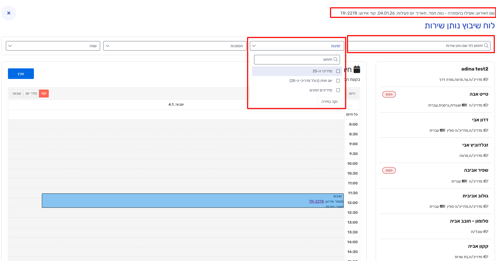
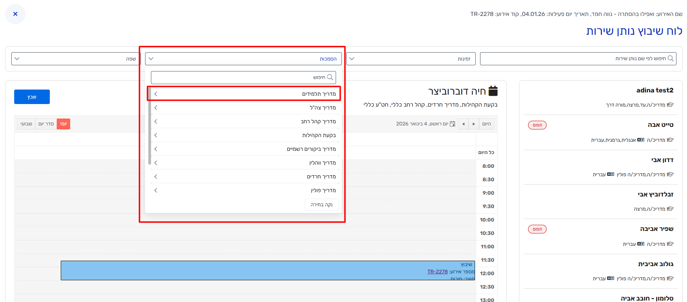
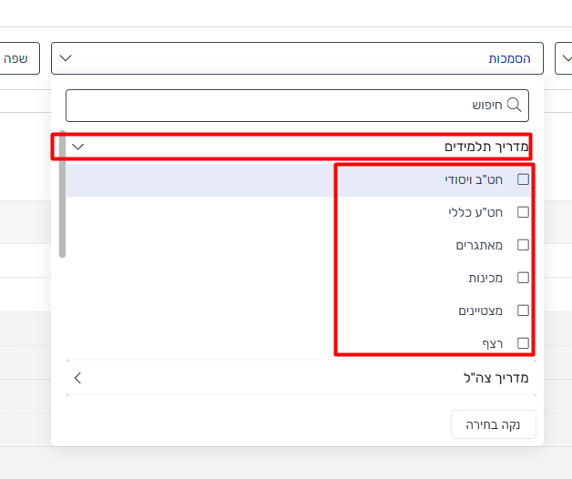
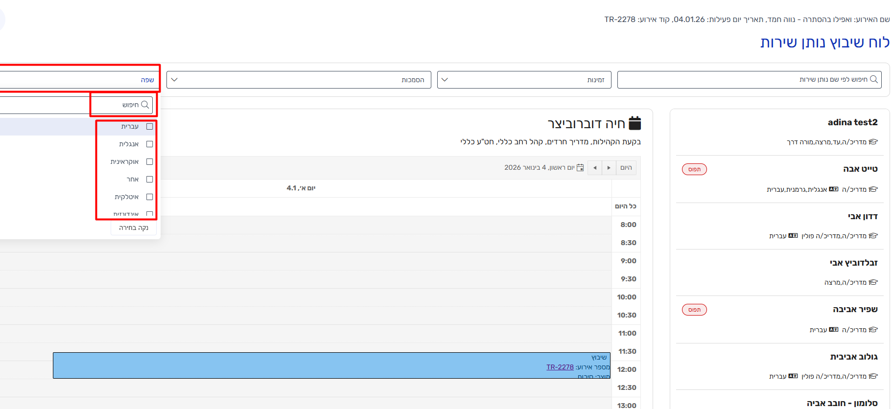
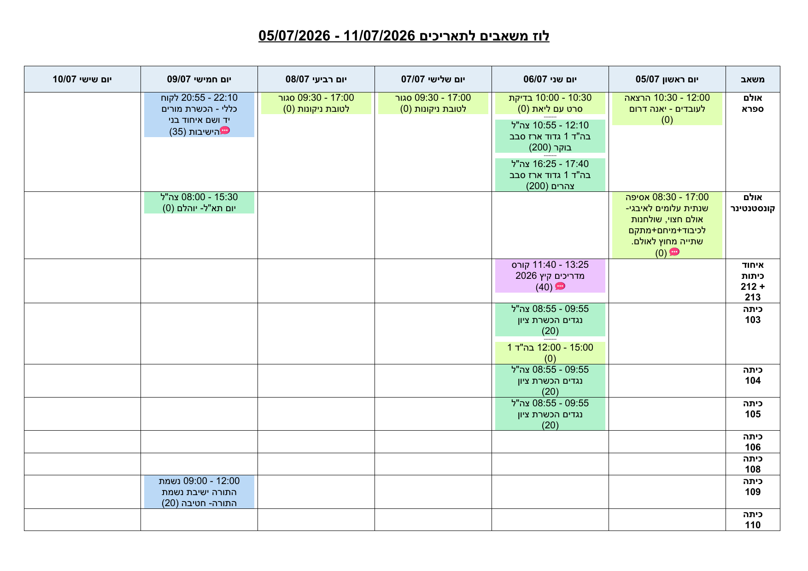
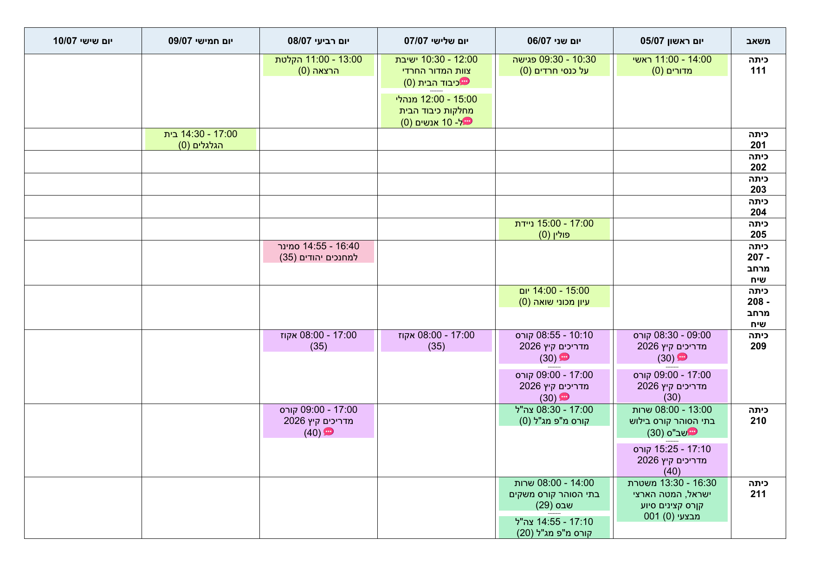
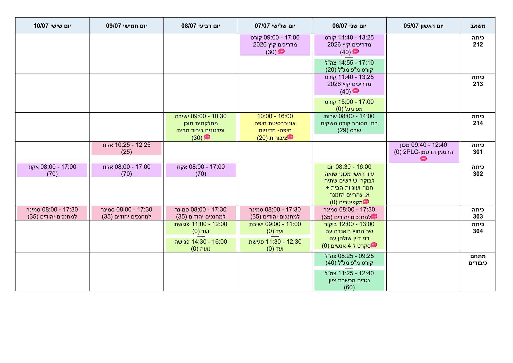
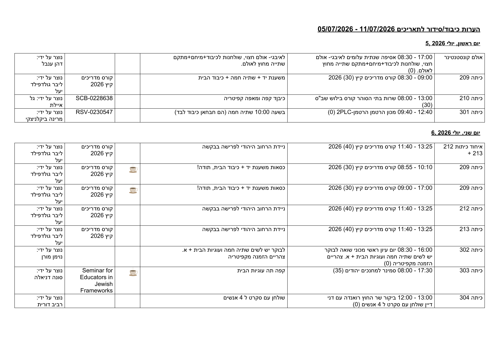
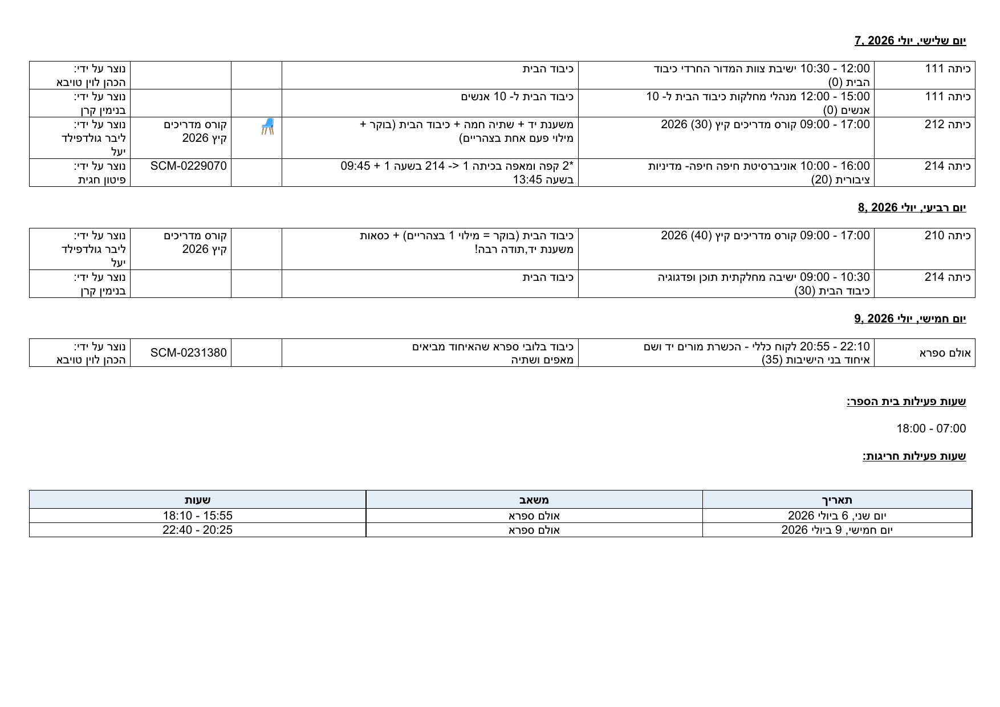

<!-- generated from: אפיון יד ושם מודול הזמנות חלק 2 מאושר 06-10 .docx | 2026-11-08 | do not edit by hand; regenerate from the docx -->

> **מקור:** מסמך 2 - תהליכי ההזמנות, גרסה מאושרת, 6.10.2026  
> **מיקום בניווט:** מסמך 2 - תהליכי ההזמנות › נספחי חומרי יד ושם  
> **הקודם:** [נספח תבניות התקשורת](12-appendix-communication-templates.md) · [מקרא](../INDEX.md)

# נספחי חומרי יד ושם

הנספחים שלהלן הם החומרים שהעביר צוות יד ושם ושאליהם מפנים פרקי המסמך. המספור נשמר כפי שהתקבל מהצוות, כך שההפניות בגוף המסמך תואמות. חומרים נוספים שהעביר הצוות ואינם מוזכרים בגוף מסמך זה אינם מובאים כאן.

## נספח 7 - דוגמת לו"ז מהזמנה עם ריבוי ימי פעילות וקבוצות

הלו"ז שמפיקה המערכת הקיימת עבור הזמנה אחת של מדור צה"ל וכוחות הביטחון, ומדגים את מבנה ההזמנה בארבע רמות: הזמנה אחת, שלושה ימי פעילות, וקבוצות ושורות לו"ז בכל יום.

הזמנה מספר SCB-0220275, מחלקת צה"ל וכוחות הביטחון, יום עיון צה"ל, משלחת צה"ל רע"א. טלפון 02-6443134, פקס 02-6443713.

| יום פעילות | נושא היום | מספר קבוצות | שעות | שפת הדרכה | שכבת גיל | מקום | רכז |
| --- | --- | --- | --- | --- | --- | --- | --- |
| שלישי, 23/06/2026 | הכנת סגל | 1 | 08:00 עד 17:00 | עברית | מבוגרים | יד ושם | ניצה שבתאי מלמד |
| חמישי, 16/07/2026 | יום הכנה ראשון | 4 | 08:00 עד 18:00 | עברית | מבוגרים | יד ושם | ניצה שבתאי מלמד |
| שלישי, 21/07/2026 | יום הכנה שני | 4 | 08:00 עד 18:00 | עברית | מבוגרים | יד ושם | ניצה שבתאי מלמד |

יום פעילות ראשון, 23/06/2026, קבוצה מספר 1, 15 משתתפים, כיתה 214:

| שעות | מוצר | נושא | נותן שירות | מיקום |
| --- | --- | --- | --- | --- |
| 09:00-10:00 | שיחה | תפיסה חינוכית | ניצה שבתאי מלמד | כיתה 214 |
| 10:00-11:30 | סיור באתר | עיצוב זיכרון |  |  |
| 12:45-14:15 | שיחה |  |  |  |
| 12:45-14:15 | מרחב שיח | חדר השאלות |  |  |
| 12:45-14:15 | חדר השאלות הגדולות |  | מירית פישלר | חדר השאלות הגדולות |

יום פעילות שני, 16/07/2026, ארבע קבוצות של 45 משתתפים:

| קבוצה | שעות | מוצר | נותן שירות | מיקום |
| --- | --- | --- | --- | --- |
| 1 | 08:00-18:00 | הרצאה |  | כיתה 209 |
| 1 | 08:00-18:00 | מדריך משלחת 6 שעות | מאיר בן שלום | כיתה 209 |
| 1 | 10:20-12:20 | סיור במוזיאון | מאיר בן שלום | מוזיאון |
| 2 | 08:00-18:00 | מדריך משלחת 6 שעות |  | כיתה 210 |
| 2 | 10:20-12:20 | סיור במוזיאון |  | מוזיאון |
| 3 | 08:00-18:00 | מדריך משלחת 6 שעות |  | כיתה 211 |
| 3 | 10:30-12:30 | סיור במוזיאון |  | מוזיאון |
| 4 | 08:00-18:00 | מדריך משלחת 6 שעות |  | איחוד כיתות 212 + 213 |
| 4 | 10:40-12:40 | סיור במוזיאון |  | מוזיאון |

יום פעילות שלישי, 21/07/2026, ארבע קבוצות של 45 משתתפים בכיתות 209, 210, 211 ובאיחוד כיתות 212 + 213. לקבוצה מספר 1 שתי שורות לו"ז: הרצאה ועדות, שתיהן בטווח 08:00-18:00 בכיתה 209.

שתי נקודות שהלו"ז מדגים ורלוונטיות לאפיון: איחוד כיתות כמשאב אחד (כיתות 212 + 213), ושורות לו"ז מקבילות באותו טווח שעות לאותה קבוצה.

## נספח 8 - דוגמת לו"ז ליום פעילות עם ריבוי מיקומי פעילות

לו"ז של יום עיון לבכירים המתקיים בשני מיקומי פעילות באותו תאריך: פתיחה באתר ההנצחה ניצנים והמשך במרכז החינוכי של יד ושם בקריית ההדרכה בנגב, עיר הבה"דים. הנספח הוא המקור למודל שבו יום פעילות אחד מכיל כמה מקומות פעילות, ובו הנסיעה בין המקומות נרשמת כרשומה נפרדת והקבוצה נספרת פעם אחת בלבד.

שם יום העיון: מתהומות השבר לצמיחה ותקווה, שמונים שנה לסיום המלחמה והחזרה לחיים. יום עיון בכירים.

| שעות | תוכן | מיקום |
| --- | --- | --- |
| 08:30-09:00 | התכנסות וכיבוד קל | ניצנים |
| 09:00-09:15 | דברי פתיחה | ניצנים |
| 09:15-10:30 | סיור באתר ההנצחה ניצנים: עמידתו וגורלו של קיבוץ ניצנים במלחמת העצמאות | ניצנים |
| 11:00-12:30 | נסיעה לקריית ההדרכה | במעבר בין המיקומים |
| 12:30-13:30 | הגעה והפסקת צהריים | עיר הבה"דים |
| 13:30-14:05 | דמותם לנגד עיני, סיור במרחב המוזיאלי | עיר הבה"דים |
| 14:05-14:35 | מיצג השואה: המהלכים ההיסטוריים מול התגובה היהודית, קולות ועדויות | עיר הבה"דים |
|  | משבר להמשכיות, מרחב החזרה לחיים | עיר הבה"דים |
| 14:35-14:50 | הפסקה | עיר הבה"דים |
| 14:50-15:35 | אנו צריכים לבנות את עתידנו, אך כיצד בונים עתיד? על כוחה של שארית הפליטה | עיר הבה"דים |
| 15:35-15:50 | הילד הפליט מרדיפות הנאצים לוחם את מלחמתה של מדינת ישראל | עיר הבה"דים |
|  | סיכום | עיר הבה"דים |

## ⟦💬 c847⟧נספח 20 - דוגמת ויסות כניסות למוזיאון לפי קהלים

קובץ הוויסות שהעביר הלקוח עבור הזמנות מקוונות. הוויסות חל על הזמנות מקוונות הכוללות כניסה למוזיאון, בשעות 09:30 עד 13:30 בלבד, ומוגדר כאחוז מסך הכניסות פר מחלקה ופר יום בשבוע.

| מחלקה | יום א | יום ב | יום ג | יום ד | יום ה | יום ו |
| --- | --- | --- | --- | --- | --- | --- |
| צה"ל | 40% | 10% | 10% | 10% | 20% |  |
| הדרכות חינוכיות | 40% | 40% | 40% | 40% | 40% |  |
| מורים |  |  |  |  |  |  |
| הדרכה וקהל רחב | 10% | 30% | 30% | 30% | 30% |  |
| מרכז הזמנות | 10% | 20% | 20% | 20% | 10% |  |
| מחלקת חו"ל |  |  |  |  |  |  |
| פרויקטורית תוכן |  |  |  |  |  |  |
| סה"כ | 100% | 100% | 100% | 100% | 100% | 0% |

שני כללי הקצאה הוצגו בקובץ. כלל סוג 1: מחלקה שלא הוגדר לה ויסות ביום מסוים יכולה להזמין מתוך כלל ה-100 אחוז, גם אם חולק פחות מ-100 אחוז. כלל סוג 2: מחלקה שלא הוגדר לה ויסות ביום מסוים בשעות הוויסות, וכל ה-100 אחוז חולקו, אינה יכולה להזמין באותו יום במערכת המקוונת; אם לא חולקו כל ה-100 אחוז, היתרה פתוחה לכולם ולא רק למי שלא הוגדר לו ויסות. הנספח מובא כחומר רקע בלבד, וכללי ההקצאה ייקבעו בקונפיגורציה לפי הנתונים שתעביר יד ושם. ⟦💬 c849⟧

קווים מנחים בקובץ: שבועיים לפני מועד הפעילות הוויסות מתאפס וניתן להזמין ללא הגבלה; סוכני נסיעות ולקוחות פרטיים יכולים להזמין במערכת המקוונת 12 חודשים קדימה במקום חצי שנה; בתי ספר יכולים להזמין 12 חודשים קדימה במקום חצי שנה; והוויסות מתייחס לשעות 09:30 עד 13:30 בלבד, וכל יתר שעות היום פתוחות לכולם.

## נספח 21 - דוגמת ויסות הדרכות בחלוקה לקהלים

ויסות שני, כמותי, שנוסף על ויסות הכניסות למוזיאון. הוא מונה קבוצות מודרכות ביד ושם על ידי מדריכי יד ושם בעברית, פר מחלקה ופר יום.

| מחלקה | יום א | יום ב | יום ג | יום ד | יום ה |
| --- | --- | --- | --- | --- | --- |
| הדרכות חינוכיות | 18 | 37 | 37 | 37 | 18 |
| צה"ל וכוחות הביטחון | 37 | 18 | 18 | 18 | 37 |
| הדרכה וקהל רחב | 20 | 20 | 20 | 20 | 20 |

כללים מנחים בקובץ: הוויסות מתייחס להזמנות ביד ושם, אצל המזמין ווירטואלי; אין צורך לספור את ההזמנות בעיר הבה"דים, שלה מדריכים ייעודיים וכלל הזמנותיה נפתחות ידנית; הוויסות סופר את כלל ההזמנות במערכת ללא קשר להיכן וכיצד נפתחה ההזמנה; ושבועיים לפני מועד הפעילות הוויסות מתאפס וכולם יכולים להזמין. הצוות ציין כי המספרים בקובץ הם סקיצה ראשונה ואינם המספרים הסופיים.

## נספח 25 - מדיניות ביטולים ושינויים

הנוסח המלא של מדיניות הביטולים והשינויים, המופיע על גבי אישורי ההזמנה. הנוסח מובא גם בנספח תבניות התקשורת, כחלק ממקטעי הנוסח הקבועים של אישור ההזמנה.

תנאים לשינוי וביטול:

לביטול או שינוי ההזמנה יש להיכנס לאתר יד ושם https://forms.yadvashem.org/he/reservations-edit ⟦💬 c851⟧ (הכתובת תעודכן עם עליית עמוד העריכה והביטול החדש)

לא יינתן החזר עבור דמי הרשמה וטיפול להזמנה מבוטלת בכל שלב ומקרה.

ניתן לשנות תאריך הזמנה פעם אחת ללא תשלום נוסף עבור דמי הרשמה וטיפול.

ביטול או שינוי סיור יתאפשר עד 3 ימי עבודה, לא כולל ימי שישי וערבי חג, לפני מועד הביקור המתוכנן, באמצעות אתר יד ושם או באמצעות כתובת המייל visit@yadvashem.org.il

ביטול או שינוי שלא יתבצע בהתאם לתנאים אלו יחוייב ב-100% מגובה החיוב בגין השימוש בשירותים השונים.

במקרה של ביטול ביום הפעילות מחמת כח עליון (מצב חירום עפ"י גורם ממשלתי מוסמך) המזמין לא יחויב בתשלום.

בנסיבות מיוחדות, יד ושם שומר לעצמו את הזכות לבטל או לשנות את ההזמנה בהודעה מוקדמת ללקוח.

Alteration and Cancellation Policy:

Please cancel or alter your reservation via Yad Vashem's website: https://forms.yadvashem.org/reservations-edit

The registration and handling fee for a cancelled registration is non-refundable under any circumstances.

Cancellation/alteration of a scheduled tour is possible up to 72 hours (3 business days, excluding Fridays and Jewish holiday eves) before the scheduled date and time, via Yad Vashem's website or via the email visit@yadvashem.org.il

Cancellation/alteration that does not fulfil these conditions will incur a charge of 100% of the price of the tour and services.

In the case of cancellation on the day of the scheduled tour due to 'force majeure' (a state of emergency as declared by an authorized governmental agency), the cancellation fee will be waived.

In special circumstances, Yad Vashem reserves the right to cancel/alter a reservation with advance notice to the visitor.

## נספח 26 - עדכון הנחיות וכללים להזמנת ביקורים ביד ושם

הנוסח המפורסם באתר יד ושם. הוא מקור הכללים לדמי ההרשמה והטיפול, למדיניות העדכון והביטול ולמדיניות הכניסה לאתר. הנוסח מובא בעברית; במקור קיים גם נוסח אנגלי מקביל.

הכניסה לאתר יד ושם אינה כרוכה בתשלום.

הזמנת כניסה למוזיאון או רכישת שירותים, לשם הבטחת הכניסה וקבלת השירותים במועד המבוקש, מותנית בהזמנה מראש וכרוכה בתשלום דמי הרשמה וטיפול (החל מתאריך 1.4.2024).

את ההזמנה יש לבצע במערכת ההזמנות המקוונת.

כניסה למוזיאון ללא הזמנה מראש תתאפשר על בסיס מקום פנוי בלבד, ופטורה מתשלום דמי הרשמה וטיפול.

דמי הרשמה וטיפול לא יוחזרו במקרה של ביטול ההזמנה.

מערכת ההזמנות המקוונת מאפשרת עדכון או ביטול של מועד הביקור ושעת הביקור בהזמנה קיימת, באופן עצמאי.

מחיר דמי הרשמה וטיפול

| שעת הביקור המוזמנת | דמי הרשמה וטיפול לאדם |
| --- | --- |
| 09:00 עד 10:00 | 10 ש"ח |
| 10:00 עד 14:00 | 15 ש"ח |
| החל מ-14:00 ועד שעה לפני סגירת המוזיאון | 10 ש"ח |

תשלום זה אינו ניתן לביטול או להחזר. הזמנת שירותים נוספים מיד ושם, כגון הדרכה של מדריך יד ושם או השכרת הדרכה קולית (אודיו גייד), מזכה בהנחה של 20 אחוז על דמי ההרשמה והטיפול בלבד, בכל שעות היום ובהתאמה לשעת הביקור המוזמנת.

כל הזמנה הכוללת כניסה למוזיאון או רכישת שירותים בתשלום מחויבת בדמי הרשמה וטיפול. סיורים ללא כניסה למוזיאון וללא רכישת שירותים בתשלום אינם מחויבים בדמי הרשמה וטיפול, וניתן להזמינם במערכת גם ללא תשלום, ובכלל זה תיאום ביקור בארכיון או בספרייה. כניסה למוזיאון ללא הרשמה מראש אינה מחויבת בדמי הרשמה וטיפול, אך היא על בסיס מקום פנוי בלבד ביום הביקור. ⟦💬 c853⟧ ⟦💬 c856⟧ ⟦💬 c859⟧

ביטול או עדכון הזמנה לקבלת שירותים בתשלום

החל מתאריך 1 במאי 2025 עודכנו מחירי ההדרכה ביד ושם, ומערכות השמע (אוזניות) כלולות במחיר ההדרכה.

עדכון או ביטול של הזמנה הכוללת הדרכה של מדריך יד ושם או שירות אחר בתשלום ניתן עד שלושה ימי עסקים מראש ללא חיוב על השירות, לא כולל ימי שישי, שבתות וחגים. עדכון, שינוי או ביטול בפחות משלושה ימי עסקים כרוך בחיוב מלא.

עדכון או ביטול של הזמנה הכוללת השכרת הדרכה קולית (אודיו גייד) או אוזניות שמע בלבד, להדרכה חיצונית, ניתן עד שני ימי עסקים מראש ללא חיוב על השירות, לא כולל ימי שישי, שבתות וחגים. עדכון או שינוי בפחות משני ימי עסקים כרוך בחיוב מלא.

עדכון או ביטול של מועד ושעת הזמנה קיימת מתבצע באמצעות לינק אישי שנשלח לדואר האלקטרוני עם סיום ההזמנה, או דרך אתר יד ושם, ללא גביית תשלום נוסף עבור דמי רישום וטיפול.

לצורך עדכון הזמנה יש להקליד מספר הזמנה, מועד הביקור, וכתובת מייל של המזמין או ח"פ או סמל מוסד.

לעדכון ההזמנה יש לבחור תאריך ושעה חדשים לכניסה למוזיאון; המערכת מציגה זמינות מועדים ושעות ביקור פנויות בלבד.

לאחר עדכון ההזמנה נשלח למזמין מייל אישור על העדכון שבוצע.

הזמנה שהוזמנה לשעת כניסה בתעריף הנמוך של דמי ההרשמה והטיפול ניתנת לשינוי לשעות אלה בלבד, עד 10:00 בבוקר ולאחר 14:00  ⟦💬 c860⟧בצהריים.

הזמנה שהוזמנה לשעת כניסה בתעריף הגבוה ניתנת לשינוי לכל שעה פנויה, אך אין החזר עבור דמי הרישום והטיפול שחויבו או שולמו.

סוכני נסיעות וארגונים בהסדר

יומיים לפני מועד הביקור מקבל המזמין חשבון לתשלום דמי טיפול והרשמה. תשלום זה אינו ניתן לביטול או להחזר.

לאחר מועד הביקור בפועל מקבל המזמין חשבון לתשלום עבור יתר השירותים שהוזמנו.

במקרה של ביטול ביום הפעילות מחמת כח עליון (מצב חירום עפ"י גורם ממשלתי מוסמך) המזמין לא יחויב בתשלום דמי טיפול והרשמה.

יד ושם שומר לעצמו את הזכות לבטל או לשנות את ההזמנה בהודעה מוקדמת ללקוח.

מדיניות כניסה ליד ושם

הכניסה ליד ושם בלבוש הולם ומכובד.

אין להכניס מזון, שתיה ותיקים. אסור לעשן במוזיאון.

הדרכה במוזיאון עם מערכות שמע של יד ושם בלבד.

יש להגיע ליד ושם 15 דקות לפני מועד הסיור. במקרה של איחור בהגעה הכניסה תהיה על בסיס מקום פנוי בלבד.

עם ההגעה לאתר יש להציג את טופס אישור ההזמנה שנשלח במייל לנציג יד ושם במרכז המבקרים.

הכניסה למוזיאון לתולדות השואה תותר עד שעה לפני מועד סגירת המוזיאון.

הכניסה למוזיאון לתולדות השואה מגיל 10 ומעלה בהצגת תעודה מזהה. לא תתאפשר כניסת ילדים מתחת לגיל זה.

אין כניסה לתינוקות בעגלה או במנשא.

## נספח 27 - מסך השיבוץ במערכת הקיימת

צילומי מסך השיבוץ בתה"ל, המדגימים את הסינון לפי נותן שירות מתאים למוצר, לפי זמינות, לפי הסמכה ולפי שפה. המסכים הם המקור לתיאור המצב הקיים בפרק השיבוץ.

## נספח 28 - לוז שבועי מרוכז

הלוז השבועי המרוכז שמפיקה המערכת הקיימת לצוותי האחזקה, הניקיון והאבטחה, לתאריכים 05/07/2026 עד 11/07/2026. הלוז מוצג כמטריצה של משאבים מול ימי השבוע, ובכל תא הפעילות, שעותיה, שם הקבוצה ומספר המשתתפים. זהו הפורמט הקבוע שאליו מפנה פרק הדוחות והדשבורדים.

⟦💬 c864⟧

---

## הערות סקירה בפרק זה

> הערות הסקירה אינן חלק מהאפיון המחייב. הן מסמנות מקומות שבהם הטקסט עדיין בדיון. הסימון ⟦💬 cN⟧ בגוף הטקסט מפנה להערה כאן.

### ⟦💬 c847⟧ סגורה
- **c847** · טל שמרית · 2026-09-08 · סומנה כסגורה: הערות ודיוקים בנושא צויינו בסעיף 12.12
  - **c848** · Lior Pridor · 2026-09-14 · סומנה כסגורה: הנספח מובא כחומר רקע של יד ושם בלבד. כללי הוויסות עצמם לא ייכתבו באפיון ברמת פירוט זו אלא ייקבעו בקונפיגורציה לפי הנתונים שתעבירו ויתורגלו בבדיקות הקבלה.

### ⟦💬 c849⟧ סגורה
- **c849** · טל שמרית · 2026-09-08 · סומנה כסגורה: יש התייחסות גדולה לנושא זה בסעיף הויסות, זהו כלל לא נכון
  - **c850** · Lior Pridor · 2026-09-14 · סומנה כסגורה: תוקן במסמך: הקביעה שהכלל שנבחר הוא כלל סוג 2 הוסרה. הנספח מובא כחומר רקע בלבד, וכללי ההקצאה ייקבעו בקונפיגורציה לפי הנתונים שתעבירו.

### ⟦💬 c851⟧ סגורה
- **c851** · וייל דבורה · 2026-09-03 · סומנה כסגורה: כמובן צריך כתובת עדכנית כשיהיה של עריכה וביטול
  - **c852** · Lior Pridor · 2026-09-14 · סומנה כסגורה: הפסקה כבר מציינת שהכתובת תעודכן עם עליית עמוד העריכה והביטול החדש.

### ⟦💬 c853⟧ סגורה
- **c853** · וייל דבורה · 2026-09-03 · סומנה כסגורה: נכון- אך רק בקיוסק! במערכת המקוונת אין שינוי בדמי הרשמה וטיפול גם כאשר הכניסה היא לאותו יום יש גביה שלהם.
  - **c854** · Lior Pridor · 2026-09-15 · סומנה כסגורה: ההבחנה מקובלת: בקיוסק בלבד אין חיוב נוסף בדמי הרשמה וטיפול לכניסה באותו יום, ואילו במערכת המקוונת דמי ההרשמה והטיפול נגבים בכל מקרה. נעדכן את הנוסח בפסקה זו כך שההבחנה תופיע במפורש.
  - **c855** · וייל דבורה · 2026-09-17 · סומנה כסגורה: 

### ⟦💬 c856⟧ סגורה
- **c856** · וייל דבורה · 2026-09-03 · סומנה כסגורה: לא מדויק, מזמינים במערכת דברים חינמיים כמו תיאום ביקור בספריה
  - **c857** · Lior Pridor · 2026-09-14 · סומנה כסגורה: אכן, המערכת תומכת גם בהזמנות ללא תשלום ובכללן תיאום ביקור בארכיון או בספרייה, שהן הזמנות תקינות גם ללא בחירת נושא. הנוסח המצוטט הוא נוסח ההנחיות הקיים שהעברתם בנספח, ונעדכן אותו לפי הנוסח המתוקן שתשלחו.
  - **c858** · Lior Pridor · 2026-09-14 · סומנה כסגורה: טופל במסמך: הובהר שניתן להזמין במערכת גם שירותים ללא תשלום, כגון ביקור בארכיון ובספרייה.

### ⟦💬 c859⟧ סגורה
- **c859** · וייל דבורה · 2026-09-03 · סומנה כסגורה: דמי הרשמה וטיפול הם אך ורק לסיורים שבהם יש כניסה למוזיאון. לדוגמא סיור מודרך באתר יד ושם אינו כרוך בדמי הרשמה וטיפול

### ⟦💬 c860⟧ סגורה
- **c860** · וייל דבורה · 2026-09-03 · סומנה כסגורה: צריך לאפשר את כל השעות , ולגבות את ההפרש
  - **c861** · Lior Pridor · 2026-09-14 · סומנה כסגורה: המערכת תאפשר בחירה של כלל טווח השעות הנדרש, והפרש התשלום ייגבה בהתאם למחירון. ההתייחסות המלאה מופיעה בפרק העוסק בכללי התמחור והחיוב.
  - **c862** · אשבל אור · 2026-09-23 · סומנה כסגורה: ידובר בחלק ג?
  - **c863** · Lior Pridor · 2026-09-23 · סומנה כסגורה: הכלל נקבע במסמך זה ותוקן בגוף הפרק: ניתן לבחור בכל טווח השעות, והפרש דמי ההרשמה והטיפול נגבה לפי המחירון. מנגנון גביית ההפרש יפורט במסמך 3. שימו לב שנספח 26, המועתק מההנחיות של יד ושם, קובע עדיין ששינוי משעה זולה מותר לשעות זולות בלבד; נבקש לעדכן את ההנחיות בהתאם.

### ⟦💬 c864⟧ נענתה על ידי מלם
- **c864** · וייל דבורה · 2026-09-06: נושאים נוספים: / עריכת הזמנה- כללים ולאיזה סוגי פעילות ניתן לערוך, / עיצוב / יצירת קבצי PDF מעוצבים / הסבר נוסף \חלוקה ברורה בין אדמיניסטרציה\פנימי\סוכנים\TITAN / תחזוקה בין פלטפורמה של סוכנים לבין פרטיים- האם צריך להחזיק את כל הלוגיקה כפול לדוגמא שינוי של דמי הרשמה וטיפול ידרוש טיפול ב2 מקומות?
  - **c865** · Lior Pridor · 2026-09-14: נתייחס לכל הנושאים שהועלו: כללי עריכת ההזמנה וסוגי הפעילות הניתנים לעריכה מפורטים בפרק עריכת ההזמנה; הפקת קבצים מעוצבים מותנית בכלי צד שלישי ותיבחן בנפרד; וההפרדה בין הערוצים לצד תחזוקה משותפת של הלוגיקה, כך ששינוי בדמי הרשמה וטיפול יבוצע במקום אחד בלבד, תפורט בפרק הייעודי.
  - **c866** · אשבל אור · 2026-09-23: לא ראינו התייחסות במסמכים א+ ב לנושא עריכת הזמנה במערכת המקוונת. נושא הפקת קבצים מעוצבים לא ברורה לנו. נדרש לאפשר יצוא קבצים מעוצבים.
  - **c867** · Lior Pridor · 2026-09-23: עריכת הזמנה: נוספה פסקה מרכזת בפרק הזמנה מקוונת עצמאית, לקוח פרטי ומוסד (מסומן כשינוי); הכללים הקובעים אילו סוגי פעילות ניתנים לעריכה ובאיזה היקף יועברו מכם. קבצים מעוצבים: הדוחות מופקים לאקסל, והפקת דוחות בפורמט קבוע עם לוגו מותנית בכלי הפקת מסמכים של צד שלישי, כמפורט בגבולות התכולה של הדוחות.
