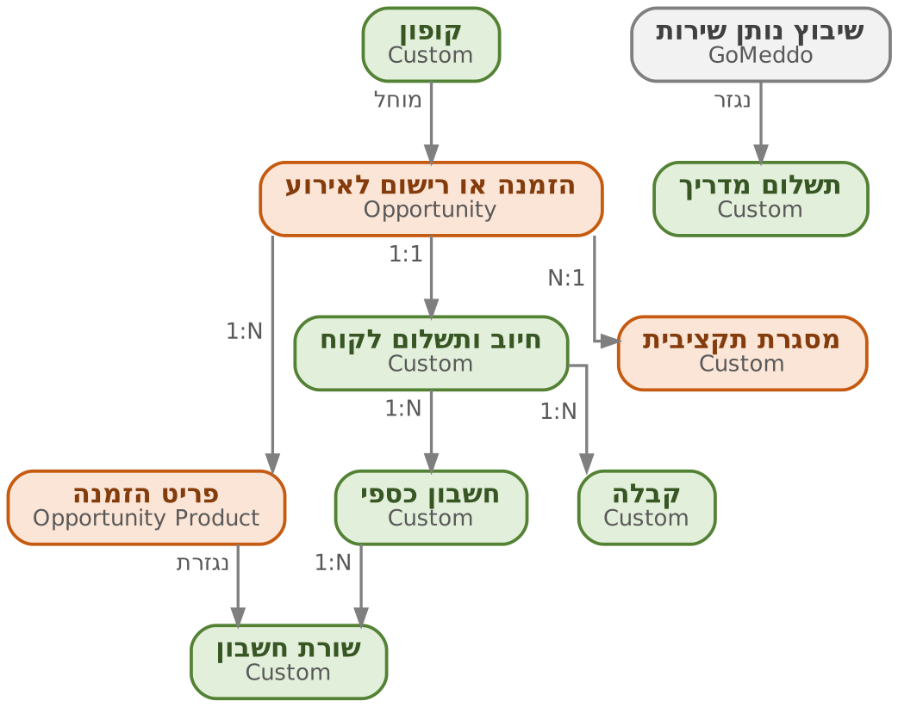

<!-- generated from: מסמך 3 אירועים וכספים - מאושר על ידי יד ושם - 2026-11-04.docx | 2026-11-08 | do not edit by hand; regenerate from the docx -->

> **מקור:** מסמך 3 - אירועים וכספים, גרסה מאושרת על ידי יד ושם, 4.11.2026  
> **מיקום בניווט:** מסמך 3 - אירועים וכספים › ישויות  
> **הקודם:** [ארכיטקטורת פתרון](02-architecture.md) · **הבא:** [מסכים מרכזיים](04-screens.md) · [מקרא](../INDEX.md)

# ישויות

מודל הנתונים המלא של המודול, על כלל ישויותיו, סוגי הרשומה והקשרים ביניהן, מפורט בפרק 4 (ישויות) במסמך 1. רשימת השדות המלאה של כל אובייקט, לרבות ערכי רשימות הבחירה, מרוכזת בנספח א מיפוי ישויות ושדות. פרק זה אינו חוזר על ההגדרות ואינו משכפל אותן, אלא מפרט את ישויות עולם האירועים וההרשמה ואת ישויות הכספים, שהוזכרו במסמכים הקודמים והפירוט שלהן נדחה למסמך זה, ומשלים את הנדרש לתהליכים המתוארים בו. מקרא הישויות, ובו שם האובייקט בסיילספורס ותפקידה של כל ישות, מובא בפרק 14.

## ההבחנה בין הזמנה לבין רישום לאירוע

שני עולמות עסקיים משלימים פועלים במודול. הזמנה היא פעולה שבה גורם חיצוני יוזם קשר עם יד ושם ומבקש לרכוש שירות, ובה המזמין קובע מה ברצונו לקבל. רישום לאירוע הוא הצטרפות לפעילות שיד ושם יזם ופרסם, שבה ההיצע נקבע מראש והנרשם בוחר מתוכו. ההבחנה היא עסקית ומשמעותית לתפעול, והיא מתבטאת במסכים, בטפסים, בתקשורת ובדוחות.

ברמת המערכת, שני העולמות נשענים על אותה תשתית: כל הזמנה וכל רישום לאירוע נושאים רשומת הזדמנות (Opportunity), המשמשת ציר החיוב, התמחור ומחזור החיים. משמעות הדבר היא שהנתונים הכספיים, הדוחות והממשק למערכת הכספית פועלים באופן אחיד על שני העולמות, ואין צורך בשני מסלולי חיוב נפרדים. רישום שאינו כרוך בתשלום נושא אף הוא הזדמנות, למוצר בסכום אפס, כדי לשמר את אחידות המודל ואת שלמות הדיווח.

המונח הזדמנות משמש במסמך זה לרשומת התשתית בלבד. בממשק המשתמש מוצגים המונחים העסקיים המוכרים לצוותי יד ושם, הזמנה ורישום, לפי סוג הרשומה והמסך שבו נמצא המשתמש.

## מודל האירוע וההרשמה

### אירוע (Event__c)

האירוע הוא ישות ההיצע: הוא מייצג פעילות שיד ושם מפרסם ושהקהל נרשם אליה, ובכלל זה הצגה, חיזיון, סיור פתוח, יום עיון, כנס, השתלמות, סמינר וקורס. האירוע מחזיק את סוג האירוע, התאריכים, הקיבולת, הסטטוס והמיתוג, ומקושר למוצר או לחבילה ולטופס ההרשמה. מפגשי האירוע ושיבוץ המשאבים מנוהלים בשכבת GoMeddo, כמתואר בפרק 4.4 במסמך 1.

⟦💬 c4⟧קיבולת ברירת מחדל מוגדרת לכל סוג אירוע וניתנת לשינוי בכל אירוע. הקיבולת נקבעת ברמת האירוע כאשר נרשמים לכלל ימי הפעילות, וברמת המפגש (יום הפעילות) כאשר נרשמים למפגשים בודדים בקורס או בסדרה, להצגה או לחיזיון. הקיבולת היא שדה חובה. לצד סטטוס האירוע מנוהלים סטטוס תשלום וסטטוס לכל יום פעילות. סוג הפעילות הוא שדה חובה, ורק לאחר מילויו ניתן להשתמש במוצרים המורשים לאותו אירוע. תצוגת האירוע מותאמת לסוגו באמצעות הטפסים הדינמיים, כך שכנס מציג מידע שונה מהצגה או מחיזיון.

באירוע מסומן האם ההרשמה אליו היא הרשמה שמית או הרשמה קבוצתית ללא שמות, וניתן להגביל את מספר הנרשמים המרבי לאותה הרשמה, בנפרד מהקיבולת הפיזית של  ⟦💬 c6⟧המשאב. לכל אירוע ניתן להגדיר מועד אחרון להרשמה, שבהגיעו ההרשמה נסגרת אוטומטית, וניתן לסגור את ההרשמה גם ידנית. באירוע בעל יותר מיום פעילות אחד, ימי הפעילות מוצגים תמיד ממוינים לפי תאריך, גם לאחר מחיקה או הוספה.

#### קישור בין אירועים

קיימים מצבים שבהם אירוע אחד מזין אירוע אחר: משתתפי סמינר הופכים בתאריך מסוים לצופים בהצגה או בחיזיון, ומשתתפי הזמנה מקושרים לצופים באירוע. לשם כך נתמך קישור דו-כיווני בין אירועים ובין אירוע להזמנה, כך שמתוך האירוע הראשון נראה האירוע המקושר ומתוך המופע הספציפי נראית ההזמנה או האירוע שממנו הגיעו המשתתפים. הקישור אינו משכפל את רשומות המשתתפים אלא מפנה אליהן, והוא הבסיס לספירת התפוסה ולתקשורת מול המשתתפים.

### מבנה הלו"ז של האירוע: חטיבה, יחידה וקבוצה

היררכיית חטיבה, יחידה וקבוצה היא מבנה הלו"ז של האירוע ואינה מבנה של הנרשם. במודל הנתונים כל רמה היא מפגש (GoMeddo Reservation): החטיבה היא שריון האב של פרק הזמן, היחידות הן שריונים מקבילים תחתיה, והקבוצות הן שריונים תחת היחידה, ובהם חלון הזמן, המשאב והמדריך. שיבוץ משתתף ליחידה ולקבוצה נרשם כמשתתף במפגש (Reservation Contact) של הקבוצה, המקושר לרישום (Registration__c) שלו.

חטיבה היא שורת לו"ז, פרק זמן מוגדר ביום האירוע הנושא כותרת.

יחידה היא חלופת תוכן בתוך אותו פרק זמן, לדוגמה סיור באתר לעומת סיור במוזיאון.

קבוצה היא יחידת התפעול הפנימית, לפי שפה, אולם או נקודת איסוף.

ההיררכיה המלאה נדרשת בעיקר בכנסים. אירוע נפתח באחד משני מבנים: מבנה מורכב, ובו חטיבה, יחידה וקבוצה, או מבנה פשוט, ובו חלוקה לקבוצות בלבד. באירוע שהוגדר כפשוט אין צורך ליצור חטיבות ויחידות, וההרשמה והשיבוץ מתבצעים ברמת הקבוצה בלבד. לכל חטיבה ויחידה נקבע האם היא מוצגת בטופס למשתתף והאם היא מיועדת לכולם או נתונה לבחירה; פרק זמן המסומן "מיועד לכולם" משבץ אליו אוטומטית את כלל המשתתפים.

### רישום (Registration__c)

הרישום מנהל את ההצטרפות של הנרשם לאירוע. הרישום מתבצע באחת מארבע רמות, לפי אופי האירוע: לאירוע כולו, ללא בחירה אישית, כמקובל בהשתלמויות ובסמינרים; לתאריכים מסוימים מתוך סדרה, כמקובל בקורסים; למופע בודד, כמקובל בהצגה ובחיזיון; ולרמות ההיררכיה, כמקובל בכנס מורכב. גם בכנס שבו קיימת היררכיה, הנרשם נרשם תחילה לאירוע עצמו ורק לאחר מכן מצטרף לחטיבה וליחידה.

רשומת הרישום תומכת בשני אופני רישום: רישום שמי, המקושר לאיש קשר, ורישום קבוצתי ללא שמות, המנוהל באמצעות מספר משתתפים. הקיבולת נספרת מול קיבולת האירוע וברמת רכיב הלו"ז שאליו נרשמו, והסטטוס מנהל גם רשימת המתנה. כל רישום מקושר להזדמנות, ורישום בתשלום נושא את שורות התמחור שלו.

### רכיב רישום (Registration Item__c)

רכיב הרישום מנהל את רכיבי הלוגיסטיקה הנלווים להרשמה: מלון ובקשת סבסוד טיסה, הסעה וארוחה. האובייקט נבנה גנרי במתכוון, כך שהזמנת ארוחה, לדוגמה, מנוהלת באותו מבנה שבו מנוהלים מלון ובקשת סבסוד טיסה, גם כאשר סוג השירות שונה, ובכך נמנע ריבוי ישויות לפי סוג. במערכת הקיימת נוהלו רכיבים אלה כישויות נפרדות לפי סוג, ובהן הזמנות מלון, הסעה ושורות אוכל, והן מאוחדות כעת תחת ישות אחת. בנוסף, היצע הלינה וההסעות של האירוע מנוהל בישויות ייעודיות תחת האירוע, המפורטות להלן ובפרקים 5.3 (כנסי מורים) ו-5.4 (סמינרים).

כל רכיב מקושר למוצר לצורך עלות ותיעוד, ונושא את זהות המשלם, לקוח, יד ושם או ספק ישיר, כך שהחשבון יכול לכלול או להחריג רכיבים לפי המשלם. בכך נתמכים אירועים מרובי משלמים. רכיבי הרישום אינם ייחודיים לכנסים והם משמשים גם בסמינרים, בקורסים ובהשתלמויות.

הקצאת מלון לאירוע (Event Hotel Allocation, Custom) מנהלת את הסדר הלינה של אירוע מול מלון אחד: האירוע (Event__c), המלון כמוצר (Product), תאריכי הכניסה והיציאה, בסיס האירוח, מכסת החדרים, החדרים התפוסים והחדרים שנותרו, והמחיר. לאירוע אחד יכולות להיות כמה הקצאות מלון.

הסעה לאירוע (Event Shuttle, Custom) מנהלת קו הסעה של האירוע: חברת ההסעות, מספר האוטובוסים, מכסת המקומות והמחיר (מחיר לנוסע בכנס או מחיר הנסיעה בסמינר). תחת כל הסעה נפתחות נקודות האיסוף שלה (Pickup Point, Custom).

רכיב רישום מסוג מלון מקושר להקצאת המלון לאירוע ונושא את שותפי החדר, מספר החדר וזהות המשלם; רכיב רישום מסוג הסעה מקושר להסעה לאירוע ולנקודת האיסוף שבחר המשתתף.

### קבוצת המשתתפים, המכסה וסטטוס הרישום

קבוצת המשתתפים בפעילות אינה ישות נפרדת: באירוע ובמופע היא הנרשמים אליו, המנוהלים ברישום (Registration__c), ובקבוצה בכנס היא המשתתפים המשובצים למפגש הקבוצה (Reservation Contact).  ⟦💬 c8⟧כל רישום שמי מקשר איש קשר אחד לפעילות, ורישום קבוצתי ללא שמות מנוהל באמצעות מספר משתתפים. כל רישום נושא שני שדות: סוג הקשר (תפקידו בפעילות) וסטטוס הקשר (מצבו בתהליך ההרשמה).

⟦💬 c10⟧סוג הקשר קובע את תפקידו של האדם בפעילות, ובכללו נרשם, משתתף ומלווה.  ⟦💬 c12⟧סגל ומרצים אינם נרשמים לאירוע: הם משובצים ליום הפעילות בשכבת GoMeddo. סטטוס הקשר קובע את מצבו בתהליך ההרשמה, ובכללו נרשם, מאושר, בהמתנה, משתתף, הגיע בפועל, לא הגיע ובוטל. שני השדות מנוהלים כרשימות בחירה סגורות בשליטת יד ושם. מעברי הסטטוס מתועדים, ומעבר לסטטוס בוטל מחייב בחירת סיבת ביטול מתוך רשימה סגורה, בהתאם לכלל החל על כל הביטולים במודול.

מכסת המשתתפים היא שדה ברמה שאליה נרשמים המשתתפים: באירוע לתאריך בודד על האירוע, ברישום למפגשים בודדים (מופעי הצגה וחיזיון, מפגשי קורס או סדרה) על כל מפגש, בכנס שבו בוחרים ימים על כל יום פעילות, ובכנס גם על כל קבוצה, שהיא מפגש (GoMeddo Reservation). באירוע ובמופע התפוסה היא סכום המשתתפים ברישומים הפעילים, ובקבוצה בכנס היא מספר המשתתפים המשובצים אליה (Reservation Contact). נותני שירות וסגל המשובצים לפעילות אינם נספרים במכסה.  ⟦💬 c14⟧כברירת מחדל, הגעה למכסה סוגרת את ההרשמה: בקישור הרישום מוצגת הודעה שההרשמה הסתיימה. למופע מלא לא ניתן להירשם. באירוע שהוגדרה בו רשימת המתנה, הרשמה החורגת מהמכסה נכנסת לסטטוס בהמתנה. שחרור מקום מקדם אוטומטית את הרשומה הראשונה בהמתנה, לפי סדר ההרשמה, והנרשם מקבל הודעה על כך. מינימום המשתתפים, שדה באותה רמה, משמש תנאי סף לקיום הפעילות ומוצג לרכז כחיווי כאשר אינו מתקיים. באירוע הנמכר בסמארטיקט, שאינה מקבלת נתונים מסיילספורס, המכסה נקבעת ונאכפת בסמארטיקט, וסיילספורס קולט את הרישומים ומציג את התפוסה.

הנוכחות בפועל מתועדת בקישור המשתתפים למפגש בשכבת GoMeddo, או בספירה כמותית בקבוצות ללא שמות, כמפורט בפרק 5.7 (ניהול נוכחות בפועל וסימון הגעה).

## ישויות הכספים

ניהול הכספים עצמו נותר במערכת הכספית. הישויות שלהלן מנהלות בסיילספורס את מה שנדרש להפקת החיוב, לתיעודו ולביטולו, ואת מה שנדרש לתשלום לנותני השירות. אופן העברת הנתונים למערכת הכספית מפורט בפרק 9.1 (ממשק המערכת הכספית).

תרשים ישויות: ישויות הכספים והקשרים ביניהן

### חשבון כספי (Custom)

החשבון הכספי מייצג חשבון שהופק מול המערכת הכספית, ומחזיק את קוד החשבון שהתקבל ממנה, את מספר החשבון, את שורותיו, את הסכומים, את המטבע ואת סטטוס ההתאמה. מדובר בחשבון לתשלום ולא בחשבונית מס. הרשומה מאפשרת הצגת החשבון בתוך סיילספורס, שכן לא לכל המשתמשים יש גישה למערכת הכספית.

בעת ההפקה נשמרים ברשומה מלוא נתוני החשבון, חלקם ממקור סיילספורס וחלקם מהמערכת הכספית, לרבות קוד החשבון, מספר החשבון, זהות משתמש האינטגרציה ששידר את הפעולה, זהות המשתמש שיזם אותה ומועד השידור. לחשבון ששולם נשמרים ברשומה גם מספר הקבלה והקישור לקבלה במערכת הכספית, המתעדכנים בעדכון התקופתי (A21-21), בכפוף להחזרתם בשליפת הדוח (פרק 11).

סטטוס ההתאמה נשען על שלושת מצבי המערכת הכספית: ללא התאמה, התאמה חלקית והתאמה מלאה. הסטטוס קובע את אופן הביטול: חשבון שאינו במצב התאמה מלאה ניתן לביטול אוטומטי בלחיצת כפתור, היוצר חשבון נגדי במינוס דרך הממשק; חשבון במצב התאמה מלאה אינו ניתן לביטול אוטומטי, ונדרשת הפקה ידנית של חשבון בסכום מינוס מתוך ההזמנה. הכלל נאכף בוולידציה ומוצג למשתמש בהודעה מפורשת.

יצירת חשבון וביטולו מותרים לבעלי הרשאה בלבד, כמפורט בפרק 8 (פרופילים והרשאות). בשונה מהמצב הקיים, שבו נדרש משתמש במערכת הכספית לצורך הפקה, במודל היעד ההרשאה נשענת על סיילספורס בלבד, וכל הקריאות נושאות מזהה משתמש אינטגרציה קבוע במערכת הכספית.

#### שורת חשבון

שורת החשבון נגזרת משורת ההזמנה ומחזיקה את שם הפריט, הכמות, המחיר ליחידה, המחיר לאחר הנחה, קוד המסגרת התקציבית ומספר המוצר (מק"ט). ⟦💬 c16⟧ המק"ט הוא שדה חובה בשידור: לכל מוצר בקטלוג מוגדר שדה ייעודי למק"ט של המערכת הכספית, ובחשבון ידני שאינו נגזר משורות ההזמנה משודר מק"ט כללי שהוגדר מראש, כך שלעולם לא משודרת שורה ללא מק"ט. לחשבון ניתן לצרף הערות: תכנית גפן שאליה משויכת ההזמנה והערות למזמין. הערה שנכתבה בשורת הצעת המחיר מוצגת בחשבון במקום שם המוצר.

שורות ההזמנה שנכללו בחשבון מקבלות חיווי "הופק חשבון" ואינן ניתנות לעריכה, לשמירת התאמה מלאה מול המערכת הכספית. יש לקבל את רשימת השדות המלאה הנדרשת לסנכרון מצוות יד ושם עד לתחילת שלב הפיתוח.

### ⟦💬 c18⟧קבלה (Custom) ⟦💬 c22⟧

הקבלה מייצגת תשלום שנסלק בפועל בכרטיס אשראי, בשונה מהחשבון המייצג דרישת תשלום. הרשומה מחזיקה את מועד העסקה, סכום החיוב, מספר האישור, ארבע הספרות האחרונות של הכרטיס, תוקפו, מספר השובר, מזהה העסקה בפלאקארד (לביצוע החזר על העסקה המקורית), מספר הטרמינל שבו בוצעה הסליקה, סוג החיוב וחברת הסליקה, לצד השם עבור הקבלה שהזין המשלם, ומספר הקבלה שהתקבל מהמערכת הכספית, ולצדו הקישור לקבלה, בכפוף להחזרתו בקריאת יצירת הקבלה (פרק 11). עותק הקבלה אינו נשמר בסיילספורס.

כל תשלום בכרטיס אשראי שנסלק דרך סיילספורס (תשלום מקוון, טופס, קישור תשלום ועמדת הקיוסק) נרשם ברמת פירוט מלאה ומשודר למערכת הכספית בסיום התשלום, ולא רק חשבונות של מוסדות רשומים. תקבול שנקלט במערכת הכספית משתקף כמצב התאמה (A21-21), ועל תשלום בדלפק המבואה לא נפתחת קבלה (A20-12). הרשומה היא הבסיס לביטול עסקה ולזיכוי, לרבות זיכוי חלקי, כמפורט בפרקים 5.10 ו-5.11. הזיכוי נרשם כהוראת זיכוי: רשומת קבלה מסוג זיכוי, המקושרת לקבלה המקורית.

### ⟦💬 c24⟧חיוב ותשלום לקוח (Custom)

הישות מרכזת את מצב החיוב של ההזמנה או הרישום: הסכום לחיוב, הסכומים ששולמו, היתרה, קישורי התשלום שנשלחו והחשבונות שהופקו. ההזמנה תומכת בריבוי קישורי תשלום ובריבוי חשבונות, כך שתוספת לאחר תשלום מטופלת בקישור נוסף על ההפרש ולא בעריכת החיוב הקיים. סבסוד מתבטא במחיר השורה ואינו ישות נפרדת. קישור לתשלום נשלח למזמין מתוך ההזמנה או לנרשם מתוך הרישום שלו, ובתשלום בקישור, המשלם יכול להזין שם עבור הקבלה, הנשמר בפרטי התשלום.

הישות נדרשת משום שההזמנה (Opportunity) מחזיקה סכום אחד, בעוד שמול הלקוח מתנהלות לאורך חיי ההזמנה או הרישום כמה דרישות תשלום וכמה תשלומים: קישור תשלום נוסף על הפרש, תשלום חלקי ותשלום לאחר עריכה. כך מוגדרת הישות בפרק 4.6 במסמך 1: היא מנהלת את החיוב והתשלום מצד הלקוח, הנגזר מסכום ההזמנה ומשורותיה, ומאפשרת עריכה וחיוב הפרשים לאחר התשלום. החלוקה בין ישויות הכספים במסמך זה: החשבון הכספי (פרק 3.3.1) מייצג חשבון שהופק במערכת הכספית ואת נתוניו; הקבלה (פרק 3.3.2) מייצגת תשלום שנסלק בכרטיס אשראי; וישות החיוב והתשלום מרכזת עבור ההזמנה או הרישום את התמונה המלאה: הסכום לחיוב, דרישות התשלום, החשבונות והקבלות המקושרים אליה והיתרה.

נתוני החשבון שהופק במערכת הכספית, ובהם קוד החשבון, מספרו, שורותיו, הסכומים, המטבע וסטטוס ההתאמה, נשמרים ברשומת החשבון הכספי (פרק 3.3.1) בלבד ואינם משוכפלים ברשומת החיוב והתשלום. לכל רשומת חיוב ותשלום מקושרים חשבון כספי אחד או יותר, וכך נשמרים הנתונים הנדרשים לביטול ולזיכוי בהמשך, כנדרש בפרק 4.6 במסמך 1.

הסכומים ברשומת החיוב והתשלום נגזרים ואינם מוזנים ידנית: הסכום לחיוב נלקח מהסכום לתשלום בהזמנה (Opportunity), לאחר הנחה ברמת ההזמנה; הסכום ששולם מסוכם מהתשלומים המקושרים לרשומה (קבלות, בניכוי קבלות מסוג זיכוי, ובמוסד המשלם בהעברה גם החשבונות הכספיים בהתאמה מלאה); בתשלום בדלפק המבואה ההזמנה מסומנת כשולמה לפי עדכון סטטוס התשלום בידי צוות המבואה (A20-12), והיתרה היא ההפרש ביניהם. הרשומה מקושרת להזמנה בקשר אב ובן (Master-Detail), כך שהסכומים מחושבים במערכת. כאשר להזמנה הופק חשבון, סטטוס התשלום נקבע לפי מצב ההתאמה מהמערכת הכספית (A21-21); כאשר לא הופק חשבון, לפי הקבלות.

ברשומת הלקוח נשמר חיווי חוב מהמערכת הכספית, המתעדכן פעמיים ביום למוסדות שיש להם הזמנה פתוחה או חיווי חוב פעיל (A21-21), ובבדיקה בזמן אמת ביצירת הזמנה חדשה או בבקשה ידנית (A21-02). לצד החיווי מוצגת, בבקשה ידנית, תצוגה חיה של חשבונות הלקוח הנשלפת מהממשק ואינה נשמרת, כמפורט בפרק 9.1.

### תשלום מדריך (Custom)

הישות מנהלת את התשלום לנותני השירות, בנפרד מחיוב הלקוחות. היא נגזרת משיבוצי GoMeddo ומחזיקה לכל פעולה את התאריך, ההזמנה או האירוע, מקום הפעילות, שעות הפעילות המקוריות ולצדן השעות לתשלום לאחר תוספת ביטול הזמן וההשלמה למינימום, קטגוריית המרחק, הקילומטראז' לתשלום, המסגרת התקציבית, קוד השכר וסמל התלוש, סימון פעולה ללא תשלום, סימון החרגה משידור, וסטטוס שידור ותשלום.

שמירת השעות המקוריות לצד השעות לתשלום נדרשת משום שקובץ השכר נקלט עם השעות המועשרות בעוד הבקרה האנושית מתבצעת מול השעות המקוריות. לפני יצירת שורת תשלום נבדק שהפעולה טרם שולמה, לצורך מניעת כפל תשלום בתיקונים רטרואקטיביים.

### קופון (Custom) ⟦💬 c26⟧

הקופון מייצג הנחה או זיכוי המשויכים ללקוח או לאוכלוסייה מוגדרת, ומחזיק את קוד המימוש, סוג ההטבה (אחוז הנחה, סכום הנחה בש"ח או פטור מלא), ערכה, טווח התוקף והסטטוס. קוד המימוש חד פעמי: הקופון נבדק בעת התמחור, חל על ההזמנה או על הרישום בכפוף לתוקפו, ומימוש נוסף שלו נחסם (מסמך 2). ניתן להפיק קופונים לקבוצת לקוחות, למשל לנרשמי השתלמות מורים: נוצר קופון נפרד לכל לקוח בקבוצה, עם קוד חד ערכי משלו, והוא נשמר בכרטיס הלקוח עד תום תוקפו. ככלל הקופון מקושר לאירוע אחד, ובסיורים פתוחים ניתן לקשר קופון אחד לכמה אירועים. שדות הקופון מפורטים בפרק 5.1 (אירועים פתוחים לקהל, סיורים, הצגות וחיזיון).

### מסגרת תקציבית, השלמה לתהליכי האירועים

המסגרת התקציבית מפורטת בפרק 4.2 במסמך 1. לצורך תהליכי האירועים והכספים מובאות שתי השלמות. הראשונה, כל אירוע מקושר למסגרת תקציבית אחת ללא תלות במספר תאריכיו, ונשמרת הפרדה בין מסגרות המשמשות הזמנות לבין מסגרות המשמשות אירועים. השנייה, כללי הפקת החשבון האוטומטי נגזרים משילוב של שלושה מקורות: המסגרת התקציבית, הקובעת אם להפיק חשבון אוטומטי; מאפייני המוסד, הקובעים את מועד ההפקה; וסימון ברמת כרטיס הלקוח, הקובע אם להחריג את המוסד מהפקה אוטומטית. חשבון אוטומטי מופק רק כאשר כל שלושת התנאים מתקיימים.

---

## הערות סקירה בפרק זה

> הערות הסקירה אינן חלק מהאפיון המחייב. הן מסמנות מקומות שבהם הטקסט עדיין בדיון. הסימון ⟦💬 cN⟧ בגוף הטקסט מפנה להערה כאן.

### ⟦💬 c4⟧ סגורה
- **c4** · טל שמרית · 2026-10-20 · סומנה כסגורה: בנוסף חשוב לזכור שהקיבולת יכולה להיות לפי אירוע (במקרה ונרשמים לכל ימי הפעילות של האירוע) / והקיבולת יכולה להיות לפי מפגש/יום פעילות (לאירועים בהם נרשמים לימים בודדים בקורס/ סדרה או לחזיון והצגה)
  - **c5** · Lior Pridor · 2026-10-26 · סומנה כסגורה: בוצע: נוסף שהקיבולת נקבעת ברמת האירוע או ברמת המפגש, לפי אופן הרישום.

### ⟦💬 c6⟧ סגורה
- **c6** · טל שמרית · 2026-10-20 · סומנה כסגורה: כמו כן, בכל הרשמה לאירוע ישנה אפשרות לסמן עד מתי ניתן להירשם לאירוע (תאריך) והסגירה להרשמה מתבצעת אוטומטית על ידי המערכת, וכן יש אפשרות לסגור (ידנית) את ההרשמה לאירוע.
  - **c7** · Lior Pridor · 2026-10-26 · סומנה כסגורה: בוצע: נוספו המועד האחרון להרשמה עם סגירה אוטומטית, והסגירה הידנית.

### ⟦💬 c8⟧ סגורה
- **c8** · טל שמרית · 2026-10-20 · סומנה כסגורה: לא מובן
  - **c9** · Lior Pridor · 2026-10-26 · סומנה כסגורה: בוצע: המשפט נוסח מחדש. כל רישום מקשר לאירוע נרשם אחד: איש קשר ברישום שמי, או קבוצה ללא שמות באמצעות מספר משתתפים. הרישום נושא את תפקיד הנרשם באירוע (סוג הקשר) ואת מצבו בתהליך ההרשמה (סטטוס הקשר).

### ⟦💬 c10⟧ סגורה
- **c10** · וייל דבורה · 2026-10-18 · סומנה כסגורה: מרצה ומשתתף באותה רמת קשר?
  - **c11** · Lior Pridor · 2026-10-26 · סומנה כסגורה: לא. מרצה אינו סוג קשר כמו משתתף. סגל ומרצים הוצאו מרשימת סוגי הקשר: הם אינם נרשמים לאירוע אלא משובצים ליום הפעילות.

### ⟦💬 c12⟧ סגורה
- **c12** · טל שמרית · 2026-10-20 · סומנה כסגורה: סגל/ מרצה אינם צריכים להירשם לאירוע. הם משובצים באירוע ביום הפעילות
  - **c13** · Lior Pridor · 2026-10-26 · סומנה כסגורה: בוצע: סגל ומרצים הוצאו מסוגי הקשר, ונוסף שהם משובצים ליום הפעילות ואינם נרשמים.

### ⟦💬 c14⟧ סגורה
- **c14** · טל שמרית · 2026-10-20 · סומנה כסגורה: איך יכול להיות מצב של רשימת המתנה? / בלינק רישום לאירוע (סמינר/השתלמות) אם מגיעים למספר הנרשמים המקסימלי, אז מי שמנסה להירשם דרך הלינק ישר מקבל הודעה כי הרישום הסתיים. / ברישום לאירוע כמו הצגה/ סיור פתוח- מלכתחילה התאריך של המופע לא יוצג לנרשם לבחירה
  - **c15** · Lior Pridor · 2026-10-26 · סומנה כסגורה: בוצע: ברירת המחדל היא כמתואר בהערה: הגעה למכסה סוגרת את ההרשמה. רשימת המתנה היא אפשרות לאירוע שהוגדר כך בלבד (דרישות המכרז, מס"ד 220).

### ⟦💬 c16⟧ סגורה
- **c16** · טל שמרית · 2026-10-20 · סומנה כסגורה: לחשבון יכולות להיות גם התוספות הבאות בשדה הערות: / תכנית הגפן אליה משוייכת ההזמנה. / הערות למזמין / וכן, בכל שורת הצעת מחיר ישנה אפשרות לכתוב הערה, ההערה שנכתבת מחליפה את המוצר שמופיע בשורת הצעת המחיר
  - **c17** · Lior Pridor · 2026-10-26 · סומנה כסגורה: בוצע: נוספו הערות החשבון, תכנית גפן והערות למזמין, והערת השורה, המוצגת בחשבון במקום שם המוצר. הערות החשבון משודרות לאלמוג בשדה הערות שנדרש להוסיף לקריאת יצירת החשבון, והערת השורה משודרת כשם הפריט (פרק 9.1 ופרק 11).

### ⟦💬 c18⟧ נענתה על ידי מלם
- **c18** · טל שמרית · 2026-10-20: לפי מה שאני יודעת הקבלה מיוצרת במערכת הנה"ח בלבד. / נשמח לראות בתהל לצד כל רישום גם את הלינק לקבלה שלו בERP, או לצד תשלום חשבון את הקבלה המתאימה לו ואת סטטוס מצב ההתאמה.
  - **c19** · Lior Pridor · 2026-10-26: כך גם באפיון: הקבלה, המסמך החשבונאי, מופקת במערכת הכספית בלבד. בתשלום בכרטיס אשראי נשמרים בסיילספורס, ברשומת הקבלה, פרטי התשלום, מספר הקבלה והקישור לקבלה במערכת הכספית, בכפוף להחזרת הקישור בקריאת יצירת הקבלה (A21-19, פרק 11). עותק הקבלה אינו נשמר בסיילספורס, והקבלה אינה נשלחת מסיילספורס. תשלום חשבון שנקלט במערכת הכספית, למשל בהעברה בנקאית, אינו יוצר רשומת קבלה בסיילספורס: הוא משתקף כמצב ההתאמה של החשבון וכסטטוס התשלום של ההזמנה, המתעדכנים פעמיים ביום (A21-21). תצוגה עדכנית של חשבונות הלקוח זמינה בבקשה ידנית (A21-02).
  - **c20** · אשבל אור · 2026-11-02: בדומה לתשלום באשראי, נבקש שגם בתשלום חשבון תהיה אפשרות להוספת קישור לקבלה במערכת הכספית
  - **c21** · Lior Pridor · 2026-11-04: בוצע, בכפוף להרחבת הממשק: לחשבון ששולם יישמרו ברשומת החשבון הכספי מספר הקבלה והקישור אליה במערכת הכספית, המתעדכנים בעדכון התקופתי (A21-21). לשם כך נבקש שדוח החשבונות במערכת הכספית יחזיר לכל חשבון ששולם את מספר הקבלה והקישור אליה; הבקשה נוספה לרשימת הרחבות הממשק (פרק 11).

### ⟦💬 c22⟧ סגורה
- **c22** · Miri Yahud · 2026-10-22 · סומנה כסגורה: נדרשת הפרדה בין קבלת תקבול בכרטיס אשראי שתתבצע באתר או במערכת (ממשק לפריוריטי להפקת קבלה), לבין קבלת תקבול בהעברה בנקאית שמגיעה למחלקת כספים (ממשק ל SF)
  - **c23** · Lior Pridor · 2026-10-26 · סומנה כסגורה: תשלום בכרטיס אשראי, באתר או במערכת, נרשם בסיילספורס ומשודר למערכת הכספית להפקת קבלה (פרק 5.9, A21-19). תקבול בהעברה בנקאית נקלט במערכת הכספית, ומשתקף בסיילספורס בעדכון המתבצע פעמיים ביום: מצב ההתאמה של החשבון, סטטוס התשלום בהזמנה וחיווי החוב במוסד (A21-21). הממשק בפרויקט פועל מול אלמוג בלבד.

### ⟦💬 c24⟧ סגורה
- **c24** · טל שמרית · 2026-10-20 · סומנה כסגורה: יש להוסיף כי ישנה אפשרות לשלוח לינק לתשלום, למזמין מתוך ההזמנה או לנרשם מתוך הרישום שלו לפעילות. בזמן התשלום דרך הלינק יש לאפשר למזמין שמשלם למלא שדה חדש בשם "שם עבור קבלה". / את הנתון הזה יש לשמור בתוך פירוט התשלום של המזמין
  - **c25** · Lior Pridor · 2026-10-26 · סומנה כסגורה: בוצע: נוספו משלוח הקישור מההזמנה או מהרישום והשדה שם עבור קבלה.

### ⟦💬 c26⟧ נענתה על ידי מלם
- **c26** · Miri Yahud · 2026-10-22: כיצד נוצרים הקופונים? האם יש מנגנון חד ערכי, באופן שלא ניתן להשתמש בקופון, מספר פעמים?
  - **c27** · Lior Pridor · 2026-10-26: הקופון נוצר ידנית בידי המשתמש ברשומת קופון ומקושר לאירוע; בסיורים פתוחים ניתן לקשרו לכמה אירועים. קוד הקופון חד ערכי וניתן לממשו פעם אחת בלבד: הקופון מוחל רק בתוקפו, והמערכת חוסמת מימוש נוסף שלו.
  - **c28** · אשבל אור · 2026-11-02: האם ניתן לייצר קופון למימוש לקבוצת אנשים (דוגמא קופון למורים)
  - **c29** · Lior Pridor · 2026-11-04: כן. ניתן להפיק קופונים לקבוצת לקוחות, למשל לנרשמי השתלמות מורים: נוצר קופון נפרד לכל לקוח בקבוצה, עם קוד חד ערכי משלו, והוא נשמר בכרטיס הלקוח עד תום תוקפו. קוד אחד המשותף לכמה אנשים אינו נתמך, משום שקוד הקופון חד פעמי. עודכנו פרק 3.3.5 ושדות הקופון בפרק 5.1.
