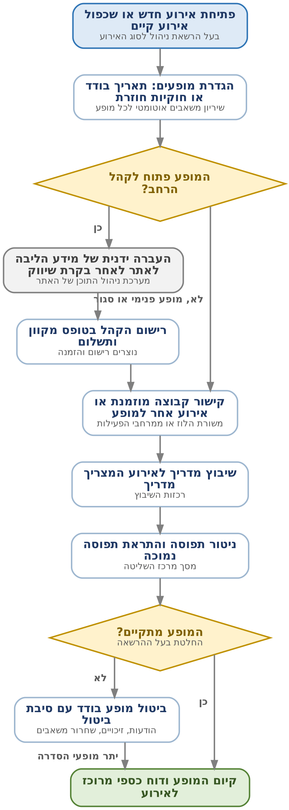

<!-- generated from: מסמך 3 אירועים וכספים - מאושר על ידי יד ושם - 2026-11-04.docx | 2026-11-08 | do not edit by hand; regenerate from the docx -->

> **מקור:** מסמך 3 - אירועים וכספים, גרסה מאושרת על ידי יד ושם, 4.11.2026  
> **מיקום בניווט:** מסמך 3 - אירועים וכספים › תהליכים עסקיים › אירועים פתוחים לקהל, סיורים, הצגות וחיזיון  
> **קודי ולידציה ואוטומציה בפרק:** A14-01, A14-02, A14-03, A14-05, A14-06, A14-07, A14-08, A14-09, A14-13, A14-14, A14-16, V14-01, V14-02, V14-03, V14-04, V14-05, V14-06, V14-08, V14-10, V14-11  
> **הקודם:** [תהליכים עסקיים](00-overview.md) · **הבא:** [פתיחת אירוע בסמארטיקט וסנכרונו לסיילספורס](02-smartticket-event-sync.md) · [מקרא](../../INDEX.md)

# אירועים פתוחים לקהל, סיורים, הצגות וחיזיון

הפרק עוסק בפעילויות יזומות של יד ושם שהקהל נרשם אליהן: סיורים פתוחים, הצגות התיאטרון וחיזיון האור-קולי. כל אירוע נפתח במקום אחד בסיילספורס, עם דגל פתוח לקהל הרחב, והניהול מבוסס על הרשאות (ניהול הצגות, ניהול חיזיון,  ⟦💬 c40⟧ניהול סיורים פתוחים): כל בעל הרשאה פותח, מעדכן ומבטל. מסך מרכז שליטה מציג את המופעים והתפוסה בזמן אמת, בצבע שונה למופע הפתוח לקהל ולמופע פנימי. סיורים פתוחים נפתחים בשני אופנים: סיור למועד מיוחד, הנפתח כמופע בודד, וסיור החוזר לפי כלל קבוע (למשל בכל יום שישי), הנפתח בהגדרת חוקיות (A14-07).

סיילספורס היא המקור למידע הליבה (קיום, מלאי, מחיר, תאריכים, שעות, פתוח או סגור לקהל), והעדכון באתר מתבצע ידנית: ⟦💬 c42⟧ לא קיים ממשק לסנכרון בין סיילספורס  ⟦💬 c44⟧לאתר; התוכן השיווקי מנוהל במערכת ניהול התוכן, ומוצר עולה לאתר רק לאחר בקרת שיווק. יחידת הניהול היא המופע הבודד: תצוגתו באתר, סגירתו לקהל, ביטולו וסיבת הביטול נקבעים ברמת המופע, ויתר מופעי הסדרה אינם מושפעים.

הזמנה או אירוע אחר מקושרים למופע, והקישור נראה משני הצדדים: משתתפי ההזמנה או הסמינר נרשמים כצופים במופע, משורת הלו"ז של ההזמנה או ממסך האירוע (פרק 4.1). לכל אירוע מוגדר אם הרישום אישי ומהו מספר הנרשמים המרבי ברישום. קליטת ההזמנה, השיבוץ והתזכורות מפורטים במסמך 2 (פרקים 12.2, 12.3, 12.9 ו-12.14), והכספים בפרקים 5.9 עד 5.11, ואינם חוזרים כאן.

תרשים תהליך 16: אירועים פתוחים לקהל

## אוטומציות

| מזהה | טריגר | הפעולה האוטומטית |
| --- | --- | --- |
| A14-01 | בדיקה מתוזמנת יומית: מופע שיתקיים בעוד יומיים ומספר הנרשמים בו נמוך מעשרה | התראת תפוסה נמוכה לבעלי הרשאת הניהול של סוג האירוע, המוצגת גם במסך מרכז השליטה לצד התפוסה, כבסיס להחלטה על ביטול המופע או על מילויו בקבוצות מוזמנות. |
| A14-02 | ביטול מופע בודד בידי בעל הרשאת ניהול, עם סיבת ביטול ברמת המופע | המופע מסומן כמבוטל ויתר מופעי הסדרה נשארים פעילים; הודעת התנצלות לנרשמי המופע, תנועות זיכוי לפי מדיניות הזיכוי (פרקים 5.10 ו-5.11), למעט רכישות בסמארטיקט, שהזיכוי עליהן מבוצע בסמארטיקט (A15-05), שחרור מוזיאון, כיתות ומבואה (אוזניות), עדכון הצוות התפעולי, ועדכון ידני של האתר על ידי אנשי השיווק. בהצגה מיודע אחראי ההצגות |
| A14-03 | ביטול הזמנה המקושרת למופע, בידי המזמין במערכת המקוונת או בידי עובד יד ושם | שחרור הרישום להצגה או לחיזיון, כך שהכרטיסים חוזרים למלאי המופע, יחד עם שחרור המוזיאון והכיתה. נותני השירות אינם משוחררים אוטומטית. כאשר להזמנה יש רישום להצגה, נשלח מייל אוטומטי לאחראי ההצגות על ביטול ההזמנה ושחרור הכרטיסים: בביטול שבעה ימים או פחות לפני המועד, בכל מופע; בביטול מוקדם יותר, רק במופע פנימי שאינו מוצג במערכת המקוונת. |
| A14-05 | מועד קרב של מופע שהרישום אליו הוא לתאריך בודד | תזכורת לנרשמי הצגות, סיורי יום שישי וחיזיון, במנגנון המפורט בפרק 12.14 במסמך 2 (תזכורות ותקשורת יזומה). אינה נשלחת לנרשמי השתלמויות, סמינרים וקורסים, שבהם הרישום הוא לכל תאריכי האירוע. |
| A14-06 | פתיחת מופע באירוע פתוח המצריך מדריך (חיזיון, סיור מודרך ביום שישי) | המופע מוצג במסך השיבוץ של הרכזות ונעלם ממנו עם השלמת השיבוץ. הצגות, כנסים, סמינרים, השתלמויות וקורסים אינם מוצגים במסך זה. |
| A14-07 | יצירת מופעים בפעילות חוזרת: בהגדרת החוקיות, בתהליך מתוזמן או בבנייה מחדש | שריון אוטומטי של המשאב לכל מופע; פתיחת ימי הפעילות כמה חודשים קדימה; בנייה מחדש לפי תאריך התחלה, תאריך סיום וימי החזרה בשבוע; העברה או ביטול של הכלל כולו. מנגנון חלונות הכניסה למוזיאון (הקצאת שעת כניסה במסגרת ויסות הכניסות, כמפורט במסמך 2) חל רק על פעילויות המתוכננות על ידי יד  ⟦💬 c46⟧ושם. |
| A14-08 | שינוי במידע הליבה של אירוע או מופע, או בהגדרת התצוגה של מופע | מידע הליבה (מלאי, מחיר, תאריכים, שעות ומצב פתוח או סגור לקהל) מתעדכן בסיילספורס. אין ממשק למערכת ניהול התוכן של האתר: התוכן מועלה לאתר ידנית על ידי אנשי השיווק, לאחר אישורי יד ושם ומחלקת  ⟦💬 c48⟧השיווק. לכל מופע נקבעת תצוגה: מוצג, מוצג כתפוס (אזל מן המלאי) או מוסתר. מופע נסגר או נפתח בסיילספורס. מופע סגור מוסר מהיצע הרישום ומטופס ההרשמה באתר (Titan Forms), כך שלא ניתן לרכוש בו כרטיסים, ונשאר גלוי לצוות התפעולי. באירוע ובמופע מנוהל השדה מוצג באתר (תיבת סימון), המתעדכן ידנית עם העלאת האירוע לאתר. |
| A14-09 | לחיצה על "שכפול אירוע", בכל סוגי האירועים; יצירת אירוע חדש | נפתח עותק עם כל הנתונים והסימונים, ימי פעילות ללא תאריך ולו"ז ללא שיבוצי משאבים ונותני שירות; הרשומה נוצרת רק בשמירה. בכל יצירת אירוע נגזרת תחילית מספר האירוע מסוג האירוע, לפי טבלת תחיליות שתגדיר יד ושם. |
| A14-13 | ⟦💬 c50⟧משלוח הודעה מרשומת האירוע | שליחה ברמת יום פעילות בודד, כמה ימי פעילות או האירוע כולו, לנרשמים, לרכזים ולנותני השירות המשובצים, לפי בחירה, עם עריכת נמענים, נושא ותוכן, אפשרות לצרף את הלו"ז כקובץ, ותיעוד המשלוח על רשומת האירוע. |
| A14-14 | הפקת דוח כספי מרוכז מרשומת האירוע | הדוח מופק כדוח מערכת וניתן לייצוא כטבלה לאקסל, ומציג את כלל השיבוצים באירוע בחלוקה לפעולות שביצעו הרכזים, לפעולות ללא תשלום ולפעולות בתשלום. ⟦💬 c52⟧ |
| A14-16 | קישור משתתפי הזמנה או אירוע אחר למופע, משורת הלו"ז או ממסך האירוע (פרק 4.1) | נוצר רישום פנימי למופע, הנספר מול הקיבולת. בהזמנה או באירוע המקור מוצג הקישור עם תאריך, שעה ומספר משתתפים; במופע מוצג קישור לפרטי ההזמנה או האירוע, וברשימת הנרשמים מובחנים נרשמים פנימיים מחיצוניים. |

## כללי ולידציה

| מזהה | הכלל | הודעת שגיאה |
| --- | --- | --- |
| V14-01 | תאריך המופע האחרון אינו יכול להקדים את תאריך המופע הראשון | טווח התאריכים אינו תקין |
| V14-02 | לא ניתן ליצור שני ימי פעילות  ⟦💬 c54⟧באותו אירוע באותו תאריך ובחפיפת שעות; מופעים באותו יום בשעות שונות מותרים | קיים כבר מופע בתאריך  ⟦💬 c56⟧זה בשעות חופפות |
| V14-03 | ⟦💬 c58⟧ביטול מופע (יום פעילות) מחייב בחירת סיבת ביטול מרשימת הסיבות; הסיבה נשמרת ברמת המופע, ומופע שבוטל מובחן בדיווח מאירוע או מהזמנה שבוטלו במלואם. בביטול אירוע שלם נבחרת סיבת הביטול פעם אחת, וכל ימי הפעילות מסומנים כמבוטלים אוטומטית עם אותה סיבה | יש לבחור סיבת ביטול למופע |
| V14-04 | שינוי שעה של הזמנה המקושרת למופע מחייב שחרור הרישום למופע תחילה; אין התאמה אוטומטית למופע אחר | יש לשחרר את הרישום למופע לפני שינוי השעה |
| V14-05 | מופע חיזיון או הצגה אינו נפתח לרישום כל עוד לא סומן אישור להפעלתו | המועד טרם אושר |
| V14-06 | סימון מופע סגור מתאפשר לבעל הרשאה בלבד ומחייב הזנת הסבר; למופע סגור לא מצורפים משתתפים נוספים, גם אם נותרו בו מקומות, והוא אינו נפתח לרישום הקהל הרחב | המופע סגור; הסימון מחייב הרשאה והסבר |
| ⟦💬 c60⟧V14-08 | שלוש פעולות מוחקות או משנות נתונים קיימים ולכן מחייבות אישור מפורש של המשתמש: מחיקת רישום של נרשם; בנייה מחדש של ימי הפעילות, המוחקת את ימי הפעילות הקיימים; והחלפת סוג הפעילות של יום פעילות. בכולן מוצגת למשתמש הודעת אישור, והפעולה מתבצעת רק לאחר שאישר. כאשר משובצים נותני שירות, לא ניתן לבנות מחדש את ימי הפעילות או להחליף את סוג הפעילות עד להסרת שיבוצם, ומוצגת הודעה מתאימה; שריוני המשאבים הפיזיים משתחררים עם השינוי | הפעולה מוחקת או משנה נתונים קיימים, יש לאשר |
| V14-10 | הצגה פתוחה לקהל שכבר הוזמנו אליה כרטיסים במערכת המקוונת ננעלת ב-53  ⟦💬 c64⟧משתתפים, פנימיים ומקוונים יחד; הצגה פנימית, או פתוחה ללא הזמנות מקוונות, ננעלת על פי המכסה הפנימית (פרמטר). במקרים אלו לא תיפתח רשימת המתנה. | המופע הגיע למכסת המשתתפים |
| V14-11 | באירוע שהוגדר בו מספר נרשמים מרבי לרישום, רישום החורג ממספר זה נחסם | מספר הנרשמים חורג מהמרבי שהוגדר לאירוע |

## ישויות ושדות ייחודיים לתהליך

| ישות | תפקיד בתהליך | שדות ייעודיים לתהליך |
| --- | --- | --- |
| אירוע (Event__c), סוגי אירוע הצגה, חיזיון, סיור | רשומת ההיצע: סוג, תאריכים, קיבולת וסטטוס | דגל פתוח לקהל הרחב, תחילית מספר אירוע, קיבולת ברירת מחדל לפי סוג אירוע, חוקיות מופעים ואופק פתיחה בחודשים, רישום אישי (כן או לא), מספר נרשמים מרבי לרישום, סטטוס טיוטה, שדות קהל, ולהצגות: קהל יעד |
| מופע (יום פעילות, GoMeddo Reservation) | התאריך הבודד בסדרה: יחידת התצוגה, הסגירה, האישור והביטול | שעה, סטטוס, אישור הפעלה (חיזיון והצגה), סיבת ביטול, תצוגה במערכת המקוונת (מוצג, מוצג כתפוס, מוסתר), מופע סגור והסבר, מכסת משתתפים |
| רישום (Registration__c) | הרשמה למופע בודד; בסיס לתפוסה, לזיכוי ולתזכורות, ונושא הקישור להזמנה או לאירוע אחר | מופע, סטטוס, מספר משתתפים, סימון פנימי (מקושר להזמנה או לאירוע) או חיצוני, קישור להזמנה (Opportunity) ולשורת הלו"ז. רמות חטיבה, יחידה וקבוצה ורכיבי הרישום זמינים בכל סוג אירוע ואינם נדרשים כאן |
| קופון (Custom) | הנחה לנרשמי האירוע; קופון מקושר לאירוע אחד, ובסיורים פתוחים ניתן לקשר קופון לכמה אירועים; הפקה לקבוצת לקוחות יוצרת קופון נפרד לכל לקוח, השמור בכרטיס הלקוח | שם, קוד, אחוז הנחה, סכום הנחה בש"ח או פטור מלא, תוקף, הערות; בקופון מסוג אחוז הנחה מוצג לצד האחוז ⟦💬 c66⟧ השווי הכספי של ההנחה |

---

## הערות סקירה בפרק זה

> הערות הסקירה אינן חלק מהאפיון המחייב. הן מסמנות מקומות שבהם הטקסט עדיין בדיון. הסימון ⟦💬 cN⟧ בגוף הטקסט מפנה להערה כאן.

### ⟦💬 c40⟧ סגורה
- **c40** · טל שמרית · 2026-10-20 · סומנה כסגורה: ישנם סיורים פתוחים שנפתחים למועדים מיוחדים, וישנם סיורים פתוחים שרצים לפי כלל קבוע (כל יום שישי). / צריך שתהיה הבחנה בין השניים
  - **c41** · Lior Pridor · 2026-10-26 · סומנה כסגורה: בוצע: נוספה ההבחנה בין סיור למועד מיוחד לבין סיור החוזר לפי כלל קבוע.

### ⟦💬 c42⟧ סגורה
- **c42** · טל שמרית · 2026-10-20 · סומנה כסגורה: למה הכוונה?
  - **c43** · Lior Pridor · 2026-10-26 · סומנה כסגורה: הכוונה היא שאין ממשק בין סיילספורס למערכת ניהול התוכן של האתר: נתוני הליבה של האירוע מנוהלים בסיילספורס, והעלאת האירוע לאתר והתוכן השיווקי מתבצעים ידנית בידי אנשי השיווק. טופס ההרשמה המוטמע באתר נשען על נתוני סיילספורס, ולכן מופע סגור או מלא מוסר מטופס ההרשמה (A14-08).

### ⟦💬 c44⟧ סגורה
- **c44** · Miri Yahud · 2026-10-22 · סומנה כסגורה: התהליך לא סגור - צריך שב SF יפתח האירוע ויעבור בממשק למערכת ניהול התוכן ע"מ שהמחלקה תוסיף את התכנים השיווקיים. לאחר חיווי שהשיווק השלים, ניתן לעלות את האירוע לאתר. מי אחראי לעלות את האירוע לאתר?
  - **c45** · Lior Pridor · 2026-10-26 · סומנה כסגורה: אין ממשק בין סיילספורס למערכת ניהול התוכן. האירוע נפתח בסיילספורס, ובו מנוהלים נתוני הליבה. התכנים השיווקיים לאתר נבנים במערכת ניהול התוכן בידי אנשי השיווק, והם מעלים את האירוע לאתר לאחר אישורי יד ושם ומחלקת השיווק (A14-08). כמו כן, באירוע ובמופע נוסף השדה מוצג באתר. כאשר כל המקומות נתפסו, סיילספורס סוגר את טופס ההרשמה. הנראות והמלל של האירוע באתר אינם מתעדכנים אוטומטית; בטופס ההרשמה ובמערכת המקוונת המופע מוצג, מוצג כתפוס או מוסתר לפי ההגדרה בסיילספורס (A14-08). הנושא נדון עם יד ושם ועם צוות השיווק.

### ⟦💬 c46⟧ סגורה
- **c46** · וייל דבורה · 2026-10-18 · סומנה כסגורה: מה זה מנגנון חלונות?
  - **c47** · Lior Pridor · 2026-10-26 · סומנה כסגורה: הכוונה להקצאת שעת כניסה למוזיאון במסגרת ויסות הכניסות, כמפורט במסמך 2. הנוסח הובהר.

### ⟦💬 c48⟧ סגורה
- **c48** · וייל דבורה · 2026-10-18 · סומנה כסגורה: צריך באירוע חיווי שהאירוע מוצג באתר, גם אם כרגע הפעולה של ההעברה לאתר היא ידנית.
  - **c49** · Lior Pridor · 2026-10-26 · סומנה כסגורה: בוצע: נוסף השדה מוצג באתר.

### ⟦💬 c50⟧ סגורה
- **c50** · טל שמרית · 2026-10-20 · סומנה כסגורה: בדומה להזמנה עם מספר ימים, צריך לאפשר משלוח ברמת יום פעילות בודד/ מספר ימי פעילות/ ברמת האירוע כולו
  - **c51** · Lior Pridor · 2026-10-26 · סומנה כסגורה: בוצע.

### ⟦💬 c52⟧ סגורה
- **c52** · טל שמרית · 2026-10-20 · סומנה כסגורה: זה לא מסמך מעוצב, זו טבלה פשוטה באקסל/ ב PDF
  - **c53** · Lior Pridor · 2026-10-26 · סומנה כסגורה: בוצע: הדוח מופק כדוח מערכת, ולא כמסמך מעוצב, וניתן לייצוא כטבלה לאקסל ולהדפסה, לרבות לקובץ PDF.

### ⟦💬 c54⟧ סגורה
- **c54** · טל שמרית · 2026-10-20 · סומנה כסגורה: לתקן: באותו התאריך ועם חפיפה בשעות
  - **c55** · Lior Pridor · 2026-10-26 · סומנה כסגורה: בוצע.

### ⟦💬 c56⟧ סגורה
- **c56** · וייל דבורה · 2026-10-18 · סומנה כסגורה: יכול להיות באותו יום פעילות בשעות שונות לדוגמא הצגה ב12:00 והצגה ב13:00 – האם יש תמיכה?
  - **c57** · Lior Pridor · 2026-10-26 · סומנה כסגורה: כן. הכלל תוקן כך שהוא חוסם רק חפיפת שעות, ומופעים באותו יום בשעות שונות מותרים.

### ⟦💬 c58⟧ סגורה
- **c58** · טל שמרית · 2026-10-20 · סומנה כסגורה: יש להוסיף: / ברגע שמבטלים אירוע שלם, בוחרים פעם אחת את סיבת הביטול, ואוטומטית כל ימי הפעילות הופכים להיות מבוטלים ומקבלים את סיבת הביטול שעודכן באירוע
  - **c59** · Lior Pridor · 2026-10-26 · סומנה כסגורה: בוצע.

### ⟦💬 c60⟧ נענתה על ידי מלם
- **c60** · טל שמרית · 2026-10-20: צריך בדיקה כפולה בשתי פעולות אלה וגם במצב שמחליפים סוג פעילות יומית לסוג פעילות
  - **c61** · Lior Pridor · 2026-10-26: בוצע: נוספה החלפת סוג הפעילות היומית של יום פעילות. בשלוש הפעולות מוצגת למשתמש הודעת אישור, והפעולה מתבצעת רק לאחר שאישר.
  - **c62** · אשבל אור · 2026-11-02: במידה ומשובצים נותני שרות לא לאפשר שינויים בסוג הפעילות או בימי הפעילות עד להסרת שיבוץ נותני השרות. יתר השיבוצים (של המשאבים הפיזיים) אמורים להשתחרר.
  - **c63** · Lior Pridor · 2026-11-04: בוצע: כאשר משובצים נותני שירות, לא ניתן לבנות מחדש את ימי הפעילות או להחליף את סוג הפעילות עד להסרת שיבוצם, ומוצגת הודעה מתאימה. שריוני המשאבים הפיזיים משתחררים עם השינוי.

### ⟦💬 c64⟧ סגורה
- **c64** · וייל דבורה · 2026-10-18 · סומנה כסגורה: כפילות לולידציה V14-11?
  - **c65** · Lior Pridor · 2026-10-26 · סומנה כסגורה: אין כפילות: V14-10 נועל הצגה לפי מכסת המופע (53 משתתפים כשקיימות הזמנות מקוונות), ו-V14-11 מגביל את מספר הנרשמים ברישום בודד, למשל קבוצה שנרשמת בבת אחת.

### ⟦💬 c66⟧ סגורה
- **c66** · וייל דבורה · 2026-10-18 · סומנה כסגורה: קופון מקושר לאירוע מסוים?
  - **c67** · Lior Pridor · 2026-10-26 · סומנה כסגורה: בוצע: קופון מקושר לאירוע אחד, ובסיורים פתוחים ניתן להגדיר קופון לכמה אירועים.
  - **c68** · טל שמרית · 2026-10-20 · סומנה כסגורה: נכון להיום כן. / למעשה יש מקרים שצריך להישאר כך (כמו השתלמות/ סמינר/ כנס) לעומת סיורים פתוחים שאפשר להגדיר למעשה שיהיה קופון וניתן יהיה להשתמש בו במספר אירועים.
