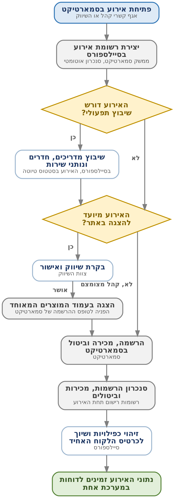

<!-- generated from: מסמך 3 אירועים וכספים - מאושר על ידי יד ושם - 2026-11-04.docx | 2026-11-08 | do not edit by hand; regenerate from the docx -->

> **מקור:** מסמך 3 - אירועים וכספים, גרסה מאושרת על ידי יד ושם, 4.11.2026  
> **מיקום בניווט:** מסמך 3 - אירועים וכספים › תהליכים עסקיים › פתיחת אירוע בסמארטיקט וסנכרונו לסיילספורס  
> **קודי ולידציה ואוטומציה בפרק:** A15-01, A15-02, A15-03, A15-04, A15-05, A15-06, V15-01, V15-02  
> **הקודם:** [אירועים פתוחים לקהל, סיורים, הצגות וחיזיון](01-open-public-events-tours-shows.md) · **הבא:** [כנסי מורים, ניהול מפגשים ומסלולים אישיים](03-teacher-conferences-sessions-tracks.md) · [מקרא](../../INDEX.md)

# פתיחת אירוע בסמארטיקט וסנכרונו לסיילספורס

סמארטיקט היא מערכת הכרטוס שבה אגף קשרי קהל וצוותי השיווק פותחים ומוכרים אירועים לקהל הרחב. היא חלק מהאתר הציבורי שבאחריות יד ושם ואינה מנוהלת במודול זה. תכולת המודול היא הסנכרון בלבד: יצירת רשומת האירוע בסיילספורס, קליטת ההרשמות, המכירות והביטולים, ושיוכם לכרטיס הלקוח האחיד.

אירוע נפתח בסמארטיקט ונוצר אוטומטית בסיילספורס, ללא פתיחה כפולה. אירוע הדורש שיבוץ מדריכים, חדרים או נותני שירות נפתח  ⟦💬 c69⟧בסמארטיקט בטיוטה, נוצר בסיילספורס ומשובץ בו, ורק לאחר מכן מועלה לאוויר בסמארטיקט בפעולה ידנית. באירועים הנמכרים בסמארטיקט, סמארטיקט היא המערכת הקובעת, והנתונים עוברים ממנה לסיילספורס בכיוון אחד; מלאי האירוע מנוהל במערכת אחת בלבד. סמארטיקט משמשת אירועים חד פעמיים בתשלום מיידי בכרטיס אשראי ומקומות ישיבה ממופים;  ⟦💬 c71⟧רכישות לקבוצות, רכישות בתשלום שוטף ורכישות של מוצרים משולבים אינן מתבצעות בסמארטיקט אלא במערכת המקוונת, והשיבוץ מנוהל בסיילספורס. התשלום על רכישה בסמארטיקט מתבצע בסמארטיקט; נתוני התשלום  ⟦💬 c73⟧מסונכרנים לסיילספורס, בהתאם למסגרת התקציבית שנבחרה לאירוע, ונשמרים ברשומת הרישום שתחת האירוע (A15-02).

אירוע מוצג בעמוד המוצרים המאוחד רק לאחר בקרת שיווק, ואירוע לקהל מצומצם אינו מוצג באתר. עריכה וביטול של רכישה נשארים בסמארטיקט ומשתקפים בסנכרון; גם הזיכוי על הרכישה מבוצע בסמארטיקט (A15-05). הנוכחות מפורטת בפרק 5.7 (ניהול נוכחות בפועל וסימון הגעה). אופן הסנכרון הטכני, תדירותו וקישור הרשומות ייסגרו מול יד ושם וספק מערכת הכרטוס וישולבו בפרק 9.4 (ממשק מערכת הכרטוס).

תרשים תהליך 17: פתיחת אירוע בסמארטיקט וסנכרון

## אוטומציות

| מזהה | טריגר | הפעולה האוטומטית |
| --- | --- | --- |
| A15-01 | פתיחת אירוע בסמארטיקט, לרבות בשלב טיוטה | יצירת רשומת אירוע בסיילספורס לפי מיפוי השדות, ללא הזנה כפולה. שדות שהוגדרו כנשארים בסמארטיקט בלבד אינם מסונכרנים. אירוע שאינו דורש שיבוץ נוצר ומסונכרן בלבד; אירוע המסומן "דורש תפעול" נשאר בטיוטה עד השלמת השיבוץ בסיילספורס. |
| A15-02 | מחזור הסנכרון התקופתי | יצירה ועדכון של רשומות רישום תחת האירוע מנתוני ההרשמות והמכירות בסמארטיקט, לרבות עדכונים, ביטולים, נתוני תשלום ונוכחות. הרשמה שנמכרה בסמארטיקט מופיעה כרישום תחת האירוע בתוך מחזור סנכרון אחד. |
| A15-03 | קליטת נתוני לקוח מסמארטיקט | ⟦💬 c75⟧הצלבה מול כרטיסי הלקוח בסיילספורס, זיהוי כפילויות ואיחודן, וצבירת היסטוריית ההשתתפות בכרטיס הלקוח האחיד. |
| A15-04 | סנכרון אירוע המיועד להצגה באתר | התראה לצוות השיווק על אירוע חדש. בדיקת השיווק והאישור מתבצעים בתוך סיילספורס על ידי משתמשי השיווק, והאירוע מוצג בעמוד המוצרים המאוחד רק לאחר אישור ובהעלאה ידנית של אנשי השיווק, כבקרת השיווק החלה על כלל המוצרים. |
| A15-05 | ביטול רישום שבוצע בסמארטיקט | עדכון רשומת הרישום בסיילספורס. הזיכוי עצמו מבוצע בסמארטיקט ומשתקף בסיילספורס בסנכרון,  ⟦💬 c77⟧ואינו עובר במסלול הוראת הזיכוי שבפרקים 5.10 ו-5.11. |
| A15-06 | סימון אירוע סמארטיקט כאירוע לקהל מצומצם | ⟦💬 c79⟧האירוע נוצר בסיילספורס אך אינו מוצג באתר ואינו מוצג במערכת המקוונת, למשל אירוע למשתתפי כנס מסוים. הרישום לאירוע כזה נעשה בקישור ייעודי הנשלח מסמארטיקט לקבוצה. |

## כללי ולידציה

| מזהה | הכלל | הודעת שגיאה |
| --- | --- | --- |
| V15-01 | אירוע סמארטיקט הדורש תפעול נשאר בסטטוס טיוטה בסיילספורס עד השלמת השיבוץ התפעולי; מניעת העלייה לאוויר בסמארטיקט תלויה במנגנון הסנכרון שייקבע | השיבוץ התפעולי טרם הושלם, האירוע אינו יכול לעלות לאוויר |
| V15-02 | מלאי אירוע מנוהל במערכת אחת בלבד; אירוע הנמכר בסמארטיקט אינו מנוהל כמלאי גם בסיילספורס | מלאי האירוע מנוהל בסמארטיקט בלבד |

## ישויות ושדות ייחודיים לתהליך

| ישות | תפקיד בתהליך | שדות ייעודיים לתהליך |
| --- | --- | --- |
| אירוע (Event__c) | רשומת האירוע הנוצרת מהסנכרון מסמארטיקט | מקור האירוע (סמארטיקט), סטטוס טיוטה, חיווי דורש תפעול, דגל הצגה באתר, סטטוס בקרת שיווק |
| רישום (Registration__c) | ההרשמות והמכירות המסונכרנות מסמארטיקט, תחת האירוע | מקור הרישום, נתוני מכירה והכנסה, סטטוס ביטול וזיכוי, נוכחות. כבכל רישום, מקושר להזדמנות (Opportunity) |
| לקוח ואיש קשר (Account, Contact) | כרטיס הלקוח האחיד המרכז את היסטוריית ההשתתפות | זיהוי ואיחוד כפילויות מנתוני סמארטיקט |
| מוצר (Product) | נתוני המוצר וחלוקת העבודה בין המערכות. | מדיניות זיכוי ברמת המוצר; מוצרים משולבים וחבילות אינם מנוהלים בסמארטיקט |

---

## הערות סקירה בפרק זה

> הערות הסקירה אינן חלק מהאפיון המחייב. הן מסמנות מקומות שבהם הטקסט עדיין בדיון. הסימון ⟦💬 cN⟧ בגוף הטקסט מפנה להערה כאן.

### ⟦💬 c69⟧ סגורה
- **c69** · טל שמרית · 2026-10-20 · סומנה כסגורה: לדעתי צריך לשנות מ"משובץ" ל"נפתח ומשובץ"
  - **c70** · Lior Pridor · 2026-10-26 · סומנה כסגורה: בוצע: הנוסח הובהר. אירוע הדורש שיבוץ נפתח בסמארטיקט בטיוטה, נוצר אוטומטית בסיילספורס ומשובץ בו, ורק לאחר השלמת השיבוץ מועלה לאוויר בסמארטיקט (A15-01).

### ⟦💬 c71⟧ סגורה
- **c71** · טל שמרית · 2026-10-20 · סומנה כסגורה: ???
  - **c72** · Lior Pridor · 2026-10-26 · סומנה כסגורה: המשפט נוסח מחדש: רכישות לקבוצות, בתשלום שוטף או של מוצרים משולבים אינן מתבצעות בסמארטיקט אלא במערכת המקוונת, והשיבוץ מנוהל בסיילספורס.

### ⟦💬 c73⟧ סגורה
- **c73** · טל שמרית · 2026-10-20 · סומנה כסגורה: בהתאם למסגרת התקציבית שבוחרים לאירוע בתהל
  - **c74** · Lior Pridor · 2026-10-26 · סומנה כסגורה: בוצע.

### ⟦💬 c75⟧ סגורה
- **c75** · טל שמרית · 2026-10-20 · סומנה כסגורה: במידה ומוסד מבצע רישום בסמארטיקט, האם הרישום שלו נכנס לכרטיס המוסד? האם הזיהוי שלו במערכת המקוונת עובר לסמארטיקט וחוזר בממשק לתהל?
  - **c76** · Lior Pridor · 2026-10-26 · סומנה כסגורה: אם נתוני ההרשמה שסמארטיקט מעבירה כוללים מזהה מוסד, ההרשמה משויכת לכרטיס המוסד במסגרת ההצלבה מול כרטיסי הלקוח (A15-03). הזיהוי של המערכת המקוונת אינו עובר לסמארטיקט, משום שסמארטיקט אינה מקבלת נתונים מסיילספורס. השדות שסמארטיקט מעבירה ייקבעו במיפוי השדות מולה (מסמך הנושאים הפתוחים, נושאים 5 ו-7).

### ⟦💬 c77⟧ סגורה
- **c77** · טל שמרית · 2026-10-20 · סומנה כסגורה: לא הבנתי איך בפועל זה מתבצע? איך אגף הכספים יודעים לבצע את הזיכוי?
  - **c78** · Lior Pridor · 2026-10-26 · סומנה כסגורה: הזיכוי על רכישה בסמארטיקט מבוצע בסמארטיקט עצמה, כמו הרכישה, וסיילספורס משקף את הביטול ואת סטטוס הביטול והזיכוי ברשומת הרישום (A15-05). היקף הטיפול הכספי ברכישות סמארטיקט, ובכלל זה הודעה לאגף הכספים, הוא נושא 9 במסמך הנושאים הפתוחים.

### ⟦💬 c79⟧ סגורה
- **c79** · טל שמרית · 2026-10-20 · סומנה כסגורה: במצבים כאלה, יש לאפשר לשלוח לינק מתוך סמארטיקט לקבוצה ייעודית לצורך רישום.
  - **c80** · Lior Pridor · 2026-10-26 · סומנה כסגורה: בוצע.
