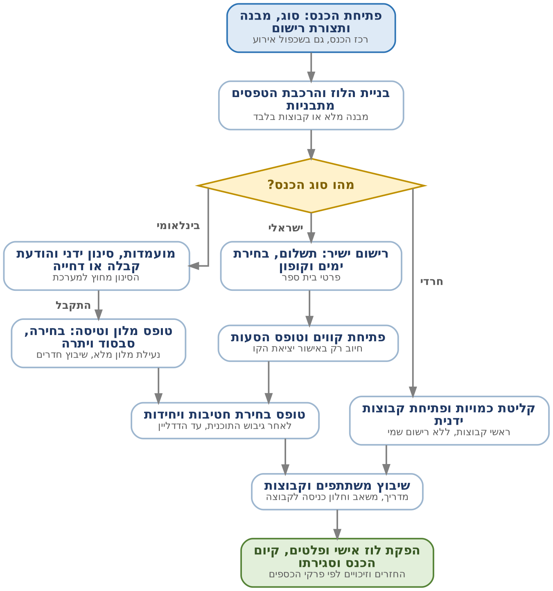
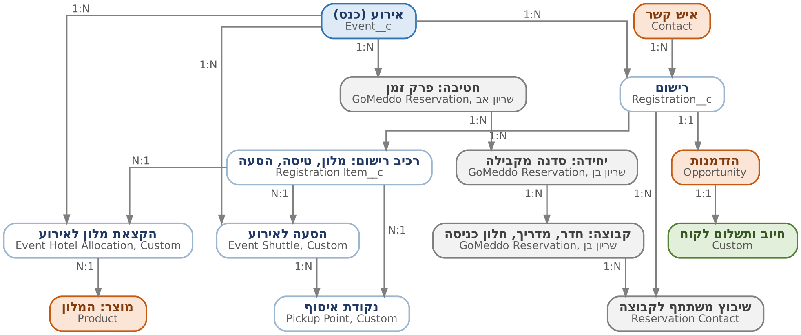

<!-- generated from: מסמך 3 אירועים וכספים - מאושר על ידי יד ושם - 2026-11-04.docx | 2026-11-08 | do not edit by hand; regenerate from the docx -->

> **מקור:** מסמך 3 - אירועים וכספים, גרסה מאושרת על ידי יד ושם, 4.11.2026  
> **מיקום בניווט:** מסמך 3 - אירועים וכספים › תהליכים עסקיים › כנסי מורים, ניהול מפגשים ומסלולים אישיים  
> **קודי ולידציה ואוטומציה בפרק:** A16-01, A16-02, A16-03, A16-05, A16-07, A16-10, A16-11, A16-13, A16-15, A16-16, A16-17, A16-18, V16-01, V16-03, V16-04, V16-06, V16-07, V16-11, V16-12  
> **הקודם:** [פתיחת אירוע בסמארטיקט וסנכרונו לסיילספורס](02-smartticket-event-sync.md) · **הבא:** [סמינרים](04-seminars.md) · [מקרא](../../INDEX.md)

# כנסי מורים, ניהול מפגשים ומסלולים אישיים

יד ושם מקיים שלושה סוגי כנסים: הכנס הישראלי (יולי, כ-350 משתתפים, הסעות וקודי קופון), הכנס הבינלאומי (דצמבר, עד 350 משתתפים באולם ספרא, מלונות וסבסוד) וכנסים למגזר החרדי,  ⟦💬 c81⟧המנוהלים גם ברישום בודדים וגם בקבוצות מאורגנות ללא רישום שמי. את הכנס מפעילים רכז הכנס וצוות הלוגיסטיקה. עיקרון התכנון הוא גמישות: תצורת הרישום, הטפסים והמועדים האחרונים נקבעים לכל כנס בנפרד, וכל פעולה אוטומטית ניתנת לדריסה ידנית. בכל כנס נקבע אם הרישום ישיר או בטופס הגשת מועמדות, ולכל סוג כנס מוגדרות ברירות מחדל (למשל סבסוד מלון או טופס מועמדות) הניתנות לשינוי בכל כנס (A16-18).

חטיבה, יחידה וקבוצה הן מבנה הלו"ז של האירוע ולא של הנרשם. כנס מורכב נפתח במבנה המלא וכנס פשוט בחלוקה לקבוצות בלבד. הנרשם נרשם תחילה לכנס עצמו, כל רישום (Registration__c) נושא הזדמנות (Opportunity), ורק לאחר מכן משובץ ליחידות. הרישום הדרגתי: טופס רישום, ולאחריו טפסי בחירת מלון, הסעות וחטיבות ויחידות, כל אחד במצב הזמנה ובמצב עריכה עד המועד האחרון שנקבע לו. הצבת הטפסים באתר באחריות יד ושם, והמודול מחבר אותם לרישום ולרכיבי הרישום.

שיבוץ מדריך, משאב וחלון כניסה למוזיאון מתבצע ברמת הקבוצה, ולחטיבה וליחידה ניתן לשבץ כמה נותני שירות. קבוצות נפתחות אוטומטית או ידנית, גם ללא רישום שמי. הלו"ז האישי, הרשימות והשלטים מופקים כדוח, כקובץ אקסל או כהודעת מייל; מסמך ממותג בלוגו הכנס מותנה בכלי הפקת מסמכים. הסליקה והזיכויים מפורטים בפרקים 5.9 עד 5.11, וישות הקופון בפרק 3.3.5.

⟦💬 c83⟧

⟦💬 c86⟧תרשים תהליך 18: כנסי מורים ומסלולים אישיים

הטבלה שלהלן מציגה אילו ישויות נפתחות או מתעדכנות בכל שלב בתהליך הכנס.

| השלב | הישות הנפתחת או המתעדכנת |
| --- | --- |
| פתיחת הכנס | נפתח אירוע (Event__c), סוג רשומה כנס, עם מבנה הכנס (מורכב או פשוט),  ⟦💬 c88⟧הקיבולת (לאירוע כולו, או ליום פעילות כאשר ניתן לבחור ימים), תצורת הרישום (לכל הימים או לימים נבחרים) והמועדים האחרונים (A16-15) |
| בניית רמות הלו"ז | רכז הכנס בונה את הלו"ז במסך האירוע (פרק 4.1): נפתחים מפגשים (GoMeddo Reservation), שריון אב לכל חטיבה, ותחתיו שריון לכל יחידה ושריון לכל קבוצה, ובשריון הקבוצה חלון הזמן, המשאב,  ⟦💬 c90⟧המדריך וחלון הכניסה למוזיאון. לחטיבה וליחידה ניתן לשבץ כמה נותני שירות. בכנס פשוט נפתחים שריוני קבוצה בלבד. קבוצות נוספות נפתחות אוטומטית או ידנית (A16-01) |
| היצע המלונות וקווי ההסעה | נפתחות הקצאות מלון לאירוע (Custom): מלון (Product), תאריכים, בסיס אירוח, מכסת חדרים ומחיר; ונפתחות הסעות לאירוע (Custom): חברת הסעות, מספר אוטובוסים, מכסת מקומות ומחיר לנוסע, ותחתיהן נקודות איסוף (Custom) |
| הגשת טופס הרישום | נפתח רישום (Registration__c) של המשתתף, שמי או כמותי, ונפתחת הזדמנות (Opportunity) המקושרת אליו; בכנס שהרישום אליו בטופס הגשת מועמדות, סטטוס המועמדות ברישום הוא הוגש |
| סינון המועמדים, בכנס שהרישום אליו בטופס הגשת מועמדות | מתעדכן רישום (Registration__c): סטטוס המועמדות ל"אושר" או ל"נדחה" |
| תשלום דמי ההשתתפות | מתעדכן חיוב ותשלום לקוח (Custom) של ההזדמנות; בסליקה בכרטיס אשראי נפתחת קבלה (Custom) |
| בחירת מלון  ⟦💬 c92⟧ובקשת סבסוד טיסה | נפתח רכיב רישום (Registration Item__c) מסוג מלון, מקושר להקצאת המלון לאירוע (Custom): סוג חדר, שותף מבוקש לחדר, בקשת סבסוד טיסה וזהות המשלם; מתעדכנים החדרים התפוסים והחדרים שנותרו בהקצאה |
| בחירת הסעה | נפתח רכיב רישום (Registration Item__c) מסוג הסעה, מקושר להסעה לאירוע (Custom) ולנקודת האיסוף (Custom), בסטטוס חיוב מותנה; החיוב מבוצע עם אישור יציאת הקו |
| בחירת חטיבות ויחידות ושיבוץ | נפתח משתתף במפגש (Reservation Contact) בשריון הקבוצה שאליה שובץ המשתתף, מקושר לרישום (Registration__c) שלו, עם מקור השיבוץ (בחירת המשתתף או שיבוץ ידני). המדריך, המשאב וחלון הכניסה למוזיאון נקבעים בשריון הקבוצה (GoMeddo Reservation) |

תרשים ישויות של כנסי מורים: האירוע, רמות הלו"ז, הרישום ורכיביו, המלונות וההסעות

## אוטומציות

| מזהה | טריגר | הפעולה האוטומטית |
| --- | --- | --- |
| A16-15 | פתיחת כנס ובחירת מבנה הכנס, או לחיצה על "שכפול אירוע" ברשומת כנס | התאמת מסכי הלו"ז והרישום למבנה שנבחר: חטיבה, יחידה וקבוצה בכנס מורכב, קבוצות בלבד בכנס פשוט; רמות שאינן נדרשות אינן מוצגות ואינן מחייבות הזנה. שכפול כנס מתבצע במתכונת המפורטת בפרק 5.1 (אירועים פתוחים לקהל). |
| A16-18 | פתיחת כנס ובחירת סוג הכנס | מילוי ברירות המחדל שהוגדרו לסוג הכנס (ישראלי, בינלאומי, חרדי) ברשומת תצורה: אופן הרישום (ישיר או בטופס הגשת מועמדות), סבסוד מלון וקיבולת. כל ערך ניתן לשינוי באירוע לאחר הפתיחה. |
| A16-01 | קליטת רישום ליחידה שהקבוצה הפתוחה בה התמלאה, או פתיחת קבוצות ידנית על ידי משתמש מורשה | פתיחת קבוצה נוספת עד תקרת הקבוצות של היחידה. במסלול הידני נפתחות קבוצות ללא רישום שמי, עם מספר, קיבולת, שם ומדריך, ונקלטות כמויות או נרשמים ידנית. בדיקת קבלה: בקיבולת 35 ותקרת שלוש קבוצות, הרישום ה-36 פותח קבוצה שנייה. |
| A16-02 | סימון חטיבה כמיועדת לכולם | שיבוץ אוטומטי של כלל הנרשמים לשורת המליאה, ללא הצגתה לבחירה בטופס. |
| A16-03 | הזנת קוד קופון בטופס הרישום | חישוב הסכום לתשלום לאחר ההנחה,  ⟦💬 c94⟧באחוז הנחה, בסכום הנחה בש"ח או בפטור מלא; סכום אפס מאושר ללא מעבר לסליקה. ישות הקופון מתוארת בפרק 3.3.5. |
| A16-07 | החלטת רכז על משלוח טופס שלב, או מועד שנקבע לנרשם שטרם השלים שלב | שליחת טופס הבחירה (מלון ובקשת סבסוד טיסה, הסעות, חטיבות ויחידות), נפרד או משולב, לרשימת הנרשמים הרלוונטית, ותזכורת מתוזמנת למי שטרם השלים. לנרשמי כנסים לא נשלחות תזכורות אוטומטיות לפי תאריך האירוע. |
| A16-05 | בחירה או שינוי של מלון וסוג חדר על ידי משתתף שאושר, או שינוי על ידי צוות הכנס | מוצגים רק מלונות שמכסת חדריהם לא התמלאה; מלון מלא ננעל לבחירה. החיוב מחושב לפי סוג החדר והתעריף התקף בניכוי הסבסוד שאושר, ומוצגים הסכום שיד ושם מעבירה למלון והיתרה להשלמה ישירה. כל שינוי מחשב את החיוב מחדש. |
| A16-17 | שינוי ברישום לכנס לאחר תשלום, בשירות עצמי או בידי צוות הכנס | שינוי בעל היבט כספי (הסעה ורכיבים אחרים המשולמים ליד ושם): המערכת מחשבת את ההפרש בין החיוב המעודכן לבין הסכום ששולם. הפרש לתשלום נגבה בקישור תשלום על ההפרש (A21-20); הפרש לזיכוי נרשם כהוראת זיכוי, לאישור ולביצוע כבפרק 5.10 (A22-03, A22-15). שינוי מלון מעדכן את ההקצאה, את הסבסוד ואת חישוב היתרה (A16-05), ללא גבייה או זיכוי ביד ושם; היתרה משולמת ישירות למלון (דרישות המכרז, מס"ד 141). שינוי בלו"ז ללא היבט כספי (חטיבות, יחידות ושיבוץ) מתעדכן בשיבוץ המשתתף (Reservation Contact) ללא חיוב. |
| A16-16 | שיבוץ משתתפים לחדר על ידי צוות הכנס, לרבות שיבוץ משותף, או שכפול הקצאת מלון לאירוע (Custom) | שיוך המשתתפים שנבחרו לאותו חדר בפעולה אחת לאחר בדיקת קיבולת סוג החדר (V16-12); שותף מבוקש מוצג לצוות והשיוך ידני.  ⟦💬 c96⟧שכפול הקצאת מלון לאירוע, בכנס הנשען על כמה מלונות, יוצר עותק עם הגדרותיה, מחירה ותאריכיה, ללא שיבוצי המשתתפים. |
| A16-10 | שיבוץ מדריך, משאב וחלון כניסה למוזיאון ברמת הקבוצה | העברת חלוקת הקבוצות והתדרים לצוות האוזניות. בכנס מותר שיבוץ מקביל של כמה נותני שירות לאותו פרק זמן, ולחטיבה וליחידה ניתן לשבץ כמה נותני שירות. שיבוץ קבוצה לחלון כניסה עם שריון תפוסה מלאה מראש חל רק על פעילויות שמתכנן יד ושם. |
| A16-13 | משלוח הודעה או קישור תשלום מרשומת הכנס, לכלל הנרשמים או לחתך מתוכם | שליחת ההודעה מתבנית, לרבות עדכוני לו"ז ושינויים, עם צרופת קובץ, ותיעודה על רשומת האירוע. קישור תשלום מציג את היתרה לתשלום ונשלח רק לנרשם שיש לו יתרה; סטטוס התשלום מתעדכן עם קליטת התשלום. |
| A16-11 | הפעלה יזומה של הפקת הפלטים מרשימת הנרשמים, לאחר בחירת נרשמים | לו"ז אישי כרונולוגי המשלב מליאות, בחירות ושיבוצים ידניים; רשימות נרשמים לפי חטיבה, יחידה ומלון, כולל שיבוץ חדרים; רשימת סדנאות וחדר לכל מרצה; שלטי כניסה; דוח הסעות לחברת ההסעות. הפלט מופק כדוח, כקובץ אקסל או במייל; מסמך ממותג מותנה בכלי הפקת מסמכים. |

## כללי ולידציה

| מזהה | הכלל | הודעת שגיאה |
| --- | --- | --- |
| V16-01 | לא ניתן להסיר חטיבה שקיימות תחתיה יחידות, ולא ניתן להסיר יחידה שקיימות תחתיה קבוצות פעילות | יש להסיר תחילה את הרמות שתחת הרשומה |
| V16-03 | יחידה שהגיעה לתקרת מספר הקבוצות וכל קבוצותיה מלאות אינה זמינה לבחירה נוספת בטופס; רישום חורג מטופל לפי כלל ההמתנה של המודול (פרק 3.2.5) | היחידה מלאה, לא ניתן להירשם אליה |
| V16-04 | בכנס שהרישום אליו בטופס הגשת מועמדות, לא ניתן לרשום תשלום או בחירת מלון למועמד שטרם אושר | המועמדות טרם אושרה |
| V16-06 ⟦💬 c98⟧ | בקשת סבסוד מחייבת מילוי פרטי חשבון בנק וצירוף אישור ניהול חשבון | בקשת סבסוד מחייבת פרטי בנק ואישור ניהול חשבון |
| V16-07 | ⟦💬 c101⟧שינוי בשירות עצמי (מלון, הסעה, חטיבות ויחידות) לאחר הדדליין שהוגדר לאותה פעולה בכנס נחסם; לאחריו השינוי מבוצע על ידי צוות הכנס בלבד | חלף המועד האחרון לשינוי, יש לפנות לצוות הכנס |
| V16-11 | בכנס שהוגדר כפשוט לא ניתן ליצור חטיבות ויחידות; הרישום והשיבוץ מתבצעים ברמת הקבוצה בלבד | הכנס מוגדר במבנה פשוט, ניהול חטיבות ויחידות אינו זמין |
| V16-12 | שיבוץ משותף לחדר נחסם כאשר מספר המשתתפים עולה על קיבולת סוג החדר | מספר המשתתפים עולה על קיבולת החדר |

## ישויות ושדות ייחודיים לתהליך

| ישות | תפקיד בתהליך | שדות ייעודיים לתהליך |
| --- | --- | --- |
| אירוע (Event__c), סוג רשומה כנס | רשומת האם של הכנס | סוג כנס (ישראלי, בינלאומי, חרדי), מבנה הכנס (מורכב או פשוט), קיבולת (לאירוע כולו או ליום פעילות), רישום לכל הימים או לימים נבחרים, אופן רישום (ישיר או בטופס הגשת מועמדות, עם ברירת מחדל לפי סוג הכנס), לוגו הכנס, תצורת רישום (הרשמה ⟦💬 c103⟧ ללא תשלום ומשלוח קישור אישי לתשלום בהמשך או תשלום מיידי; סדנאות לבחירה; קופון), מועד אחרון לכל פעולה (מלון, הסעה, סדנה), תקציב סבסוד |
| רישום (Registration__c) | משתתף בכנס, שמי או כמותי, מקושר להזדמנות | סטטוס מועמדות (הוגש, אושר, נדחה), בחירת ימים, פרטי בית ספר, קוד קופון, בקשת סבסוד וסבסוד מאושר, פרטי בנק ואישור ניהול חשבון, מספר משתתפים ברישום כמותי |
| רמות הלו"ז: חטיבה, יחידה, קבוצה (GoMeddo Reservation; במערכת הקיימת new_learning_division, new_workshop ו-new_itinerary_group) | מבנה הלו"ז של הכנס, לא של הנרשם: החטיבה שריון אב, והיחידות והקבוצות שריונים תחתיה | חטיבה: כותרת, שעות, מיועד לכולם, הצג בטופס. יחידה: הצג בטופס, מספר משתתפים מרבי לקבוצה, תקרת קבוצות, קריטריון תכונות לשיבוץ. קבוצה: שם, קיבולת, מדריך, חלון כניסה למוזיאון, תדר אוזניות |
| משתתף במפגש (Reservation Contact) | שיבוץ המשתתף לקבוצה, המקושר לרישום שלו | רישום, מקור השיבוץ (בחירת המשתתף או שיבוץ ידני), נוכחות |
| רכיב רישום (Registration Item__c) | רכיבי הלוגיסטיקה של המשתתף; ישות גנרית המשמשת גם סמינרים, קורסים והשתלמויות | סוג רכיב (מלון, הסעה, ארוחה), קישור להקצאת מלון לאירוע (Custom), סוג חדר (יחיד, חצי מזוגי), שותף מבוקש ושותפים לחדר, מספר חדר, תאריכי כניסה ויציאה, בקשת סבסוד טיסה, קישור להסעה לאירוע (Custom) ולנקודת איסוף (Custom), זהות המשלם, סטטוס חיוב מותנה |
| הקצאת מלון לאירוע (Event Hotel Allocation, Custom) | ⟦💬 c105⟧היצע הלינה של הכנס; לכנס עם כמה מלונות נפתחת הקצאה לכל מלון | אירוע, מלון (Product), תאריכי כניסה ויציאה, בסיס אירוח, מכסת חדרים, חדרים תפוסים, חדרים שנותרו, מחיר |
| הסעה לאירוע (Event Shuttle, Custom) | קו הסעה של הכנס | אירוע, חברת הסעות, מספר אוטובוסים, מכסת מקומות, מחיר לנוסע, אישור יציאת הקו |
| נקודת איסוף (Pickup Point, Custom) | נקודת איסוף בקו הסעה | הסעה לאירוע, שם הנקודה ומיקומה, שעת איסוף |
| ברירות מחדל לסוג כנס (רשומת תצורה) | ערכי הפתיחה של כנס לפי סוגו (A16-18) | סוג כנס, אופן רישום, סבסוד מלון, קיבולת |

---

## הערות סקירה בפרק זה

> הערות הסקירה אינן חלק מהאפיון המחייב. הן מסמנות מקומות שבהם הטקסט עדיין בדיון. הסימון ⟦💬 cN⟧ בגוף הטקסט מפנה להערה כאן.

### ⟦💬 c81⟧ סגורה
- **c81** · טל שמרית · 2026-10-20 · סומנה כסגורה: המנוהלים גם בבודדים וגם אפשרות קבוצות מאורגנות
  - **c82** · Lior Pridor · 2026-10-26 · סומנה כסגורה: בוצע.

### ⟦💬 c83⟧ סגורה
- **c83** · וייל דבורה · 2026-10-18 · סומנה כסגורה: הכנס הבינלאומי הוא לא הגשת מועמדות. הגשת מועמדות יש ברישום לסמינרים ולגנדל
  - **c84** · Lior Pridor · 2026-10-26 · סומנה כסגורה: בוצע: הגשת המועמדות הוסרה מתיאור הכנס הבינלאומי. בכל כנס נקבע אם הרישום ישיר או בטופס הגשת מועמדות, עם ברירת מחדל לפי סוג הכנס (A16-18), וסטטוס המועמדות והכלל V16-04 חלים רק בכנס שהרישום אליו בטופס הגשת מועמדות. כך עודכנו גם טבלת השלבים וטופס הרישום לכנס (פרק 7).
  - **c85** · טל שמרית · 2026-10-20 · סומנה כסגורה: לפעמים יש גם בכנסים, בכל מקרה אנחנו מחליטים בכל אירוע האם להשתמש בטופס הגשת מועמדות או שמדובר ברישום ישיר.

### ⟦💬 c86⟧ סגורה
- **c86** · טל שמרית · 2026-10-20 · סומנה כסגורה: התרשים נכון בעיקרון, אבל צריך שתהיה גמישות, אם יום אחד גם כנס חרדים יצטרך סבסוס מלון למשל, או שכנס בינלאומי יהיה ללא טופס הגשת מועמדות. / אלו נתונים שטוב שיהיו בתור ברירת מחדל בזמן פתיחת האירוע, אבל עם אפשרות לשינוי לפי הצורך.
  - **c87** · Lior Pridor · 2026-10-26 · סומנה כסגורה: בוצע: לכל סוג כנס מוגדרות ברירות מחדל הניתנות לשינוי בפתיחת האירוע, ונוספו האוטומציה A16-18 ורשומת התצורה של ברירות המחדל. התרשים מציג את ברירות המחדל.

### ⟦💬 c88⟧ סגורה
- **c88** · טל שמרית · 2026-10-20 · סומנה כסגורה: גם באירוע מסוג כנס, ישנם מצבים שהרישום הוא לכל הימים או שיש אפשרות לבחור ימים ספציפיים לרישום. / לכן צריך שתהיה קיבולת מקסימלית לאירוע/ ליום פעילות במידת הצורך
  - **c89** · Lior Pridor · 2026-10-26 · סומנה כסגורה: בוצע.

### ⟦💬 c90⟧ סגורה
- **c90** · וייל דבורה · 2026-10-19 · סומנה כסגורה: בחטיבות ויחידות ניתן לשבץ מספר נותני שירות לאותה חטיבה\יחידה.
  - **c91** · Lior Pridor · 2026-10-26 · סומנה כסגורה: בוצע.

### ⟦💬 c92⟧ סגורה
- **c92** · וייל דבורה · 2026-10-19 · סומנה כסגורה: אין בחירת טיסה. יש בקשה לסבסוד הטיסה.
  - **c93** · Lior Pridor · 2026-10-26 · סומנה כסגורה: בוצע: אין בחירת טיסה. בחירת הטיסה הוחלפה בבקשת סבסוד טיסה בטבלת השלבים, בטופס הבחירה ובתיאור רכיב הרישום (פרק 3.2.4).

### ⟦💬 c94⟧ סגורה
- **c94** · טל שמרית · 2026-10-20 · סומנה כסגורה: להוסיף אפשרות לקופון של סכום. אם אין אפשרות, אז ליד האחוז להציג למנהל הקורס מה השווי הכספי של הקופון.
  - **c95** · Lior Pridor · 2026-10-26 · סומנה כסגורה: בוצע: הקופון מוגדר באחוז הנחה, בסכום הנחה בש"ח או בפטור מלא. בקופון מסוג אחוז הנחה מוצג לצד האחוז השווי הכספי של ההנחה (פרק 5.1, A16-03).

### ⟦💬 c96⟧ סגורה
- **c96** · טל שמרית · 2026-10-20 · סומנה כסגורה: מיועד למצב בו יש מספר מלונות באותו האירוע
  - **c97** · Lior Pridor · 2026-10-26 · סומנה כסגורה: בוצע: הובהר שהשכפול מיועד לכנס עם כמה מלונות.

### ⟦💬 c98⟧ סגורה
- **c98** · וייל דבורה · 2026-10-19 · סומנה כסגורה: ?
  - **c99** · Lior Pridor · 2026-10-26 · סומנה כסגורה: V16-06 מבטיח שמבקש סבסוד ממלא בטופס את פרטי חשבון הבנק ומצרף אישור ניהול חשבון, כדי שההחזר יבוצע בהמשך בלי לחזור למשתתף.
  - **c100** · טל שמרית · 2026-10-20 · סומנה כסגורה: זה מיועד להקל על צוות יד ושם בביצוע ההחזר בהמשך. שמראש המשתתף ימלא את פרטיו יחד עם אישור ניהול חשבון בנק ולא נצטרך ל"רדוף אחריו"

### ⟦💬 c101⟧ סגורה
- **c101** · טל שמרית · 2026-10-20 · סומנה כסגורה: צריך להבדיל בין שינוי שקשור לכסף, כמו מלון והסעה, וייתכן שכבר שולם ולא תמיד מדובר באותו הסכום.  לבין שינוי שקשור ללו"ז ואין לו היבט כספי. / צריך למצוא דרך לתת ביטוי לשני הסוגים של השינויים (במיוחד בהיבט הכספי)
  - **c102** · Lior Pridor · 2026-10-26 · סומנה כסגורה: בוצע: נוספה האוטומציה A16-17. בשינוי בעל היבט כספי (הסעה ורכיבים אחרים המשולמים ליד ושם) לאחר תשלום מחושב ההפרש: הפרש לתשלום נגבה בקישור תשלום, והפרש לזיכוי נרשם כהוראת זיכוי כבפרק 5.10. שינוי מלון מעדכן את ההקצאה, את הסבסוד ואת חישוב היתרה, והיתרה משולמת ישירות למלון. שינוי בלו"ז ללא היבט כספי מתעדכן בשיבוץ המשתתף (Reservation Contact) ללא חיוב.

### ⟦💬 c103⟧ סגורה
- **c103** · טל שמרית · 2026-10-20 · סומנה כסגורה: לעיתים יש הרשמה ואת החיוב מבצעים רק בהמשך, במצב בו האירוע תלוי מספר משתתפים, לכן יש לאפשר משלוח לינק אישי לתשלום לנרשם.
  - **c104** · Lior Pridor · 2026-10-26 · סומנה כסגורה: בוצע.

### ⟦💬 c105⟧ סגורה
- **c105** · טל שמרית · 2026-10-20 · סומנה כסגורה: ישנם מצבים שייש יותר ממלון אחד.
  - **c106** · Lior Pridor · 2026-10-26 · סומנה כסגורה: בוצע.
