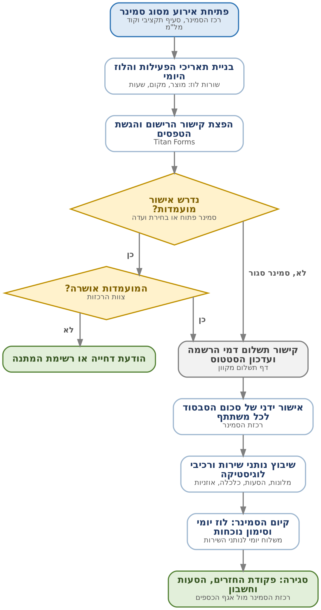
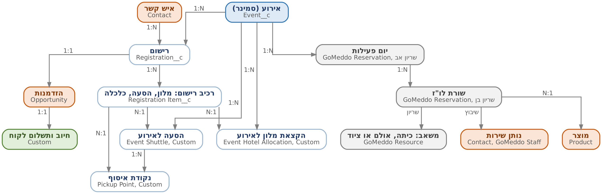

<!-- generated from: מסמך 3 אירועים וכספים - מאושר על ידי יד ושם - 2026-11-04.docx | 2026-11-08 | do not edit by hand; regenerate from the docx -->

> **מקור:** מסמך 3 - אירועים וכספים, גרסה מאושרת על ידי יד ושם, 4.11.2026  
> **מיקום בניווט:** מסמך 3 - אירועים וכספים › תהליכים עסקיים › סמינרים  
> **קודי ולידציה ואוטומציה בפרק:** A17-01, A17-02, A17-04, A17-05, A17-09, A17-10, A17-11, V17-02, V17-03, V17-04, V17-05, V17-08, V17-09  
> **הקודם:** [כנסי מורים, ניהול מפגשים ומסלולים אישיים](03-teacher-conferences-sessions-tracks.md) · **הבא:** [קורסים והכשרות](05-courses-trainings.md) · [מקרא](../../INDEX.md)

# סמינרים

מחלקת חו"ל מנהלת כ-70 עד 80 סמינרים בשנה, לתקופות של 5 עד 12 ימים, בשלושה סוגים: סמינר סגור, שבו שותף מחו"ל מגייס את הקבוצה ומעביר רשימה מוכנה; סמינר פתוח, שבו כל משתתף מגיש מועמדות אישית והמחלקה מחליטה מי מתקבל; ומסעות באירופה. מרגע הנחיתה ועד ההמראה יד ושם היא הגורם המארגן היחיד של המשתתף, וכל הקבוצה מתנהלת יחד, ללא מסלולים מקבילים.

הסמינר מנוהל כאירוע אחד המרכז את כל המידע התפעולי: נרשמים וסבסוד, לו"ז יומי, שיבוץ נותני שירות, מלונות, הסעות, כלכלה, צרופות וחשבון לגוף מממן. הרישום הוא לאירוע כולו, וכל רישום (Registration__c) נושא הזדמנות (Opportunity). שיבוץ נותני השירות לשורות הלו"ז (עובדי יד ושם, מדריכים, מרצים ומורי דרך) ידני במלואו, ממסך השיבוץ האחיד ובעזרת מסננים בלבד, לפי המוצר, הסטטוס, השפות וההסמכות. אישור הסבסוד ידני, וההחזר מבוצע רק לאחר קיום הסמינר. מסך הכלכלה מוצג למידע בלבד, והזמנות האוזניות מופקות אוטומטית משורות הלו"ז.

כל סמינר משויך לסעיף תקציבי יחיד, המוזן ידנית, לצורך דיווח לתורמים על עלותו, ומנוהלים בו רכז ראשי ורכז משני. משתתפי סמינר יכולים להיות מקושרים בתאריך מסוים כצופים בהצגה או בחיזיון, והקישור מוצג משני האירועים. עקרונות השיבוץ, שריון החדרים והאולמות והתזכורות שפורטו במסמך 2 (פרקים 12.9, 12.11 ו-12.14) אינם חוזרים כאן.

תרשים תהליך 19: סמינרים

הטבלה שלהלן מציגה אילו ישויות נפתחות או מתעדכנות בכל שלב בתהליך הסמינר.

| השלב | הישות הנפתחת או המתעדכנת |
| --- | --- |
| פתיחת הסמינר ובניית התאריכים | אירוע (Event__c), סוג רשומה סמינר; ימי הפעילות נוצרים בבניית התאריכים (A17-04) כשריוני אב ב-GoMeddo (GoMeddo Reservation) |
| הגשת טופס הרישום או המועמדות | רישום (Registration__c) לאירוע כולו, מקושר להזדמנות (Opportunity); בסמינר הדורש אישור מועמדות, בסטטוס מועמדות הוגש |
| אישור או דחיית המועמדות | לא נפתחת ישות חדשה: סטטוס המועמדות ברישום מתעדכן ל"אושר" או ל"נדחה", וההודעה מתועדת ברשומת האירוע (A17-05) |
| אישור הסבסוד | לא נפתחת ישות חדשה: הסבסוד המאושר נרשם ברישום, רק למשתתף שסימן בקשת סבסוד (V17-08) |
| תשלום דמי ההרשמה | חיוב ותשלום לקוח; סטטוס התשלום ברישום מתעדכן עם קליטת התשלום (A17-10) |
| בניית הלו"ז היומי ושיבוץ נותני השירות | שורת לו"ז (GoMeddo Reservation, שריון בן) תחת יום הפעילות, עם מוצר, כיתה או מקום ונותני שירות |
| מלונות, הסעות וכלכלה | נפתחת הקצאת מלון לאירוע (Event Hotel Allocation, Custom) לכל מלון בסמינר והסעה לאירוע (Event Shuttle, Custom) לכל קו הסעה, עם נקודות האיסוף שלו (Pickup Point, Custom), ורכיב רישום (Registration Item__c) מסוג מלון או הסעה לכל משתתף מקושר אליהן; הכלכלה ברכיב רישום |

תרשים ישויות של סמינרים: האירוע, ימי הפעילות ושורות הלו"ז, הרישום ורכיביו, הקצאת המלון, ההסעה לאירוע ונקודות האיסוף

## אוטומציות

| מזהה | טריגר | הפעולה האוטומטית |
| --- | --- | --- |
| A17-01 | שמירה, שינוי או ביטול של שורת לו"ז המסומנת כדורשת אוזניות | נדרשת הזמנה לצוות האוזניות: תאריך, שעה, כמות מכשירים, מטענים ונרתיקים, ומועד החזרה כשהקבוצה יוצאת לסיור מחוץ ליד ושם או אינה חוזרת באותו יום. שינוי כיתה או שעה מחייב את עדכון ההזמנה, וביטול השורה מחייב את ביטולה. הרשומה שתחזיק את ההזמנה ואופן מסירתה לצוות האוזניות טרם הוגדרו (נושא פתוח). |
| A17-02 | מועד מתוזמן לכל יום פעילות של הסמינר | הלו"ז היומי מופק משורות הלו"ז ונשלח לכל נותני השירות המשובצים לאותו יום, עם התראה על שינויים ביחס לגרסה הקודמת שנשלחה. המשלוח מתועד ברשומת האירוע. הלו"ז היומי והלו"ז המלא מופקים כדוח; מסמך מעוצב מותנה בכלי הפקת מסמכים. |
| A17-04 | לחיצה על "בניית תאריכים" לאחר מילוי שדות התדירות | נוצרים כל ימי הפעילות בטווח שבין תאריך הפעילות הראשון לאחרון. בסמינר אין דילוג על שבתות וחגים. לאחר הבנייה ניתן להסיר ולהוסיף תאריכים ידנית. |
| A17-05 | אישור או דחיית מועמדות בסמינר פתוח או בסמינר שמשתתפיו נבחרים בוועדה | אישור שולח למועמד קישור לתשלום דמי ההרשמה; דחייה שולחת הודעת דחייה. רק מועמד שאושר ממשיך לתשלום. ההודעות נשלחות ממאגר תבניות ההודעה, עם אפשרות לצרף קבצים, ומתועדות ברשומת האירוע. |
| A17-09 | סיום סמינר שנפתחו בו קווי הסעה | בסיום הסמינר מופק דוח של קווי ההסעה של הסמינר (Event Shuttle): לכל קו מוצגים חברת ההסעות, מספר האוטובוסים, מספר הנוסעים ומחיר הנסיעה. הדוח משמש להשוואה מול החשבונית של ספק ההסעות. |
| A17-10 | משלוח קישור תשלום למשתתף מרשומת הרישום | נשלחת הודעה עם קישור לדף תשלום מקוון המציג את הסכום הנותר לתשלום. עם קליטת התשלום בכרטיס אשראי מתעדכן סטטוס התשלום ברישום אוטומטית. קליטת התשלום במערכת הכספית מפורטת בפרק 5.9 (הפקת חשבון וחיוב לקוח מול אלמוג). |
| A17-11 | לחיצה על "שכפול אירוע" ברשומת סמינר | הסמינר משוכפל עם נתוניו וסימוניו, ימי הפעילות ללא תאריך והלו"ז ללא שיבוצים, במתכונת המפורטת בפרק 5.1 (אירועים פתוחים לקהל, סיורים, הצגות וחיזיון). הרשומה החדשה נוצרת רק לאחר הזנת השינויים ושמירה. |

## כללי ולידציה

| מזהה | הכלל | הודעת שגיאה |
| --- | --- | --- |
| V17-02 | תאריך הפעילות האחרון אינו יכול להקדים את תאריך הפעילות הראשון | טווח התאריכים אינו תקין |
| V17-03 | לא ניתן ליצור שני ימי פעילות באותו תאריך באותו סמינר | קיים כבר יום פעילות בתאריך זה |
| V17-04 | בסמינר הדורש אישור מועמדות לא ניתן לשלוח קישור תשלום או לרשום תשלום למועמד שטרם אושר | המועמדות טרם אושרה |
| V17-05 | שינוי שיבוץ עובד יד ושם ממצב ללא תשלום למצב בתשלום מחייב מוצר המוגדר בתשלום, סימון מפורש ואישור מנהל | תשלום לעובד מחייב מוצר בתשלום ואישור מנהל |
| V17-08 | לא ניתן לאשר סבסוד למשתתף שלא סימן בקשת סבסוד בטופס הרישום | לא הוגשה בקשת סבסוד למשתתף זה |
| V17-09 | עדכון השדה עלות חומרי לימוד למשתתף באירוע (Event__c) וסימון חריגה מעלות מתאפשרים לבעל הרשאת ניהול עלות חומרי לימוד בלבד. זוהי קבוצת ההרשאה שמסמך 2 (יוזרים, הרשאות והסבת נתונים) מפנה אליה; כלל העלות עצמו ממתין להשלמת האפיון מול אגף המכירות | עדכון עלות חומרי הלימוד מחייב הרשאה ייעודית |

## ישויות ושדות ייחודיים לתהליך

| ישות | תפקיד בתהליך | שדות ייעודיים לתהליך |
| --- | --- | --- |
| אירוע (Event__c), סוג רשומה סמינר | רשומת האם: פרטי הסמינר, תאריכים, תקציב וצוות | סעיף תקציבי ידני, רכז ראשי, רכז משני, סוג סמינר (סגור, פתוח, מסע), תאריך פעילות ראשון ואחרון, תדירות, מודל סבסוד (לכל משתתף או ברמת הסמינר), אירוע מקושר (הצגה או חיזיון), עלות חומרי לימוד למשתתף, סימון חריגה  ⟦💬 c107⟧מעלות |
| רישום (Registration__c) | משתתף בסמינר, רשום לאירוע כולו | סטטוס מועמדות (הוגש, אושר, נדחה), קורות חיים ומסמכים מצורפים, הגבלות תזונה, בקשת סבסוד, סבסוד מאושר, פרטי בנק להחזר (כתובת, חשבון בנק במדינת המשתתף, שם בעלי החשבון), סטטוס תשלום |
| שורת לו"ז (GoMeddo Reservation, שריון בן) | פעילות בתוך יום: הרצאה, סיור, סדנה, ארוחה, הסעה או שורת מידע | מוצר, כיתה או מקום, שעת התחלה וסיום, נותני שירות (עד שניים), מתרגם סימולטני, סימון אוזניות |
| רכיב רישום (Registration Item__c) | מלונות, הסעות וכלכלה של הסמינר | קישור להקצאת המלון לאירוע או להסעה לאירוע ולנקודת האיסוף, שיוך חדרים ידני (שותפים לחדר ומספר חדר), בקשות מיוחדות, זהות המשלם, מידע כשרות וספקי קייטרינג (אינפורמטיבי) |
| הקצאת מלון לאירוע (Event Hotel Allocation, Custom) | מלון אחד או כמה מלונות לסמינר | אירוע, מלון (Product), תאריכים, בסיס אירוח, מכסת חדרים, חדרים תפוסים ושנותרו, מחיר |
| הסעה לאירוע (Event Shuttle, Custom) ונקודת איסוף (Pickup Point, Custom) | קווי ההסעה של הסמינר | אירוע, חברת הסעות, מספר אוטובוסים, מכסת מקומות, מחיר הנסיעה; בנקודת האיסוף: שם הנקודה ומיקומה, שעת איסוף |

---

## הערות סקירה בפרק זה

> הערות הסקירה אינן חלק מהאפיון המחייב. הן מסמנות מקומות שבהם הטקסט עדיין בדיון. הסימון ⟦💬 cN⟧ בגוף הטקסט מפנה להערה כאן.

### ⟦💬 c107⟧ סגורה
- **c107** · טל שמרית · 2026-10-20 · סומנה כסגורה: ישנם שדות נוספים שהועברו ברשימת השדות (מיקום הפעילות, סווג מיקום הפעילות וכו')
  - **c108** · Lior Pridor · 2026-10-26 · סומנה כסגורה: הטבלה מציגה את השדות המרכזיים לתהליך בלבד. רשימת השדות המלאה, ובה מיקום הפעילות וסיווגו, מרוכזת בנספח א (מיפוי ישויות ושדות).
