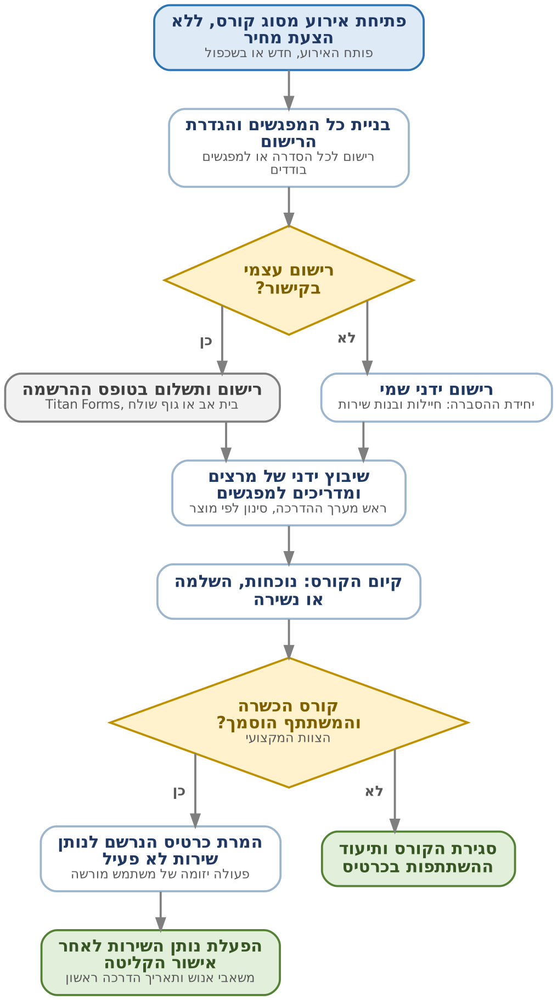
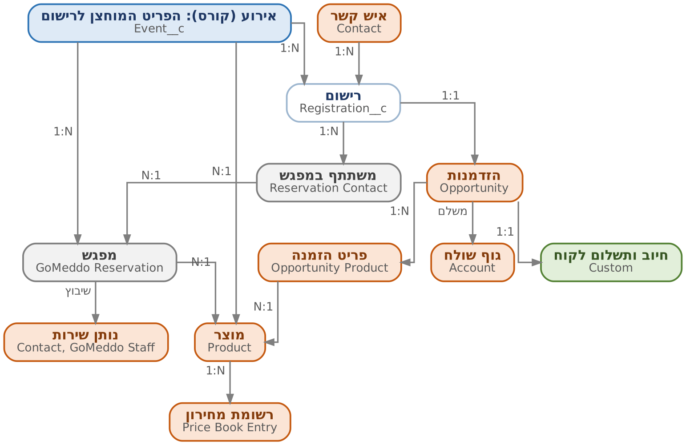

<!-- generated from: מסמך 3 אירועים וכספים - מאושר על ידי יד ושם - 2026-11-04.docx | 2026-11-08 | do not edit by hand; regenerate from the docx -->

> **מקור:** מסמך 3 - אירועים וכספים, גרסה מאושרת על ידי יד ושם, 4.11.2026  
> **מיקום בניווט:** מסמך 3 - אירועים וכספים › תהליכים עסקיים › קורסים והכשרות  
> **קודי ולידציה ואוטומציה בפרק:** A17B-01, A17B-02, A17B-03, A17B-06, A17B-07, A17B-09, A17B-10, V17B-01, V17B-03, V17B-04, V17B-06, V17B-07  
> **הקודם:** [סמינרים](04-seminars.md) · **הבא:** [השתלמויות](06-professional-development.md) · [מקרא](../../INDEX.md)

# קורסים והכשרות

פלטפורמת הקורסים וההכשרות משמשת את מערך ההדרכה, אגף בית הספר ואגפים נוספים: קורסי הכשרת מדריכים, קורס מדריכי פולין, מסעות מורשת, קורסים פתוחים לקהל וסדרות הרצאות, כ-40 עד 50 קורסים בשנה. באירוע מסוג זה אין הצעת מחיר, ופותח האירוע משבץ אליו את כל המשאבים הנדרשים לו. האירוע מנוהל בסיילספורס, הרישום מתבצע בטופס הרשמה או ברישום ידני שמי, וכל רישום (Registration__c) נושא הזדמנות (Opportunity).

שלוש החלטות מנחות את הפרק. כל תאריכי המפגשים נבנים בפעולה אחת לפי חוקיות. הרישום גמיש: לכל הסדרה או למפגשים בודדים, מחיר מסובסד לעובדי יד ושם וחשבון לגוף שולח. שיבוץ המרצים והמדריכים ידני בלבד, ללא הצעת שיבוץ.

בסיום קורס הכשרה הצוות המקצועי מעניק הסמכה, והקורס ותאריכו נרשמים ברשימת ההכשרות שבכרטיס איש הקשר (Contact). סמינרים, השתלמויות, נוכחות ומנגנוני החיוב והזיכוי מפורטים בפרקים 5.4, 5.6, 5.7 ו-5.9 עד 5.11.

הכשרות המדריכים (בתי המדרש) מנוהלות כאירוע מסוג קורס, בהפרדה בין מבצע ההכשרה לבין המדריכים המשתתפים: רישום מצומצם בקישור וסימון הגעה. סכומי התשלום אינם מחושבים בסיילספורס.

תרשים תהליך 20: קורסים והכשרות

הטבלה שלהלן מציגה אילו ישויות נפתחות או מתעדכנות בכל שלב בתהליך הקורס, לרבות הקשר להזמנה, למוצר ולמחירון.

| השלב | הישות הנפתחת או המתעדכנת |
| --- | --- |
| פתיחת הקורס ובניית המפגשים | נפתח אירוע (Event__c), סוג רשומה קורס. האירוע הוא הפריט המוצע לרישום, ומקושר למוצר (Product) שממנו נגזר מחיר ההרשמה; הקורס אינו מקושר לחבילה (Bundle). המפגשים נוצרים בבניית התאריכים (A17B-01) כמפגשים (GoMeddo Reservation) |
| שיבוץ מרצים ומדריכים | מתעדכן המפגש (GoMeddo Reservation): מוצר בשורת השיבוץ ונותן השירות המשובץ (GoMeddo Staff), לפי סינון המוצר (A17B-07) |
| רישום לקורס | נפתח רישום (Registration__c) לסדרה כולה או למפגשים נבחרים; נפתח משתתף במפגש (Reservation Contact) לכל מפגש בסדרה, או ברישום חלקי לכל מפגש שנבחר (A19-10). נפתחת הזדמנות (Opportunity) ובה פריט הזמנה (Opportunity Product) למוצר הקורס, במחיר מרשומת המחירון (Price Book Entry), או במחיר המסובסד לעובד יד ושם |
| תשלום | מתעדכן חיוב ותשלום לקוח (Custom); בסליקה בכרטיס אשראי נפתחת קבלה (Custom). בתשלום על ידי גוף שולח מופק חשבון כספי (Custom) לגוף השולח (Account) במקום חיוב המשתתף (A17B-06) |
| נוכחות, סיום והסמכה | מתעדכנים משתתף במפגש (Reservation Contact): נוכחות; רישום (Registration__c): סטטוס השלמה או נשירה, הסמכה ותאריך ההסמכה; איש קשר (Contact): רשימת ההכשרות (A17B-02) |
| ביטול מסע או אירוע | מתעדכן אירוע (Event__c): סימון ביטול; הרישומים מופקים כדוח, ונפתחות הוראות זיכוי (קבלה, Custom, מסוג זיכוי) לנרשמים ששילמו, לאישור כבפרקים 5.10 ו-5.11 (A17B-03) |

תרשים ישויות של קורסים והכשרות: האירוע והמפגשים, הרישום, ההזמנה, המוצר והמחירון

## אוטומציות

| מזהה | טריגר | הפעולה האוטומטית |
| --- | --- | --- |
| A17B-01 | לחיצה על "בניית תאריכים" באירוע, לאחר מילוי שדות התדירות | יצירת כל מפגשי הקורס בפעולה אחת לפי התדירות והימים שנבחרו, עם שעות, מיקום ברירת מחדל וכיתה משובצת מראש. בתדירות חודשית יום החל בחג נדחה ליום העבודה הבא. לאחר הבנייה ניתן למחוק תאריך חריג ולהוסיף מפגש חורג ביום אחר, בלי לשבש את יתר המפגשים. ימי הפעילות מוצגים תמיד ממוינים לפי תאריך ושעה, גם לאחר מחיקה או הוספה. בתדירות יומית או שבועית לא נוצר מפגש בתאריך החל בחג או ביום סגירה לפי לוח החגים וימי הסגירה של המערכת (מסמך 2, לוח שנה עברי, חגים וימי סגירה), והתאריכים שדולגו מוצגים למשתמש בסיום הבנייה (דרישות המכרז, מס"ד  ⟦💬 c109⟧171). |
| A17B-02 | סימון הסמכה על ידי הצוות המקצועי ברישום לקורס הכשרה שסטטוס ההשלמה בו הוא "הושלם" | רישום הקורס ותאריך ההסמכה ברשימת ההכשרות שבכרטיס המשתתף. משתתף שנשר אינו מוסמך. תעודה מעוצבת מהמערכת מותנית בכלי הפקת מסמכים. |
| A17B-03 | סימון ביטול מסע או אירוע ברשומת האירוע | הפקת פרטי כל הנרשמים כדוח, פתיחת הוראות זיכוי לנרשמים ששילמו, למעט רכישות בסמארטיקט (A15-05), לאישור מרכז ההזמנות או המחלקה המטפלת כבפרקים 5.10 ו-5.11, והודעה מסודרת אחת לגורם הכספי לבקרה, והודעה מרוכזת אחת לכל הנרשמים על הביטול, ללא משלוח פרטני ידני. השריונים של האירוע בשכבת GoMeddo (חדרים, משאבים ונותני שירות) משתחררים, ונותני השירות המשובצים מקבלים הודעה על הביטול. הכלל חל על ביטול אירוע שלם בכל סוגי האירועים. הזיכוי עצמו מבוצע לפי פרקי הביטולים, 5.10 (ביטול ושינוי הזמנה של לקוח פרטי) ו-5.11 (ביטול, זיכוי והחזר ללקוחות מוסדיים). |
| A17B-06 | סימון ברישום שהתשלום מבוצע על ידי הגוף השולח | יצירת דרישת חשבון לגוף השולח במקום חיוב המשתתף. ההפקה מפורטת בפרק 5.9 (הפקת חשבון וחיוב לקוח מול אלמוג). |
| A17B-07 | בחירת מוצר בשורת שיבוץ במפגש של קורס | סינון רשימת נותני השירות לפי המוצר: סיור במוזיאון מעלה מדריכים ועובדי יד ושם בלבד, עדות מעלה נותני עדות בלבד. אין הצעת שיבוץ אוטומטית, והמשבץ בוחר ידנית. |
| A17B-09 | לחיצה על "שכפול אירוע" ברשומת קורס | שכפול הקורס עם כל הנתונים והסימונים, מפגשים ללא תאריך ולו"ז ללא שיבוצי משאבים ונותני שירות. הרשומה נוצרת בשמירה בלבד, במתכונת המפורטת בפרק 5.1 (אירועים פתוחים לקהל, סיורים, הצגות וחיזיון). |
| A17B-10 | רישום מדריך כמשתתף בהכשרת מדריכים, בקישור רישום מצומצם או בהוספה ידנית | המדריך נרשם כמשתתף ולא כמבצע שירות. האחראי על היום מסמן מי הגיע, ועבור מדריך שסומן כמגיע וכזכאי לתשלום נוצר אוטומטית שיבוץ מחוץ ללו"ז במפגש, המסומן לתשלום ונזקף למסגרת תקציבית קבועה ונפרדת של הכשרות המדריכים, ולא למסגרת התקציבית של ההכשרה, כמו במישוב (מסמך 2, פרק 12.13). מהשיבוץ נפתחת רשומת תשלום המדריך (A24-01) לתשלום החודשי, ללא הזנה כפולה. ההכשרה מוצגת בכרטיס נותן השירות עם סטטוס התשלום. ישויות: נפתח רישום (Registration__c) של המדריך כמשתתף; נפתחים שיבוץ מחוץ ללו"ז (GoMeddo) ורשומת תשלום מדריך (Custom); מתעדכנים ברישום השדות זכאי לתשלום והגיע, והנתונים מוצגים בכרטיס נותן השירות (Contact). |

## כללי ולידציה

| מזהה | הכלל | הודעת שגיאה |
| --- | --- | --- |
| V17B-01 | תאריך הפעילות האחרון אינו יכול להקדים את תאריך הפעילות הראשון | טווח התאריכים אינו תקין |
| V17B-03 | ברישום חלקי, סכום המפגשים שנבחרו אינו עולה על תקרת המחיר שהוגדרה לסדרה | הסכום עולה על תקרת המחיר שהוגדרה לאירוע |
| V17B-04 | העברת משתתף ששילם מאירוע לאירוע מחייבת פעולה ידנית ותיעוד הפעולה | העברה בין אירועים מבוצעת ידנית ומחייבת תיעוד |
| V17B-06 | רישום למסע פולין לקהל הרחב מותנה בתשלום המחיר הראשוני ליד ושם | הרישום מותנה בתשלום הראשוני |
| V17B-07 | ⟦💬 c111⟧ניכוי ממשכורת אינו מוצע כאמצעי תשלום בטופס הרישום; אופן השימוש בו לעובדי יד ושם ייבחן מול משאבי אנוש | ניכוי ממשכורת אינו זמין בטופס |

## ישויות ושדות ייחודיים לתהליך

| ישות | תפקיד בתהליך | שדות ייעודיים לתהליך |
| --- | --- | --- |
| אירוע (Event__c), סוג קורס | רשומת האם של הקורס: חוקיות המפגשים והגדרת הרישום | תאריך פעילות ראשון ואחרון, שעת פתיחה וסיום, תדירות (יומי, שבועי, פעם בשבועיים, פעם בחודש, ידנית), יום בשבוע, מיקום ברירת מחדל, כיתה משובצת מראש, רישום מלא או חלקי, תקרת מחיר, מספר נרשמים לאירוע ולכל מפגש; במסעות, לדיווח ולמשובים בלבד, לא לשיבוץ ולא לתשלום: תאריכי המסע בנפרד מתאריכי ההכנה, המדריכים שיצאו למסע, ראש צוות ההדרכה, מספר משתתפים גם ללא רשימה שמית (לצורך הזמנות של אוזניות, כיבוד, חדרים וכניסות למוזיאון); מוצר ההרשמה (Product), שממנו נגזר המחיר |
| רישום (Registration__c) | משתתף בקורס, מקושר להזדמנות | אופן תשלום (עצמי, פריסה, גוף שולח), הגוף השולח, סימון עובד יד ושם, סטטוס השלמה או נשירה, הסמכה ותאריך ההסמכה; במדריך המשתתף בהכשרת מדריכים: זכאי לתשלום, הגיע |
| איש קשר (Contact): הנרשם | כרטיס הנרשם, ובו רשימת ההכשרות שעבר | רשימת ההכשרות (קורס ותאריך), מטריצת הסמכות בסיס (אם מדובר בנותן שירות), והכשרות המדריכים שבהן השתתף עם סטטוס התשלום |

---

## הערות סקירה בפרק זה

> הערות הסקירה אינן חלק מהאפיון המחייב. הן מסמנות מקומות שבהם הטקסט עדיין בדיון. הסימון ⟦💬 cN⟧ בגוף הטקסט מפנה להערה כאן.

### ⟦💬 c109⟧ סגורה
- **c109** · וייל דבורה · 2026-10-19 · סומנה כסגורה: יש להוסיף אוטומציה של סידור התאריכים מחדש לפי  סדר (תצוגתית) בכל מקום שיש יותר מיום פעילות אחד
  - **c110** · Lior Pridor · 2026-10-26 · סומנה כסגורה: בוצע: באירוע בעל יותר מיום פעילות אחד, ימי הפעילות מוצגים תמיד ממוינים לפי תאריך, גם לאחר מחיקה או הוספה. הכלל נוסף בפרק 3.2.1 וחל על כל סוגי האירועים.

### ⟦💬 c111⟧ סגורה
- **c111** · טל שמרית · 2026-10-20 · סומנה כסגורה: לא לאפשר זאת באופן אוטומטי בתור סוג תשלום, יש לבחון את הנושא מול משא"ב
  - **c112** · Lior Pridor · 2026-10-26 · סומנה כסגורה: בוצע: ניכוי ממשכורת אינו מוצע כאמצעי תשלום בטופס הרישום, הוסר מערכי אופן התשלום ברישום, ואינו כלול באמצעי התשלום שבתכולה.
