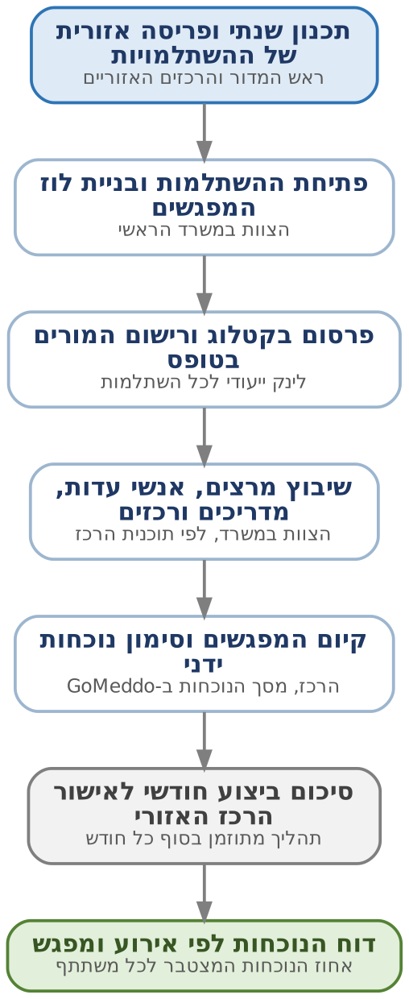

<!-- generated from: מסמך 3 אירועים וכספים - מאושר על ידי יד ושם - 2026-11-04.docx | 2026-11-08 | do not edit by hand; regenerate from the docx -->

> **מקור:** מסמך 3 - אירועים וכספים, גרסה מאושרת על ידי יד ושם, 4.11.2026  
> **מיקום בניווט:** מסמך 3 - אירועים וכספים › תהליכים עסקיים › השתלמויות  
> **קודי ולידציה ואוטומציה בפרק:** A18-01, A18-02, A18-03, A18-05, A18-06, A18-08, A18-11, V18-01, V18-02, V18-03  
> **הקודם:** [קורסים והכשרות](05-courses-trainings.md) · **הבא:** [ניהול נוכחות בפועל וסימון הגעה](07-attendance-arrival.md) · [מקרא](../../INDEX.md)

# השתלמויות

השתלמויות המורים הן הליבה התפעולית של בית הספר ומתנהלות לפי שנת לימודים עברית. ראש המדור קובע פריסה שנתית, הרכזים האזוריים מגייסים מורים וקובעים אזור ופורמט (פרונטלי, זום או היברידי), והצוות במשרד הראשי פותח את ההשתלמות ומזין את השיבוצים. המורה נרשם כאדם פרטי, כל רישום (Registration__c) נושא הזדמנות (Opportunity), וההשתלמות מנוהלת לרוב כקבוצה אחת, ללא חטיבות ויחידות.

הנוכחות נרשמת ידנית על ידי הרכז לכל מפגש, גם בזום, במסך הנוכחות של GoMeddo, והיא נשמרת לדוחות הנוכחות ולסיכום החודשי.

תרשים תהליך 21: השתלמויות

## ⟦💬 c113⟧אוטומציות

| מזהה | טריגר | הפעולה האוטומטית |
| --- | --- | --- |
| A18-01 | לחיצה על בניית המפגשים לאחר מילוי שדות התדירות | יצירת כל מפגשי ההשתלמות בפעולה אחת לפי תאריך התחלה, תאריך סיום, יום בשבוע ושעה, עם אפשרות למחוק תאריך בודד ולהוסיף מפגש חורג. מפגש אינו נוצר בתאריך החל בחג או ביום סגירה לפי לוח החגים וימי הסגירה של המערכת (מסמך 2, לוח שנה עברי, חגים וימי סגירה), והתאריכים שדולגו מוצגים למשתמש בסיום הבנייה; בסמינר אין דילוג, כמפורט ב-A17-04. ישויות: נפתחים מפגשים (GoMeddo Reservation) תחת האירוע (Event__c). |
| A18-02 | סוף כל חודש קלנדרי, לכל השתלמות פעילה | הפקת סיכום ביצוע חודשי לרכז האזורי: מרצים, מפגשים, מתוכנן מול מבוצע, ומשלוחו לאישור. שינויים, החלפות וביטולים שדווחו מעודכנים בשיבוצים, והאישור מתועד כבסיס לנתוני השכר. בדיקת קבלה: החלפת מרצה מופיעה בסיכום ומשתקפת בנתוני השכר. ישויות: נקראים המפגשים ושיבוצי נותני השירות (GoMeddo); מתעדכנים שיבוצי נותני השירות ותשלום מדריך (Custom), כבסיס לנתוני השכר. |
| A18-03 | סימון נוכחות במפגש | ⟦💬 c115⟧חישוב ⟦💬 c116⟧ אחוז הנוכחות המצטבר של המשתתף מכלל מפגשי ההשתלמות. ישויות: מתעדכנים משתתף במפגש (Reservation Contact): נוכח או לא נוכח; ורישום (Registration__c): אחוז נוכחות מחושב. |
| A18-05 | קליטת רישום להשתלמות | שליחת הודעת אישור הרשמה מתבנית הנבחרת לפי סוג האירוע, כולל צרופות (תוכנית הקורס, חוברות ומסמכים נלווים). ישויות: נקראים רישום (Registration__c) ואירוע (Event__c); ההודעה נשלחת לאיש הקשר (Contact). |
| A18-06 | יצירת מפגש מקוון בהשתלמות | הקמת מפגש Zoom מרשומת המפגש דרך הממשק, תיעוד קישור ההקלטה וקליטת נתוני ההשתתפות לבקרה בלבד. נתוני Zoom אינם קובעים נוכחות. ישויות: מתעדכנים מפגש (GoMeddo Reservation): קישור זום וקישור הקלטה; ומשתתף במפגש (Reservation Contact): חיווי השתתפות מזום, ללא שינוי הנוכחות. |
| A18-08 | משלוח אימייל או SMS לרשימת הנרשמים מתוך רשומת ההשתלמות | תיעוד ההודעה שנשלחה, ברשומת ההשתלמות. הרשאת המשלוח ניתנת לצוות המרכזי ולרכזים האזוריים. ישויות: ההודעה מתועדת ברשומת האירוע (Event__c). |
| A18-11 | לחיצה על "שכפול אירוע" ברשומת השתלמות | שכפול ההשתלמות עם כל הנתונים והסימונים, מפגשים ללא תאריך ולו"ז ללא שיבוצים, במתכונת המפורטת בפרק 5.1 (אירועים פתוחים לקהל, סיורים, הצגות וחיזיון). ישויות: נפתחים אירוע (Event__c) חדש ומפגשים (GoMeddo Reservation) ללא תאריך. |

## כללי ולידציה

| מזהה | הכלל | הודעת שגיאה |
| --- | --- | --- |
| V18-01 | מפגש פרונטלי אינו נשמר ללא מקום פעילות, הנדרש לחישוב הקילומטרים של נותן השירות | מפגש פרונטלי מחייב מקום פעילות |
| V18-02 | לא ניתן ליצור שני מפגשים באותו תאריך באותה השתלמות | קיים כבר מפגש בתאריך זה |
| V18-03 | הרישום נחסם לאחר תאריך סגירת הרישום או בהגעה למגבלת הנרשמים שהוגדרה להשתלמות | הרישום להשתלמות נסגר |

## ישויות ושדות ייחודיים לתהליך

| ישות | תפקיד בתהליך | שדות ייעודיים לתהליך |
| --- | --- | --- |
| אירוע (Event__c) מסוג השתלמות | רשומת האם של השתלמות מורים | רכז תפעול, שותף כספי, קוד קופון, סמל השתלמות במשרד החינוך (טקסט), אזור, פורמט (פרונטלי, זום, היברידי), מגבלת נרשמים, תאריך סגירת רישום |
| רישום (Registration__c) | מורה הרשום להשתלמות; כל רישום נושא הזדמנות | שכבת גיל, מקצוע הוראה, תפקיד בבית הספר, שם מוסד (טקסט חופשי), אחוז נוכחות מחושב |
| מפגש (GoMeddo Reservation) ומשתתף במפגש (Reservation Contact) | מפגש בודד בסדרה ותיעוד הנוכחות של כל משתתף בו | סוג מפגש (אונליין, פרונטלי), מקום פעילות (חובה בפרונטלי), קישור זום וקישור הקלטה; נוכח או לא נוכח, סיבת אי נוכחות והערה לכל משתתף, מקור הסימון (ידני) |
| נותן שירות (Contact, סוג רשומה מדריך) | מרצה, איש עדות, מדריך או רכז המשובץ למפגש | שיבוץ למפגשי ההשתלמות |

---

## הערות סקירה בפרק זה

> הערות הסקירה אינן חלק מהאפיון המחייב. הן מסמנות מקומות שבהם הטקסט עדיין בדיון. הסימון ⟦💬 cN⟧ בגוף הטקסט מפנה להערה כאן.

### ⟦💬 c113⟧ סגורה
- **c113** · טל שמרית · 2026-10-20 · סומנה כסגורה: יש להוסיף אוטומציה נוספת עבור גמול השתלמות. הרחבתי בנושא בסעיף A18-03
  - **c114** · Lior Pridor · 2026-10-26 · סומנה כסגורה: דוח הנוכחות כלול: הנוכחות נרשמת לכל מפגש, אחוז הנוכחות מחושב, ודוח הנוכחות ניתן לייצוא לאקסל (פרק 6.2). אין מנגנון אוטומטי או ממשק להעברת נתוני הנוכחות למשרד החינוך, ואוטומציה לדיווח גמול ההשתלמות אינה בתכולה.

### ⟦💬 c115⟧ נענתה על ידי מלם
- **c115** · Lior Pridor · 2026-11-04: בוצע: נוסף באירוע מסוג השתלמות השדה סמל השתלמות במשרד החינוך (טקסט), ונוסף לדוח הנוכחות (פרק 6.2) פירוט הנוכחות של כל נרשם בכל מפגשי ההשתלמות, עם סינון לפי נרשם, הניתן לייצוא לאקסל. / אין תהליך אוטומטי לשליחת הדוחות לנרשמים

### ⟦💬 c116⟧ ממתינה למענה מלם
- **c116** · טל שמרית [2] · 2026-10-21: הרכז יוכל לעדכן את הנוכחות למפגש מסויים עד 60 מתום ההשתלמות. רק בעלי הרשאה יוכלו לעשות זאת גם לאחר 60 יום. / באישור הנוכחות שיהיה מקום להוסיף הערה / שיהיה אפשר לשלוח לכל נרשם את פירוט הנוכחות שלו (מתוך האירוע עצמו) / להוסיף באירוע מסוג השתלמות שדה חדש בשם "סמל השתלמות במשרד החינוך" / יש צורך באקסל של דוח נוכחות של ההשתלמות הכולל פרטים אישיים של הנרשמים.
  - **c117** · Lior Pridor · 2026-10-26: אין מנגנון אוטומטי או ממשק להעברת נתוני הנוכחות למשרד החינוך, ואוטומציה לדיווח גמול ההשתלמות אינה בתכולה. כלולים: הערה לכל משתתף במפגש בעת סימון הנוכחות, לצד סיבת אי הנוכחות; ודוח הנוכחות לפי אירוע ומפגש (פרק 6.2), הניתן לייצוא לאקסל. אינם כלולים: חלון עריכה של 60 יום, משלוח פירוט הנוכחות לכל נרשם, והשדה סמל השתלמות במשרד החינוך.
  - **c118** · אשבל אור · 2026-11-03: מבקשים בכל זאת לכלול את שני הדברים הבאים: דוח נוכחות לכל נרשם / שדה סמל השתלמות במשרד החינוך (שדה טקסט פשוט(
