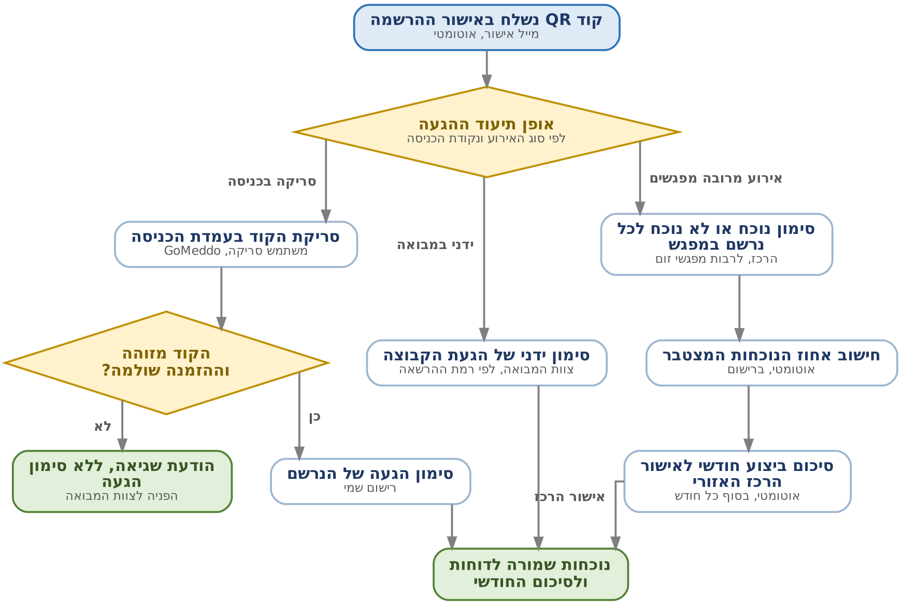
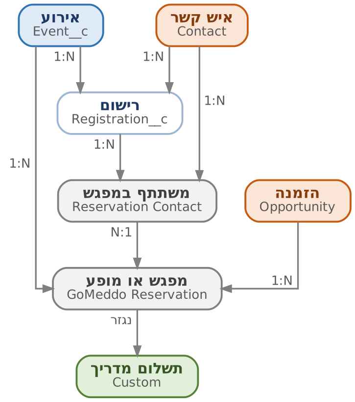

<!-- generated from: מסמך 3 אירועים וכספים - מאושר על ידי יד ושם - 2026-11-04.docx | 2026-11-08 | do not edit by hand; regenerate from the docx -->

> **מקור:** מסמך 3 - אירועים וכספים, גרסה מאושרת על ידי יד ושם, 4.11.2026  
> **מיקום בניווט:** מסמך 3 - אירועים וכספים › תהליכים עסקיים › ניהול נוכחות בפועל וסימון הגעה  
> **קודי ולידציה ואוטומציה בפרק:** A19-01, A19-02, A19-04, A19-05, A19-06, A19-07, A19-08, A19-09, A19-10, V19-01, V19-03, V19-04, V19-05, V19-06  
> **הקודם:** [השתלמויות](06-professional-development.md) · **הבא:** [כניסה והזמנה בעמדות קיוסק](08-kiosk-entry-ordering.md) · [מקרא](../../INDEX.md)

# ניהול נוכחות בפועל וסימון הגעה

הפרק מגדיר כיצד מתועדת ההגעה בפועל, בשני מסלולים. באירועים בעלי רישום לתאריך בודד, בעיקר הצגות וחיזיון, ההגעה מסומנת בכניסה בסריקת קוד QR או ידנית בעמדת המבואה, והנתון משתתפים בפועל מזין את הדוחות והדשבורדים. באירועים מרובי מפגשים (השתלמויות, קורסים והכשרות) הרכז מסמן נוכח או לא נוכח לכל נרשם בכל מפגש, והנוכחות נשמרת לדוחות.

סימון ההגעה וקוד ה-QR ממומשים ב-GoMeddo, ללא מנגנון סריקה בפיתוח ייעודי וללא מוצר חיצוני. קוד QR מופק לנרשמים שמיים בלבד; קבוצה המגיעה יחד מסומנת ידנית בפעולה אחת, הכוללת את מספר המשתתפים בפועל (A19-09), ללא קוד ברמת הקבוצה. ניהול נוכחות שמי מופעל ברמת האירוע (Event__c), רק באירועים המצריכים זאת. הנוכחות הקובעת היא הסימון הידני של הרכז, גם במפגשי זום, ונתוני ממשק ה-Zoom הם חיווי תומך בלבד.

את מספר המבקרים בפועל מעדכנים רק בעלי הרשאה, ברמה הנמוכה ביותר בלבד: בהזמנה ברמת הקבוצה, ובאירוע ברמת הנרשם או רישום הקבוצה. הנתון מסוכם אוטומטית ליום הפעילות ולהזמנה או לאירוע, ואינו נערך ברמות אלה; בכמה ימי פעילות, הנתון ברמת ההזמנה או האירוע הוא המספר הגבוה מבין הימים (פרק 4.5). עמדות הסריקה מופרדות לפי נקודת הכניסה, מוזיאון, תיאטרון וחיזיון, וכל עמדה מציגה ומעדכנת רק את הפעילות שלה (A19-07). סכומי התשלום לנותני השירות אינם מחושבים בסיילספורס.

⟦💬 c119⟧תרשים תהליך 22: ניהול נוכחות בפועל וסימון הגעה

הטבלה שלהלן מציגה אילו ישויות נפתחות או מתעדכנות בכל שלב בתהליך.

| השלב | הישות הנפתחת או המתעדכנת |
| --- | --- |
| רישום לאירוע שהנוכחות בו מנוהלת לכל מפגש | נפתח משתתף במפגש (Reservation Contact) לכל מפגש ברישום (A19-10) |
| שליחת אישור ההרשמה | מתעדכן רישום שמי (Registration__c): קוד QR (A19-01) |
| סריקה פרטנית בכניסה | מתעדכן משתתף במפגש (Reservation Contact): סימון הגעה (A19-02) |
| סימון ידני ברמת קבוצה | מתעדכנים רישום הקבוצה (Registration__c) באירוע, או הקבוצה בהזמנה: סטטוס הגעה ומספר משתתפים בפועל, המסוכם אוטומטית ליום הפעילות ולהזמנה או לאירוע (בכמה ימי פעילות, המספר הגבוה מבין הימים) (A19-09) |
| סימון נוכחות במפגש בסדרה | מתעדכנים משתתף במפגש (Reservation Contact): נוכח או לא נוכח; ורישום (Registration__c): אחוז נוכחות (A19-05) |
| סיום מפגש זום | מתעדכן משתתף במפגש (Reservation Contact): חיווי השתתפות מזום בלבד (A19-04) |
| סיכום חודשי ואישורו | מופק דוח הסיכום החודשי; שיבוצי נותני השירות ותשלום מדריך (Custom) מתעדכנים לפי השינויים שאושרו (A19-06). האישור נשמר כסטטוס ברשומות תשלום המדריך (Custom) של החודש |

תרשים ישויות של ניהול נוכחות בפועל: האירוע או ההזמנה, המפגש, הרישום והמשתתף במפגש

## אוטומציות

| מזהה | טריגר | הפעולה האוטומטית |
| --- | --- | --- |
| A19-01 | שליחת מייל אישור ההרשמה | צירוף קוד QR למייל האישור של רישום שמי לאירוע. הקוד מזהה את הרישום ומשמש לסימון ההגעה בכניסה. לרישום קבוצתי ולהזמנת ביקור לא מופק קוד, וההזמנה נשלפת לפי מספר ההזמנה. הקוד והסריקה ממומשים ב-GoMeddo. |
| A19-02 | סריקת קוד QR בכניסה לאירוע | הצגת רשימת הנרשמים לאירוע וסימון הגעה פרטני ברשומת המשתתף במפגש. בסריקת קוד שאינו מזוהה או של רישום שטרם שולם מוצגת הודעת שגיאה, לא נרשמת הגעה והמבקר מופנה לצוות המבואה (V19-04, V19-05). |
| A19-04 | סיום מפגש זום | קליטת נתוני הנוכחות מממשק ה-Zoom כחיווי תומך בלבד, ללא עדכון הנוכחות הקובעת, שהיא הסימון הידני של הרכז. |
| A19-05 | עדכון נוכחות במפגש | חישוב אחוז הנוכחות המצטבר של הנרשם והצגתו ברישום. |
| A19-06 | סוף כל חודש (תזמון אוטומטי) | במחלקת מורים מישראל, הפקת סיכום הפעולות של החודש (מרצים, מפגשים, ביצוע בפועל, החלפות וביטולים) ושליחתו לרכז האזורי לאישור או לדיווח שינויים. הביצוע המאושר הוא הסופי; הוא הבסיס לנתוני השכר ולסיכום החודשי לנותן השירות, כמפורט ב-A18-02. |
| A19-07 | בחירת סינון לפי אירוע בעמדת הסריקה | הצגת רשימת הנרשמים והסריקות של אותו אירוע בלבד, בהתאם לסוג משתמש הסריקה (מוזיאון, תיאטרון, חיזיון). כל עמדה רואה ומעדכנת את הפעילות הרלוונטית לה בלבד. |
| A19-08 | הפעלת מצב כניסה מהירה בעמדת הסריקה | כל סריקה תקינה מסמנת הגעה ומחזירה את המסך לסריקה הבאה ללא אישור נוסף, לזרימת קהל רציפה. |
| A19-09 | סימון ידני של הגעת קבוצה במבואה, ללא סריקת קוד | עדכון סטטוס ההגעה ומספר המשתתפים בפועל ברשימת ההזמנות והאירועים, ברמת הקבוצה בהזמנה, או ברמת הנרשם או רישום הקבוצה באירוע; הנתון מסוכם אוטומטית ליום הפעילות ולהזמנה או לאירוע (בכמה ימי פעילות, המספר הגבוה מבין הימים) (V19-06). |
| A19-10 | רישום לאירוע שהנוכחות בו מנוהלת לכל מפגש, הוספת מפגש לאירוע, או ביטול רישום | ברישום לסדרה כולה נוצר אוטומטית משתתף במפגש (Reservation Contact) לכל מפגש באירוע, וברישום חלקי רק למפגשים שנבחרו. מפגש שנוסף לאחר הרישום יוצר משתתף במפגש לכל הרישומים הפעילים לסדרה כולה, וביטול רישום מבטל את המשתתף במפגשים שטרם התקיימו. על רשומות אלה מסומנת הנוכחות ומחושב אחוז הנוכחות (A19-02, A19-05). |

## כללי ולידציה

| מזהה | הכלל | הודעת שגיאה |
| --- | --- | --- |
| V19-01 | סימון הגעה ברמת קבוצה מחייב הזנת מספר משתתפים בפועל | חובה להזין מספר משתתפים בפועל |
| V19-03 | במחלקת מורים מישראל, הביצוע החודשי בפועל נקלט כסופי רק לאחר אישור הרכז האזורי על הסיכום החודשי | הביצוע החודשי טרם אושר על ידי הרכז |
| V19-04 | סריקת קוד שאינו מזוהה במערכת אינה מסמנת הגעה | לא נמצא מידע עבור הקוד שנסרק |
| V19-05 | סריקת קוד של רישום שטרם שולם אינה מסמנת הגעה | הרישום טרם שולם, יש לפנות לצוות המבואה |
| V19-06 | עדכון מספר המבקרים בפועל מתבצע ברמה הנמוכה ביותר בלבד ומותנה בקבוצת ההרשאה עדכון משתתפים בפועל; ברמת ההזמנה, האירוע ויום הפעילות הנתון מחושב ואינו נערך | מספר המבקרים בפועל מחושב ברמה זו ואינו ניתן לעריכה |

## ישויות ושדות ייחודיים לתהליך

| ישות | תפקיד בתהליך | שדות ייעודיים לתהליך |
| --- | --- | --- |
| משתתף במפגש (Reservation Contact) | תיעוד הנוכחות בפועל של נרשם שמי בכל מפגש | נוכח או לא נוכח, סיבת אי נוכחות, הערה, מקור הסימון (סריקה, ידני, חיווי זום) |
| רישום (Registration__c) | הנרשם או הקבוצה שהגעתם מסומנת | קוד QR (ברישום שמי), סטטוס הגעה, סטטוס תשלום, מספר משתתפים בפועל (בקבוצה ללא רישום שמי) |
| אירוע (Event__c) | האירוע שבו נמדדת הנוכחות | חיווי ניהול נוכחות |
| מפגש (GoMeddo Reservation) | המפגש שבו נמדדת הנוכחות | צורת מפגש (פרונטלי, זום, היברידי), משתתפים בפועל |
| תשלום מדריך (Custom), אישור חודשי | אישור הרכז האזורי לסיכום הביצוע החודשי, הנשמר כסטטוס ברשומות תשלום המדריך של אותו חודש. הסיכום עצמו הוא דוח (A18-02, A19-06) ואינו נשמר כרשומה | סטטוס אישור חודשי, הרכז המאשר, מועד האישור, שינויים שדווחו (החלפת מרצה, ביטול מפגש, עדכון נוכחות) |

---

## הערות סקירה בפרק זה

> הערות הסקירה אינן חלק מהאפיון המחייב. הן מסמנות מקומות שבהם הטקסט עדיין בדיון. הסימון ⟦💬 cN⟧ בגוף הטקסט מפנה להערה כאן.

### ⟦💬 c119⟧ סגורה
- **c119** · טל שמרית · 2026-10-20 · סומנה כסגורה: יש להוסיף לתרשים את דיווח הגמול השתלמות
  - **c120** · Lior Pridor · 2026-10-26 · סומנה כסגורה: אוטומציה לדיווח גמול ההשתלמות ולהעברת הנתונים למשרד החינוך אינה בתכולה, ולכן אינה מופיעה בתרשים. דוח הנוכחות כלול (פרק 6.2).
