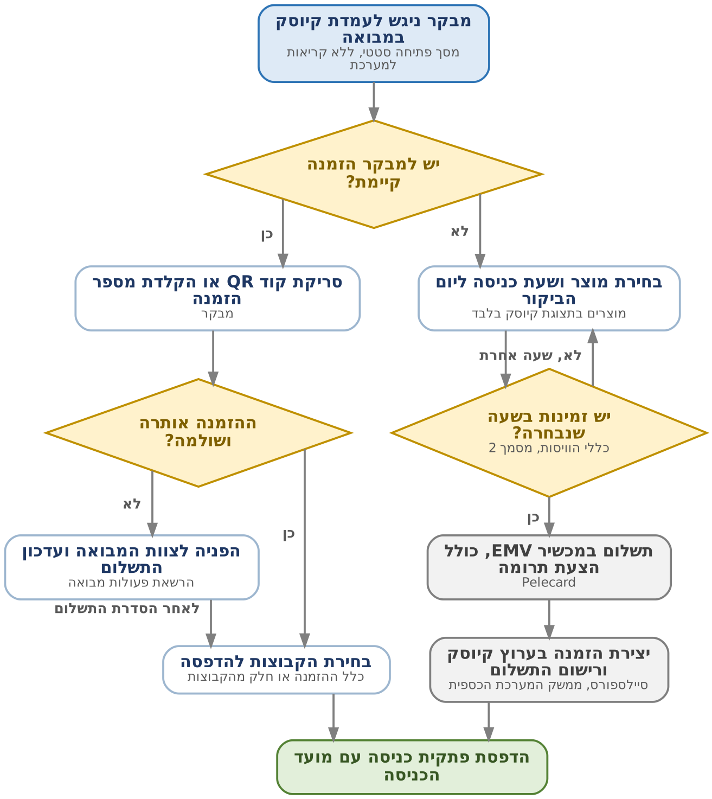
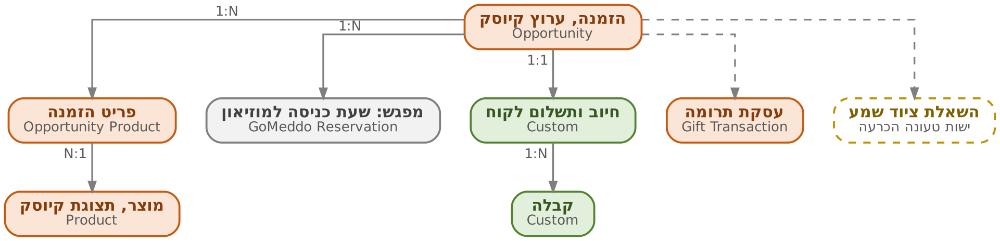

<!-- generated from: מסמך 3 אירועים וכספים - מאושר על ידי יד ושם - 2026-11-04.docx | 2026-11-08 | do not edit by hand; regenerate from the docx -->

> **מקור:** מסמך 3 - אירועים וכספים, גרסה מאושרת על ידי יד ושם, 4.11.2026  
> **מיקום בניווט:** מסמך 3 - אירועים וכספים › תהליכים עסקיים › כניסה והזמנה בעמדות קיוסק  
> **קודי ולידציה ואוטומציה בפרק:** A20-01, A20-02, A20-03, A20-04, A20-05, A20-06, A20-07, A20-08, A20-09, A20-10, A20-11, A20-12, V20-01, V20-02, V20-03, V20-04, V20-05, V20-06, V20-07, V20-08  
> **הקודם:** [ניהול נוכחות בפועל וסימון הגעה](07-attendance-arrival.md) · **הבא:** [הפקת חשבון וחיוב לקוח מול אלמוג](09-almog-invoicing-billing.md) · [מקרא](../../INDEX.md)

# כניסה והזמנה בעמדות קיוסק

עמדות הקיוסק במבואה משרתות מבקר שהגיע לקמפוס בשלוש פעולות: שליפת הזמנה (Opportunity) קיימת והדפסת פתקית כניסה עם מועד הכניסה למוזיאון; הזמנת כניסה במקום ליום הביקור בלבד, כולל בחירת שעה, בדיקת זמינות וויסות (מסמך 2) ותשלום במכשיר EMV דרך Pelecard, עם הצעת תרומה כחלק מהתשלום, או בחירת תשלום בדלפק המבואה; והצגת אירועי היום הפתוחים להרשמה.

הקיוסק עובר מהמערכת המקוונת הקיימת לעבודה מול סיילספורס. מסכי העמדה בנויים כטופס Titan Forms בבעלות יד ושם, והאפיון מגדיר את הנתונים, הכללים והסנכרון שמאחוריו. שלוש החלטות מחייבות: מסך פתיחה סטטי ומשיכת נתונים רק בלחיצה יזומה, כדי לא לצרוך את בנק הפניות של פלטפורמת הטפסים (כ-800,000 פניות); בהזמנה בעמדה לכניסה באותו יום אין דמי הרשמה וטיפול; ותרומה נרשמת כתנועת תשלום נפרדת מהכנסות הביקור.

לצד העמדות פועל המסלול המאויש של צוות המבואה על אותן הזמנות: עדכון סטטוס ואמצעי תשלום, חתימה דיגיטלית על קבלת ציוד שמע וביטולים. פעולות אלה פתוחות לקבוצת ההרשאה "פעולות מבואה" בלבד. סימון ההגעה מפורט בפרק 5.7 (ניהול נוכחות בפועל וסימון הגעה).

תרשים תהליך 23: כניסה והזמנה בעמדות קיוסק

הטבלה שלהלן מציגה אילו ישויות נפתחות או מתעדכנות בכל פעולה בעמדה.

| הפעולה | הישות הנפתחת או המתעדכנת |
| --- | --- |
| שליפת הזמנה קיימת | נקראת הזמנה (Opportunity) לפי מספר ההזמנה; לא נפתחת ישות (A20-08) |
| הדפסת כרטיסים | לא נפתחת ישות: הכרטיסים מופקים מנתוני ההזמנה והמפגש (A20-09) |
| הזמנה חדשה | נפתחים הזמנה (Opportunity) בערוץ קיוסק, פריט הזמנה (Opportunity Product) לכל מוצר שנבחר, ומפגש (GoMeddo Reservation) לשעת הכניסה למוזיאון, כמו בהזמנה המקוונת שבמסמך 2 (A20-02, A20-11) |
| ⟦💬 c121⟧תשלום | נפתחת קבלה (Custom) עם אישור העסקה; מתעדכן סטטוס התשלום בהזמנה (A20-03). בבחירת תשלום בדלפק לא נפתחת קבלה, ומתעדכנים סטטוס התשלום ואמצעי התשלום (A20-12) |
| תרומה | נפתחת עסקת תרומה (Gift Transaction) ונרשמת תנועת תשלום נפרדת בתחילית PRSV (A20-07) |
| מסירת ציוד שמע | החתימה נשמרת כתמונה; הישות שבה נשמרת ההשאלה טעונה הכרעה (A20-10) |

תרשים ישויות של עמדת הקיוסק: ההזמנה, פריטיה, המפגש, הקבלה ועסקת התרומה

## אוטומציות

| מזהה | טריגר | הפעולה האוטומטית |
| --- | --- | --- |
| A20-01 | גישה לעמדת הקיוסק | מוצג מסך פתיחה סטטי ללא קריאות API. נתונים נמשכים מסיילספורס רק בפעולה יזומה של המבקר (שליפת הזמנה, הזמנה חדשה, אירועי היום). |
| A20-02 | בחירת מוצר ושעה בהזמנה חדשה בעמדה | מוצגים רק מוצרים שהוגדרו לתצוגת קיוסק. השעה נבדקת מול חלונות הכניסה, הקיבולת והמכסות (מסמך 2). שעה שמכסתה מלאה אינה ניתנת לבחירה ומוצעות שעות חלופיות. לא מחושבים דמי הרשמה וטיפול. |
| A20-03 | השלמת תשלום בעמדה | הסליקה מתבצעת במכשיר EMV דרך  ⟦💬 c123⟧Pelecard. עם אישור העסקה נוצרת ההזמנה בערוץ קיוסק, אישור העסקה נשמר בה והתשלום מועבר למערכת הכספית כמפורט בפרק 5.9 (הפקת חשבון וחיוב לקוח מול אלמוג). |
| A20-04 | שלב התשלום בעמדה, לפני אישור העסקה | מוצגת הצעת תרומה כחלק מהליך התשלום בהתאם למודל הקיים במערכת המקוונת. |
| A20-07 | אישור תרומה בעמדה | העסקה מפוצלת לשתי תנועות תשלום: מוצרי ההזמנה, והתרומה בתחילית PRSV לצורך הפרדתה בדיווח הכספי; גם תנועת התשלום של ההזמנה נושאת חיווי PRSV לזיהוי תשלום מפוצל. תעודת הזהות של התורם נקלטת לצורך הפקת קבלה לפי סעיף 46. |
| A20-05 | אישור עסקת התשלום בהזמנה חדשה | מופקת פתקית כניסה עם מועד הכניסה למוזיאון. הפתקית מופקת מנתוני ההזמנה; הפקת כרטיס בעיצוב ממותג מותנית בכלי הפקת מסמכים. |
| A20-06 | לחיצה יזומה על אירועי היום | נמשכים ומוצגים אירועי היום הפתוחים להרשמה. ההרשמה עצמה מתבצעת לפי תהליכי ההרשמה שבפרקים 5.1 עד 5.6. |
| A20-08 | הקלדת מספר הזמנה בעמדה | ההזמנה נשלפת לפי מספר ההזמנה, ומוצגים תאריך, שעת הכניסה, הקבוצות ומספר המשתתפים בכל אחת. להזמנה לא מופק קוד QR (A19-01). |
| A20-09 | אישור הדפסה בהזמנה שאותרה ושולמה | מודפס כרטיס לכל משתתף בקבוצות שנבחרו, כולל מועד הכניסה. בהזמנה מרובת קבוצות ניתן להדפיס לקבוצה שהגיעה, וכרטיסי יתר הקבוצות מודפסים בהגעתן. |
| A20-10 | קליטת חתימה דיגיטלית על מסירת ציוד שמע במבואה | החתימה, הנקלטת בטאבלט או במחשב, נשמרת כתמונה ומקושרת לרשומת ההשאלה, עם מועד המסירה. |
| A20-11 | יצירת הזמנה בעמדת הקיוסק | ההזמנה מסומנת בערוץ מכירה קיוסק ואינה מוצגת במסך הזמנות ללא מוסד שלא  ⟦💬 c125⟧שולמו. |
| A20-12 | בחירת תשלום בדלפק בהזמנה חדשה בעמדה | ההזמנה נוצרת בערוץ קיוסק בסטטוס התשלום "ממתין לתשלום בדלפק", ומודפס פתק עם פירוט המוצרים לתשלום. התשלום נגבה בדלפק המבואה בסמארטיקט, וצוות המבואה מעדכן בהזמנה את סטטוס התשלום ואת אמצעי התשלום (V20-08). פתקית הכניסה מופקת לאחר עדכון סטטוס התשלום. על התשלום בדלפק לא נפתחת קבלה (Custom) בסיילספורס, והוא אינו משודר מסיילספורס למערכת הכספית. תשלום במזומן אינו חלק מאוטומציה זו: צוות המבואה רשאי לרשום מזומן ידנית כאמצעי התשלום בהזמנה, ואופן רישום התקבול במזומן הוא נושא פתוח (פרק 9.4). |

## כללי ולידציה

| מזהה | הכלל | הודעת שגיאה |
| --- | --- | --- |
| V20-01 | הזמנה חדשה בעמדה נשמרת רק לשעה העוברת את בדיקת הוויסות  ⟦💬 c127⟧והזמינות ושטרם חלפה | אין זמינות בשעה המבוקשת, יש לבחור שעה אחרת |
| V20-02 | הפקת פתקית כניסה להזמנה קיימת מחייבת את איתורה לפי מספר ההזמנה | מספר ההזמנה לא נמצא |
| V20-03 | בהזמנה חדשה, פתקית הכניסה מופקת רק לאחר קבלת אישור עסקת  ⟦💬 c129⟧התשלום, או בבחירת תשלום בדלפק לאחר שצוות המבואה עדכן את סטטוס התשלום (A20-12) | נדרש להשלים את התשלום להפקת פתקית הכניסה |
| V20-04 | הזמנה חדשה בעמדת הקיוסק נפתחת ליום הביקור בלבד | בעמדה ניתן להזמין להיום בלבד, להזמנה למועד אחר יש להשתמש במערכת המקוונת |
| V20-05 | הזמנה קיימת שטרם שולמה אינה מפיקה כרטיסים בעמדה, והמבקר מופנה לצוות המבואה. הכלל אינו חל על קבוצות שאינן מחויבות בתשלום לפני ההגעה, כמפורט במסמך 2 | ההזמנה טרם שולמה, יש לפנות לצוות המבואה |
| V20-06 | תרומה לפי סעיף 46 מחייבת קליטת תעודת זהות של התורם לצורך הפקת הקבלה | להפקת קבלה על התרומה יש להזין תעודת זהות |
| V20-07 | מסירת ציוד שמע נשמרת רק לאחר קליטת החתימה הדיגיטלית של המבקר | נדרשת חתימה על קבלת ציוד השמע |
| V20-08 | עדכון סטטוס ואמצעי תשלום, קליטת חתימה וביטול במבואה מותרים רק למשתמש בקבוצת ההרשאה "פעולות מבואה" | הפעולה מותרת לבעלי הרשאת פעולות מבואה בלבד |

## ישויות ושדות ייחודיים לתהליך

| ישות | תפקיד בתהליך | שדות ייעודיים לתהליך |
| --- | --- | --- |
| הזמנה (Opportunity) | ההזמנה הקיימת המאותרת בעמדה או ההזמנה החדשה הנוצרת בה | מספר הזמנה, שעת כניסה, ערוץ מכירה (קיוסק), סטטוס תשלום (לרבות ממתין לתשלום בדלפק), אמצעי תשלום (מזומן, כרטיס אשראי, העברה בנקאית, ללא תשלום), אישור עסקת Pelecard |
| עסקת תרומה (Gift Transaction) | התרומה הנלווית לתשלום בעמדה | סכום התרומה, תעודת זהות של התורם לקבלה לפי סעיף 46, תנועת תשלום נפרדת בתחילית PRSV, וחיווי  ⟦💬 c131⟧PRSV גם בתנועת התשלום של ההזמנה לזיהוי תשלום מפוצל |
| השאלת ציוד שמע | מסירת האוזניות במבואה | חתימה דיגיטלית שמורה כתמונה ומקושרת לרשומת ההשאלה, מועד המסירה |
| מוצר (Product) | הכניסה, האודיו גייד והמוצרים המוצגים בעמדה | תצוגת קיוסק (רק השדות והמוצרים הרלוונטיים לעמדה), ללא דמי הרשמה וטיפול בהזמנה בעמדה |

---

## הערות סקירה בפרק זה

> הערות הסקירה אינן חלק מהאפיון המחייב. הן מסמנות מקומות שבהם הטקסט עדיין בדיון. הסימון ⟦💬 cN⟧ בגוף הטקסט מפנה להערה כאן.

### ⟦💬 c121⟧ סגורה
- **c121** · טל שמרית · 2026-10-20 · סומנה כסגורה: ישנם מצבים שאנשים רוצים לשלם בדלפק המבואה במזומן. אז הם מקבלים פתק שעליו כתוב שעליהם לשלם על מנת לקבל את השירות (אודיו גייד, הצטרפות לסיור, הצטרפות להצגה)
  - **c122** · Lior Pridor · 2026-10-26 · סומנה כסגורה: בוצע: נוספה האוטומציה A20-12. בעמדה ניתן לבחור תשלום בדלפק: ההזמנה נוצרת בסטטוס התשלום "ממתין לתשלום בדלפק", ומודפס פתק עם פירוט המוצרים לתשלום. התשלום נגבה בדלפק המבואה בסמארטיקט, וצוות המבואה מעדכן בהזמנה את סטטוס התשלום ואת אמצעי התשלום. תשלום במזומן אינו חלק מאוטומציה זו: צוות המבואה רשאי לרשום מזומן ידנית כאמצעי התשלום בהזמנה, ואופן רישום התקבול במזומן הוא נושא פתוח (פרק 9.4).

### ⟦💬 c123⟧ נענתה על ידי מלם
- **c123** · אשבל אור · 2026-11-02: הסליקה בקופות במבואה יחלו לעבוד מול שבא ב1.127. לכן האינטגרציה תריכה להיות מול שבא ולא מול פלאקארד.
  - **c124** · Lior Pridor · 2026-11-04: הועבר לנושאים פתוחים

### ⟦💬 c125⟧ סגורה
- **c125** · וייל דבורה · 2026-10-19 · סומנה כסגורה: יש לתת תמיכה ליצירת הזמנה - ותשלום בדלפק, יש להדפיס גם את המוצרים שבהזמנה
  - **c126** · Lior Pridor · 2026-10-26 · סומנה כסגורה: בוצע: יצירת הזמנה בעמדה עם תשלום בדלפק והדפסת המוצרים לתשלום נוספו (A20-12). ראו גם התשובה בשלב התשלום בטבלת שלבי התהליך.

### ⟦💬 c127⟧ סגורה
- **c127** · וייל דבורה · 2026-10-19 · סומנה כסגורה: והשעה טרם חלפה
  - **c128** · Lior Pridor · 2026-10-26 · סומנה כסגורה: בוצע.

### ⟦💬 c129⟧ סגורה
- **c129** · וייל דבורה · 2026-10-19 · סומנה כסגורה: או בחירת "תשלום בדלפק" – עם סטטוס הזמנה מתאים
  - **c130** · Lior Pridor · 2026-10-26 · סומנה כסגורה: בוצע: נוסף מסלול תשלום בדלפק (A20-12) עם סטטוס התשלום "ממתין לתשלום בדלפק". פתקית הכניסה מופקת לאחר שצוות המבואה עדכן את סטטוס התשלום, והכלל V20-03 עודכן בהתאם.

### ⟦💬 c131⟧ סגורה
- **c131** · וייל דבורה · 2026-10-19 · סומנה כסגורה: גם תנועת התשלום צריכה חיווי PRSV כדי לדעת שמדובר בתשלום מפוצל
  - **c132** · Lior Pridor · 2026-10-26 · סומנה כסגורה: בוצע: גם תנועת התשלום של ההזמנה נושאת חיווי PRSV לזיהוי תשלום מפוצל (A20-07).
