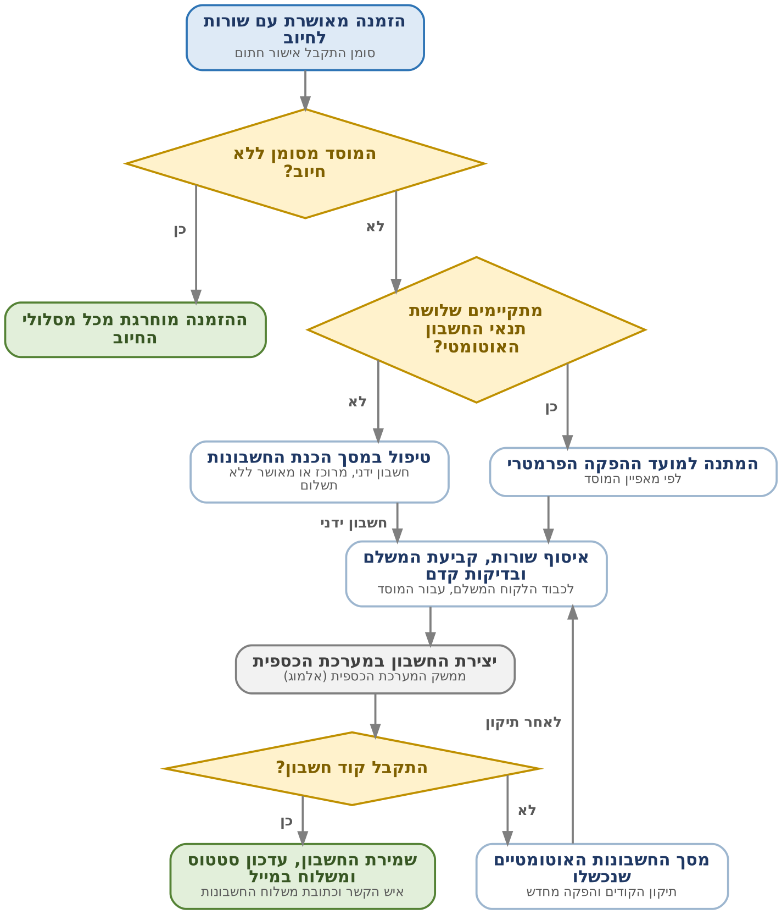
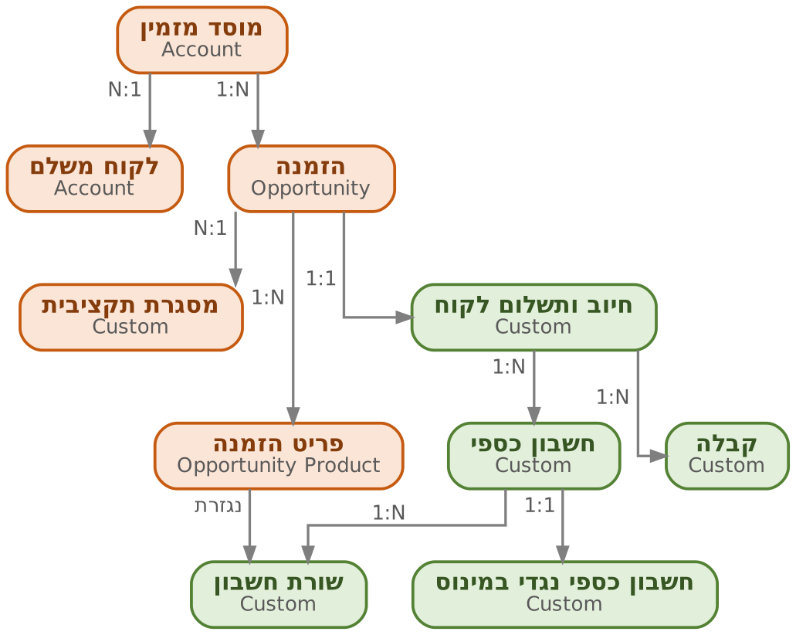

<!-- generated from: מסמך 3 אירועים וכספים - מאושר על ידי יד ושם - 2026-11-04.docx | 2026-11-08 | do not edit by hand; regenerate from the docx -->

> **מקור:** מסמך 3 - אירועים וכספים, גרסה מאושרת על ידי יד ושם, 4.11.2026  
> **מיקום בניווט:** מסמך 3 - אירועים וכספים › תהליכים עסקיים › הפקת חשבון וחיוב לקוח מול אלמוג  
> **קודי ולידציה ואוטומציה בפרק:** A21-01, A21-02, A21-03, A21-04, A21-10, A21-11, A21-12, A21-13, A21-15, A21-16, A21-19, A21-20, A21-21, V21-01, V21-02, V21-04, V21-06, V21-07, V21-14, V21-16, V21-17  
> **הקודם:** [כניסה והזמנה בעמדות קיוסק](08-kiosk-entry-ordering.md) · **הבא:** [ביטול ושינוי הזמנה של לקוח פרטי](10-private-customer-cancel-change.md) · [מקרא](../../INDEX.md)

# הפקת חשבון וחיוב לקוח מול אלמוג

הפרק מגדיר כיצד הזמנה מאושרת הופכת לחשבון לתשלום (חשבון, לא חשבונית מס) וכיצד כל תשלום בכרטיס אשראי נרשם ומשודר למערכת הכספית. את התהליך מפעילים בעלי ההרשאה הכספית במחלקות, ובהם רכזות לוגיסטיות שקיבלו הרשאה זו, ממסך החשבונות והכנת החשבונות וממסך החשבונות האוטומטיים שנכשלו (פרק 4.3). רכזות שקיבלו הרשאה לכך מפיקות חשבון ושולחות קישור לתשלום מתוך ההזמנה. העבודה מתבצעת מול אלמוג בממשק רזה. ⟦💬 c133⟧ מוסד רשאי לבחור בין תשלום מיידי בכרטיס אשראי, בקישור תשלום מתוך ההזמנה (A21-19), לבין חשבון לתשלום במועד שנקבע במאפייני המוסד.

חשבון אוטומטי מופק רק כאשר מתקיימים יחד שלושה תנאים: המסגרת התקציבית (Custom) של ההזמנה מסומנת להפקה אוטומטית, בכרטיס הלקוח (Account) לא מסומן "לא להפיק חשבון אוטומטי", ומאפיין המוסד, שדה תזמון הפקת החשבון בכרטיס הלקוח (Account), מגדיר את מועד ההפקה. המועד הוא פרמטר שיד ושם משנה ללא פיתוח, ולא ערך קבוע: מספר הימים של כל ערך תזמון מנוהל ברשומת תצורה (A21-13). כאשר מוגדר למוסד לקוח משלם, החשבון מופק לכבוד הלקוח המשלם ועבור המוסד שבו התקיימה הפעילות.

כל חשבון שנשלח לאלמוג נשמר כרשומה בסיילספורס, ולצדו מוצגת בהזמנה, בבקשה ידנית, תצוגה חיה של החשבונות מאלמוג (A21-02). כל תשלום בכרטיס אשראי מועבר לאלמוג כקבלה. החשבון מופק כקובץ PDF בתבנית בסיסית, בכלים הסטנדרטיים של סיילספורס, ונשלח במייל כצרופה; עיצוב ממותג מותנה בכלי הפקת מסמכים. מבנה הקריאות מפורט בפרק 9.1 (ממשק המערכת הכספית) ובפרק 11 (נקודות הקצה של ממשק המערכת הכספית), התעריפים וההנחות בפרק 10 (דמי ההרשמה והטיפול) ובמסמך 2, פרק 12.2, והביטולים בפרקים 5.10 (לקוח פרטי) ו-5.11 (לקוחות מוסדיים).

תרשים תהליך 24: הפקת חשבון וחיוב מול אלמוג

הטבלה שלהלן מציגה אילו ישויות נפתחות או מתעדכנות בכל שלב בתהליך הפקת החשבון והחיוב.

| השלב | הישות הנפתחת או המתעדכנת |
| --- | --- |
| אישור ההזמנה | מתעדכנת הזמנה (Opportunity): התקבל אישור חתום. נבדקים סימון ההפקה האוטומטית במסגרת התקציבית (Custom), סימוני כרטיס הלקוח (Account) ומאפיין המוסד (A21-01) |
| הגעת מועד ההפקה | תהליך מתוזמן קורא את מאפיין המוסד בכרטיס הלקוח (Account) ואת רשומות התצורה, ובוחר את שורות ההזמנה (Opportunity Product) שטרם הופק עבורן חשבון (A21-13) |
| הפקת החשבון מול אלמוג | נפתח חשבון כספי (Custom) תחת חיוב ותשלום לקוח (Custom) של ההזמנה, עם שורת חשבון (Custom) לכל שורת הזמנה; שורות ההזמנה מסומנות "הופק חשבון" וסטטוס התשלום בהזמנה מתעדכן (A21-10). בלקוח משלם החשבון מופק לכבוד הלקוח המשלם (Account) (A21-15). בכשל לא נפתחת רשומה, וההזמנה נרשמת במסך הכשלים (A21-03) |
| שליחת החשבון | לא נפתחת ישות: החשבון נשלח לאיש הקשר של ההזמנה (Contact) ולכתובת למשלוח חשבונות שבכרטיס הלקוח (Account) (A21-12) |
| תשלום בכרטיס אשראי | נפתחת קבלה (Custom) תחת חיוב ותשלום לקוח (Custom), ונשמר בה מספר הקבלה שמפיקה אלמוג; סטטוס התשלום בהזמנה מתעדכן (A21-19) |
| ביטול חשבון | נפתח חשבון כספי נגדי (Custom) במינוס, המקושר לחשבון המקורי; ההתאמה מתאפסת ושורות ההזמנה חוזרות להפקה (A21-11) |
| הצגת מצב החוב והחשבונות | לא נשמרת רשומה: הנתונים נשלפים מאלמוג ומוצגים בהזמנה ובכרטיס הלקוח (A21-02); פעמיים ביום מתעדכנים מצב ההתאמה בחשבון הכספי (Custom) וחיווי החוב בכרטיס הלקוח (A21-21) |

תרשים ישויות של הפקת חשבון וחיוב: ההזמנה, החיוב, החשבון הכספי, הקבלה וכרטיס הלקוח

## אוטומציות

| מזהה | טריגר | הפעולה האוטומטית |
| --- | --- | --- |
| A21-01 | אישור הזמנה שסומן בה התקבל אישור חתום | בדיקת שלושת תנאי החשבון האוטומטי: סימון ההפקה האוטומטית במסגרת התקציבית (Custom), סימון "לא להפיק חשבון אוטומטי" בכרטיס הלקוח (Account) ומאפיין המוסד בכרטיס הלקוח. מוסד המסומן ללא חיוב מוחרג מכל מסלולי החיוב וממסך הכנת החשבונות; הזמנה שאינה עומדת בתנאים ממתינה במסך לטיפול ידני. בהזמנה מרובת תאריכים החשבון מופק לפי מדיניות הגוף המזמין, באחת משתי דרכים: חשבון לאחר כל מפגש, על שורות ההזמנה (Opportunity Product) של אותו מפגש בלבד, או חשבון מאוחד אחד בסיום, על כל השורות שטרם הופק עבורן חשבון. בשתי הדרכים לא מופק חשבון שני על אותה שורה (V21-07). |
| A21-13 | תהליך מתוזמן יומי: הגיע מועד ההפקה | ההפקה נבדקת פעם ביום, למעט בשבת ובימי חג, והחשבון מופק בשפת ההזמנה. לפי מסמך 2 (פרק 12.14) מוגדרים חמישה תזמונים, כרשומות תצורה: חשבון דמי הרשמה וטיפול 3 ימים לפני הפעילות; חשבון כללי 21 או 10 ימים לפני הפעילות, לפי מאפיין המוסד; וחשבון שירותים נוספים יום אחד או 3 ימים אחרי הפעילות, כאשר סומן בהזמנה. לסוכני נסיעות: חשבון דמי הרשמה וטיפול 3 ימים לפני הביקור וחשבון שירותים יומיים אחריו, כולל שקלול שינויים עד הביקור (מסמך 2, פרק 12.2, A02-11). |
| A21-15 | הפקת חשבון להזמנה של מוסד שמוגדר לו לקוח משלם | שורת "לכבוד" נושאת את הלקוח המשלם (שם, מספר לקוח פנימי, ח"פ או סמל מוסד) ושורת "עבור" נושאת את המוסד המבצע (שם, סמל מוסד וכתובת), לפי שדות מוסד משלם ושיוך לרשת. לאלמוג משודרים קוד הלקוח המשלם וקוד המוסד הקשור. |
| A21-10 | קבלת קוד חשבון מאלמוג | שמירת רשומת החשבון הכספי ושורותיה (קוד המסגרת התקציבית ומק"ט) עם המשתמש היוזם, עדכון סטטוס התשלום וסימון השורות "הופק חשבון". החשבון מסומן מקור; הפעולה "צור העתק" מפיקה מסמך זהה המסומן העתק, ללא חיוב או קוד חשבון נוסף. |
| A21-03 | כשל בהפקת חשבון אוטומטית | ההזמנה נרשמת במסך החשבונות האוטומטיים שנכשלו, וסיבת השגיאה מוצגת גם בשדה הערות לטיפול בחשבון שבהזמנה. לא נוצרת רשומת חשבון חלקית והסטטוס אינו מתעדכן; לאחר תיקון הקודים או הנתונים החשבון מופק מחדש מהמסך. |
| A21-12 | שליחת חשבון, בודד או כמה חשבונות יחד | משלוח במייל מסיילספורס לאיש הקשר של ההזמנה ולכתובת הייעודית למשלוח חשבונות שבכרטיס המוסד, בשפת ההזמנה. החשבון מופק כקובץ PDF בתבנית בסיסית, בכלים הסטנדרטיים של סיילספורס (מסמך 2, פרק 12.14); עיצוב ממותג מותנה בכלי הפקת מסמכים. |
| A21-02 | ⟦💬 c135⟧יצירת הזמנה חדשה למוסד, או פתיחת תצוגת החשבונות בהזמנה, באירוע ובכרטיס הלקוח | ביצירת הזמנה חדשה או בבקשה ידנית: בדיקת חשבונות פתוחים באלמוג לפי סמל מוסד או ח"פ והצגת חיווי חוב  ⟦💬 c137⟧לרכזת. בתצוגת החשבונות, בבקשה ידנית בהזמנה או בכניסה למסך החשבונות: שליפת דוח החשבונות החי מאלמוג  ⟦💬 c139⟧להזמנה, לאירוע, למוסד ולמוסד המשלם, עם סינון ומיון, ללא שמירה בסיילספורס. מוסד המסומן חסום להזמנות אינו יכול להזמין, לא במערכת המקוונת ולא על ידי הרכז. |
| A21-21 | תהליך מתוזמן, פעמיים ביום | שליפת מצב ההתאמה מאלמוג (שליפת דוח) לחשבונות הכספיים (Custom) שאינם בהתאמה מלאה, ועדכון מצב ההתאמה ברשומת החשבון הכספי ובסטטוס התשלום של ההזמנה; לחשבון ששולם נשמרים ברשומת החשבון הכספי גם מספר הקבלה והקישור אליה; ולמוסדות שיש להם הזמנה פתוחה (הזמנה שטרם שולמה במלואה) או חיווי חוב פעיל, בדיקת חשבונות פתוחים ועדכון חיווי החוב בכרטיס הלקוח (Account), עם מועד העדכון. חיווי החוב והתשלום מוצגים כך ללא קריאה בכל כניסה; תצוגה עדכנית בזמן אמת נשארת בבקשה ידנית (A21-02). |
| A21-11 | ביטול חשבון בידי בעל הרשאה | לחשבון שאינו בהתאמה מלאה: יצירת חשבון נגדי במינוס באלמוג באותה קריאה בסימון ביטול, רשומת חשבון נגדית מקושרת, איפוס ההתאמה והחזרת ההזמנה והשורות להפקה מחדש. חשבון בהתאמה מלאה מבוטל ידנית בלבד, בחשבון ידני בסכום מינוס. עם ביטול אוטומטי של חשבון שאינו בהתאמה מלאה מתעדכנות כמויות השורות לפי מספר הקבוצות והמשתתפים הנוכחי, לפני ההפקה מחדש. |
| A21-16 | הפקת חשבון ידני או מרוכז: מכרטיס המוסד, מהזמנה, מאירוע או ממסך הכנת החשבונות | מילוי אוטומטי מן ההקשר (פרטי המוסד, מספר ההזמנה או האירוע, המסגרת התקציבית) ושידור מק"ט כללי. חשבון מאוחד מופק להזמנות של מוסד אחד בלבד. סימון הופק חשבון ידני או מרוכז מחייב אסמכתא והערות; מאושר ללא תשלום מחייב הערות. |
| A21-04 | שינוי מספר קבוצות או מספר משתתפים בהזמנה | המערכת מעדכנת את הכמות בשורות ההזמנה (Opportunity Product) המתומחרות לפי קבוצה או לפי משתתף, כך שהחשבון הבא יופק לפי המספרים החדשים. העדכון האוטומטי נעצר כאשר הוא עלול לשנות סכום שכבר נדרש או נגבה: בהזמנה ששולמה אף שורה אינה מתעדכנת, ומוצגת הודעה שההפרש מטופל ידנית; ושורה שהופק עבורה חשבון אינה מתעדכנת, יתר השורות מתעדכנות, ומוצגת הודעה שלא כל השורות עודכנו. בשני המקרים השינוי מבוצע בהוספת שורה, בביטול חשבון שטרם שולם והפקתו מחדש (A21-11) או בקישור תשלום על ההפרש (A21-20), כקבוע במסמך 2 (פרק 12.8, V08-05). |
| A21-19 | סליקה מוצלחת בכרטיס אשראי, בתשלום מקוון, בקישור תשלום או במכשיר ה-EMV בעמדת הקיוסק | ⟦💬 c141⟧יצירת רשומת קבלה (Custom) בסיילספורס עם פרטי העסקה ומספר המסוף, ושידור התקבול לאלמוג בסיום התשלום. הקבלה עצמה, המסמך החשבונאי, מופקת באלמוג; מספר הקבלה חוזר ונשמר ברשומה, ולצדו הקישור לקבלה במערכת הכספית, בכפוף להרחבת הקריאה (פרק 11); עותק הקבלה אינו נשמר בסיילספורס, והקבלה אינה נשלחת מסיילספורס. סטטוס התשלום של ההזמנה מתעדכן; בהזמנה שהופק לה חשבון, לפי מצב ההתאמה (A21-21). חל על כל תשלום בכרטיס אשראי, לא רק על חשבונות של מוסדות. בתשלום בקישור, המשלם יכול להזין שם עבור הקבלה, הנשמר בפרטי התשלום ומשודר עם הקבלה. בטופס ובמערכת המקוונת הקבלה מופקת על שם הנרשם. |
| A21-20 | עריכת הזמנה ששולמה או שהופק לה חשבון, לרבות מעבר לשעת כניסה בתעריף גבוה | הפרש דמי ההרשמה והטיפול או תוספת בתשלום נגבים בקישור תשלום נפרד על ההפרש, והתשלום משודר לאלמוג כקבלה. תיקון חשבון קיים: ביטול והפקה מחדש. הגורם הכספי במחלקה מקבל מייל עם הנחיה לחייב או לזכות. |

## כללי ולידציה

| מזהה | הכלל | הודעת שגיאה |
| --- | --- | --- |
| V21-01 | לא ניתן להפיק חשבון בסכום כולל אפס, ולא ניתן להפיק חשבון להזמנה או לרישום שאינם משויכים למוסד או לגוף משלם בעל קוד לקוח במערכת הכספית. נרשם פרטי משלם בקישור תשלום ואינו מקבל חשבון | אין אפשרות ליצור חשבון לסכום 0 / אין אפשרות ללא שיוך למוסד או לגוף משלם בעל קוד לקוח |
| V21-02 | לא ניתן להפיק חשבון כאשר קיימת שורה ללא קוד המסגרת התקציבית או ללא מק"ט | לא ניתן להפיק חשבון: חסרים קוד המסגרת התקציבית או מק"ט בשורת ההזמנה |
| V21-04 | חשבון מופק רק להזמנה שסומן בה התקבל אישור חתום; הזמנה מהמערכת המקוונת נכנסת עם הסימון | לא ניתן להפיק חשבון להזמנה שטרם אושרה |
| V21-16 | בהזמנה של גוף ביטחון המסומנת הזמנת רכש נדרשת, הפקת החשבון מותנית בסימון הזמנת רכש התקבלה | לא ניתן להפיק חשבון לפני קבלת הזמנת הרכש |
| V21-06 | ההפקה מותנית בזהות מלאה בין הקודים בסיילספורס לבין אלמוג: קוד לקוח, לרבות קוד הלקוח המשלם, קוד המסגרת התקציבית ומק"ט. אי התאמה מזוהה בקריאה למערכת הכספית, והחשבון מנותב למסך הכשלים | קוד מוסד לא קיים באלמוג |
| V21-07 | לא ניתן להפיק חשבון נוסף על שורה שכבר הופק עבורה חשבון, אלא לאחר ביטול החשבון הקודם | לשורה זו כבר הופק חשבון |
| V21-14 | יצירת חשבון וביטולו מותרים לבעלי הרשאה בלבד. רכזות בעלות ההרשאה רשאיות ליצור חשבון ולשלוח קישור לתשלום; ביטול חשבון והפקת חשבון בסכום מינוס מותרים לבעלי ההרשאה הכספית ולמנהל המערכת בלבד. הפקה ומשלוח של חשבון אוטומטי מותרים לקבוצת ההרשאה הפק ושלח חשבון אוטומטי, הנפרדת מההרשאה הכספית הכללית | אין הרשאה להפקה ולמשלוח של חשבון אוטומטי |
| V21-17 | ביטול אוטומטי מותר רק לחשבון שאינו במצב התאמה מלאה; הכלל נאכף בסיילספורס לפני הקריאה לאלמוג | החשבון בהתאמה מלאה, נדרש חשבון ידני בסכום מינוס |

## ישויות ושדות ייחודיים לתהליך

| ישות | תפקיד בתהליך | שדות ייעודיים לתהליך |
| --- | --- | --- |
| חשבון כספי ושורת חשבון (Custom) | רשומת החשבון שהופק מול אלמוג, לתצוגה גם למשתמשים ללא גישה לאלמוג ולביטול עתידי | קוד חשבון אלמוג, מספר החשבון, היקף (הזמנה מלאה או שורות), מצב התאמה, מקור או העתק, קישור לחשבון נגדי, מקור הפקה (אוטומטי או ידני), המשתמש היוזם; בשורה: קוד המסגרת התקציבית ומק"ט |
| לקוח (Account) | נושא ההגדרות הכספיות של המוסד | קוד לקוח באלמוג, מאפיין מוסד, מוסד משלם, שיוך לרשת, ללא חיוב, לא להפיק חשבון אוטומטי, כתובת ייעודית למשלוח חשבונות, חיווי חוב ומועד עדכונו |
| מסגרת תקציבית (Custom) ומאפיין מוסד (רשומת תצורה) | כללי ההפקה: האם מופק חשבון אוטומטי ומתי | במסגרת: הפקת חשבון אוטומטי, מחירון, ייעוד להזמנות או לאירועים, מספרים פנימיים המקושרים לאלמוג. במאפיין המוסד: מועדי ההפקה ביחס למועד הפעילות (חשבון כללי, דמי הרשמה וטיפול, שירותים נוספים) |
| הזמנה (Opportunity) ושורת הזמנה | מקור החיוב ויחידת החיוב | סטטוס תשלום, התקבל אישור חתום, הזמנת רכש התקבלה, שפת הזמנה, סימון הופק חשבון ידני, מרוכז או מאושר ללא תשלום, אסמכתא, הערות, הערות לטיפול בחשבון; בשורה: קוד המסגרת התקציבית, מק"ט, הופק חשבון |

---

## הערות סקירה בפרק זה

> הערות הסקירה אינן חלק מהאפיון המחייב. הן מסמנות מקומות שבהם הטקסט עדיין בדיון. הסימון ⟦💬 cN⟧ בגוף הטקסט מפנה להערה כאן.

### ⟦💬 c133⟧ סגורה
- **c133** · טל שמרית · 2026-10-20 · סומנה כסגורה: ???
  - **c134** · Lior Pridor · 2026-10-26 · סומנה כסגורה: בוצע: המשפט תוקן. הממשק בפרויקט פועל מול אלמוג בלבד, במינימום הקריאות הנדרש לתהליכים שבמסמך, וכך גם בדיקות הקבלה והעלייה לאוויר. ראו גם התשובה בפרק 9.1.

### ⟦💬 c135⟧ סגורה
- **c135** · טל שמרית · 2026-10-20 · סומנה כסגורה: כמובן שמוסד שמסומן לו "חסום להזמנות" לא יכול לבצע הזמנה במערכת המקוונת ולא בתהל ע"י הרכז.
  - **c136** · Lior Pridor · 2026-10-26 · סומנה כסגורה: בוצע.

### ⟦💬 c137⟧ סגורה
- **c137** · וייל דבורה · 2026-10-19 · סומנה כסגורה: פניה לקבל את מצב החוב :רק ביצירת הזמנה חדשה או בבקשה ידנית.
  - **c138** · Lior Pridor · 2026-10-26 · סומנה כסגורה: בוצע: הבדיקה מול אלמוג בזמן אמת מתבצעת רק ביצירת הזמנה חדשה או בבקשה ידנית (A21-02). בנוסף, פעמיים ביום מתעדכן חיווי החוב בכרטיס הלקוח בתהליך מתוזמן (A21-21), למוסדות שיש להם הזמנה פתוחה או חיווי חוב פעיל, כך שהחיווי זמין ללא קריאה בכל כניסה.

### ⟦💬 c139⟧ סגורה
- **c139** · וייל דבורה · 2026-10-19 · סומנה כסגורה: בהזמנה - רק בבקשה ידנית לקבל את החשבונות, או בכניסה למסך שכל ייעודו חשבונות.
  - **c140** · Lior Pridor · 2026-10-26 · סומנה כסגורה: בוצע: בהזמנה, דוח החשבונות החי נשלף מאלמוג רק בבקשה ידנית או בכניסה למסך החשבונות, ואינו נשמר בסיילספורס (A21-02). בנפרד, פעמיים ביום מתעדכנים מצב ההתאמה של החשבונות וסטטוס התשלום בהזמנה (A21-21).

### ⟦💬 c141⟧ סגורה
- **c141** · טל שמרית [2] · 2026-10-21 · סומנה כסגורה: בעת ביצוע החיוב יש לאפשר למזמין שמשלם למלא שדה בשם " שם עבור קבלה ". / את הנתון הזה יש לשמור בתוך פירוט התשלום של המזמין.
  - **c142** · Lior Pridor · 2026-10-26 · סומנה כסגורה: בוצע: בתשלום בקישור תשלום, המשלם יכול להזין שם עבור הקבלה; בטופס ובמערכת המקוונת הקבלה מופקת על שם הנרשם. השם נשמר בפרטי התשלום ומשודר לאלמוג עם הקבלה (A21-19).
