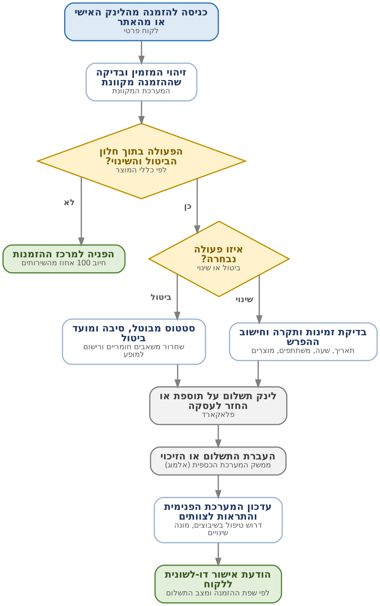
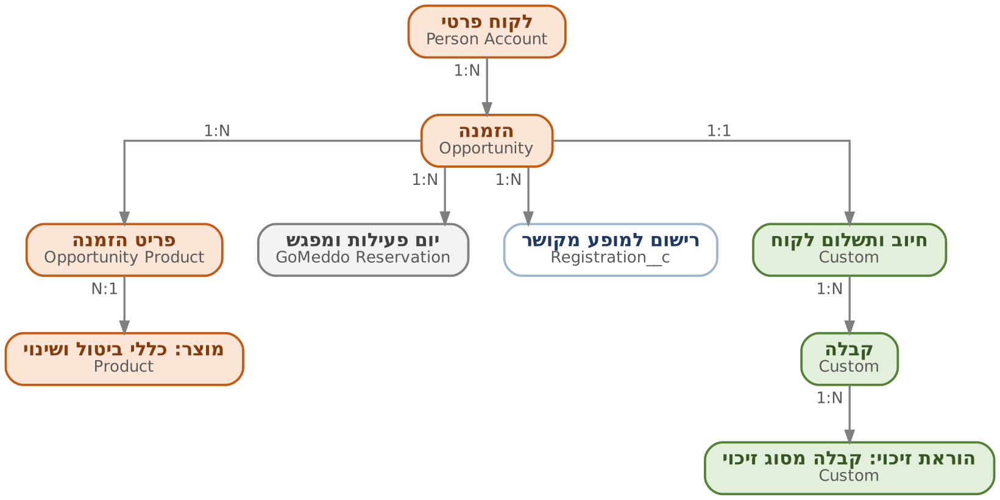

<!-- generated from: מסמך 3 אירועים וכספים - מאושר על ידי יד ושם - 2026-11-04.docx | 2026-11-08 | do not edit by hand; regenerate from the docx -->

> **מקור:** מסמך 3 - אירועים וכספים, גרסה מאושרת על ידי יד ושם, 4.11.2026  
> **מיקום בניווט:** מסמך 3 - אירועים וכספים › תהליכים עסקיים › ביטול ושינוי הזמנה של לקוח פרטי  
> **קודי ולידציה ואוטומציה בפרק:** A22-01, A22-03, A22-04, A22-06, A22-07, A22-08, A22-09, A22-10, A22-11, A22-13, A22-14, A22-15, V22-01, V22-02, V22-03, V22-04, V22-09, V22-11, V22-12, V22-13  
> **הקודם:** [הפקת חשבון וחיוב לקוח מול אלמוג](09-almog-invoicing-billing.md) · **הבא:** [ביטול, זיכוי והחזר ללקוחות מוסדיים](11-institutional-cancel-credit-refund.md) · [מקרא](../../INDEX.md)

# ביטול ושינוי הזמנה של לקוח פרטי

לקוח פרטי, המשלם באשראי במעמד ההזמנה, מבטל ומשנה את הזמנתו בשירות עצמי במערכת המקוונת, ללא אזור אישי וללא שם משתמש וסיסמה, באמצעות מספר ההזמנה בצירוף כתובת המייל שממנה בוצעה או מספר הטלפון שהוזן בה (מסמך 2, פרק 12.2). הגישה היא להזמנה בודדת, מהקישור האישי שבאישור ההזמנה או בזיהוי זה.  ⟦💬 c143⟧הפעולות: ביטול הזמנה ושינוי תאריך או שעה בהזמנה קיימת. שינוי כמויות המוזמנים, שינוי סוג הסיור או המוצר והחלפת אירוע נשארים בשלב זה בידי מרכז ההזמנות.

כל הכללים פרמטריים ומתעדכנים בידי מנהל המערכת: חלון הביטול והשינוי, המוגדר לכל סוג פעילות (חבילה); תקרת המשתתפים בקבוצה; ומדיניות ההחזר. בהזמנת חבילה (Bundle), כגון חבילת בר מצווה, חלים הכללים שהוגדרו לחבילה וגוברים על כללי המוצרים שבה; כשלא הוגדרו כללים לחבילה, חל החלון המחמיר מבין מוצריה. דמי ההרשמה והטיפול אינם מוחזרים כברירת מחדל. בעריכה ניתן לבחור בכל השעות הפנויות: מעבר לשעה בתעריף הגבוה מחויב בהפרש דמי ההרשמה והטיפול בקישור תשלום נפרד, ומעבר לתעריף נמוך יותר אינו מזכה בהחזר. התעריפים והחלונות מרוכזים בפרק 10 (דמי ההרשמה והטיפול) ואינם משוכפלים כאן.

ביטול ושינוי משחררים מיידית את המשאבים הפיזיים ואת הרישום למופע מקושר, אך אינם מבטלים שיבוץ של נותן שירות: ההזמנה מסומנת "דרוש טיפול בשיבוצים" והשחרור ידני בלבד. החזר וזיכוי חלקי מחושבים לפי מדיניות המוצר ונרשמים כהוראת זיכוי, המאושרת במרכז ההזמנות או במחלקה המטפלת ומשודרת למערכת הכספית; ההחזר לכרטיס האשראי נשלח אוטומטית לפלאקארד לאחר האישור, והגורם הכספי מקבל הודעה לבקרה; כאשר לא ניתן להחזיר לכרטיס, ההחזר מבוצע בהעברה בנקאית בידי הגורם הכספי. המסלול החשבונאי של לקוחות מוסדיים מפורט בפרק 5.11 (ביטול, זיכוי והחזר ללקוחות מוסדיים).

תרשים תהליך 25: ביטול ושינוי הזמנה של לקוח פרטי

הטבלה שלהלן מציגה אילו ישויות נפתחות או מתעדכנות בכל שלב בתהליך הביטול והשינוי.

| השלב | הישות הנפתחת או המתעדכנת |
| --- | --- |
| כניסה להזמנה | נקראת הזמנה (Opportunity) לפי מספר ההזמנה ופרטי הזיהוי של המזמין, ונבדק שנקלטה במערכת המקוונת (V22-01, V22-11) |
| בדיקת הכללים | נקראים כללי הביטול והשינוי של סוג הפעילות (חבילה, Bundle), ובהזמנה שאינה חבילה מהמוצר (Product) של כל שורת הזמנה (Opportunity Product) (V22-02) |
| ביטול | מתעדכנת הזמנה (Opportunity): סטטוס מבוטל, סיבת ביטול, תאריך ושעת ביטול; בביטול מפגש בודד מתעדכן המפגש (GoMeddo Reservation). משתחררים שריוני המשאבים הפיזיים במפגשי ההזמנה והרישום למופע המקושר (Registration__c) (A22-01) |
| שינוי תאריך או שעה | מתעדכנים מפגשי ההזמנה (GoMeddo Reservation) למועד החדש, ובהזמנה (Opportunity) תאריך הביקור הקודם והחדש. שיבוצי נותני השירות נשמרים, וההזמנה מסומנת "דרוש טיפול בשיבוצים" (A22-04) |
| הוספת משתתפים או מוצרים | מתעדכנות שורות ההזמנה (Opportunity Product); נשלח קישור תשלום על ההפרש, ועם התשלום נפתחת קבלה (Custom) תחת חיוב ותשלום לקוח (Custom) (A22-08) |
| ביטול או הפחתה בהזמנה ששולמה | מתעדכנות שורות ההזמנה (Opportunity Product); נוצרת הוראת זיכוי, רשומת קבלה (Custom) מסוג זיכוי המקושרת לקבלה של העסקה המקורית, ונפתחת משימה (Task) לאישורה: למרכז ההזמנות בהזמנות שלו, ולמחלקה המטפלת בהזמנות של מחלקות אחרות (A22-03, A22-07) |
| אישור הזיכוי וביצועו | מתעדכנת הוראת הזיכוי (קבלה, Custom): אושר ומשודר למערכת הכספית בקריאת הזיכוי, בכפוף להגדרתה (פרק 9.1), ולאחר ביצוע ההחזר, אוטומטית מול פלאקארד או בהעברה בנקאית בידי הגורם הכספי, בוצע, עם אמצעי ההחזר ומספר מסמך הזיכוי מהמערכת הכספית, כאשר קריאת הזיכוי מחזירה אותו (A22-15) |
| הודעה ללקוח | לא נפתחת ישות: נשלחת הודעה ללקוח הפרטי (Person Account) לפי שפת ההזמנה (A22-06) |

תרשים ישויות של ביטול ושינוי הזמנה של לקוח פרטי: ההזמנה, שורותיה, המפגשים, הרישום למופע והחיוב

## אוטומציות

| מזהה | טריגר | הפעולה האוטומטית |
| --- | --- | --- |
| A22-01 | ביטול הזמנה או מפגש בודד, או שינוי תאריך או שעה | שחרור אוטומטי ומיידי של שיבוצי המשאבים הפיזיים (כיתות, מוזיאון, חדרים), ובהזמנה המקושרת להצגה או לחיזיון גם של הרישום למופע. בביטול מקוון: סטטוס מבוטל, סיבת ביטול בוטל על ידי המזמין במערכת המקוונת, ורישום תאריך ושעת הביטול. |
| A22-03 | ביטול או הפחתה מקוונים בהזמנה ששולמה באשראי | נוצרת הוראת זיכוי בסכום ההחזר שחושב (A22-07), מקושרת לקבלה (Custom) של העסקה המקורית ובסטטוס ממתין לאישור, ונפתחת משימה (Task) לאישור הזיכוי וסכומו: למרכז ההזמנות בהזמנות שלו, ולמחלקה המטפלת בהזמנות של מחלקות אחרות. במקביל נשלח חיווי לתיבת המייל הייעודית של הגורם הכספי. |
| A22-04 | ביטול, או שינוי תאריך או שעה, בהזמנה עם נותני שירות משובצים | השיבוץ נשמר ואינו מתבטל. ההזמנה מסומנת "דרוש טיפול בשיבוצים", נוצרת משימה לרכז, ונשלח מייל למשבצות, לרכזת ההזמנה ולרכזת הלוגיסטית עם שמות המדריכים וציון יום חוזה לצד כל שם. השחרור ידני בלבד. ללא שיבוצים: מייל לשתי הרכזות בלבד. |
| A22-06 | כל ביטול או שינוי | הודעה דו-לשונית ללקוח לפי שפת ההזמנה, סוג הפעולה ומצב התשלום, ובה הסכום לחיוב או לזיכוי. ההודעה מיידעת בלבד: סכום הזיכוי מחושב ב-A22-07, מאושר במרכז ההזמנות או במחלקה המטפלת ומבוצע לאחר האישור (A22-03, A22-15). |
| A22-07 | ביטול או הפחתת משתתפים בהזמנה ששולמה | חישוב ההחזר לפי מדיניות המוצר: זיכוי אודיו גייד או אוזניות שהוסרו, וזיכוי עלות הדרכה רק כאשר מספר הקבוצות קטן; דמי ההרשמה והטיפול מזוכים לפי שיעור ההחזר שבמדיניות המוצר. סכום ההחזר נרשם בהוראת זיכוי לאישור מרכז ההזמנות או המחלקה המטפלת (A22-03), וההחזר מבוצע לאחר האישור (A22-15). |
| A22-15 | אישור הוראות זיכוי בידי מרכז ההזמנות או המחלקה המטפלת, כל אחת בנפרד או כרשימה, מתוך רשימת הוראות הזיכוי הממתינות לפי טווח תאריכים | הסטטוס עובר לאושר, והוראת הזיכוי משודרת למערכת הכספית בקריאת הזיכוי, בכפוף להגדרתה (פרק 9.1). ההחזר לכרטיס האשראי נשלח אוטומטית לפלאקארד על העסקה המקורית; עם אישור פלאקארד ההוראה מסומנת כבוצעה, ונשלחת הודעה אוטומטית לגורם הכספי לבקרה. כאשר ההחזר לכרטיס נכשל או אינו אפשרי, הגורם הכספי מבצע את ההחזר בהעברה בנקאית ומסמן את ההוראה כבוצעה. מספר מסמך הזיכוי מהמערכת הכספית נשמר בהוראה כאשר קריאת הזיכוי מחזירה אותו. |
| A22-08 | הוספת משתתפים או מוצרים, או מעבר לשעה בתעריף גבוה, בהזמנה ששולמה | חישוב ההפרש לפי המחירון וכללי המוצר (רכיב השירות שנוסף ודמי הרשמה וטיפול על התוספת בלבד) ושליחת קישור תשלום נפרד. ההזמנה תומכת בריבוי קישורים ובריבוי חשבונות. התשלום שנקלט מועבר למערכת הכספית, כמפורט בפרק 5.9 (הפקת חשבון וחיוב לקוח מול אלמוג). |
| A22-09 | עדכון כמות משתתפים בהזמנת סוכן שטרם הופק לה חשבון | חישוב מחדש של מלוא החיוב לפי מספר המשתתפים המעודכן, לרבות אודיו גייד, אוזניות ודמי הרשמה, במקום זיכוי או תוספת. חשבון דמי הרשמה וטיפול שכבר הופק אינו מתבטל בביטול ההזמנה. |
| A22-10 | עדכון מקוון של הזמנה ללא שיבוצים וללא לו"ז (מעבר לשורת סיור במוזיאון) | ההזמנה מסומנת לבדיקה חוזרת של הרכזות, משום שאין בה שיבוץ או שורת לו"ז שיפעילו התראה אחרת על השינוי (A22-04, A22-11): היא מוצגת בתצוגת ההזמנות מהמערכת המקוונת ובצבע מובחן (מסמך 2, פרק 12.4, A04-07). |
| A22-11 | עדכון מקוון של הזמנה הכוללת שורות לו"ז ללא שיבוצים | מייל לרכזת הלוגיסטית. נושא המייל מדגיש את שינוי התאריך וכולל את התאריך הישן ואת החדש. זהו מייל פנימי; הלקוח מקבל את ההודעה שב-A22-06 ואישור הזמנה מעודכן (מסמך 2, פרק 12.14). |
| A22-13 | סימון ביטול מחמת כוח עליון ביום הפעילות, בידי בעל הרשאה | המזמין אינו מחויב בתשלום בגין הביטול, וסיבת הפטור נרשמת בהזמנה. הסימון אינו זמין בשירות עצמי. |
| A22-14 | ביטול או שינוי מחוץ לחלון, המבוצע בידי מרכז ההזמנות | חיוב במלוא עלות השירותים שהוזמנו, ומשלוח הודעה ללקוח בצירוף נוהל הביטולים. החזר חריג של עלות ההזמנה או של דמי ההרשמה מבוצע רק בפנייה למרכז ההזמנות. |

## כללי ולידציה

| מזהה | הכלל | הודעת שגיאה |
| --- | --- | --- |
| V22-01 | גישה לעריכה או לביטול מותנית בהתאמה מלאה של מספר ההזמנה ושל אמצעי הזיהוי של המזמין שנקבעו במסמך 2, פרק 12.2 (כתובת המייל או מספר הטלפון שהוזן בהזמנה). כל הזמנה נפתחת בנפרד | פרטי הזיהוי אינם תואמים את ההזמנה |
| V22-02 | ביטול או שינוי מתאפשרים רק בתוך חלון הזמן המוגדר לסוג הפעילות (חבילה), ובהזמנה שאינה חבילה בתוך החלון שהוגדר למוצר, בימי עסקים. ערכי החלונות בפרק 10 (דמי ההרשמה והטיפול) | חלף המועד לביצוע הפעולה באופן מקוון, יש לפנות למרכז ההזמנות |
| V22-03 | דמי הרשמה וטיפול ודמי אירוע מוחזרים בביטול או בהפחתת משתתפים לפי שיעור ההחזר שבמדיניות המוצר (ברירת המחדל: ללא החזר), ונגבים פעם אחת בלבד גם כשההזמנה עודכנה; על משתתפים שנוספו נגבים על התוספת בלבד, ובמעבר לשעה בתעריף הגבוה נגבה הפרש התעריף (V22-04). שיעור ההחזר הוא פרמטר של מדיניות הביטולים ברמת המוצר | לפי מדיניות המוצר, דמי ההרשמה והטיפול ודמי האירוע אינם מוחזרים בפעולה זו |
| V22-04 | בשינוי שעה מוצגות כל השעות הפנויות. מעבר משעה בתעריף הנמוך לשעה בתעריף הגבוה מחויב בהפרש דמי ההרשמה והטיפול לפי המחירון; מעבר לתעריף נמוך יותר אינו מזכה בהחזר. בשינוי מוצגת הודעת אזהרה שאינה חוסמת | ⟦💬 c147⟧מעבר לשעה בתעריף הגבוה כרוך בתשלום הפרש דמי הרשמה וטיפול |
| V22-09 | ⟦💬 c149⟧הוספת משתתפים בהזמנת מדריך חיצוני או בסיור מודרך פרטי מוגבלת לתקרת המשתתפים שהוגדרה במוצר (ברירת מחדל: 35). המערכת אינה יוצרת קבוצה נוספת בשירות עצמי | חריגה ממספר המשתתפים המרבי לקבוצה, יש לפתוח הזמנה חדשה |
| V22-11 | עריכה וביטול בשירות עצמי מתאפשרים להזמנות שנקלטו במערכת המקוונת בלבד | הזמנה זו נפתחה במערכת הפנימית, יש לפנות למרכז ההזמנות |
| V22-12 | שינוי כמויות המוזמנים, שינוי סוג הסיור או המוצר בהזמנת ביקור והחלפת אירוע ברישום קיים אינם נתמכים בשירות עצמי בשלב זה, ומתבצעים בידי מרכז ההזמנות | לא ניתן לבצע שינוי זה באופן מקוון, יש לפנות למרכז ההזמנות |
| V22-13 | הוראת זיכוי משודרת למערכת הכספית ומסומנת כבוצעה רק לאחר אישורה במרכז ההזמנות או במחלקה המטפלת | הוראת הזיכוי טרם אושרה |

## ישויות ושדות ייחודיים לתהליך

| ישות | תפקיד בתהליך | שדות ייעודיים לתהליך |
| --- | --- | --- |
| הזמנה (Opportunity) | הרשומה הנערכת או המבוטלת | סטטוס, סיבת ביטול, תאריך ושעת ביטול, סימון הזמנה מקוונת, סימון דרוש טיפול בשיבוצים, תאריך ביקור קודם וחדש, סימון פטור כוח עליון, מצב תשלום, שפת הזמנה |
| מפגש (יום פעילות) | ביטול מפגש בודד מתוך הזמנה מרובת מפגשים | סיבת ביטול ברמת המפגש, תאריך ושעת ביטול |
| מוצר (Product), כללי ביטול ושינוי | פרמטרים המנוהלים בידי מנהל המערכת | חלון ביטול ועדכון בימי עסקים, תנאי שינוי, שיעור החזר מחיר ושיעור החזר דמי הרשמה, רכיב מזוכה בהפחתת כמות, תקרת משתתפים בקבוצה |
| חבילה (Bundle), כללי ביטול ושינוי | כללי הביטול והשינוי של הזמנת חבילה, הגוברים על כללי המוצרים שבה | חלון ביטול ועדכון בימי עסקים, תנאי שינוי, שיעור החזר מחיר ושיעור החזר דמי הרשמה |
| חיוב ותשלום לקוח | תיעוד התוספת, ההחזר והזיכוי החלקי מול פלאקארד והעברתם למערכת הכספית | אסמכתת העסקה המקורית, סכום החזר או הפרש, קישור תשלום, סטטוס העברה למערכת הכספית |
| הוראת זיכוי: קבלה (Custom) מסוג זיכוי | ההחזר ללקוח, מהחישוב ועד הביצוע | סכום, קישור לקבלה המקורית, סטטוס (ממתין לאישור, אושר, בוצע), המאשר ומועד האישור, אמצעי ההחזר (כרטיס אשראי או העברה בנקאית), מספר מסמך הזיכוי מהמערכת הכספית, אישור ההחזר מפלאקארד |

---

## הערות סקירה בפרק זה

> הערות הסקירה אינן חלק מהאפיון המחייב. הן מסמנות מקומות שבהם הטקסט עדיין בדיון. הסימון ⟦💬 cN⟧ בגוף הטקסט מפנה להערה כאן.

### ⟦💬 c143⟧ נענתה על ידי מלם
- **c143** · טל שמרית · 2026-10-20: בימים הקרובים יש לנו דיון בנושא ונעביר עדכון מה מאפשרים ומה לא לביצוע במערכת המקוונת
  - **c144** · Lior Pridor · 2026-10-26: מקובל, נעדכן את הפרק לפי ההחלטה שתעבירו. נבקש לקבל אותה עד סגירת האפיון ב-4 בנובמבר.
  - **c145** · אשבל אור · 2026-11-03: פעולות שניתן לבצע במע' המקוונת: ביטול הזמנה, שינוי תאריך\שעה להזמנה קיימת. נושא פתוח: שינוי כמויות מוזמנים, שינוי סוג סיור\מוצר
  - **c146** · Lior Pridor · 2026-11-04: בוצע: בשירות עצמי במערכת המקוונת ניתן לבטל הזמנה ולשנות תאריך או שעה בהזמנה קיימת. שינוי כמויות המוזמנים ושינוי סוג הסיור או המוצר מבוצעים בשלב זה בידי מרכז ההזמנות; הרחבת השירות העצמי לפעולות אלה, אם תוחלט, תיבחן כבקשת שינוי.

### ⟦💬 c147⟧ סגורה
- **c147** · וייל דבורה · 2026-10-19 · סומנה כסגורה: ניתן לאפשר את כל השעות – ולגבות את ההפרש
  - **c148** · Lior Pridor · 2026-10-26 · סומנה כסגורה: בוצע: בשינוי שעה ניתן לבחור כל שעה פנויה, ובמעבר לשעה בתעריף הגבוה נגבה הפרש דמי ההרשמה והטיפול, כקבוע במסמך 2 (V02-08), בקישור תשלום נפרד (A21-20).

### ⟦💬 c149⟧ סגורה
- **c149** · טל שמרית [2] · 2026-10-22 · סומנה כסגורה: את כל הכללים נעביר במדויק בשבועיים הקרובים. / לגבי כלל זה הוא בעיקרון לא עבור קבוצות חינוכיות, שם נאפשר להוסיף קבוצות ולהסיר קבוצות. / את כלל המידע אודות שינויים במערכת המקוונת (מעבר לביטול או שינוי תאריך ושעה) נעביר בשבועיים הקרובים
  - **c150** · Lior Pridor · 2026-10-26 · סומנה כסגורה: מקובל. הוספה והסרה של קבוצות בהזמנה חינוכית, לרבות בשירות עצמי, מפורטות בפרק 5.11 (A23-13). נעדכן את הפרק לפי הכללים שתעבירו; נבקש לקבל אותם עד סגירת האפיון ב-4 בנובמבר.
