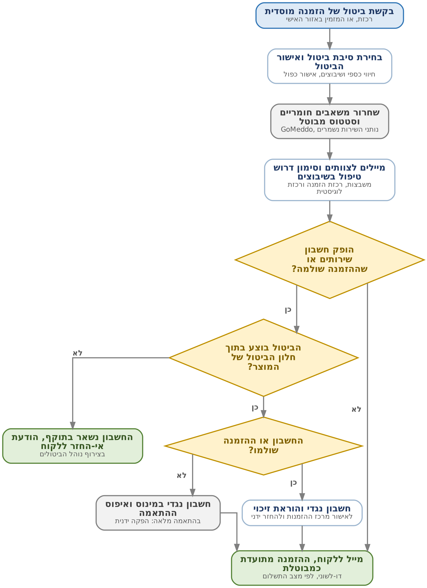
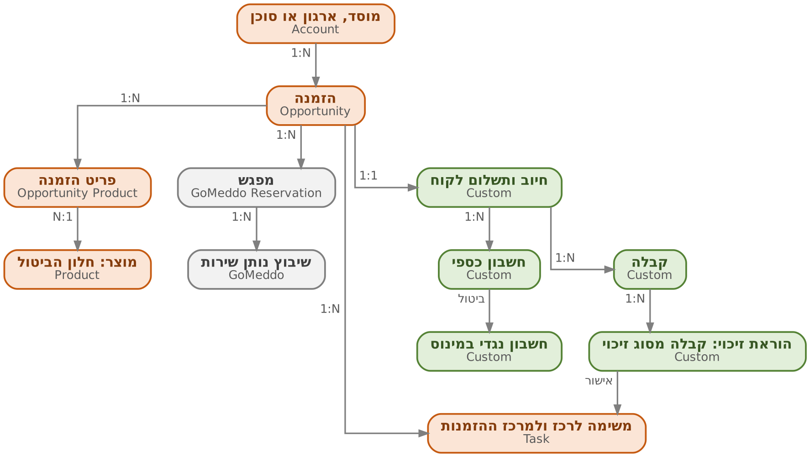

<!-- generated from: מסמך 3 אירועים וכספים - מאושר על ידי יד ושם - 2026-11-04.docx | 2026-11-08 | do not edit by hand; regenerate from the docx -->

> **מקור:** מסמך 3 - אירועים וכספים, גרסה מאושרת על ידי יד ושם, 4.11.2026  
> **מיקום בניווט:** מסמך 3 - אירועים וכספים › תהליכים עסקיים › ביטול, זיכוי והחזר ללקוחות מוסדיים  
> **קודי ולידציה ואוטומציה בפרק:** A23-01, A23-02, A23-03, A23-05, A23-06, A23-07, A23-08, A23-09, A23-11, A23-12, A23-13, V23-01, V23-02, V23-03, V23-04, V23-06, V23-08, V23-09, V23-13, V23-14  
> **הקודם:** [ביטול ושינוי הזמנה של לקוח פרטי](10-private-customer-cancel-change.md) · **הבא:** [תשלום מדריכים ונותני שירות וקובץ מלם](12-guide-provider-payment-malam-file.md) · [מקרא](../../INDEX.md)

# ביטול, זיכוי והחזר ללקוחות מוסדיים

לקוחות מוסדיים, מוסדות חינוך, ארגונים, סוכני נסיעות וגופים בעלי הסדר, מחויבים בחשבון, ולכן ביטול הזמנה שלהם הוא גם תהליך חשבונאי; הביטולים מהווים כ-10 עד 20 אחוזים מהחשבונות. הביטול מבוצע בידי הרכזות או בידי המזמין באזור האישי, והטיפול הכספי בידי הגורם הכספי במחלקה. ביטול ההזמנה, שחרור המשאבים והטיפול בשיבוצים מפורטים במסמך 2; פרק זה מוסיף את ההשלכה הכספית.

ההכרעה הכספית נגזרת משני נתונים: מועד הביטול ביחס לחלון הביטול, ומצב החשבון. חלון הביטול מנוהל כפרמטר לכל סוג פעילות (חבילה), ובהזמנה שאינה חבילה כפרמטר של המוצר; לדוגמה, בהזמנה עם הדרכה של יד ושם הוא שלושה ימי עסקים. ביטול במועד מזכה בביטול חשבון השירותים או בהחזר, וביטול מאוחר מחויב במלוא העלות. ככלל, ובכפוף לשיעור ההחזר שהוגדר במדיניות הביטולים (פרק 10), דמי ההרשמה והטיפול אינם מוחזרים, וחשבון שהופק בגינם אינו מבוטל, למעט ביטול ביום הפעילות מחמת כוח עליון (V23-08).

ביטול חשבון נשלח לממשק אלמוג כקריאה זהה ליצירת החשבון בתוספת סימון ביטול, ויוצר באלמוג חשבון נגדי במינוס. ביטול אוטומטי אפשרי רק כל עוד החשבון אינו בהתאמה מלאה; חשבון בהתאמה מלאה מזוכה בהפקה ידנית של חשבון במינוס מתוך ההזמנה. את הביטול ואת הפקת החשבון במינוס מבצע בסיילספורס משתמש בעל הרשאה כספית, בפרופיל רכזת כספית או מנהל מערכת (פרק 8); רכזת ההזמנות מפיקה חשבון מתוך ההזמנה, אך אינה מבטלת או מזכה חשבון. אין צורך במשתמש במערכת הכספית. שיבוצי נותני השירות אינם מתבטלים אוטומטית בשום תרחיש, וההחזר בפועל מבוצע לאחר אישור הוראת הזיכוי, כבפרק 5.10. קיצור משך הביקור מטופל כעדכון ההזמנה: השורות שהוסרו מטופלות לפי מצב החשבון, כבעדכון קבוצות (A23-13).

תרשים תהליך 26: ביטול, זיכוי והחזר ללקוחות מוסדיים

הטבלה שלהלן מציגה אילו ישויות נפתחות או מתעדכנות בכל שלב בתהליך הביטול והזיכוי המוסדי.

| השלב | הישות הנפתחת או המתעדכנת |
| --- | --- |
| בקשת הביטול | נקראת הזמנה (Opportunity); מוצגים מצב החיוב מחיוב ותשלום לקוח (Custom) ונותני השירות המשובצים במפגשי ההזמנה (A23-02) |
| ביטול ההזמנה או המפגש | מתעדכנים הזמנה (Opportunity) או מפגש (GoMeddo Reservation): סטטוס מבוטל, סיבת ביטול, תאריך ושעת ביטול. משתחררים שריוני המשאבים הפיזיים, ושיבוצי נותני השירות נשמרים (A23-01, V23-01) |
| טיפול בשיבוצים | מתעדכנת הזמנה (Opportunity): סימון "דרוש טיפול בשיבוצים", ונפתחת משימה (Task) לרכז (A23-03) |
| ביטול חשבון שטרם שולם | נפתח חשבון כספי נגדי (Custom) במינוס, המקושר לחשבון המקורי; ההתאמה מתאפסת וההזמנה חוזרת להפקה (A23-06, A23-09) |
| החזר בגין תשלום | נפתחת הוראת זיכוי: קבלה (Custom) מסוג זיכוי, המקושרת לקבלה של התשלום המקורי, ונפתחת משימה (Task) לאישורה:  ⟦💬 c151⟧למרכז ההזמנות בהזמנות שלו, ולמחלקה המטפלת בהזמנות של מחלקות אחרות. לאחר האישור וביצוע ההחזר מתעדכנים בה הסטטוס, אמצעי ההחזר ומספר מסמך הזיכוי, כאשר קריאת הזיכוי מחזירה אותו (A23-07, A23-12, A23-13) |
| עדכון קבוצות או משתתפים | מתעדכנות שורות ההזמנה (Opportunity Product). חשבון שהופק וטרם שולם מבוטל בחשבון נגדי (Custom), ומופק חשבון חדש המקושר אליו כחשבון מחליף (A23-13, V23-04); בחשבון ששולם נפתחת במקום זאת הוראת זיכוי על ההפרש (A23-07) |
| ביטול מאוחר | לא נפתחת ישות: החשבון נשאר בתוקף, ונשלחת הודעה ללקוח בצירוף נוהל הביטולים (A23-11) |

תרשים ישויות של ביטול, זיכוי והחזר ללקוחות מוסדיים: ההזמנה, המפגשים והשיבוצים, החיוב, החשבון הכספי והחשבון הנגדי, הקבלה והוראת הזיכוי

## אוטומציות

| מזהה | טריגר | הפעולה האוטומטית |
| --- | --- | --- |
| A23-01 | ביטול הזמנה או מפגש בודד | שחרור אוטומטי ומיידי של כל שיבוצי המשאבים הפיזיים ועדכון הסטטוס למבוטל, עם רישום תאריך ושעת הביטול. שיבוצי נותני השירות נותרים על כנם. רישום למופע המקושר להזמנה מטופל כמפורט בפרק 5.1 (A14-03). |
| A23-02 | לחיצה על כפתור הביטול בידי משתמש פנימי | מוצגים הסטטוס הכספי של ההזמנה ורשימת נותני השירות המשובצים בה. כאשר משובצים נותני שירות מוצגות שתי הודעות אישור, זו אחר זו: הראשונה: "להזמנה משובצים נותני שירות, האם להמשיך בביטול למרות השיבוץ?"; השנייה, לאחר אישור הראשונה: "האם לבטל בכל זאת?". בחירה ב"לא" באחת מהן עוצרת את הביטול. הביטול מושלם רק לאחר בחירת סיבת ביטול (V23-01). המנגנון נקבע במסמך 2, פרק 12.9 (V09-03). |
| A23-03 | הושלם ביטול הזמנה | עם שיבוצים: מייל למשבצות, לרכזת ההזמנה ולרכזת הלוגיסטית עם שמות נותני השירות וציון יום חוזה לצד כל שם, וההזמנה מסומנת "דרוש טיפול בשיבוצים" עם משימה לרכז. ללא שיבוצים: מייל לרכזת ההזמנה ולרכזת הלוגיסטית. |
| A23-05 | ביטול הזמנה בידי מוסד או סוכן נסיעות באזור האישי במערכת המקוונת | סיבת הביטול נקבעת אוטומטית לערך "בוטל על ידי המזמין במערכת המקוונת". ההמשך תלוי במצב ההזמנה: (1) לא הופק חשבון וההזמנה לא שולמה: הביטול מסתיים ללא טיפול כספי. (2) הופק חשבון שטרם שולם: נשלחת הודעה לתיבת המייל הייעודית לחשבונות המחלקה, ובעל הרשאה כספית מבטל את החשבון (A23-09). (3) החשבון שולם, או שההזמנה שולמה באשראי: נשלחת הודעה לתיבה הייעודית, ונפתחת הוראת זיכוי (A23-07). נוסח ההודעה תואם את התרחיש. הביטול העצמי מתאפשר רק בתוך חלון הביטול (V23-06). |
| A23-06 | ביטול חשבון שאינו בהתאמה מלאה, בידי בעל הרשאה | יצירת חשבון נגדי במינוס באלמוג דרך הממשק, איפוס ההתאמה והחזרת ההזמנה לסטטוס המאפשר הפקה מחדש. החשבון הנגדי נשמר כרשומה מקושרת לחשבון המקורי ונושא קוד חשבון אלמוג. המנגנון מפורט בפרק 5.9 (הפקת חשבון וחיוב לקוח מול אלמוג, A21-11). |
| A23-07 | הושלם ביטול של חשבון ששולם, בוטלה במועד הזמנה ששולמה באשראי, או הופחתו קבוצות או משתתפים בהזמנה ששולמה (A23-13) | נפתחת הוראת זיכוי, כבפרק 5.10 (A22-03, A22-15): קבלה (Custom) מסוג זיכוי בסכום ההחזר, המקושרת להזמנה ולרשומת החיוב והתשלום שלה, ולקבלה של התשלום המקורי כאשר קיימת קבלה, ונפתחת משימה (Task) לאישורה: למרכז ההזמנות בהזמנות שלו, ולמחלקה המטפלת בהזמנות של מחלקות אחרות. לאחר האישור ההוראה משודרת למערכת הכספית בקריאת הזיכוי, בכפוף להגדרתה (פרק 9.1), וההחזר מבוצע כבפרק 5.10: לכרטיס האשראי אוטומטית מול פלאקארד, עם הודעה לגורם הכספי לבקרה, או בהעברה בנקאית בידי הגורם הכספי במחלקה. בחשבון ששולם, בעל הרשאה כספית מפיק גם חשבון ידני בסכום מינוס (V23-13), כדי שהחשבון יזוכה במערכת הכספית. עד להגדרת קריאת הזיכוי, הגורם הכספי רושם את מסמך הזיכוי במערכת הכספית לפי ההודעה האוטומטית ומזין את מספרו בהוראה. ההוראה מסומנת כבוצעה, עם מספר מסמך הזיכוי מהמערכת הכספית כאשר קריאת הזיכוי מחזירה אותו. ללקוח נשלח מייל דו-לשוני בשפת ההזמנה. |
| A23-08 | ביטול מרוכז של סוכן נסיעות במסך ההזמנות היומי באזור האישי, או פעולה מרוכזת של משתמש פנימי על הזמנות שסומנו | המסך היומי של הסוכן מציג את כלל הזמנותיו לתאריך שבחר (מסמך 2, פרק 12.2). ממנו הסוכן מבטל שורה אחר שורה או את כל השורות יחד, וכל הזמנה מטופלת בנפרד על כל ההשלכות האמורות. משתמש פנימי מפעיל על כמה הזמנות יחד העברה לזיכוי, ביטול שיבוץ מדריך או סימון השהיה; בהשהיה הסכום ששולם נשמר ואין זיכוי. |
| A23-09 | ביטול הזמנה של מוסד, ארגון או סוכן נסיעות, לפי מצב החשבונות שהופקו לה | חשבון דמי ההרשמה והטיפול של סוכן נסיעות או ארגון בהסדר: בוטלה ההזמנה לפני מועד הפקתו, החשבון אינו מופק והמזמין אינו מחויב בדמי ההרשמה והטיפול; בוטלה לאחר שהופק, החשבון נשאר בתוקף ואינו מבוטל, ודמי ההרשמה והטיפול מוחזרים רק לפי שיעור ההחזר (V23-08). מועד ההפקה מנוהל כפרמטר. חשבון השירותים, בביטול בתוך חלון הביטול: טרם הופק, אינו מופק; הופק וטרם שולם, מבוטל בידי בעל הרשאה כספית במנגנון A23-06, חשבון הזיכוי נשלח למזמין, ונשלחת הודעה לתיבת המייל הייעודית לחשבונות המחלקה, בנושא הכולל את מספר ההזמנה ואת תאריכה; שולם, מטופל לפי A23-07. ביטול מאוחר מטופל לפי A23-11. |
| A23-11 | ביטול מאוחר, לאחר תום חלון הביטול | חשבון השירותים נשאר בתוקף ואינו מבוטל, חשבון ששולם אינו מוחזר, והלקוח מקבל הודעה כי שירות שבוטל סמוך למועד אינו מוחזר, בצירוף נוהל הביטולים. פרק הזמן שבין הביטול למועד הפעילות מחושב בימי עסקים, ללא ימי שישי, שבתות וחגים. |
| A23-12 | ביטול במועד של הזמנה ששולמה באשראי | הודעה ללקוח כי דמי ההרשמה והטיפול אינם מוחזרים וכי התשלום עבור השירותים הנוספים יוחזר, העתק למרכז ההזמנות ולתיבה הייעודית, ופתיחת הוראת זיכוי לפי A23-07. |
| A23-13 | עדכון קבוצות או משתתפים בהזמנה חינוכית, לרבות בשירות עצמי | טרם הופק חשבון: החשבון יופק לפי המספרים המעודכנים. הופק וטרם שולם: השורות שהופק עבורן חשבון אינן מתעדכנות (A21-04), הגורם הכספי מקבל מייל עם הנחיה, ובעל הרשאה מבטל את החשבון ומפיק חשבון חדש, ושניהם נשלחים למזמין. הופק ושולם: בהפחתה נפתחת הוראת זיכוי בסכום ההפרש לפי A23-07, ובתוספת נגבה ההפרש בקישור תשלום נפרד (A21-20). בהפחתה ובתוספת כאחד נשלח מייל לצוות הלוגיסטי ולכספים, ולא מופק חשבון מחליף אוטומטי. |

## כללי ולידציה

| מזהה | הכלל | הודעת שגיאה |
| --- | --- | --- |
| V23-01 | ביטול הזמנה (Opportunity) או מפגש (GoMeddo Reservation) מחייב בחירת סיבת ביטול מרשימה סגורה; הסיבה נשמרת בשדה סיבת הביטול של ההזמנה או של המפגש | חובה לבחור סיבת ביטול |
| V23-02 | ביטול הזמנה שמשובצים בה נותני שירות מבוצע רק לאחר אישור בשתי הודעות עוקבות (A23-02), כקבוע במסמך 2, פרק 12.9 (V09-03) | להזמנה משובצים נותני שירות, האם להמשיך בביטול |
| V23-03 | ביטול וזיכוי של חשבון מותרים לבעלי ההרשאה הכספית ולמנהל המערכת בלבד; יצירת חשבון מותרת גם לרכזות בעלות ההרשאה, למעט חשבון בסכום מינוס, המותר לבעלי ההרשאה הכספית ולמנהל המערכת בלבד. ההרשאה ניתנת בסיילספורס, ואין צורך במשתמש במערכת הכספית | אין הרשאה לביטול או זיכוי חשבון |
| V23-04 | לא ניתן להפיק חשבון נוסף על שורות שכבר הופק עבורן חשבון, לרבות לאחר עדכון קבוצות או משתתפים, בטרם נוצר החשבון הנגדי והתאפסה ההתאמה | יש להשלים את ביטול החשבון הקיים בטרם הפקה מחדש |
| V23-06 | ביטול עצמי מתאפשר עד תום חלון הביטול המוגדר לסוג הפעילות (חבילה) או למוצר שבהזמנה; בהזמנה עם הדרכה של יד ושם, עד שלושה ימי עסקים לפני המועד. לאחר מכן הביטול מבוצע בפנייה לרכזת | חלף המועד לביטול עצמי, יש לפנות לרכזת ההזמנה |
| V23-08 | חשבון דמי הרשמה וטיפול שהופק אינו מבוטל, ואינו מוחזר אלא לפי שיעור ההחזר שהוגדר במדיניות הביטולים; אם טרם שולם, הוא נשאר לתשלום. חריג: ביטול ביום הפעילות מחמת כוח עליון, שבו המזמין אינו מחויב | חשבון דמי ההרשמה והטיפול נשאר בתוקף ואינו ניתן לביטול |
| V23-09 | ביטול חשבון שירותים או החזר בגינו מתאפשרים רק כאשר ההזמנה בוטלה בתוך חלון הביטול. בביטול מאוחר השירות מחויב במלואו | שירות שבוטל סמוך למועד מחויב במלואו, החשבון אינו מבוטל |
| V23-13 | ביטול אוטומטי של חשבון נחסם כאשר החשבון בהתאמה מלאה במערכת הכספית. הזיכוי מבוצע בהפקה ידנית של חשבון בסכום מינוס מתוך ההזמנה | החשבון בהתאמה מלאה, יש להפיק ידנית חשבון בסכום מינוס |
| V23-14 | הוראת זיכוי משודרת למערכת הכספית ומסומנת כבוצעה רק לאחר אישורה במרכז ההזמנות או במחלקה המטפלת | הוראת הזיכוי טרם אושרה |

## ישויות ושדות ייחודיים לתהליך

| ישות | תפקיד בתהליך | שדות ייעודיים לתהליך |
| --- | --- | --- |
| הזמנה (Opportunity) ומפגש | הרשומה המבוטלת, ברמת ההזמנה או ברמת המפגש הבודד | סטטוס (מבוטל), סיבת ביטול מרשימה סגורה, תאריך ושעת ביטול, מצב תשלום, שפת הזמנה, סימון דרוש טיפול בשיבוצים, סימון השהיה |
| חשבון כספי (Custom) | החשבון המבוטל, החשבון הנגדי במינוס והחשבון המעודכן לאחר עדכון קבוצות | קוד חשבון אלמוג, מצב התאמה, קישור לחשבון נגדי, קישור לחשבון המחליף, סוג החשבון (דמי הרשמה וטיפול או שירותים), סטטוס תשלום |
| הוראת זיכוי: קבלה (Custom) מסוג זיכוי | ההחזר ללקוח המוסדי, מהיצירה ועד הביצוע (A23-07) | סכום, קישור לקבלה המקורית, סטטוס (ממתין לאישור, אושר, בוצע), המאשר ומועד האישור, אמצעי ההחזר (כרטיס אשראי או העברה בנקאית), מספר מסמך הזיכוי מהמערכת הכספית, אישור ההחזר מפלאקארד |
| משימה (Task) | אישור הוראת הזיכוי במרכז ההזמנות או במחלקה המטפלת, וטיפול הרכז בשיבוצים | נושא, ההזמנה, הוראת הזיכוי המקושרת, האחראי, סטטוס |
| מוצר (Product) | נושא את מדיניות הביטול החלה על הזמנה שאינה חבילה; בהזמנת חבילה (Bundle) חלה מדיניות החבילה | חלון ביטול בימי עסקים, כפרמטר הניתן לשינוי בידי יד ושם |

---

## הערות סקירה בפרק זה

> הערות הסקירה אינן חלק מהאפיון המחייב. הן מסמנות מקומות שבהם הטקסט עדיין בדיון. הסימון ⟦💬 cN⟧ בגוף הטקסט מפנה להערה כאן.

### ⟦💬 c151⟧ סגורה
- **c151** · טל שמרית [2] · 2026-10-22 · סומנה כסגורה: רק בהזמנות של מרכז ההזמנות, הזמנות של מחלקות אחרות יגיעו למחלקות עצמן
  - **c152** · Lior Pridor · 2026-10-26 · סומנה כסגורה: בוצע, בפרק זה ובפרק 5.10: הוראת הזיכוי נפתחת לאישור מרכז ההזמנות בהזמנות שלו, ולאישור המחלקה המטפלת בהזמנות של מחלקות אחרות, וכך גם בכללי הוולידציה החוסמים את שידור ההוראה לפני האישור.
