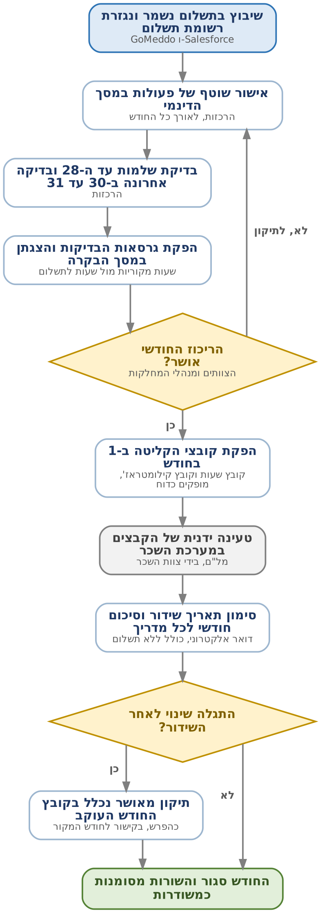
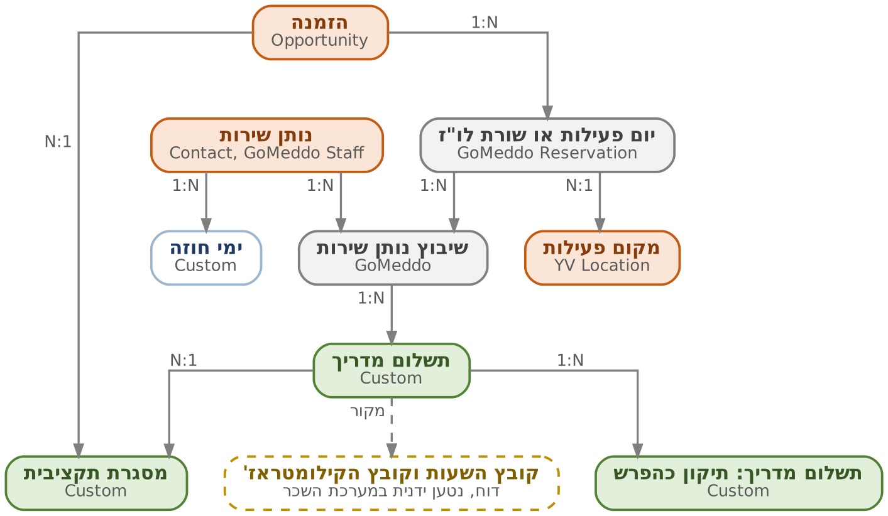

<!-- generated from: מסמך 3 אירועים וכספים - מאושר על ידי יד ושם - 2026-11-04.docx | 2026-11-08 | do not edit by hand; regenerate from the docx -->

> **מקור:** מסמך 3 - אירועים וכספים, גרסה מאושרת על ידי יד ושם, 4.11.2026  
> **מיקום בניווט:** מסמך 3 - אירועים וכספים › תהליכים עסקיים › תשלום מדריכים ונותני שירות וקובץ מלם  
> **קודי ולידציה ואוטומציה בפרק:** A24-01, A24-02, A24-04, A24-05, A24-06, A24-08, A24-09, A24-11, A24-12, V24-01, V24-02, V24-04, V24-05, V24-07, V24-08, V24-09, V24-11  
> **הקודם:** [ביטול, זיכוי והחזר ללקוחות מוסדיים](11-institutional-cancel-credit-refund.md) · **הבא:** [דוחות ודשבורדים](../06-reports-dashboards.md) · [מקרא](../../INDEX.md)

# תשלום מדריכים ונותני שירות וקובץ מלם

התהליך מרכז את התשלום לכ-400 נותני שירות בחודש, כ-2,300 פעולות בממוצע: מדריכים שכירים המשולמים דרך מערכת השכר מל"ם, ונותני שירות המשולמים כנגד חשבונית או דרישת תשלום, ובהם מקבלי שכר סופרים. הרכזות מפעילות את התהליך, מנהלי המחלקות מאשרים, והדיווח על עבודת המדריך מבוצע בידי יד ושם ולא בידי המדריך.

סכומי התשלום אינם מחושבים בסיילספורס. המערכת מנהלת את השיבוצים ואת נתוני הזכאות, את מסך העבודה של הרכזות, את האישור החודשי, את הסיכום החודשי לכל מדריך ואת הפקת קובץ השעות וקובץ הקילומטראז' וגרסאות הבדיקות שלהם. הקבצים מופקים כדוח, וצוות השכר טוען אותם ידנית למערכת השכר. כללי התשלום מובאים בנספח 12 בחומרי יד ושם (מידע על מדריכים, כספים והנחיות שיבוץ), ומבנה הקבצים בדוגמאות הקבצים שבנספחים 14 עד 17 בחומרי יד ושם; החומרים מצורפים למסמך.

מחזור השכר החודשי, כפי שנמסר בנספח 12 בחומרי יד ושם: עד ה-28 בחודש מוודאים שכל הפעולות משובצות ושסימוני התשלום והזכאות לנסיעות תקינים; ב-30 עד 31 בחודש מתבצעת בדיקה אחרונה; וב-1 בחודש מופקים הקבצים לשידור, ופעולה שלא הופיעה עד אז אינה משולמת באותו חודש (V24-09). שינוי, תוספת או ביטול לאחר השידור מוגשים בטופס בחתימת מנהל המחלקה ומטופלים בחודש העוקב כהפרש (A24-05, V24-04).

נותני שירות שאינם נקלטים במל"ם, המשולמים כנגד חשבונית או דרישת תשלום ובהם מקבלי שכר סופרים, אינם נכללים בקובץ השעות ובקובץ הקילומטראז'. הפלט החודשי עבורם הוא דוח התשלום למדריכים, הכולל איחוד (פרק 6.1), המיוצא לאקסל ונטען לאקסס, ללא ממשק. החישוב עבורם נשאר מחוץ לסיילספורס.

חישוב המרחק, ביטול הזמן, ימי החוזה וטופס הזמינות מפורטים במסמך 2 ואינם חוזרים כאן. פרק זה מוסיף את רשומת התשלום, את מחזור הבקרה והאישור, את התיקונים וההפרשים ואת המעבר של עובד יד ושם לשיבוץ בתשלום.

תשלום לנותן שירות בגין שיבוץ שבוטל מטופל במסך השיבוץ הרגיל, בסימון לתשלום. נותן שירות שהגיע ולא הדריך אך זכאי לתשלום לפי ההסכם הקיבוצי משובץ בשיבוץ מחוץ ללו"ז, בידי מורשים בלבד ועם הערה המפרטת את מהות השיבוץ, ונפתחת לו רשומת תשלום מדריך כבכל שיבוץ לתשלום (A24-01). בהכשרת מדריכים השיבוץ מחוץ ללו"ז נוצר אוטומטית עם סימון ההגעה והזכאות (A17B-10). חובת התשלום למדריכי ה-25 על הדרכה שבוטלה עד 24 שעות מראש מפורטת במסמך 2, פרק 12.13 (זמינות מדריכים וניהול נותני שירות).

תרשים תהליך 27: תשלום מדריכים וקובץ מלם

הטבלה שלהלן מציגה אילו ישויות נפתחות או מתעדכנות בכל שלב במחזור התשלום החודשי.

| השלב | הישות הנפתחת או המתעדכנת |
| --- | --- |
| שמירת שיבוץ לתשלום | נפתחת רשומת תשלום מדריך (Custom), הנגזרת משיבוץ נותן השירות (GoMeddo) ביום הפעילות או בשורת הלו"ז (GoMeddo Reservation); במדריך מל"ם נרשמת בה גם זכאות לזמן היערכות (A24-01, A24-09) |
| אישור שוטף במסך הדינמי | מתעדכן שיבוץ נותן השירות (GoMeddo): סימון לתשלום וסוג תשלום נסיעות, ובהתאם רשומת תשלום המדריך (Custom), לרבות החרגה משידור. שיבוץ מחודשים קודמים שטרם שודר מוצג ומצטרף לחודש הנוכחי (A24-05, V24-09) |
| סגירת חודש הדיווח | מתעדכנות רשומות תשלום מדריך (Custom) של מדריך מל"ם: זכאות למענק הדרכה (A24-08) |
| הפקת גרסאות הבדיקות | לא נפתחת ישות: דוחות הבדיקה של קובץ השעות וקובץ הקילומטראז' מופקים מרשומות תשלום מדריך (Custom) ומוצגים במסך הבקרה (A24-11) |
| אישור חודשי | מתעדכן סטטוס האישור החודשי ברשומות תשלום מדריך (Custom) של החודש, בשני שלבים במחלקת מורים מישראל, ובשלב אחד ביתר המחלקות (A24-12) |
| הפקת קובצי הקליטה | לא נפתחת ישות: הקבצים מופקים כדוח. ברשומות תשלום מדריך (Custom) נרשמים תאריך השידור והסטטוס שודר, ובהמשך שולם (A24-04) |
| תיקון לאחר שידור | נפתחת רשומת תשלום מדריך (Custom) נוספת לתיקון, המקושרת לשיבוץ ולחודש המקור, ונכללת בקובץ העוקב כהפרש (A24-05, V24-04) |
| סיכום חודשי למדריך | לא נפתחת ישות: נשלח מייל לנותן השירות (Contact), והמשלוח מתועד בכרטיסו (A24-06) |

תרשים ישויות של תשלום מדריכים ונותני שירות: נותן השירות וימי החוזה, השיבוץ, רשומת התשלום ותיקוניה, המסגרת התקציבית וקובצי הקליטה

## אוטומציות

| מזהה | טריגר | הפעולה האוטומטית |
| --- | --- | --- |
| A24-01 | שמירת שיבוץ המסומן לתשלום | נפתחת רשומת תשלום מדריך (Custom), הנגזרת משיבוץ נותן השירות (GoMeddo). הרשומה מקושרת לנותן השירות (Contact), להזמנה (Opportunity) או לאירוע (Event__c), ליום הפעילות או לשורת הלו"ז (GoMeddo Reservation) ולמקום הפעילות (YV Location). נשמרים בה השעות המקוריות לצד השעות לתשלום, סוג תשלום הנסיעות (ללא, צד אחד, מלא) והקילומטראז'. קוד השכר וסמל התלוש נגזרים מסוג הפעילות ומצורת ההעסקה, והסעיף התקציבי מהמסגרת התקציבית (Custom). בעיר הבה"דים השעות לתשלום נמנות מתחילת הפעילות הראשונה ועד סיום האחרונה. פעולה וירטואלית נוצרת ללא נסיעות, עם אפשרות שינוי. סכומים אינם מחושבים. |
| A24-02 | שיבוץ הדרכת חוץ | חישוב המרחק, ביטול הזמן וחסימת השיבוץ החופף מפורטים במסמך 2. תוספת כאן: משתמש מורשה רשאי לשנות ידנית את שעות ביטול הזמן בשיבוץ כדי לאפשר שני שיבוצים סמוכים. השינוי מותנה בהרשאה ומתועד. |
| A24-09 | שמירת שיבוץ הדרכה של מדריך מל"ם | המערכת מסמנת ברשומת תשלום המדריך (Custom) זכאות לזמן היערכות, כאשר ההדרכה מתקיימת ביד ושם, בבית וולין, אצל המזמין או בעיר הבה"דים, ואינה וירטואלית. כאשר למדריך שתי הדרכות באותו יום נבדק המרווח ביניהן: מרווח קצר משעתיים מזכה בזמן היערכות אחד, ומרווח גדול משעתיים מזכה בשניים. מדריכי ה-25, מדריכי כספים ושעות השתלמות אינם מזכים. הסימון הוא נתון זכאות בלבד; התוספת, 25 אחוז מערך השעה הבסיסי, מחושבת במערכת השכר. הכללים בנספח 12 בחומרי יד ושם. |
| A24-08 | סגירת חודש הדיווח למדריך מל"ם | סיכום שעות ההדרכה של מדריך מל"ם בחודש. מדריך שביצע לפחות שש שעות הדרכה בחודש מסומן ברשומות תשלום המדריך (Custom) של החודש כזכאי למענק הדרכה. המענק מגדיל את הערך השעתי שלו להדרכה בחמישה שקלים לשעה. מדריכי ה-25, מדריכים גמלאים ומדריכי כספים אינם זכאים, ושעות השתלמות אינן נספרות. הסכום מחושב במערכת השכר. הכלל בנספח 12 בחומרי יד ושם. |
| A24-11 | הפקת הקבצים לקראת האישור החודשי | הפקת גרסאות הבדיקות של קובץ השעות וקובץ הקילומטראז' מרשומות תשלום מדריך (Custom) של החודש, והצגתן במסך הבקרה: כל הנתונים הנקלטים במל"ם, ולצדם נתוני עזר מנותן השירות (Contact), מההזמנה (Opportunity), משיבוץ נותן השירות (GoMeddo) וממקום הפעילות (YV Location): שעות מקוריות מול שעות לתשלום, שם המדריך, שם הפעילות, מספרי הזמנה ושיבוץ, תיאור הקוד וסיווג המרחק. |
| A24-12 | אישור הצוותים ומנהלי המחלקות (זהות המאשרים בכל שלב לאישור יד ושם) | ⟦💬 c153⟧במחלקת מורים מישראל, המחלקה היחידה שבה פועלים רכזים אזוריים, השלב הראשון הוא אישור הרכז האזורי (A19-06), והשני אישור הצוותים ומנהלי המחלקות; ביתר המחלקות האישור הוא של הצוותים ומנהלי המחלקות בלבד. בסיומו מסומן הריכוז החודשי כמאושר לשידור, ונפתחת האפשרות להפקת קובצי הקליטה. |
| A24-04 | הפעלת הפקת קובצי הקליטה בידי הצוות, לאחר האישור החודשי | הפקת קובץ השעות וקובץ הקילומטראז' במבנה שבדוגמאות הקבצים בנספחים 14 עד 17 בחומרי יד ושם, לפי מועד ביצוע הפעילות, כולל ימי חוזה מזכים ותיקונים מאושרים, ובלי פעולות ללא תשלום ושורות מוחרגות; ימי מחלה, חופשה ומילואים מדווחים בתאריך בלבד. תאריך השידור נרשם בכל שורה, והסטטוס מתעדכן ל"שודר", ולאחר הקליטה במערכת השכר צוות השכר מעדכן אותו ל"שולם". |
| A24-05 | אישור תיקון לשורה שכבר שודרה, או איתור שיבוץ מחודשים קודמים שטרם שודר | תיקון לשורה ששודרה נרשם כרשומה המקושרת לשיבוץ ולחודש המקור ונכלל בקובץ העוקב כהפרש. שיבוץ מחודשים קודמים שטרם שודר מוצג במסך הדינמי ומצטרף לקובץ החודש הנוכחי. בהחלפת מדריך מטופלות שתי הפעולות בנפרד. |
| A24-06 | השלמת השידור החודשי | משלוח סיכום חודשי בדואר אלקטרוני לכל מדריך, שכיר או נותן שירות: תאריכים, קבוצות, שעות, מקום הפעילות, תחבורה ציבורית וקילומטראז', לרבות פעולות ללא תשלום, וללא נתונים כספיים. המדריך אינו נדרש לאשר או לדווח. המשלוח מתועד בכרטיסו. |

## כללי ולידציה

| מזהה | הכלל | הודעת שגיאה |
| --- | --- | --- |
| V24-01 | שורה שסומנה כמשודרת או ששולמה אינה נכללת שוב בקובץ החודשי; תיקון בגינה מטופל כהפרש בלבד | השורה כבר שודרה לתשלום, יש להגיש תיקון כהפרש |
| V24-02 | שיבוץ עובד יד ושם או רכז נוצר ללא תשלום וללא תשלום נסיעות, בכל סוגי האירועים. מעבר לשיבוץ בתשלום מחייב מוצר בתשלום, סימון מפורש ואישור מנהל | תשלום לעובד מחייב מוצר בתשלום ואישור מנהל |
| V24-04 | תיקון או תוספת לשורה ששודרה נכנסים לקובץ רק לאחר השלמת ההגשה והאישור | התיקון טרם אושר |
| V24-05 | קובצי הקליטה מופקים רק לאחר השלמת האישור החודשי של הצוותים ושל מנהלי המחלקות | טרם הושלם תהליך האישור החודשי |
| V24-07 | השלמת השעות להיקף יום החוזה חלה רק על שיבוץ שסומן ידנית כיום חוזה. הסימון אפשרי רק כשקיים לנותן השירות יום חוזה בתוקף באותו תאריך; המערכת מציגה חיווי ואינה מסמנת אוטומטית | לא קיים לנותן השירות יום חוזה בתוקף בתאריך זה |
| V24-08 | שורה המסומנת בהחרגה משידור אינה נכללת בקובץ השעות ובקובץ הקילומטראז', ונשמרת ברשומת התשלום לצורך מעקב | אין |
| V24-09 | פעולה שלא הופיעה במערכת עד הבדיקה האחרונה בסוף החודש אינה משולמת באותו חודש; היא מוצגת במסך הדינמי כשיבוץ מחודשים קודמים שטרם שודר ומצטרפת לקובץ החודש העוקב (A24-05) | החודש נסגר לשידור, הפעולה תצורף לקובץ החודש העוקב |
| V24-11 | שורה בקובץ השעות אינה מופקת ללא קוד שכר, סמל לתלוש וסעיף תקציבי, ושורה בקובץ הקילומטראז' אינה מופקת ללא סעיף תקציבי | חסרים קוד שכר, סמל לתלוש או סעיף תקציבי בשורת התשלום |

## ישויות ושדות ייחודיים לתהליך

| ישות | תפקיד בתהליך | שדות ייעודיים לתהליך |
| --- | --- | --- |
| שיבוץ נותן שירות (GoMeddo) | מקור הנתונים לתשלום | סימון לתשלום, סוג תשלום נסיעות (ללא, צד אחד, מלא), שעות מקוריות ושעות לתשלום, שעות ביטול זמן (שינוי ידני בהרשאה), סימון יום חוזה, סוג שיבוץ (מחלה, חופשה, מילואים) |
| תשלום מדריך (Custom) | רשומת התשלום הנגזרת מהשיבוץ, נפרדת מחיוב הלקוחות | קוד שכר, סמל לתלוש, סעיף תקציבי, סימון הסכם קיבוצי, זכאות מענק הדרכה, זכאות זמן היערכות, החרגה משידור, קישור לתיקון ולחודש המקור, תאריך שידור, סטטוס אישור חודשי, סטטוס שידור (שודר, שולם) |
| ימי חוזה (Custom) | ימי החוזה של נותן השירות, שלפיהם מסומן שיבוץ כיום חוזה (V24-07) | שדה חדש בתהליך זה: כולל נסיעות (כן או לא) לכל יום חוזה. יתר השדות במסמך 1, פרק 4.5 |
| דוח בקרת השעות: גרסת הבדיקות של קובץ השעות | דוח, ולא ישות: מוצג במסך הבקרה החודשי לאישור יד ושם, ומופק מרשומות תשלום מדריך (Custom). פירוט הדוח בפרק 6 | נקלטים במל"ם: משרד, מספר עובד, מ.נ, אירוע, תאריך, תג, כניסה, יציאה, קוד שכר, סעיף תקציבי. נתוני עזר: שם המדריך, כניסה ויציאה מקוריות, שם הפעילות, מספר הזמנה, תיאור הקוד, קילומטראז', הערת סיווג |
| דוח בקרת הקילומטראז': גרסת הבדיקות של קובץ הקילומטראז' | דוח, ולא ישות: מוצג במסך הבקרה החודשי לאישור יד ושם, ומופק מרשומות תשלום מדריך (Custom). פירוט הדוח בפרק 6 | נקלטים במל"ם: אירוע, משרד, זהות, מ.נ, שם העובד, סמל, טווח תאריכים, כמות, סעיף תקציבי. נתוני עזר: הערה, מספר הזמנה, מיקום וכתובת הפעילות, עיר המגורים, תאריך ושעת הפעילות, קטגוריית המרחק |

---

## הערות סקירה בפרק זה

> הערות הסקירה אינן חלק מהאפיון המחייב. הן מסמנות מקומות שבהם הטקסט עדיין בדיון. הסימון ⟦💬 cN⟧ בגוף הטקסט מפנה להערה כאן.

### ⟦💬 c153⟧ סגורה
- **c153** · טל שמרית [2] · 2026-10-22 · סומנה כסגורה: רק למחלקת מורים מישראל יש רכזים אזוריים.
  - **c154** · Lior Pridor · 2026-10-26 · סומנה כסגורה: בוצע.
