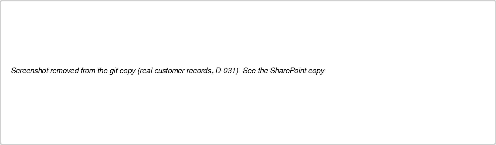
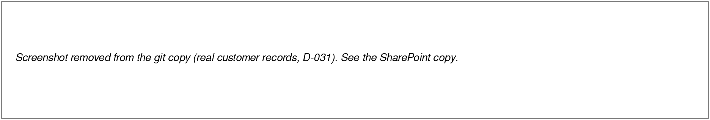

<!-- generated from: מסמך 3 אירועים וכספים - מאושר על ידי יד ושם - 2026-11-04.docx | 2026-11-08 | do not edit by hand; regenerate from the docx -->

> **מקור:** מסמך 3 - אירועים וכספים, גרסה מאושרת על ידי יד ושם, 4.11.2026  
> **מיקום בניווט:** מסמך 3 - אירועים וכספים › נספח דוגמאות מסכי החשבונות במערכת הקיימת  
> **הקודם:** [נספחי חומרי יד ושם](12-appendix-yv-materials.md) · **הבא:** [נספח מקרא ישויות](14-appendix-entity-legend.md) · [מקרא](../INDEX.md)

# נספח דוגמאות מסכי החשבונות במערכת הקיימת

⟦💬 c231⟧הנספח מביא שלושה צילומי מסך של מסכי החשבונות במערכת הקיימת, כפי שהועברו על ידי צוות יד ושם. הם מובאים כהמחשה למסכים המתוארים בפרק 4.3, ואינם מחייבים את עיצוב המסכים במערכת החדשה.

צילום מסך 1: מסך כלל החשבונות

צילום מסך 2: מסך הכנת חשבונות

צילום מסך 3: מסך חשבונות אוטומטיים שנכשלו

---

## הערות סקירה בפרק זה

> הערות הסקירה אינן חלק מהאפיון המחייב. הן מסמנות מקומות שבהם הטקסט עדיין בדיון. הסימון ⟦💬 cN⟧ בגוף הטקסט מפנה להערה כאן.

### ⟦💬 c231⟧ נענתה על ידי מלם
- **c231** · טל שמרית [2] · 2026-10-22: ישנה תצוגה רביעית שבסיכומי הפגישות שמתי צילום מסך " מסך הזמנות ללא מוסד שלא שולמו" / מסך הזמנות ללא מוסד שלא שולמו- מסך זה צריך להכיל את כל ההזמנות שאין להם מוסד מזמין , ז"א אנשים פרטיים ביצעו את ההזמנה, ושהם לא בסטטוס תשלום "שולם" או "אין צורך בתשלום". / למסך זה אין להביא את ההזמנות שנוצרו בקיוסק. / מסך זה צריך להיות דינמי, שתהיה אפשרות לשנות להזמנה את סטטוס התשלום לסטטוס תשלום הנכון, וכן אפשרות לשלוח ממסך זה תשכורת לשלם על ההזמנה, ז"א לשלוח למזמין לינק לתשלום באשראי. (למקרים בהם מסיבה כלשהי המערכת לא חייבה אותו או שהייתה שגיאה בזמן החיוב). / כמון כן, ישנה תצוגה נוספת שהראתי לכם אבל שכחתי כנראה להוסיף ביכום הפגישה שהתקיימה בנושא. / מסך "הזמנות- תצוגת כספים" / מסך זה ניתן לבחור את גם אחת מבין התצוגות הבאות:
  - **c232** · Lior Pridor · 2026-10-26: מסך הזמנות ללא מוסד שלא שולמו יוגדר כתצוגה תפעולית של הזמנות, כפי שנקבע במסמך 2 (תצוגות תפעוליות, ובהן הזמנות שטרם שולמו): הזמנות ללא מוסד מזמין שטרם שולמו, למעט הזמנות שנוצרו בעמדת הקיוסק (A20-11). מהתצוגה ניתן לעדכן את סטטוס התשלום של ההזמנה ולשלוח למזמין קישור לתשלום באשראי (פרק 4.3). נשמח לקבל במהלך החודש הראשון של היישום את צילומי המסך ואת רשימת התצוגות של מסך הזמנות בתצוגת כספים, ונשיב על תכולתן.
  - **c233** · אשבל אור · 2026-11-03: מבקשים שתצוגה זו תופיע גם באזור הכספי יחד עם שלושת התצוגות הקשורות לכספים כברירת מחדל.
  - **c234** · Lior Pridor · 2026-11-04: בוצע: התצוגה מוצגת גם באזור הכספי, יחד עם שלוש תצוגות החשבונות, כברירת מחדל (פרק 4.3).
