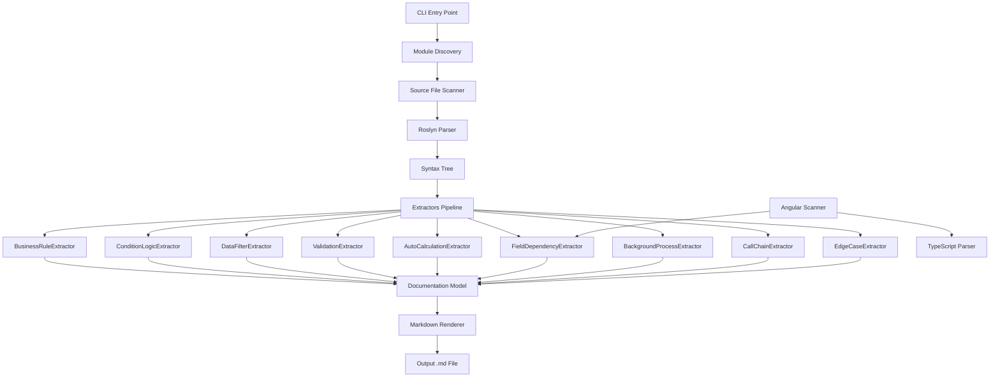

# מסמך עיצוב: מחולל תיעוד לוגיקה עסקית

## סקירה כללית

מחולל תיעוד הלוגיקה העסקית הוא כלי קונסול .NET עצמאי שמבצע ניתוח סטטי של קוד המקור של YVReservationsAPI ומייצר מסמך Markdown מקיף המתאר את כל הלוגיקה העסקית. הכלי פועל ישירות על קבצי המקור (ללא צורך בהרצת האפליקציה), מפרסר עצי תחביר C# כדי לזהות ולחלץ כללים עסקיים, לוגיקת תנאים, סינוני נתונים, וולידציות, חישובים אוטומטיים, תלויות בין שדות, תהליכי רקע, שרשראות קריאות API, ומקרי קצה.

המחולל מכוון לארכיטקטורה תלת-שכבתית של המערכת:
- **Controllers** (`YVReservationsAPI/Controllers/`) — נקודות קצה של API וניתוב
- **Services** (`Services/Services/`) — לוגיקה עסקית ותזמור
- **Repositories** (`Data/Repositories/`) — גישה לנתונים ואינטגרציה עם CRM

בנוסף, הכלי סורק את הפרונטאנד Angular (`ReservationsApp/src/app/`) עבור תלויות שדות ולוגיקת וולידציה בצד הלקוח.

### החלטות עיצוב מרכזיות

1. **ניתוח סטטי באמצעות Roslyn** — שימוש בפלטפורמת הקומפיילר של .NET (Roslyn) לפרסור קבצי מקור C# לעצי תחביר ומודלים סמנטיים. מספק הבנה מדויקת של הקוד ללא צורך בהרצת האפליקציה.
2. **ארגון לפי מודולים** — הסורק מזהה מודולים על ידי קורלציה בין שמות Controller, Service ו-Repository (למשל: `ReservationsController` → `ReservationService` → `ReservationsRepository` = מודול "Reservations").
3. **TypeScript AST עבור Angular** — שימוש בפרסר TypeScript (באמצעות regex) לחילוץ תלויות שדות מרכיבי Angular.
4. **חילוץ מבוסס כללים** — לכל קטגוריית תיעוד (כללים עסקיים, תנאים, סינונים וכו') יש חולץ ייעודי שעובר על עץ התחביר ומחפש דפוסים ספציפיים.
5. **מודעות ל-FetchXML** — המערכת משתמשת בהרחבה ב-FetchXML לשאילתות CRM. הכלי מזהה באופן ספציפי דפוסי בניית FetchXML לתיעוד סינוני נתונים.

## ארכיטקטורה



### זרימת הביצוע

1. **גילוי מודולים** — סורק את תיקיית Controllers כדי לזהות את כל המודולים. ממפה כל Controller לקבצי Service ו-Repository המתאימים לפי מוסכמת שמות.
2. **פרסור מקור** — טוען כל קובץ מקור ומייצר `SyntaxTree` + `SemanticModel` של Roslyn.
3. **חילוץ** — מריץ כל חולץ על העצים המפורסרים. החולצים מייצרים פריטי תיעוד מטיפוסים שונים.
4. **רזולוציית הפניות צולבות** — מקשר שרשראות קריאות, מזהה תלויות בין-מודולריות, ופותר מיפויי שדות דרך `MapFunctionRepository`.
5. **רינדור** — מרכיב את כל פריטי התיעוד לקובץ Markdown פלט בהתאם להיררכיית הכותרות והפורמט שנקבעו.

## רכיבים וממשקים

### 1. נקודת כניסה CLI (`DocumentationGenerator.Program`)

```csharp
public class Program
{
    static async Task Main(string[] args)
    // args: --backend <path> --frontend <path> --output <path> [--modules <comma-separated>]
}
```

אחריות:
- פרסור ארגומנטי CLI (נתיב backend, נתיב frontend, נתיב פלט, סינון מודולים אופציונלי)
- תזמור צינור העיבוד
- דיווח התקדמות לקונסול

### 2. גילוי מודולים (`ModuleDiscovery`)

```csharp
public interface IModuleDiscovery
{
    List<ModuleDefinition> DiscoverModules(string backendPath);
}

public class ModuleDefinition
{
    public string Name { get; set; }
    public string ControllerPath { get; set; }
    public string ServicePath { get; set; }
    public List<string> RepositoryPaths { get; set; }
    public string AngularModulePath { get; set; }
}
```

לוגיקה:
- סורק תיקיית `Controllers/` לקבצי `*Controller.cs`
- לכל controller, מוצא את ה-`*Service.cs` המתאים ב-`Services/Services/`
- מוצא קבצי `*Repository.cs` מתאימים ב-`Data/Repositories/`
- ממפה לתיקיות מודול Angular ב-`src/app/` לפי מוסכמת שמות
- 12 המודולים הנדרשים מזוהים: Reservations, EventRegistration, EventReservation, ServiceProvider, Contact, Commemoration, ActivityDay, FrontDesk, ItineraryItem, ScheduleDate, Reports, Login

### 3. פרסר מקור (`RoslynSourceParser`)

```csharp
public interface ISourceParser
{
    ParsedSource Parse(string filePath);
    SemanticModel GetSemanticModel(string filePath);
}

public class ParsedSource
{
    public string FilePath { get; set; }
    public SyntaxTree SyntaxTree { get; set; }
    public SemanticModel SemanticModel { get; set; }
    public List<ClassDeclarationSyntax> Classes { get; set; }
    public List<MethodDeclarationSyntax> PublicMethods { get; set; }
}
```

### 4. חולצים (אחד לכל קטגוריית תיעוד)

כל חולץ מממש ממשק משותף:

```csharp
public interface IExtractor<TOutput> where TOutput : DocumentationItem
{
    List<TOutput> Extract(ParsedSource source, ModuleDefinition module);
}
```

#### 4.1 BusinessRuleExtractor — חולץ כללים עסקיים

מזהה כללים עסקיים על ידי חיפוש:
- ענפי תנאים במתודות service שאוכפים אילוצי domain
- guard clauses ודפוסי וולידציה
- לוגיקת מעבר מצבים (שינויי סטטוס, פעולות Cancel)
- דפוסי override גנריים של `Cancel()`, `Create()`, `Update()` בשירותים

שדות פלט: תיאור (≤300 תווים), סיבה עסקית, תנאי הפעלה, תנאי אי-הפעלה, סדר ביצוע.

#### 4.2 ConditionLogicExtractor — חולץ לוגיקת תנאים

עובר על עצי תחביר עבור:
- `IfStatementSyntax` — מתעד נתיבי true/false
- `SwitchStatementSyntax` — מתעד כל case
- `ConditionalExpressionSyntax` (ternary)
- `CoalesceExpressionSyntax` (null-coalescing)
- תנאים מקוננים מתועדים בצורה היררכית

#### 4.3 DataFilterExtractor — חולץ סינוני נתונים

מזהה:
- קריאות LINQ `.Where()` עם lambda predicates
- בניית סינוני FetchXML (`FilterFetchXML`, `FilterActiveFetchXml`, `FilterNotCancelledFetchXml`)
- דפוסי `GetLinkedEntity` ו-`LinkedFetchXml`
- מעקב פרמטרים מ-Controller → Service → Repository

#### 4.4 ValidationExtractor — חולץ וולידציות

מחפש:
- בדיקות `string.IsNullOrEmpty` אחריהן זריקת חריגות
- אטריביוטים של model validation (`[Required]`, `[StringLength]` וכו')
- guard clauses ידניים לפני פעולות שמירה
- הדפוס `throw new Exception(...)` ככישלון וולידציה

#### 4.5 AutoCalculationExtractor — חולץ חישובים אוטומטיים

מזהה:
- הוראות השמה שבהן הצד הימני מפנה לשדות מרובים
- מתודות כמו `updateReservationPaymentStatus` שמחשבות וקובעות ערכים
- שדות שנקבעים בתוך מתודות service שאינם העברה ישירה מקלט

#### 4.6 FieldDependencyExtractor — חולץ תלויות שדות

מזהה:
- צד שרת: כאשר שינוי שדה מפעיל עדכונים לשדות אחרים באותה מתודה
- צד לקוח (Angular): `(change)` event handlers, `ngOnChanges`, מנויי `valueChanges` של reactive forms

#### 4.7 BackgroundProcessExtractor — חולץ תהליכי רקע

מזהה:
- דפוסי `async`/`await` לפעולות fire-and-forget
- שליחת אימייל (`sendMail`, `SendConfirmationMail`, `sendReminderEmail`)
- יצירת/עדכון ישויות CRM כתופעות לוואי של פעולות משתמש
- פעולות שיוצרות ישויות במערכות חיצוניות (`CreatePaymentObjectInCrm`)

#### 4.8 CallChainExtractor — חולץ שרשראות קריאות

עוקב:
- מכל מתודה ציבורית ב-Controller → קריאות מתודות Service → קריאות Repository
- קריאות service-to-service (למשל `ReservationService` קורא ל-`ItineraryGroupService`)
- פעולות CRM דרך `CRMConnection` (Create, Update, Retrieve, Delete)

#### 4.9 EdgeCaseExtractor — חולץ מקרי קצה

מוצא:
- בלוקי `try/catch` — במיוחד `catch(Exception)` גנרי
- בדיקות null (`if (x == null)`)
- בדיקות אוספים ריקים (`if (list.Count == 0)`)
- תנאי גבול (ערכי אפס, השוואות מקסימום)

### 5. מודל תיעוד (Documentation Model)

```csharp
public abstract class DocumentationItem
{
    public string ModuleName { get; set; }
    public string ClassName { get; set; }
    public string MethodName { get; set; }
    public string Description { get; set; }
}

public class BusinessRuleItem : DocumentationItem
{
    public string BusinessReason { get; set; }
    public string TriggerCondition { get; set; }
    public string NonTriggerCondition { get; set; }
    public int ExecutionOrder { get; set; }
}

public class ConditionLogicItem : DocumentationItem
{
    public string ConditionExpression { get; set; }
    public string TruePath { get; set; }
    public string FalsePath { get; set; }
    public List<ConditionLogicItem> NestedConditions { get; set; }
    public string ExternalSource { get; set; }
    public bool IsUnclear { get; set; }
}

public class DataFilterItem : DocumentationItem
{
    public string DataSource { get; set; }
    public List<string> FilterFields { get; set; }
    public string FilterOperator { get; set; }
    public string CombinationLogic { get; set; } // AND/OR
    public string ParameterOrigin { get; set; }
    public bool IsImplicit { get; set; }
    public string DefaultValue { get; set; }
    public bool IsRequired { get; set; }
}

public class ValidationItem : DocumentationItem
{
    public string ValidatedField { get; set; }
    public string ValidationLogic { get; set; }
    public string ErrorResponse { get; set; }
    public string BypassCondition { get; set; }
    public string ProtectedAction { get; set; } // Create, Update, Delete, Custom
    public int ExecutionOrder { get; set; }
}

public class AutoCalculationItem : DocumentationItem
{
    public string Formula { get; set; }
    public List<string> InputFields { get; set; }
    public string OutputField { get; set; }
    public bool IsReadOnly { get; set; }
    public string TriggerTiming { get; set; }
    public string ExternalDependency { get; set; }
    public string NullBehavior { get; set; }
}

public class FieldDependencyItem : DocumentationItem
{
    public string SourceField { get; set; }
    public string SourceEntity { get; set; }
    public string TargetField { get; set; }
    public string TargetEntity { get; set; }
    public string DependencyType { get; set; } // recalculation, visibility, reset, filter, enabled/disabled
    public string TriggerMechanism { get; set; }
    public bool IsClientSide { get; set; }
}

public class BackgroundProcessItem : DocumentationItem
{
    public string TriggeringAction { get; set; }
    public string ProcessDescription { get; set; }
    public List<string> ServicesInvoked { get; set; }
    public List<EntityOperation> DataModifications { get; set; }
    public string ExecutionTiming { get; set; } // sync, async-immediate, async-deferred
    public string IntegrationPoint { get; set; }
    public List<FailureScenario> FailureScenarios { get; set; }
}

public class CallChainItem : DocumentationItem
{
    public List<CallStep> Steps { get; set; }
    public List<string> ReadEntities { get; set; }
    public List<string> WriteEntities { get; set; }
    public List<ConditionalBranch> ConditionalPaths { get; set; }
}

public class EdgeCaseItem : DocumentationItem
{
    public string TriggeringCondition { get; set; }
    public string SystemBehavior { get; set; }
    public bool IsIntentional { get; set; }
    public string Category { get; set; } // null/missing, boundary, concurrent, external-unavailable, permission
    public bool RequiresClarification { get; set; }
}
```

### 6. מרנדר Markdown (`MarkdownRenderer`)

```csharp
public interface IMarkdownRenderer
{
    string Render(DocumentationModel model);
}
```

אחריות:
- יצירת תוכן עניינים עם קישורי עוגן
- יישום היררכיית כותרות תלת-רמתית (מודול → תהליך → פריט)
- עיצוב פריטים עם שדות סטנדרטיים: תיאור, טריגר, תנאי, לוגיקה, שירותים קשורים, טבלאות קשורות, הערות
- רינדור טבלאות תלויות שדות
- הפקת סעיף הפניות צולבות לתלויות בין-מודולריות
- סידור אלפביתי של תהליכים בתוך מודולים
- סימון לוגיקה לא ברורה עם מחווני "unclear from code"

### 7. סורק Angular (`AngularScanner`)

```csharp
public interface IAngularScanner
{
    List<FieldDependencyItem> ExtractFieldDependencies(string angularModulePath);
}
```

אפשרויות מימוש:
- אפשרות א: הפעלת `ts-morph` דרך תהליך Node.js
- אפשרות ב: התאמת דפוסים מבוססת regex לדפוסי Angular נפוצים (`(change)=`, `valueChanges.subscribe`, `ngOnChanges`)
- **נבחר: אפשרות ב** — פשוט יותר, מספיק לזיהוי תלויות שדות בהתחשב בדפוסי Angular הידועים

## מודלי נתונים

### נתוני קלט (מבני קוד מקור שמזוהים)

| דפוס | היכן נמצא | שיטת חילוץ |
|---------|-------------|-------------------|
| Generic Service `BasicService<TItem, TList, TCrm>` | Services/ | ניתוח היררכיית מחלקות Roslyn |
| מיפוי שדות CRM `MapFunctionRepository.GetDestinationPropertyFor` | Services/ | מעקב קריאות מתודות |
| בניית FetchXML | Repositories/ | ניתוח מחרוזות ליטרליות + דפוסי מתודות |
| פעולות Entity (Create, Update, Delete) | Repositories/ via `CRMConnection` | מעקב קריאות מתודות |
| אטריביוטי Route בcontroller `[Route("...")]` | Controllers/ | חילוץ תחביר אטריביוטים |
| Angular event bindings `(change)="..."` | ReservationsApp/ | דפוסי regex בתבניות |

### נתוני פלט (מבנה תיעוד שנוצר)

```
output.md
├── תוכן עניינים
├── מודול: ActivityDay
│   ├── תהליך: CreateActivityDay
│   │   ├── כללים עסקיים
│   │   ├── לוגיקת תנאים
│   │   ├── וולידציות
│   │   └── שרשרת קריאות
│   └── תהליך: UpdateActivityDay
│       └── ...
├── מודול: Commemoration
│   └── ...
├── מודול: Contact
│   └── ...
├── ... (12 מודולים בסך הכל)
└── סעיף הפניות צולבות
    └── טבלת תלויות בין-מודולריות
```

### מיפוי ישויות CRM

המערכת משתמשת בדפוס מיפוי model-to-CRM:
- `Data/Modals/` מכיל מודלים ברמת האפליקציה (למשל `ReservationItem`, `ActivityDay`)
- `Data/Modals/CRMModals/` מכיל מודלים ברמת CRM (למשל `ReservationCRM`, `ActivityDayCRM`)
- `MapFunctionRepository` מספק תרגום שמות מאפיינים בין השכבות
- מחלקת הבסיס `BasicRepository` מטפלת בהמרת entity ↔ model דרך מתודות אבסטרקטיות `SetItemToEntity` ו-`SetEntityToItem`

## טיפול בשגיאות

### שגיאות סורק

| תרחיש שגיאה | אסטרטגיית טיפול |
|---|---|
| קובץ מקור לא ניתן לפרסור (שגיאות תחביר) | רישום אזהרה, דילוג על הקובץ, סימון מקטע המודול כ"נסרק חלקית" |
| קובץ לא נמצא (service/repo צפוי חסר) | רישום אזהרה, המשך עם קבצים זמינים |
| תלויות שירות מעגליות במעקב שרשרת קריאות | זיהוי מעגלים, ניתוק בנקודת המעגל, תיעוד כ"הפניה מעגלית" |
| נתיב מודול Angular לא נמצא | דילוג על ניתוח frontend למודול זה, ציון בפלט |
| מחרוזת FetchXML מורכבת מדי לניתוח סטטי | תיעוד כ"שאילתה דינמית מורכבת — דורש ניתוח runtime" |

### אמצעי הגנה על איכות הפלט

- אם כוונת תנאי לא ברורה → סימון עם "unclear from code" לפי דרישה 11.2
- אם לא נמצאו כללים עסקיים במודול → הכללת ציון מפורש "לא זוהו כללים עסקיים" לפי דרישה 1.5
- אם כלל סותר כלל אחר → תיעוד שניהם, הוספת הערה "מומלץ סקירה אנושית" לפי דרישה 11.3
- כל הפריטים המתועדים כוללים שם מחלקה + שם מתודה לעקיבות לפי דרישה 11.4

## מאפייני נכונות (Correctness Properties)

*מאפיין הוא תכונה או התנהגות שצריכה להתקיים בכל הרצות תקינות של מערכת — למעשה, הצהרה פורמלית על מה שהמערכת צריכה לעשות. מאפיינים משמשים כגשר בין מפרטים הניתנים לקריאה אנושית לבין ערבויות נכונות הניתנות לאימות מכני.*

### מאפיין 1: שלמות מבנית של BusinessRuleItem

*לכל* BusinessRuleItem שמיוצר על ידי המחולל, הפריט חייב לכלול תיאור לא ריק של עד 300 תווים, businessReason לא ריק, triggerCondition לא ריק, nonTriggerCondition לא ריק, className לא ריק, ו-methodName לא ריק.

**מאמת: דרישות 1.2, 11.4**

### מאפיין 2: תקינות רצף סדר ביצוע

*לכל* קבוצת פריטי תיעוד (BusinessRuleItems או ValidationItems) החולקים את אותם className ו-methodName, ערכי executionOrder שלהם חייבים ליצור רצף רציף המתחיל מ-1 ללא פערים או כפילויות.

**מאמת: דרישות 1.3, 4.4**

### מאפיין 3: ארגון שכבות מודול

*לכל* מקטע מודול בפלט המרונדר שמכיל פריטים מתועדים, המקטע חייב לכלול בדיוק שלושה תת-מקטעי שכבה (Controllers, Services, Repositories) המוצגים בסדר זה.

**מאמת: דרישות 1.4**

### מאפיין 4: שלמות ConditionLogicItem דו-נתיבי

*לכל* ConditionLogicItem המייצג ענף if/else, הפריט חייב לכלול conditionExpression לא ריק, תוצאת truePath לא ריקה, ותוצאת falsePath לא ריקה.

**מאמת: דרישות 2.2**

### מאפיין 5: שלמות תנאי רב-נתיבי

*לכל* ConditionLogicItem המייצג switch או שרשרת else-if עם N נתיבים, הפריט חייב לתעד בדיוק N תוצאות case בתוספת התנהגות default/fallback (או ציון מפורש שאין default).

**מאמת: דרישות 2.3**

### מאפיין 6: סדר היררכי של תנאים מקוננים

*לכל* ConditionLogicItem עם תנאים מקוננים, התנאי ההורה חייב להופיע לפני כל ילדיו המקוננים בפלט המרונדר, בשמירה על סדר מהחיצוני לפנימי.

**מאמת: דרישות 2.4**

### מאפיין 7: שלמות מבנית של DataFilterItem

*לכל* DataFilterItem שמיוצר על ידי המחולל, הפריט חייב לכלול dataSource לא ריק, לפחות filterField אחד, filterOperator לא ריק, ושדות IsRequired ו-DefaultValue מתועדים (כאשר DefaultValue יכול להיות "N/A" אם לא ישים).

**מאמת: דרישות 3.2, 3.4**

### מאפיין 8: שלמות מבנית של ValidationItem

*לכל* ValidationItem שמיוצר על ידי המחולל, הפריט חייב לכלול validatedField לא ריק, validationLogic לא ריק, errorResponse לא ריק, וערך protectedAction לא ריק מתוך הקבוצה {Create, Update, Delete, Custom}.

**מאמת: דרישות 4.2**

### מאפיין 9: שלמות מבנית של AutoCalculationItem

*לכל* AutoCalculationItem שמיוצר על ידי המחולל, הפריט חייב לכלול formula לא ריק, לפחות inputField אחד, outputField לא ריק, triggerTiming לא ריק, דגל isReadOnly מתועד, ותיאור nullBehavior לא ריק.

**מאמת: דרישות 5.2, 5.5**

### מאפיין 10: דרישת פירוט שלב-אחר-שלב לחישוב מורכב

*לכל* AutoCalculationItem עם יותר מ-2 שדות קלט או המכיל לוגיקת תנאים מקוננת, הפריט חייב לכלול פירוט שלב-אחר-שלב המראה כל תוצאת ביניים.

**מאמת: דרישות 5.4**

### מאפיין 11: שלמות מבנית ורינדור טבלאי של FieldDependencyItem

*לכל* FieldDependencyItem שמיוצר על ידי המחולל, הפריט חייב לכלול sourceField לא ריק, sourceEntity, targetField, targetEntity, dependencyType (מתוך הקבוצה {recalculation, visibility, reset, filter, enabled/disabled}), ו-triggerMechanism. בעת רינדור, תלויות שדות חייבות להופיע בטבלה עם עמודות: Source Field, Target Field, Dependency Type, Trigger.

**מאמת: דרישות 6.2, 6.4**

### מאפיין 12: שלמות מבנית של BackgroundProcessItem

*לכל* BackgroundProcessItem שמיוצר על ידי המחולל, הפריט חייב לכלול triggeringAction לא ריק, processDescription לא ריק, לפחות שירות אחד ב-servicesInvoked, לפחות רשומה אחת ב-dataModifications, ו-executionTiming לא ריק מתוך הקבוצה {synchronous, async-immediate, async-deferred}.

**מאמת: דרישות 7.2**

### מאפיין 13: שלמות תיעוד תרחישי כשל

*לכל* BackgroundProcessItem שיש לו failureScenarios אחד או יותר, כל FailureScenario חייב לציין triggerCondition לא ריק, תיאור systemBehavior לא ריק, ומידע retry (מספר ניסיונות + מרווח, או ציון מפורש שאין retry).

**מאמת: דרישות 7.4**

### מאפיין 14: שלמות מבנית של CallStep

*לכל* CallStep בתוך CallChainItem, הצעד חייב לכלול className לא ריק, methodName לא ריק, רשימת parameters עם טיפוסים לכל פרמטר, ו-returnType לא ריק.

**מאמת: דרישות 8.2**

### מאפיין 15: מעקב ישויות בשרשרת קריאות

*לכל* CallChainItem, רשימות readEntities ו-writeEntities חייבות להתקיים (יכולות להיות ריקות) ולהכיל רק שמות ישויות/טבלאות תקינים. האיחוד של readEntities ו-writeEntities חייב להתאים לישויות שמופנות בצעדי שרשרת הקריאות.

**מאמת: דרישות 8.5**

### מאפיין 16: שלמות מבנית וסיווג של EdgeCaseItem

*לכל* EdgeCaseItem שמיוצר על ידי המחולל, הפריט חייב לכלול triggeringCondition לא ריק, תיאור systemBehavior לא ריק, דגל boolean isIntentional, וקטגוריה מתוך הקבוצה {null/missing, boundary, concurrent, external-unavailable, permission}.

**מאמת: דרישות 9.2, 9.4**

### מאפיין 17: תקינות היררכיית כותרות

*לכל* פלט Markdown מרונדר, רמות כותרות לעולם לא ידלגו (למשל, H1 לא יבוא מיד אחריו H3 ללא H2 ביניהם). מבנה הכותרות חייב לעקוב אחר: H1 למודול, H2 לתהליך, H3 לפריט.

**מאמת: דרישות 10.1**

### מאפיין 18: סדר שדות בפריט תיעוד

*לכל* פריט תיעוד מרונדר בפלט, השדות חייבים להופיע בסדר המדויק הזה: תיאור, טריגר, תנאי, לוגיקה, שירותים קשורים, טבלאות קשורות, הערות. שדות שאינם ישימים יציגו "N/A".

**מאמת: דרישות 10.3**

### מאפיין 19: סדר אלפביתי של תהליכים בתוך מודולים

*לכל* מקטע מודול בפלט המרונדר המכיל שני תהליכים או יותר, שמות התהליכים חייבים להיות בסדר אלפביתי עולה.

**מאמת: דרישות 10.6**

### מאפיין 20: מחוון לוגיקה לא ברורה

*לכל* פריט תיעוד שבו הלוגיקה לא ניתנת לקביעה מהקוד (IsUnclear = true), הפלט המרונדר חייב לכלול מחוון "unclear from code" ולא להציג כוונה מסיקה כעובדה.

**מאמת: דרישות 11.2**

## אסטרטגיית בדיקות

### גישת בדיקות

פיצ'ר זה הוא כלי ניתוח קוד ויצירת תיעוד. הלוגיקה המרכזית כוללת:
1. **פרסור** — המרת קבצי מקור ל-AST (מטופל על ידי Roslyn, כבר נבדק)
2. **חילוץ דפוסים** — זיהוי דפוסי קוד ספציפיים בעצי תחביר
3. **רינדור** — המרת מודל תיעוד לטקסט Markdown

**ישימות בדיקות מבוססות מאפיינים (Property-Based Testing):**
- צינור החילוץ ממיר קוד מקור לפריטי תיעוד מובנים. בעוד שיצירת עצי תחביר C# תקינים באקראי אינה מעשית, אנו יכולים לייצר אובייקטי מודל תיעוד אקראיים ולאמת מאפיינים מבניים עליהם.
- שכבת הרינדור (מודל → Markdown) היא פונקציה טהורה עם מאפיינים אוניברסליים ברורים.
- PBT חל על: אינווריאנטים מבניים על פריטי פלט, נכונות רינדור, מאפייני סדר/היררכיה.
- PBT לא חל על: שלמות חילוץ (דורש קוד אמיתי), נכונות סמנטית של תיאורים שחולצו.

**ספריית PBT:** FsCheck (עבור .NET/C#) — מוגדרת ל-100+ איטרציות לכל מאפיין.

כל בדיקת מאפיין מתויגת: `// Feature: business-logic-documentation, Property {N}: {title}`

### בדיקות יחידה (מבוססות דוגמאות)

| קטגוריית בדיקה | מה נבדק | דוגמה |
|---|---|---|
| גילוי מודולים | מיפוי נכון controller→service→repo | בהינתן `ReservationsController.cs`, מצא `ReservationService.cs` ו-`ReservationsRepository.cs` |
| חילוץ תנאים | זיהוי if/else | בהינתן מתודה עם `if (x == null) return; else ...`, חלץ שני נתיבים |
| חילוץ סינונים | זיהוי LINQ Where | בהינתן `.Where(e => e.Status == "Active")`, חלץ שדה, אופרטור, ערך |
| חילוץ וולידציות | זיהוי guard clause | בהינתן `if (string.IsNullOrEmpty(field)) throw new Exception(...)`, חלץ וולידציה |
| מעקב שרשרת קריאות | מעקב קריאות מתודות | בהינתן controller הקורא service הקורא repo, הפק שרשרת מסודרת |
| רינדור Markdown | מבנה כותרות נכון | בהינתן מודל תיעוד, הפלט כולל היררכיית H1/H2/H3 נכונה |
| זיהוי מקרי קצה | זיהוי try/catch | בהינתן try/catch עם handler ריק, סמן כ"פגם פוטנציאלי" |
| פרסור FetchXML | חילוץ סינון ממחרוזות XML | בהינתן `<condition attribute="status" operator="eq" value="0"/>`, חלץ סינון |

### בדיקות אינטגרציה

| תרחיש בדיקה | אימות |
|---|---|
| סריקת מודול מלאה (מודול בדיקה קטן) | מייצר Markdown תקין עם כל המקטעים הנדרשים |
| יצירת הפניות צולבות | תלויות בין-מודולריות מזוהות נכון |
| מודול ללא לוגיקה עסקית | פלט "לא זוהו כללים עסקיים" מיוצר |
| רזולוציית מיפוי CRM | שמות שדות מתורגמים נכון דרך דפוסי MapFunctionRepository |

### בדיקות קבלה

הרצת הכלי על קוד המקור בפועל של YVReservationsAPI ואימות:
- כל 12 המודולים הנדרשים מופיעים בפלט
- קישורי תוכן העניינים תקינים
- כל פריט כולל שדות: תיאור, טריגר, תנאי, לוגיקה, שירותים קשורים, טבלאות קשורות, הערות
- תהליכים בתוך מודולים מסודרים אלפביתית
- מקטע הפניות צולבות קיים ומלא
